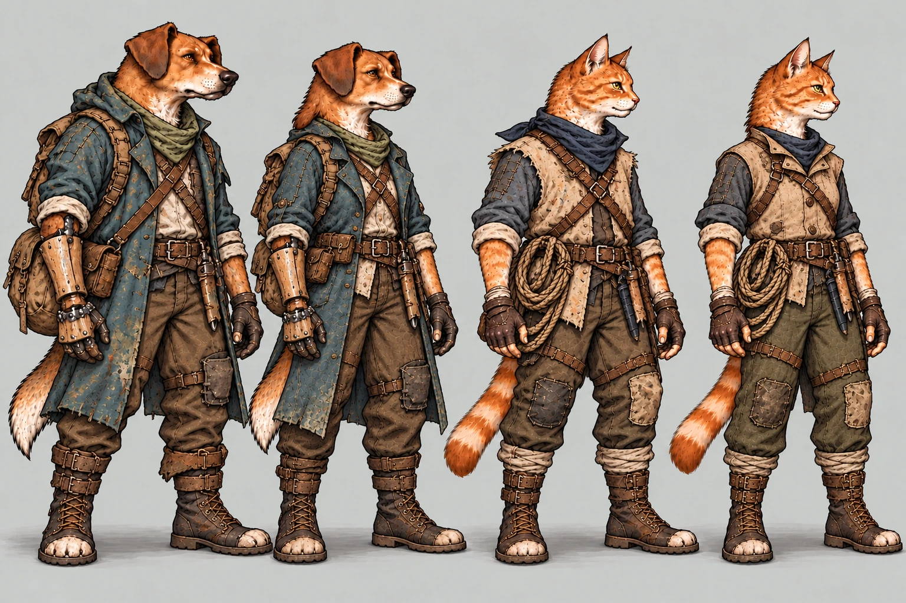
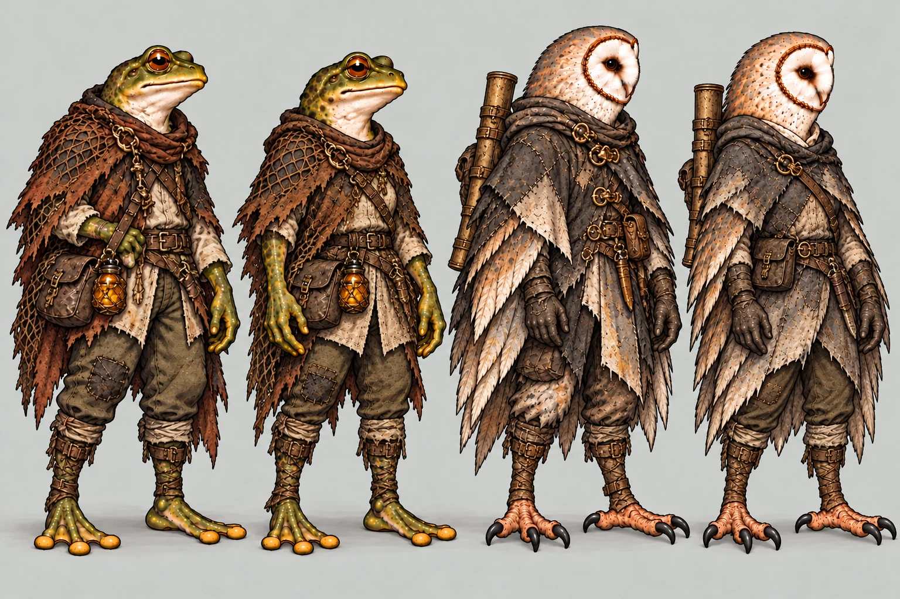
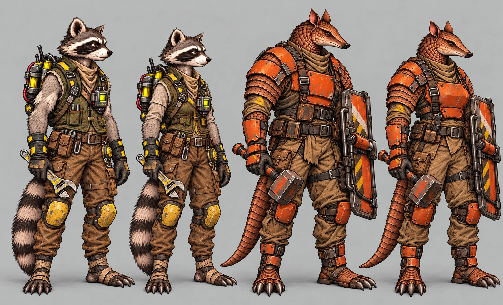

# Recrutas femininas — roupa normal de expedição (#247)

**Propostas para aprovação do Lucas antes das poses.** Complemento das roupas confortáveis do [PR #244](https://github.com/lucasyemz/after-humans-godot/pull/244), não uma substituição delas.

O pedido do Lucas em 29/10/2026 é ter as seis recrutas femininas também com roupa normal de missão. Bento, Nick,
Íris e Véspera mantêm sexo, identidade, aparência e roupas definidos; não se produzem alternativas deles aqui.

## Como ler as pranchas

Em cada par: **macho à esquerda, fêmea à direita**, seguido do segundo par na mesma ordem. Os machos são redesenhos
de comparação das referências canônicas; não substituem seus sprites. As fêmeas retomam os rostos e marcas das
propostas de lobby da r4 do PR #244, agora com equipamento de expedição. Os figurinos femininos, tanto no lobby
quanto nesta entrega, ainda dependem do aceite artístico do Lucas.

### Cão e gato

Referência de identidade com roupa de lobby:

### Sapo e coruja

Referência de identidade com roupa de lobby:

### Guaxinim e Tatu

Referência de identidade com roupa de lobby:

## Decisões de figurino

| Tipo de recruta | Roupa/equipamento de missão | Identidade feminina |
| --- | --- | --- |
| Cão | Casaco azul de campo, lenço, proteção de antebraço, luvas, mochila, bolsa, calça reforçada e botas | Pelagem caramelo, orelhas caídas e focinho da cadela do lobby; corte e fechamento próprios no casaco |
| Gato | Camada de campo bege sobre mangas escuras, lenço, corda, lâmina embainhada, luvas e botas | Gata laranja de olhos verdes; jaqueta funcional em vez de repetir o colete masculino |
| Sapo | Capa de rede/lona, túnica de campo, bolsa, frasco âmbar, calça e faixas | Marcas verdes, focinho mais arredondado e corte próprio de fechamento; sem seios |
| Coruja | Capa remendada cinza/castanha, lenço, equipamento tubular nas costas, cinto e luvas | Disco facial claro e plumagem da coruja do lobby; braços articulados e mãos visíveis; sem seios |
| Guaxinim | Colete de mecânica oliva com acentos amarelos, rádio, mochila, chave, luvas e proteção nos joelhos | Mesma máscara facial e cauda listrada; painéis/fechamento adaptados, sem perder ferramentas |
| Tatu | Armadura laranja com placas sobre roupa reforçada, escudo e martelo | Mesma cabeça alongada, escamas, orelhas e corpo robusto; placa de peito protetora sem moldagem de seios |

As roupas de missão têm construção própria, mas preservam a função e a cobertura da classe. Não reduzir
armadura ou equipamento por ser uma versão feminina. Os traços das mamíferas ficam discretos sob tecido e
proteção opacos. Sapo/coruja não recebem anatomia de mamífera. As corujas têm cotovelos, antebraços, punhos e mãos,
sem substituir esses membros por asas fechadas ou escondê-los sob a capa.

Os dois recrutas novos usam o redesenho aprovado na #225: Guaxinim com altura de destino 1,44 m e Tatu 1,56 m,
robusto, nas proporções dos fundadores. A referência é a tag `codex-pr229-originals`; a main ainda contém imagens
antigas em alguns caminhos de produção, que não servem como base de anatomia para esta proposta.

## Cobertura de uso futura

| Contexto | Figurino |
| --- | --- |
| Lobby/Estação após a chegada | Confortável, PR #244 |
| Ver personagem, preparação e saída | Normal de expedição |
| Exploração, luta e acampamento fora da Estação | Normal de expedição |
| Chegada | Ainda normal; troca para confortável depois |

Esta proposta não implementa sexo no recrutamento/save, troca automática, seleção de roupas ou poses. Não há
ids alterados nem variantes femininas dos quatro fundadores. A aprovação dos figurinos precede o pacote de
poses, retratos e integração; não prometer cobertura das poses a partir destas três ilustrações.

## Arquivos, medidas e referências

As pranchas WebP são conceitos com fundo, sem texto gravado, não sprites com alfa. Os canvas de revisão e hashes
ficam em [assets.json](recruit_female_expedition/assets.json). As reduções são reais, a 40%, com pares em cinza.
As alturas nas ilustrações são aproximadas: não medir âncoras por elas. Não existem margens de 9-slice aplicáveis.

Após aprovação, os sprites devem respeitar o canvas canônico e a âncora de cada pose: padrão de origem
1178×1335 e pé no mesmo ponto da pose correspondente, conferindo [characters.md](characters.md) e o contrato
canônico por personagem. Não usar a âncora do idle para sentado/deitado, nem alterar alturas/ids para encaixar
um desenho. Nada será convertido diretamente destas pranchas com `sync_combat_art.py`.

Referências de expedição: `art/combat/recruits/{dog,cat,frog,owl}_recruit_01_idle.webp` na main `5bb29281`;
`raccoon/rato-idle.png` e `armadillo/tatu-idle.png` da #225/tag `codex-pr229-originals`. Referências de rosto do lobby:
`{dog_cat,frog_owl,raccoon_armadillo}_variants_concept.png` na tag `codex-pr244-originals-r4`. Os hashes ficam no contrato.

Os PNG de conceito ficam fora da main. Tag, Release e pasta de originais serão vinculados no PR.

## QA de conceito

Checklist: [qa.md](qa.md), aplicado ao figurino. Alfa/âncoras/sprites e antes/depois no jogo não podem ser
aprovados nesta etapa: o pedido mantém a produção de poses bloqueada antes do aceite artístico. Estas imagens
não são apresentadas como capturas da Godot; o antes/depois no jogo deve acompanhar o pacote de poses após aprovação.
Nenhuma alteração de código, dados ou arte de produção.

### Rodada 1 — VEREDITO: APROVADO para revisão de figurino

Conferidos os seis tipos com as referências canônicas e de lobby: pelagem/pele/disco facial, roupas e
funcionalidade visual da classe, cobertura de proteção, mãos/pés, caudas e ausência de alterações dos fundadores.
Rádio/mochila/chave da Guaxinim, armadura/escudo/martelo da Tatu e braços/mãos das duas corujas aparecem.
Sapo/coruja sem seios; peito da armadura da Tatu é uma proteção ampla, não duas peças moldadas em seios.
Leitura conferida em tamanho normal, a 40% e em cinza. Três PNG e nove WebP com formato/dimensões/hash conferidos.
Sem problemas altos ou médios no **conceito de figurino**. O aceite artístico do Lucas continua pendente.

Observações baixas: rosto/sexo ficam mais sutis sob o equipamento; a comparação de identidade com o lobby está
acima. Normalizar alturas, largura e âncoras nos sprites após aprovação, sem usar as medidas ilustrativas dos
pares como escala de integração.

A suíte completa já passou na mesma base `5bb29281` (92/92, incluindo paridade 48/48); não foi repetida para
estas adições exclusivas de documentação. A validação de imagens foi feita separadamente.

## Leitura reduzida

| Pares | Cor a 40% | Cinza a 40% |
| --- | --- | --- |
| Cão/gato | [Cor](recruit_female_expedition/dog_cat_40.webp) | [Cinza](recruit_female_expedition/dog_cat_gray_40.webp) |
| Sapo/coruja | [Cor](recruit_female_expedition/frog_owl_40.webp) | [Cinza](recruit_female_expedition/frog_owl_gray_40.webp) |
| Guaxinim/Tatu | [Cor](recruit_female_expedition/raccoon_armadillo_40.webp) | [Cinza](recruit_female_expedition/raccoon_armadillo_gray_40.webp) |
