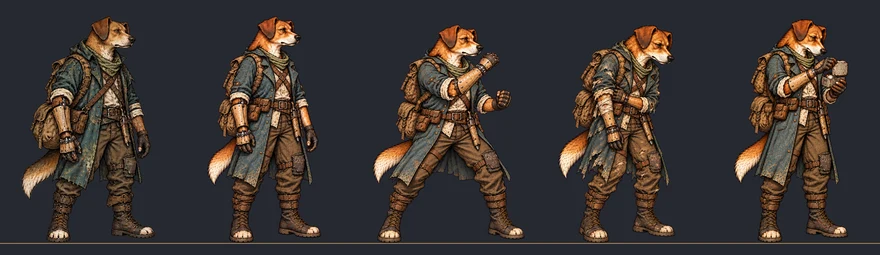

# Poses de expedição das recrutas femininas — #250

**Leva 1 de 3: parada, guarda, ferida e item das seis recrutas, 24 sprites.** Feitas pela Awesomic no gerador do
ChatGPT, com os figurinos de expedição aprovados na #247. As levas 2 (as quatro habilidades) e 3 (dano, esquiva,
defesa, morte, sentada e dormindo) entram neste mesmo PR, depois que o Lucas aprovar esta.

## Pranchas em escala métrica

Todas as pranchas usam a mesma escala, 330 px por metro, com o pé de cada pose na linha do chão. A primeira coluna é o
recruta macho de referência da classe; depois vêm parada, guarda, ferida e item. As versões a 40% e em cinza são
reduções reais. Sem texto nos PNG.

| Recruta | Prancha | 40% | Cinza |
| --- | --- | --- | --- |
| Cão (1.72 m) | [Prancha](recruit_female_expedition_poses/dog_female.webp) | [Cor](recruit_female_expedition_poses/dog_female_40.webp) | [Cinza](recruit_female_expedition_poses/dog_female_gray_40.webp) |
| Gato (1.50 m) | [Prancha](recruit_female_expedition_poses/cat_female.webp) | [Cor](recruit_female_expedition_poses/cat_female_40.webp) | [Cinza](recruit_female_expedition_poses/cat_female_gray_40.webp) |
| Sapo (1.38 m) | [Prancha](recruit_female_expedition_poses/frog_female.webp) | [Cor](recruit_female_expedition_poses/frog_female_40.webp) | [Cinza](recruit_female_expedition_poses/frog_female_gray_40.webp) |
| Coruja (1.66 m) | [Prancha](recruit_female_expedition_poses/owl_female.webp) | [Cor](recruit_female_expedition_poses/owl_female_40.webp) | [Cinza](recruit_female_expedition_poses/owl_female_gray_40.webp) |
| Guaxinim (1.44 m) | [Prancha](recruit_female_expedition_poses/raccoon_female.webp) | [Cor](recruit_female_expedition_poses/raccoon_female_40.webp) | [Cinza](recruit_female_expedition_poses/raccoon_female_gray_40.webp) |
| Tatu (1.56 m) | [Prancha](recruit_female_expedition_poses/armadillo_female.webp) | [Cor](recruit_female_expedition_poses/armadillo_female_40.webp) | [Cinza](recruit_female_expedition_poses/armadillo_female_gray_40.webp) |

## Decisões

- **Guaxinim e Tatu:** a base é o redesenho aprovado na #225, mais alto e na proporção dos fundadores. A `main` ainda
  tem o desenho antigo deles no combate, mais agachado; por isso o macho de referência dessas duas pranchas é o da #225.
- **Parada e guarda (regra da #221):** na parada, a arma fica abaixada ou guardada. Na guarda, a recruta pega a arma que
  já levava: o soco do cão, a lâmina da gata, o frasco do sapo, o tubo de latão da coruja e a chave do Guaxinim. No
  Tatu, como no macho, a parada tem as mãos livres e o escudo nas costas, e a guarda tem escudo e martelo na mão.
- **Latas de primeiros socorros:** o gerador desenhou uma cruz vermelha nas latas do item. A cruz foi apagada por ser
  emblema protegido; a lata ficou de metal liso.
- **Gerador:** ChatGPT, GPT Image 2.5 (OpenAI), fundo magenta recortado. O traço é o dos figurinos aprovados.

## Encaixe

O [contrato](recruit_female_expedition_poses/contract.json) traz por arquivo: PNG/SHA-256, a imagem do gerador de onde a
pose saiu (`generator_file`/`generator_sha256`), canvas, âncora, altura de referência, caixa do alfa, escala uniforme e
translação. Só escala uniforme e translação, nada esticado:

- **Canvas, âncora e altura de referência:** os do recruta canônico da classe em `combat_art.json`. O cão usa
  1086×1448, âncora [542,1425], referência 1385; as outras classes, 1178×1335/1336 com a âncora da classe.
- **Altura:** da cabeça ao pé é a altura de referência na parada; a mesma escala vale para as outras poses da recruta.
- **Pé:** o meio dos dois pés fica na âncora.
- **Largura na guarda:** nenhuma passa de 1,2 m, o espaço de um herói na fila. A mais larga é a do cão, 1,15 m.

## Conferido

- Nenhuma pose de ferida tem sangue.
- As corujas têm braços e mãos; sapo e coruja sem seios; mamíferas discretas sob a roupa.
- Sem franja magenta do recorte.
- Todas as poses cabem no canvas da classe, sem canvas próprio.

## Ainda falta

- **QA de design e antes/depois na Godot:** rodam antes de o PR sair do rascunho.
- **Levas 2 e 3** e os seis retratos derivados do idle.
- **Integração** no jogo, as variantes femininas na expedição e a roupa confortável delas no lobby (#249): com o Claude.

## Originais

Os 24 PNG, as 24 imagens do gerador e os scripts estão na Release
[`awesomic-250-expedicao-originals-leva1`](https://github.com/lucasyemz/after-humans-godot/releases/tag/awesomic-250-expedicao-originals-leva1).
O SHA-256 do pacote e de cada PNG está no contrato. Nada na `main` fora de `docs/design/recruit_female_expedition_poses*`:
nenhum arquivo em scripts, data, tests, tools ou art, e nenhum id mudou.
