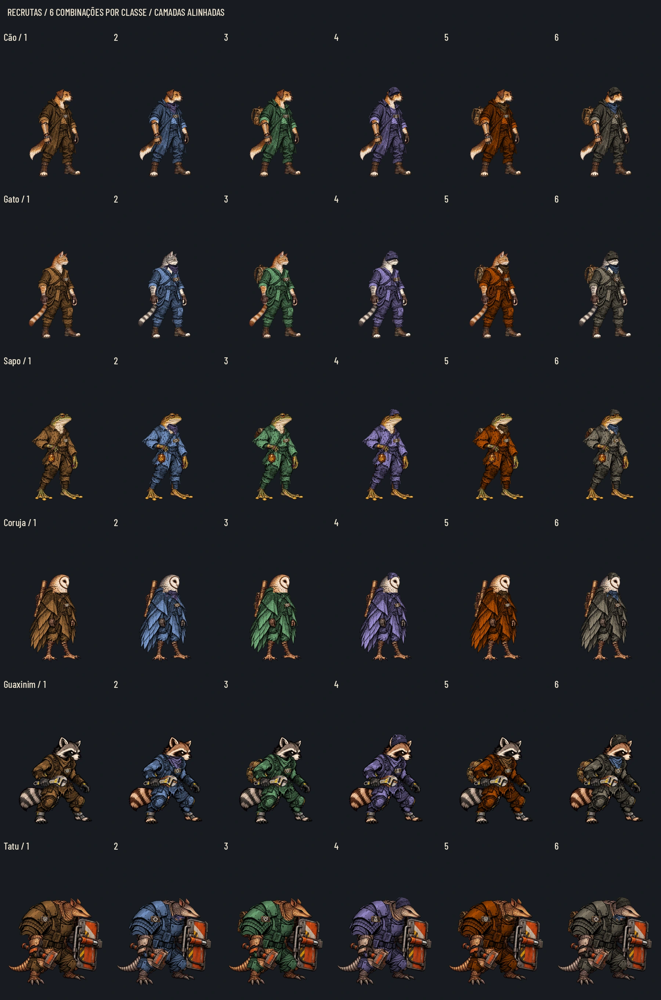

# Recrutas em camadas — #191

Seis classes, duas bases por classe, roupa tingível e quatro famílias de acessórios. A entrega inclui Guaxinim e Tatu, já disponíveis na main pelo #196 e citados no comentário de 28/10. São **60 WebP RGBA**, dez por classe, e **36 combinações de exemplo**. Só a pose parada; nenhuma animação nova.

[Antes/depois na mesma escala](recruit_layers/before_after.webp) · [Antes/depois a 40%](recruit_layers/before_after_40.webp) · [Prancha a 40%](recruit_layers/overview_40.webp) · [Cinza a 40%](recruit_layers/overview_gray_40.webp) · [Fundos escuro/claro/cinza](recruit_layers/readability.webp) · [Leitura reduzida](recruit_layers/readability_40.webp) · [Contrato completo](recruit_layers/contract.json) · [Auditoria](recruit_layers/audit.json).

## Para aprovar pelas pranchas

| Classe | Combinações | Camadas separadas | Cinza a 40% |
|---|---|---|---|
| Cão | [seis exemplos](recruit_layers/dog_combinations.webp) | [dez camadas](recruit_layers/dog_layers.webp) | [reduzido](recruit_layers/dog_gray_40.webp) |
| Gato | [seis exemplos](recruit_layers/cat_combinations.webp) | [dez camadas](recruit_layers/cat_layers.webp) | [reduzido](recruit_layers/cat_gray_40.webp) |
| Sapo | [seis exemplos](recruit_layers/frog_combinations.webp) | [dez camadas](recruit_layers/frog_layers.webp) | [reduzido](recruit_layers/frog_gray_40.webp) |
| Coruja | [seis exemplos](recruit_layers/owl_combinations.webp) | [dez camadas](recruit_layers/owl_layers.webp) | [reduzido](recruit_layers/owl_gray_40.webp) |
| Guaxinim | [seis exemplos](recruit_layers/raccoon_combinations.webp) | [dez camadas](recruit_layers/raccoon_layers.webp) | [reduzido](recruit_layers/raccoon_gray_40.webp) |
| Tatu | [seis exemplos](recruit_layers/armadillo_combinations.webp) | [dez camadas](recruit_layers/armadillo_layers.webp) | [reduzido](recruit_layers/armadillo_gray_40.webp) |

As bases variam o pelo/pele/plumagem natural, mantendo espécie, pose e equipamentos fixos. Cão: caramelo/creme e malhado claro com sela escura; gato: tigrado laranja e prata; sapo: oliva e ocre manchado; coruja: fulva e cinza, ambas com disco facial claro; Guaxinim: cinza e castanho, mantendo máscara e cauda anelada; Tatu: carapaça natural marrom e cinza/taupe. A roupa oculta parte dessas diferenças, como aconteceria com uma roupa real. Os recrutas continuam distintos dos fundadores.

O figurino segue a Estação Remendadora: costuras, tecido gasto, couro reaproveitado, metal riscado e mochilas remendadas, sem texto/logotipo humano. Equipamentos característicos ficam: punho/bracelete do cão, corda/bainha do gato, frasco do sapo, rifle da coruja, chave do Guaxinim e escudo/martelo do Tatu.

## Arquivos e composição

Pasta `art/combat/recruits/layers/<classe>/`, nomes iguais nas seis classes:

| Arquivo | Conteúdo | Tingir? |
|---|---|---|
| `base_a.webp`, `base_b.webp` | Uma das duas bases; inclui mãos, pés e equipamento fixo | Não |
| `clothes.webp` | Roupa e armadura externa em cinza, com luz/sombra | Sim |
| `scarf.webp` | Lenço/bandana em cinza | Sim, independente da roupa |
| `bag.webp` | Mochila de couro/lona, atrás do corpo | Não |
| `cap.webp` | Gorro em cinza | Sim |
| `badge_protection.webp` | Plaqueta com escudo | Não |
| `badge_healing.webp` | Plaqueta com cruz | Não |
| `badge_ranged.webp` | Plaqueta com alvo | Não |
| `badge_chemistry.webp` | Plaqueta com ampola | Não |

São quatro **famílias** de acessórios (lenço, mochila, gorro, insígnia). A insígnia tem quatro arquivos alternativos para expressar o papel sem depender de cor; por isso são dez imagens, em vez de sete. Nunca empilhar as duas bases nem as quatro insígnias. A plaqueta é uma marca física pequena da roupa, não substitui o ícone/tooltip do papel no HUD: a leitura fina do símbolo diminui com o personagem a 40%.

**Ordem de trás para a frente:** `bag` → uma `base` → `clothes` → `scarf` → `cap` → uma `badge`. Camadas opcionais podem ser omitidas. Todas usam origem `(0,0)` e exatamente o mesmo quadro, sem recentrar pelo alfa de cada acessório. Mistura alfa normal, sem adição e sem escalas individuais.

As roupas já têm recortes para que mãos, chave, frasco e martelo do corpo permaneçam à frente, sem uma camada extra de mãos. O lenço do Tatu respeita a borda do escudo. As mochilas ficam atrás; não colocar a mochila depois do corpo. Gorros não cobrem os olhos. Nenhuma mudança na arma por papel: é uma aparência modular para a pose idle atual, não um sistema novo de equipamentos de combate.

Roupa, lenço e gorro usam RGB rigorosamente igual nos três canais; todos os WebP são lossless para preservar isso. A demonstração multiplica o cinza pela cor, preservando alfa e contraste local. Os exemplos usam cores já existentes no kit: `#c98a4b`, `#8fb4f0`, `#86c98f`, `#b7a6f4`, `#d55e00`, `#a69a84`. São amostras de comparação, não uma nova paleta final de seleção: o Lucas decide essa paleta. Os seis exemplos alternam bases A/B e mostram sem acessórios, lenço, mochila, gorro, lenço+mochila e conjunto completo. O contrato descreve cada combinação.

## Medidas para integrar

| Classe/pasta | WebP final | PNG de origem | Âncora canônica x,y | Âncora na textura x,y |
|---|---|---|---|---|
| Cão (`dog`) | 543×724 | 1086×1448 | 542, 1425 | 271, 712.5 |
| Gato (`cat`) | 589×668 | 1178×1336 | 589.5, 1312 | 294.75, 656 |
| Sapo (`frog`) | 589×668 | 1178×1336 | 588.5, 1311 | 294.25, 655.5 |
| Coruja (`owl`) | 589×668 | 1178×1336 | 589.5, 1312 | 294.75, 656 |
| Guaxinim (`raccoon`) | 589×668 | 1178×1335 | 601.5, 1184 | 300.75, 592 |
| Tatu (`armadillo`) | 589×668 | 1178×1335 | 601, 1087 | 300.5, 543.5 |

Todas as dez camadas de cada classe têm o mesmo tamanho da textura idle atual; as coordenadas acima pertencem ao quadro inteiro, não ao conteúdo do acessório. A conversão de coordenadas usa **a razão uniforme da largura**, inclusive nos canvases de altura ímpar. Os tamanhos finais já consideram esse arredondamento. Reutilizar `body_reference_pixels` e os ids do contrato, sem remedir o centro pela mochila. Guaxinim conserva o class_id `rato`; nenhum id foi renomeado. Sem 9-slice.

A prancha antes/depois compara a arte atual e duas montagens com a mesma escala do corpo e a mesma linha do pé; a marca não segue a borda da roupa. As montagens de leitura são provas estáticas sobre fundos de controle, não capturas de integração já funcionando no jogo. As poses e retratos atuais não foram substituídos.

## Fontes fora da main

Tag `codex-pr<N>-originals`, pasta `art/combat/source/recruit_layers_20261028/`, somente em commit isolado de fontes. O Release na mesma tag fornece o ZIP automático: a árvore da tag contém apenas fontes, medidas e instruções. Os PNG individuais normalizados não entram no PR nem no histórico da branch para a main; os atlas brutos da geração continuam fora do Git. O Claude integra pela #189, usando `tools/sync_combat_art.py`, preservando o contrato.

Depois de extrair as fontes: `python docs/design/recruit_layers/build_delivery.py --sources art/combat/source/recruit_layers_20261028`. Dependências: Pillow, numpy, scipy e cairosvg. As máscaras de oclusão e os retângulos de encaixe ficam junto ao gerador; não são dados do jogo. O contrato contém hashes dos WebP, PNG e referências.

## QA de design

**Rodada 1 — VEREDITO: REPROVADO.** Gravidade média: `clothes` de Guaxinim, Tatu e sapo cobria partes da chave, martelo e frasco; havia sobras da abertura de pescoço em algumas roupas. Sugestão: recortar a roupa respeitando a geometria do equipamento e remover o verso das golas. Correção: máscaras comuns às duas bases, com bordas suavizadas, e limpeza das mangas/colarinho.

**Rodada 2 — VEREDITO: REPROVADO.** Gravidade média: resíduos magenta em poucos pixels nas bases de gato/sapo/coruja. Gravidade média na documentação: o escudo do Tatu era cortado na prancha antes/depois. Sugestão: neutralizar os resíduos de chroma e ampliar o espaço entre personagens. Correção: saneamento de cor nas fontes/saída, WebP lossless para evitar novos resíduos de compressão e prancha em três filas, com células maiores. Os rótulos das funções também foram traduzidos para português.

**Rodada 3 — VEREDITO: APROVADO.** Sem pendências altas ou médias. Checklist conferido: comparar com a arte atual, olhos/focinho/espécie, encaixe entre ambas as bases e a roupa, mãos/armas à frente, mochila atrás, gorro acima dos olhos, alfa no claro/escuro, cinza e 40%, arquivos/canvas e ausência de mudanças em código/dados/testes. Conferidos os seis conjuntos de camadas e as 36 montagens; a prancha comparativa mostra o escudo inteiro. Auditoria confirma 60 RGBA, cinzas exatos e zero resíduos magenta detectados. Observação baixa: a insígnia física é pequena a 40%; manter o ícone/tooltip de papel no HUD. A aprovação artística final permanece com o Lucas.

## Validação e integração

Sessenta arquivos RGBA, cinzas exatos nas peças tingíveis, mesmos canvases das referências, hashes dos originais comparados ao Git. Nenhuma mudança em scripts/data/tests ou ids. A importação na Godot e o runner completo são registrados no PR. A base `20890be` tem a falha já conhecida de `test_faces` nos retratos/face_boxes dos recrutas Guaxinim/Tatu; esta entrega não altera retratos nem corrige o sistema de faces.

**Runner desta branch:** 78/79 em 513,779 s; paridade 48/48. Falhou somente `test_faces`, pelos retratos/caixas de rosto ausentes do Guaxinim/Tatu, já na base. Avisos de foco e lambda liberada no Treino registrados. A arte passou pela QA de design, mas o merge permanece bloqueado até a correção da main e CI verde.
