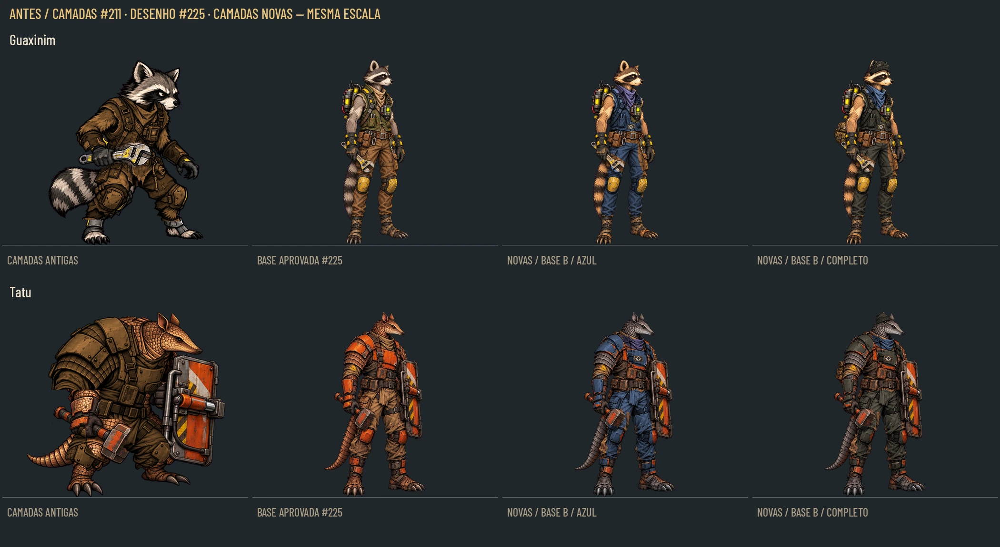
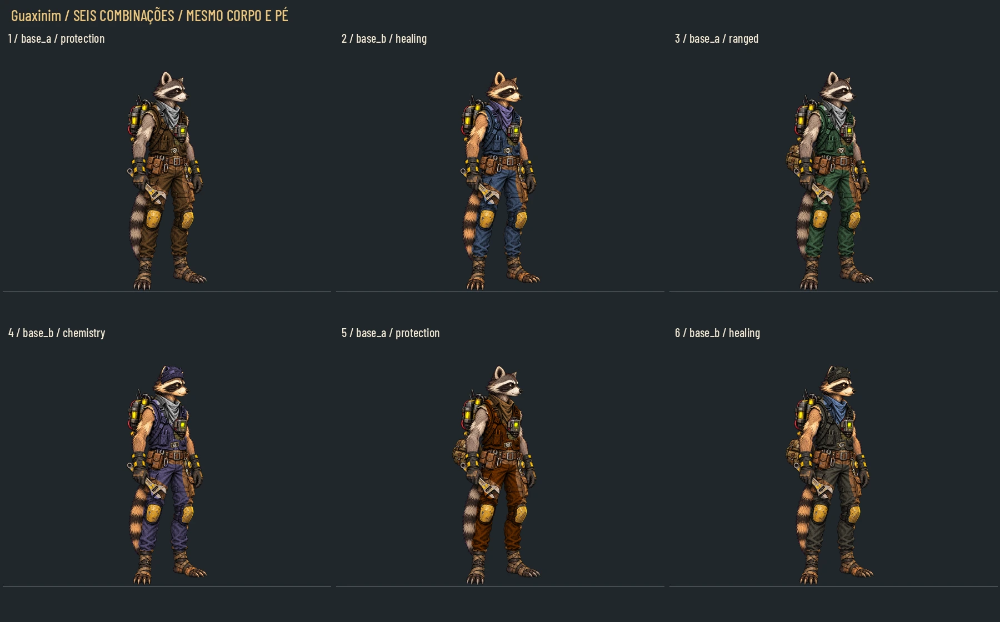
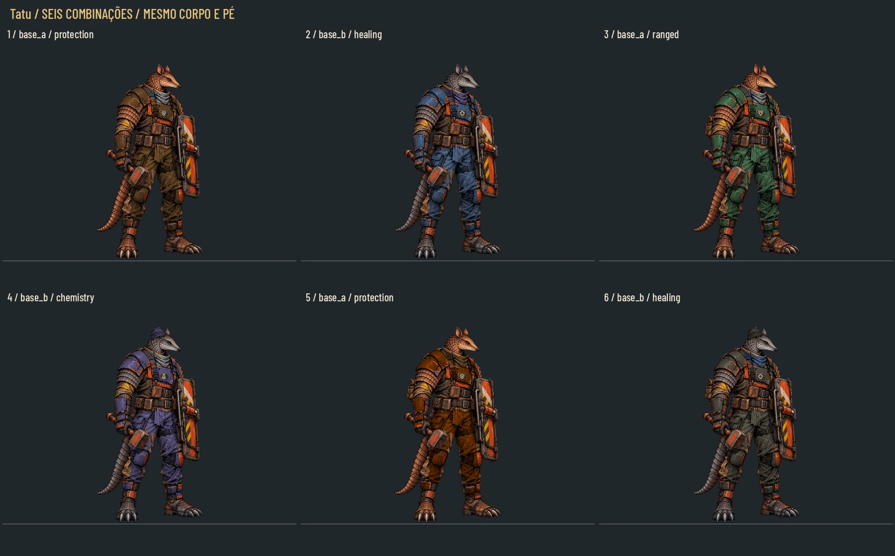
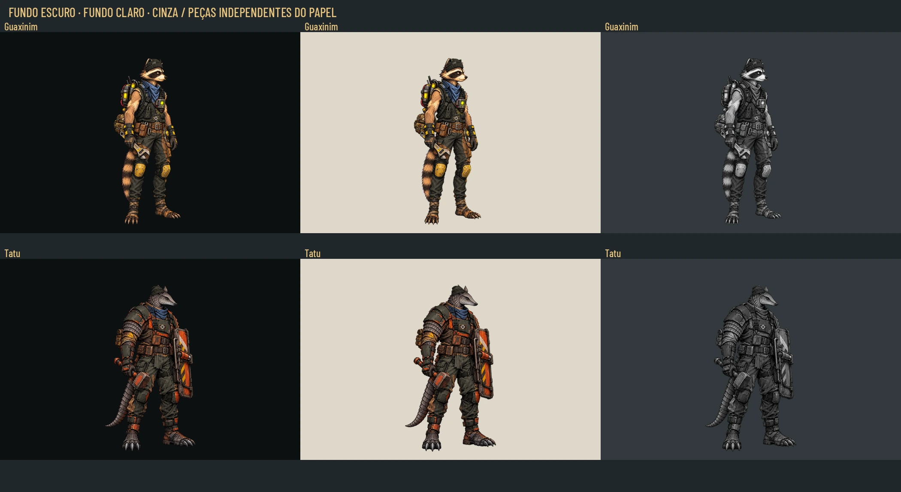
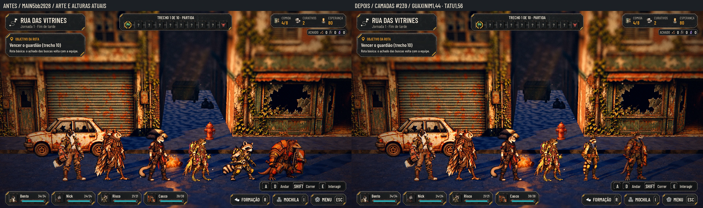
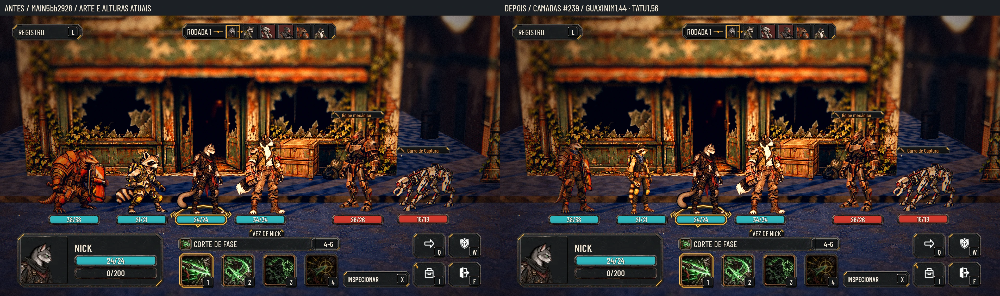

# Personalização do Guaxinim e Tatu no desenho novo — #239

Atualização das duas classes da #191/#211 para o idle aprovado na #225/#229. A roupa e os acessórios anteriores foram registrados na anatomia nova; nenhuma proporção do personagem foi regenerada. As duas bases de cada classe compartilham exatamente o alfa do desenho aprovado e variam somente as cores das regiões de pelo/carap­aça. Os quatro outros recrutas continuam com a entrega anterior.

**Este PR contém pranchas e documentação.** Os vinte PNG ficam em tag/Release de fontes; o PC integra a conversão para WebP e os vínculos da personalização. Nenhuma alteração em art/, scripts/, data/, tests/, tools/ ou ids.

Na primeira coluna estão as camadas antigas da #211; na segunda, o corpo aprovado da #225; nas demais, montagens novas. A escala por personagem e a linha dos pés são iguais entre colunas. A montagem antiga não é apresentada como recurso de produção já integrado.

## Combinações e camadas

| Personagem | Seis combinações | Camadas isoladas | 40% | Cinza a40% |
|---|---|---|---|---|
| Guaxinim | [prancha](recruit_layers_refresh/raccoon_combinations.webp) | [dez camadas](recruit_layers_refresh/raccoon_layers.webp) | [redução](recruit_layers_refresh/raccoon_40.webp) | [cinza](recruit_layers_refresh/raccoon_gray_40.webp) |
| Tatu | [prancha](recruit_layers_refresh/armadillo_combinations.webp) | [dez camadas](recruit_layers_refresh/armadillo_layers.webp) | [redução](recruit_layers_refresh/armadillo_40.webp) | [cinza](recruit_layers_refresh/armadillo_gray_40.webp) |

Guaxinim A: cinza com máscara e cauda anelada; B: castanho quente, mantendo as mesmas marcas. Tatu A: carapaça marrom; B: taupe/cinza, com o mesmo desenho das escamas. Conversão de cor restrita por máscara, sem mudar rosto, olhos, equipamento ou geometria. Os PNG das bases têm o mesmo alfa, pixel por pixel, do idle aprovado. As máscaras/parametrização estão no pacote de fontes para reprodução e inspeção.

As bases incluem **roupa neutra e equipamento fixo**. `clothes` fornece a área de tingimento por cima da roupa neutra; `scarf` controla a cor do lenço independentemente. Omitir uma dessas camadas deixa a respectiva peça neutra na base. A estrutura permite variações de cor sem inventar o corpo que está escondido sob a roupa. Mãos, ferramenta, scanner, frascos, escudo e martelo preservam a imagem aprovada.

O Guaxinim mantém sua mochila técnica de cilindros. A bolsa opcional de couro é uma peça adicional baixa, atrás do corpo. Os acessórios da #211 foram reaproveitados com escala uniforme e translação, sem esticamento por eixo. Os gorros deixam os olhos descobertos. As plaquetas usam os quatro símbolos já existentes de proteção, cura, distância e química; o símbolo é físico e pequeno, enquanto o papel continua identificado pelo HUD/tooltip do jogo.

## Arquivos e composição

Vinte PNG RGBA1178×1335: dez por personagem, em `raccoon/` e `armadillo/`, todos com origem(0,0). Os nomes seguem o contrato anterior:

| Arquivo | Uso | Tingimento |
|---|---|---|
| `base_a.png`, `base_b.png` | Escolher uma base vestida neutra | Não |
| `clothes.png` | Roupa e placas selecionadas, com oclusões para equipamento | Sim |
| `scarf.png` | Lenço já registrado no pescoço | Sim, independente |
| `bag.png` | Bolsa atrás do corpo | Não |
| `cap.png` | Gorro | Sim |
| `badge_protection.png` | Plaqueta de proteção | Não |
| `badge_healing.png` | Plaqueta de cura | Não |
| `badge_ranged.png` | Plaqueta de distância | Não |
| `badge_chemistry.png` | Plaqueta de química | Não |

Ordem: **bag → uma base → clothes → scarf → cap → uma badge**. Mistura alfa normal, sem adição. Nunca empilhar bases ou plaquetas alternativas. Cada PNG já tem todo o canvas; não recentrar pelo seu alfa nem aplicar uma escala separada no jogo. `clothes`, `scarf` e `cap` têm R=G=B exatos, preservados na conversão WebP lossless. Multiplicar o RGB pela cor escolhida, preservando alfa e luz/sombra.

As cores das seis provas são amostras do kit existente: `#c98a4b`, `#8fb4f0`, `#86c98f`, `#b7a6f4`, `#d55e00`, `#a69a84`. A paleta final de seleção continua uma decisão do Lucas. As provas alternam A/B, acessórios e quatro símbolos, sem depender só de vermelho/verde.

## Medidas

| Personagem | Fonte | WebP previsto | Âncora fonte x,y | Âncora textura x,y | Referência | Altura |
|---|---|---|---|---|---|---|
| Guaxinim |1178×1335 |589×668 |588.5,1305 |294.25,652.5 |1240px |1,44m |
| Tatu |1178×1335 |589×668 |589,1305 |294.5,652.5 |1240px |1,56m |

São as medidas da #225. Não usar as referências999/807 ou âncoras antigas da #211. O corpo ocupa1240/1335=92,88% da altura, com topo emy65 e contato inferior emy1305. A textura cai para metade da resolução, com a altura ímpar arredondada para668; coordenadas seguem o fator0,5 da largura, como o pipeline existente. 9-slice não se aplica.

As caixas de destino dos acessórios, em pixels da fonte, estão abaixo. São áreas de encaixe: a peça é ajustada uniformemente dentro delas, sem deformação, e centralizada. A caixa visível efetiva de cada PNG está em `assets.*.bbox` no [contrato](recruit_layers_refresh/contract.json).

| Personagem | Bag | Cap | Badge |
|---|---|---|---|
| Guaxinim |315,405–492,700 |545,65–695,177 |598,492–667,534 |
| Tatu |325,325–486,620 |572,70–718,155 |643,355–716,402 |

O lenço é recortado diretamente no registro da fonte, sem reposicionamento. Os recortes da roupa respeitam mãos/armas, o scanner e os bolsos de equipamento; fivelas, couro e partes fixas conservam a cor original, permitindo o aspecto de sucata reaproveitada.

## Leitura e alfa

Também há [redução real a40%](recruit_layers_refresh/readability_40.webp). Alfa do corpo conferido contra a fonte aprovada; RGB transparente zerado; canvas e contato no chão invariáveis entre A/B; vinte arquivos de fonte e vinte WebP temporários auditados. As insígnias continuam com formas diferentes quando a cor é removida, mas a informação de papel no tamanho de jogo continua responsabilidade do HUD.

## Antes/depois na Godot

O antes usa arte/altura atuais da main `5bb2928`; o depois carrega em memória a composição6 deste pacote, no corpo/altura da #225. A fila inclui os quatro fundadores intactos e os dois recrutas, com câmera/posições constantes. A luta usa uma equipe real de quatro. Não é uma tela de personalização implementada: o harness só vincula os protótipos à renderização real do jogo.

Metadados, câmera e hashes em [capture.json](recruit_layers_refresh/capture.json). Os sprites foram carregados pelo jogo, sem colagem de personagens na captura. O log de encerramento traz avisos de recursos, sem falha na geração das fotos.

Ambiente sem GPU física: Godot4.7.2, OpenGL Compatibility/Mesa llvmpipe CPU, Xvfb,1920×1080. Forward+ e o uso dinâmico das camadas ficam para a integração no PC.

## Fontes e integração

Tag `codex-pr240-originals`, pasta `art/combat/source/recruit_layers_refresh_20261028/`, com20 PNG, contrato, auditoria e helpers. Release com ZIP automático de árvore isolada de fontes; PNG fora da branch para a main. As fontes aprovadas reutilizadas são `codex-pr229-originals` (corpos) e `codex-pr211-originals` (acessórios); o pacote final já contém os20 PNG necessários, sem exigir as fontes anteriores para apenas convertê-los.

O PC converte pelo pipeline de `tools/sync_combat_art.py`, preserva os nomes WebP de `art/combat/recruits/layers/<raccoon|armadillo>/`, atualiza os registros/contratos da integração e conserva os ids `rato`, `tatu`, `raccoon_recruit_01`, `armadillo_recruit_01`. `preview_idle` no contrato é somente uma composição de QA temporária; não é uma21ª camada ou uma nova pose de produção.

As bases só correspondem ao idle da #225: a exploração/guarda diferente da #221, ataques, feridos e acampamento exigem registro próprio. A aparência da personalização não deve ser sobreposta a uma postura incompatível. Este lote não amplia a integração da #189 nem modifica as histórias do Gustavo.

## QA de design

**Rodada1 — VEREDITO: REPROVADO.** Gravidade média, `bag.png` e `cap.png` das duas classes: o primeiro encaixe usava largura/altura independentes e deformava as peças herdadas. Correção: ajuste uniforme dentro da caixa de destino e revisão dos pontos de encaixe, sem cortar ou cobrir olhos. A captura preliminar foi interrompida e refeita com as peças corrigidas.

**Rodada2 — VEREDITO: APROVADO.** Sem problemas altos ou médios após a correção. Conferidos: anatomia/identidade da fonte aprovada, duas variações naturais, equipamento preservado, peças tingíveis em cinza exato, corpo com alfa idêntico entre A/B e à #225, medidas/âncoras, acessórios proporcionais, oclusão de mãos/ferramentas e leitura sobre claro/escuro/cinza a40%. As capturas reais mantêm os personagens apoiados no chão, ao lado dos fundadores. Observações de integração: bases vestidas neutras; insígnias pequenas não substituem o HUD; registro só do idle da #225; Forward+ no PC. Aprovação artística final pelo Lucas.

## Verificação

Auditoria de20 PNG e20 WebP, grayscale exato, hashes, canvas, alfa das bases e âncoras em [audit.json](recruit_layers_refresh/audit.json). A base `5bb2928` é a mesma já validada nesta sessão pelo runner inteiro: **92/92 em641,292s, paridade48/48 lutas,3351 passos**. Não houve alteração de produção desde essa execução; esta rodada verifica os novos arquivos de arte e capturas, sem repetir o runner idêntico. O CI do PR terá a própria execução.

[PR #240](https://github.com/lucasyemz/after-humans-godot/pull/240) · [Release](https://github.com/lucasyemz/after-humans-godot/releases/tag/codex-pr240-originals) · [ZIP de20 PNG e medidas](https://github.com/lucasyemz/after-humans-godot/archive/refs/tags/codex-pr240-originals.zip).
