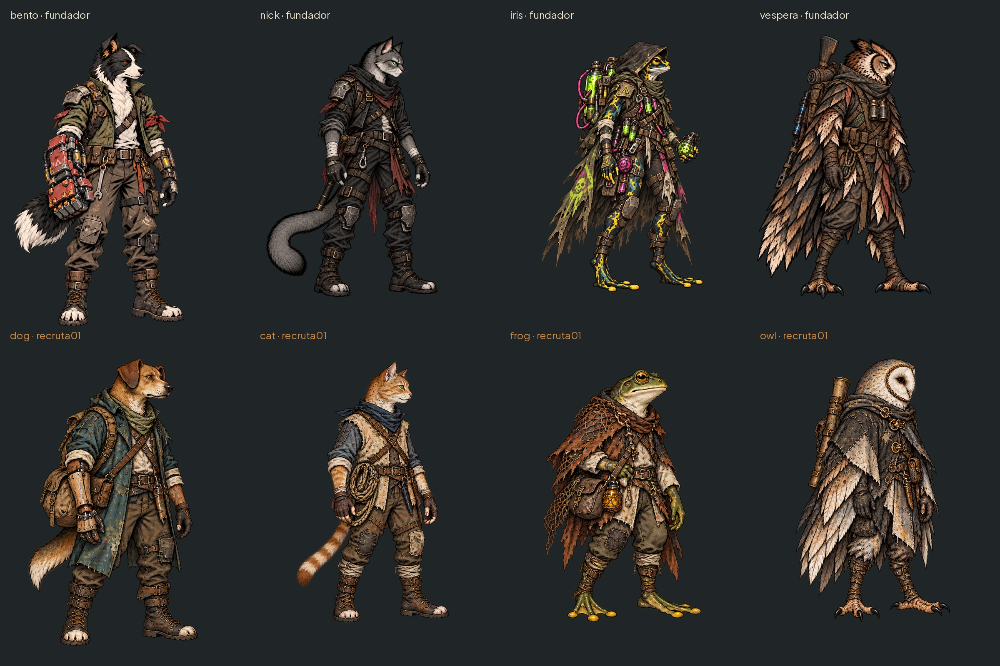

# Recrutas distintos dos fundadores — #14

Uma variação idle por classe, parada e voltada à direita, com roupa/equipamento e silhueta próprios. Cão fulvo com orelha caída, sobretudo azul e prótese de madeira; gato ruivo com colete claro e lenço azul; sapo verde sem capuz pontudo, poncho de rede e frascos âmbar; coruja branca com rosto de suindara e poncho cinza. Não são recolorações dos fundadores.

| Arquivo em art/combat/recruits/ (WebP) | Canvas | Âncora de pé | Altura visível |
|---|---|---|---|
| dog_recruit_01_idle | 543×724 | 271,711 | 692 |
| cat_recruit_01_idle | 589×668 | 294,655 | 630 |
| frog_recruit_01_idle | 589×668 | 294,655 | 610 |
| owl_recruit_01_idle | 589×668 | 294,655 | 636 |

WebP RGBA quality90/method6. PNG de fonte2× em art/combat/source/recruits/, mesma base do pipeline de metade da resolução. Fonte2× é ampliação para compatibilidade, não alegação de maior detalhe. Coordenadas da tabela são no WebP; multiplicar por2 no manifesto de origem. Sem9-slice; margem lateral mínima24px e inferior12px. Usar escala física da classe a partir do idle, sem esticar pela largura. A arte isolada do personagem pode ser recortada para retrato depois da escolha da variação.

Os nomes ingleses são nomes de arquivo, não novos ids de classe ou de campanha. Integração #16: Claude mapeia cão/gato/sapo/coruja para a imagem escolhida, persiste a escolha no save e mantém o fallback dos fundadores para saves antigos. Não alterei scripts, tabelas ou saves. Copiar PNGs para a árvore SourceArt/HeroStatics/Recruits no checkout Unreal ausente, registrar na ferramenta e medir o retrato na integração.

## QA de design

Rodada1 — VEREDITO: APROVADO. Comparação lado a lado com os quatro fundadores: pelagem/pele, roupa, acessório e contorno diferentes; mesma linguagem pintada. Conferidos alfa por componente principal, pés completos, canvases e âncoras. Reconhecimento continua sem cores pela orelha caída, colete curto, poncho de rede e rosto em coração. Sem problemas altos/médios. Observação baixa: a escolha dos recortes de retrato e escala final de arena/Estação depende da integração; nenhum personagem recebeu um id novo.
