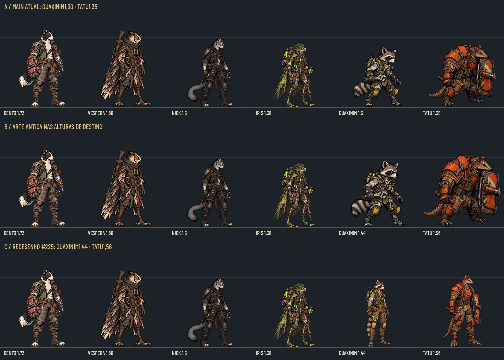
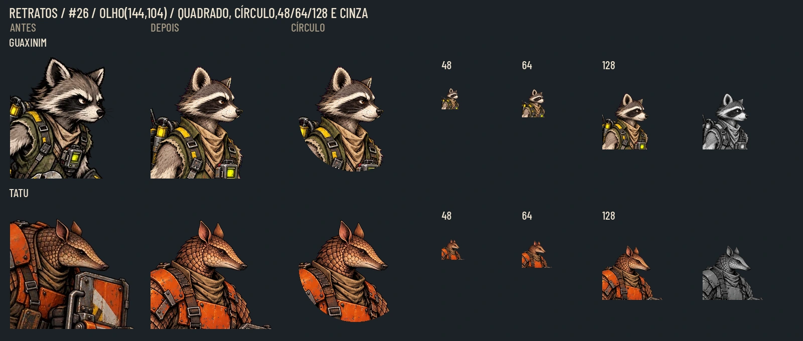
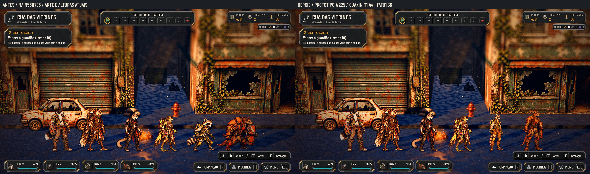
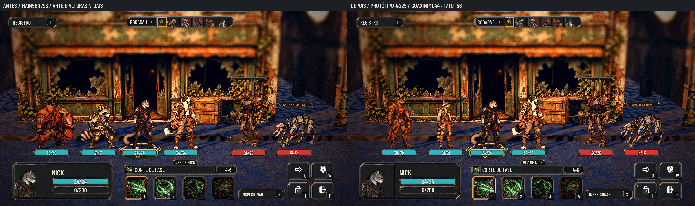
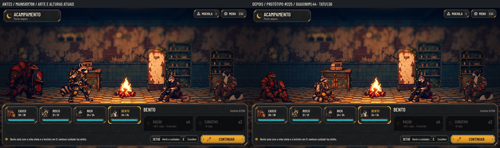
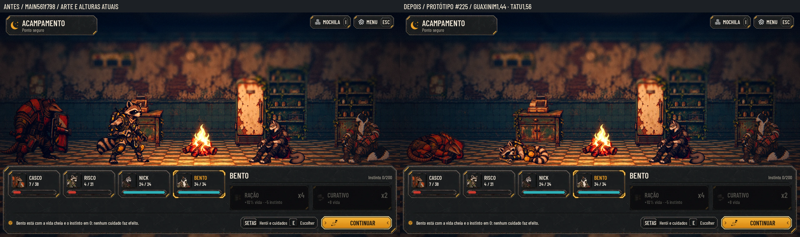

# Guaxinim e Tatu na proporção dos fundadores — #225 + #210

Redesenho completo dos dois recrutas, preservando espécie, rosto reconhecível, roupa, cores e equipamento. Cabeça menor em relação ao corpo, tronco mais vertical, pernas mais longas; cauda recolhida junto às pernas e escudo do Tatu junto ao braço no idle. O Guaxinim tem 1,44 m; o Tatu,1,56 m e ombros/armadura mais robustos. Os ids `rato`, `tatu`, `raccoon_recruit_01` e `armadillo_recruit_01` continuam os mesmos.

**Este PR leva somente pranchas, documentação e medidas.** Os 26 PNG de conversão ficam na tag/Release; nenhum arquivo de produção foi trocado. A integração é do Orquestrador PC.

A fila A usa a arte/altura da main; B mostra o efeito de aumentar somente a altura antiga; C mostra o desenho novo nas alturas de destino. Mesma escala em metros e linha dos pés. Os fundadores não foram redimensionados entre filas.

## Todas as poses, lado a lado

Nas folhas abaixo, as duas colunas usam a mesma altura de destino para isolar a mudança do desenho. Cada pose nova aparece ao lado da correspondente antiga. Para `item`, que não existia, o antes é o fallback idle. O antes de acampamento é identificado como **proposta #220**, não como arte integrada na main.

| Personagem | Idle e quatro habilidades | Reações e item | Acampamento |
|---|---|---|---|
| Guaxinim | [antes/depois](recruits_redraw/raccoon_poses_1.webp) | [antes/depois](recruits_redraw/raccoon_poses_2.webp) | [antes/depois](recruits_redraw/raccoon_poses_3.webp) |
| Tatu | [antes/depois](recruits_redraw/armadillo_poses_1.webp) | [antes/depois](recruits_redraw/armadillo_poses_2.webp) | [antes/depois](recruits_redraw/armadillo_poses_3.webp) |

Cada um recebe: idle; quatro golpes; hurt, dodge, defense e death; item; seat e sleep; retrato. São **24 corpos e dois retratos**. `rato_mordida` mantém o golpe com a chave (Chave de Desmonte); `rato_poeira` mantém o scanner (Ponte de Diagnóstico), como nos dados atuais. Não há mordida ou poeira inventada a partir do nome técnico. A queda continua ajoelhada; dormir continua deitado de lado. Sem sangue, sombra pintada ou efeitos novos.

## Medidas

| Personagem | Tela dos 12 corpos | Âncora fixa no PNG x,y | WebP previsto | Âncora na textura x,y | Altura/ref. | Largura visual idle |
|---|---|---|---|---|---|---|
| Guaxinim |1178×1335 |588.5,1305 |589×668 |294.25,652.5 |1,44 m /1240 px |0,526 m |
| Tatu |1178×1335 |589,1305 |589×668 |294.5,652.5 |1,56 m /1240 px |0,848 m |

Os dois idles ocupam **1240/1335 =92,88%** da altura do canvas. O topo fica em y65 e o contato inferior em y1305. As poses agachadas, ajoelhadas, sentadas e deitadas usam naturalmente menos altura; conservam a escala por pixel e a referência do idle. Não ampliar uma pose dobrada pela altura de seu alfa. A âncora permanece a mesma em todos os corpos de cada personagem, com contato vertical arredondado em até1px na textura final. Coordenadas convertidas pela razão uniforme da largura; altura ímpar resulta explicitamente em668px.

A largura pedida para a formação é atendida no idle: ambos abaixo de1,2m e o Tatu abaixo do Bento com a cauda. A ação `tatu_abrigo` abre o escudo e chega a cerca de1,34m momentaneamente; as medidas por pose estão no [contrato](recruits_redraw/contract.json). A largura de referência para a fila é a do idle, não a do gesto aberto.

## Retratos conforme #26

Os dois PNG RGBA256×256 são **recortes dos novos idles**, não novas gerações do rosto. Olho visível alinhado em(144,104), âncora de layout(128,128), sem máscara ou aro gravado. Prova em48/64/128px, círculo de raio interno112,64px e cinza; área segura do rosto com raio104px.

| Retrato | Caixa do recorte no PNG idle | Olho na fonte |
|---|---|---|
| `raccoon_recruit_01.png` |429,16.5,829,416.5 |654,179 |
| `armadillo_recruit_01.png` |490,4.5,890,404.5 |715,167 |

Extremo final exclusivo; interpolação bicúbica para256. Os retratos não passam pela redução de50% aplicada aos corpos. 9-slice não se aplica.

## Antes/depois na Godot

Capturas reais da main `561f798` e do pacote proposto carregado por cima **em memória**. Mesmos personagens, câmera, chão e instante pausado por par. Nenhum sprite foi colado numa captura. A fila mostra os seis; a luta usa Bento, Nick, Guaxinim e Tatu; o acampamento usa a mesma equipe. Os retratos novos são avaliados na prancha própria e ainda não substituem os ícones de produção no HUD.

Sem GPU física: Godot4.7.2, OpenGL Compatibility/Mesa llvmpipe CPU, Xvfb,1920×1080. Forward+ e a QA dinâmica da integração ficam com o PC. Câmera/posições e hashes em [capture.json](recruits_redraw/capture.json); os harnesses estão no pacote de originais.

## Originais e integração pelo PC

Tag `codex-pr<N>-originals`, pasta `art/combat/source/recruits_redraw_20261028/`, com PNG normalizados, registros, contrato e helpers de QA. Release na mesma tag com ZIP automático de uma árvore isolada de fontes, fora do histórico da branch para a main. Atlas brutos de geração permanecem fora do Git. Os corpos dos atlas foram normalizados ao canvas pedido; os painéis nativos têm aproximadamente a resolução de uso no jogo, sem alegação de detalhe extra pelo aumento para o PNG de conversão.

- Apontar `LEGACY_RECRUITS`/fontes do `tools/sync_combat_art.py` para as novas pastas `raccoon/` e `armadillo/`. Os nomes preservam o padrão `rato-idle`, `rato-attackN-<habilidade>`, `rato-hurt/dodge/block/defeat` e equivalentes do Tatu. `block` vira reaction `defense`; `defeat` vira `death`, como hoje.
- Acrescentar os novos `*-item.png` à reação `item`, sem mudar as habilidades ou ids. Converter corpos para589×668 e copiar os retratos256×256 com os nomes atuais.
- Usar **1240px de referência** e as âncoras novas. Não reutilizar999/807 nem as âncoras antigas: isso faria os personagens novos crescerem ou deslocarem o pé.
- Conferir `character_heights.gd` com1,44/1,56m e os campos de largura do idle no manifesto. Integrar as quatro poses de acampamento da #210 junto do contrato ativo, manifesto e testes de contagem; a proposta não altera o contrato ativo antecipadamente.
- As camadas antigas destas duas classes (#191/#211) têm outra anatomia. Não sobrepô-las aos novos idles; a atualização dessas camadas depende da aprovação deste desenho. Este lote é o conjunto completo de poses solicitado na #225.

A proposta substitui o desenho antigo de acampamento do PR #220. A #210 permanece aberta até a integração/aprovação. Nenhum arquivo em art/, scripts/, data/, tests/ ou tools/ foi alterado nesta branch; o contrato desta pasta é só de proposta.

## QA de design

**Rodada1 — VEREDITO: REPROVADO.** Gravidade alta: a base inicial do Guaxinim simplificava a roupa/equipamento, trocando mangas, botas e retirando mochila/chave. Correção: recuperados colete sem mangas, antebraços com pelo, tornozelos enfaixados/garras, mochila amarela, chave, scanner e frascos, mantendo a proporção nova. Retratos recortados do idle para preservar a identidade.

**Rodada2 — VEREDITO: REPROVADO.** Gravidade média: a primeira foto da luta tinha uma fogueira na frente dos pés do Guaxinim; a borda direita da prancha cortava o escudo antigo do Tatu na comparação de altura. Correção: encontro capturado num trecho livre do mesmo cenário, igual no antes/depois, e prancha com colunas maiores. Nenhuma remoção de cenário por edição de imagem.

**Rodada3 — VEREDITO: APROVADO.** Sem problemas altos ou médios após as correções. Conferidos: 24 corpos RGBA no canvas correto, 2 retratos recortados dos idles, medidas/âncoras, habilidades e equipamento, queda ajoelhada, poses de acampamento, comparação com os quatro fundadores, leitura a40% e em cinza, capturas reais e escopo somente docs. A espera da captura do acampamento também foi ampliada para terminar a animação da HUD antes de congelar o par. Observações de integração: a pose ativa `tatu_abrigo` abre até1,34m; as camadas antigas não servem à anatomia nova; Forward+ será conferido no PC. Aprovação artística final pelo Lucas.

## Verificação

88/88 testes locais em593,178s, paridade48/48, Godot4.7.2. Os logs mantêm avisos de recursos/coroutine ao encerrar. Contratos ativos e todos os arquivos de produção permanecem iguais à base; somente pranchas/docs entram no PR. Auditoria dos26 PNG e medidas em [audit.json](recruits_redraw/audit.json).
