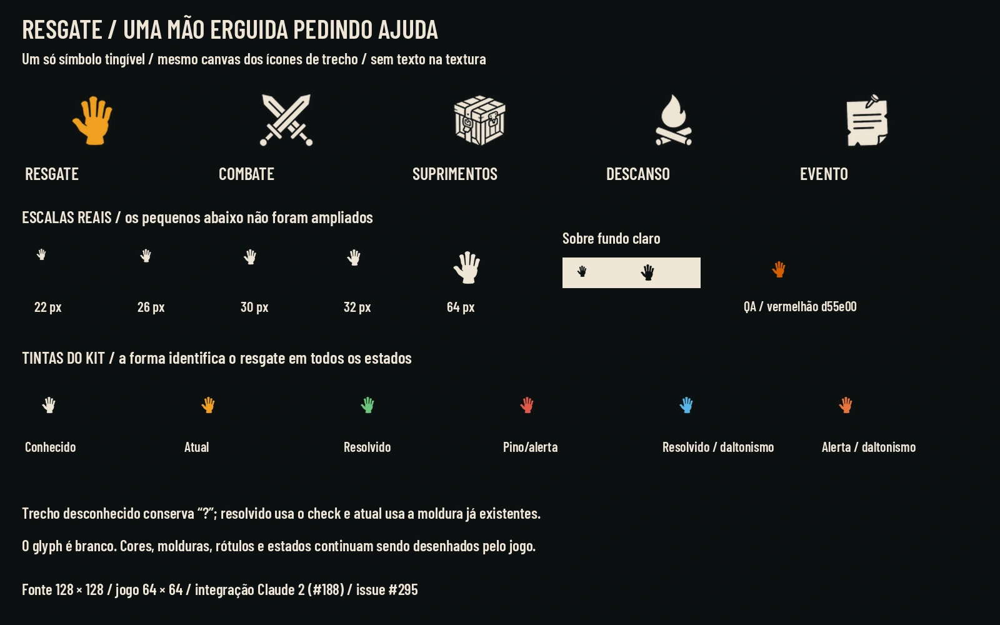
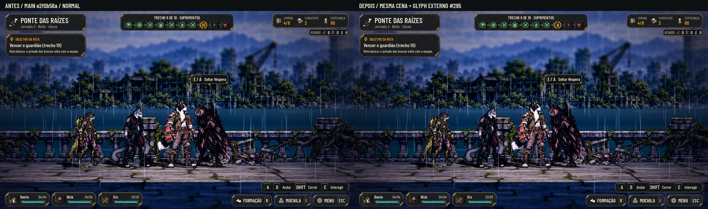
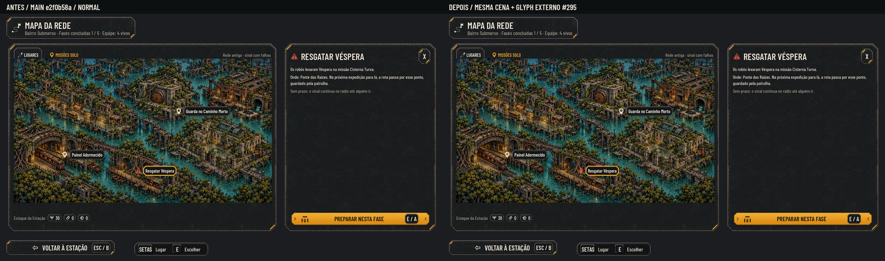

# Ícone de resgate — #295

Um único glyph `node-rescue`: **mão erguida pedindo ajuda**, sem arma, caixa, chama ou moldura própria. O gesto se distingue de combate, suprimentos, descanso e evento pela silhueta; a identificação não depende da cor. Segue o preenchimento branco tingível dos ícones de trecho do kit da Estação e funciona no pino do Mapa da Rede.

[Cinza](rescue_icon/board_gray.webp) · [Prancha a 40%](rescue_icon/board_40.webp)

## Medidas para integração pelo Claude 2

| Campo | Medida/uso |
|---|---|
| Nome/identificador | `node-rescue` — mantém o nome pedido na issue |
| Destino sugerido | `art/ui/kit/station/icons/node-rescue.webp` |
| PNG de origem | 128×128, RGBA, máscara branca |
| WebP do jogo | 64×64, lossless, igual aos outros `node-*` |
| Âncora | Centro: (64,64) na origem; (32,32) no jogo |
| Respiro | Corpo contido em 104×104 no PNG; recorte alfa do WebP (8,3)–(56,61), incluindo antialias |
| Uso reduzido | 22/32 px; rota atual 46×0,56 = 25,76 px; pino do mapa 30 px |
| 9-slice | Não se aplica a um glyph |

Um arquivo atende a todos os estados: a HUD aplica as tintas existentes de conhecido, atual, resolvido e alerta. A moldura âmbar do trecho atual e o check do resolvido continuam sendo os do kit. Trecho desconhecido conserva `?`; este desenho não autoriza revelar um preso antes das regras existentes.

As amostras usam os tokens reais da main e incluem a paleta de daltonismo; a prancha também testa o vermelhão `#d55e00` pedido no checklist de QA. O glyph não tem texto, fundo, cor fixa, halo ou estado de jogo embutido. Não se acrescenta um novo tipo de trecho, recompensa, pose do preso ou regra de resgate.

## Antes e depois na Godot

**Main e2f0b58a**, Godot 4.7.2, 1920×1080, Compatibility/Mesa llvmpipe por CPU, sem GPU física. Campanha isolada com a Véspera capturada na fase 2 e expedição 4242. Cada dupla mantém câmera, elenco e momento congelados; o depois troca apenas a textura do glyph, carregada fora do repositório. Não é uma implementação de integração.

| Vista | Maior (130%) | Daltonismo | 40% | Cinza |
|---|---|---|---|---|
| Trecho do preso | [Abrir](rescue_icon/before_after_route_larger.webp) | [Abrir](rescue_icon/before_after_route_colorblind.webp) | [Abrir](rescue_icon/route_40.webp) | [Abrir](rescue_icon/route_gray.webp) |
| Pino de resgate | [Abrir](rescue_icon/before_after_map_larger.webp) | [Abrir](rescue_icon/before_after_map_colorblind.webp) | [Abrir](rescue_icon/map_40.webp) | [Abrir](rescue_icon/map_gray.webp) |

A captura mantém o título atual “Suprimentos” do trecho; mudar o rótulo e associar o glyph ao resgate são decisões da integração do Claude 2 (#188). No mapa, a prova troca só o farol do pino de resgate, conservando o nome e o painel existente. O redesenho de outros pinos fica fora desta entrega.

## Originais e QA

Originais na tag **[`codex-pr316-originals`](https://github.com/lucasyemz/after-humans-godot/tree/codex-pr316-originals)**, pasta `art/ui/source/rescue_icon_20261102/`: [Release](https://github.com/lucasyemz/after-humans-godot/releases/tag/codex-pr316-originals) · [ZIP](https://github.com/lucasyemz/after-humans-godot/archive/refs/tags/codex-pr316-originals.zip). **Não juntar a tag na main.** O PR leva somente as pranchas e esta documentação; nenhum arquivo de produção, código, dado ou teste é alterado. O pacote original traz o PNG, WebP reproduzível, medidas/hashes e receitas da prova. A integração cabe ao Claude 2; o Lucas aprova pela prancha.

[QA de design](rescue_icon/qa.md) · [Verificação de arquivos](rescue_icon/verification.json)

Passagem pela §14 da narrativa: o gesto representa o pedido de ajuda/resgate já existente na #188. Respeita a lore, sem revelar mistério, transformar hipótese em fato ou prometer mecânica nova. Não define espécie/gênero do preso; pode reaparecer para qualquer resgate previsto pelas regras.

Validação da main e2f0b58a: **115/115 testes**, paridade **48/48**.
