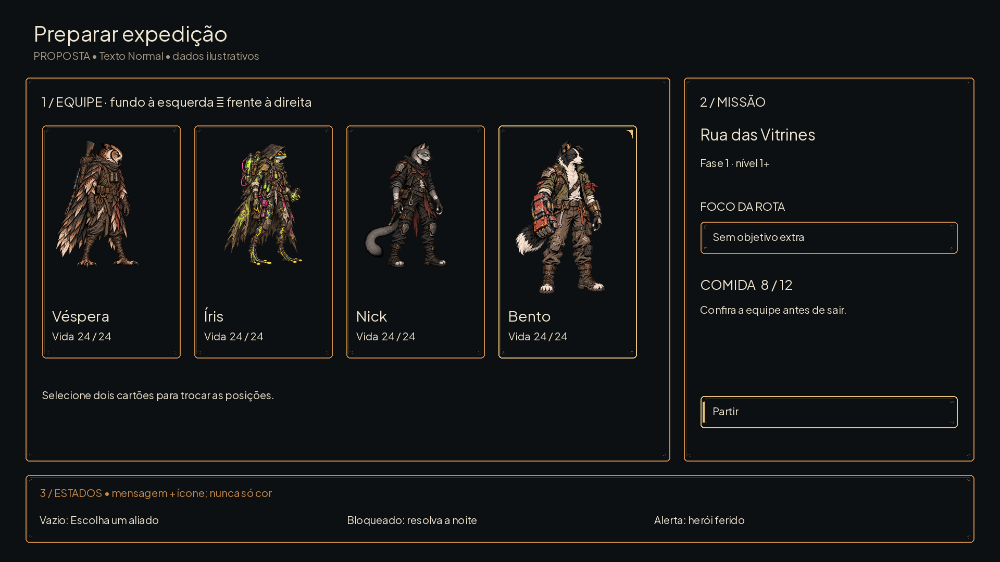
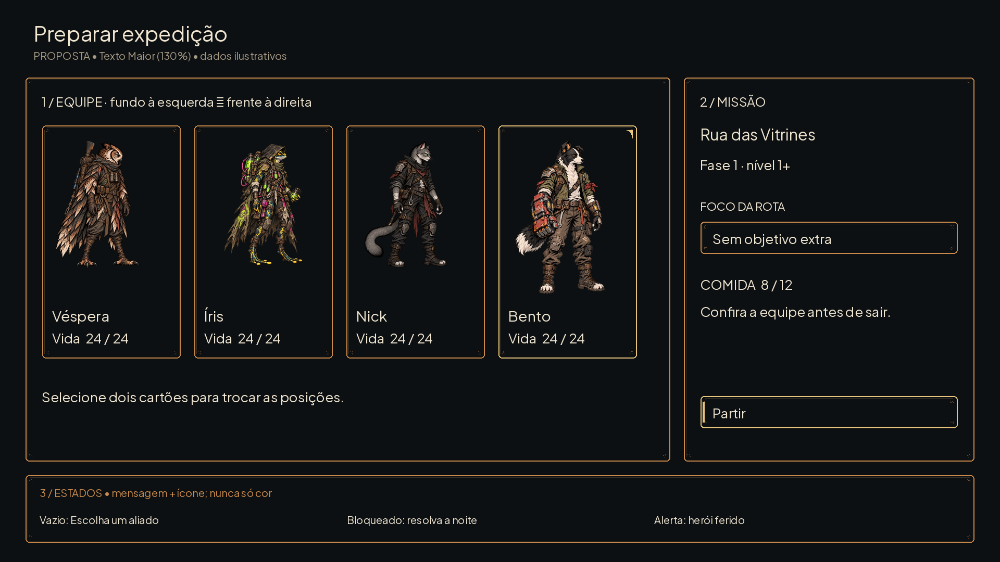
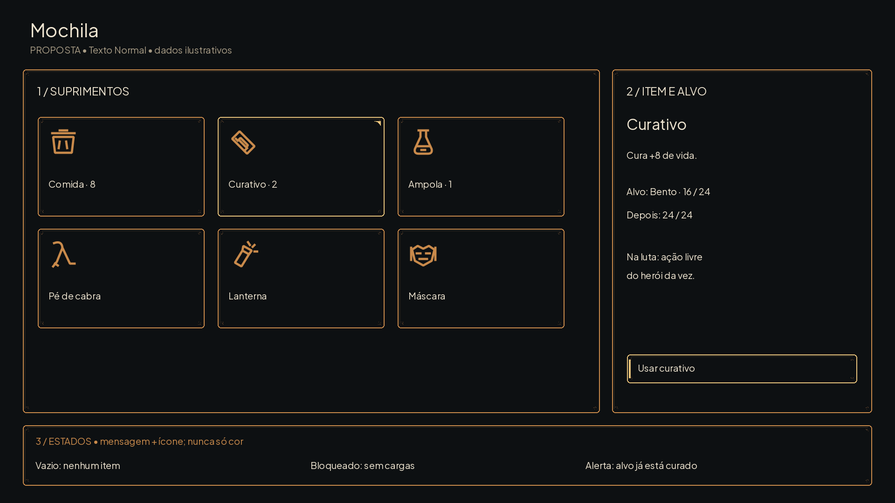
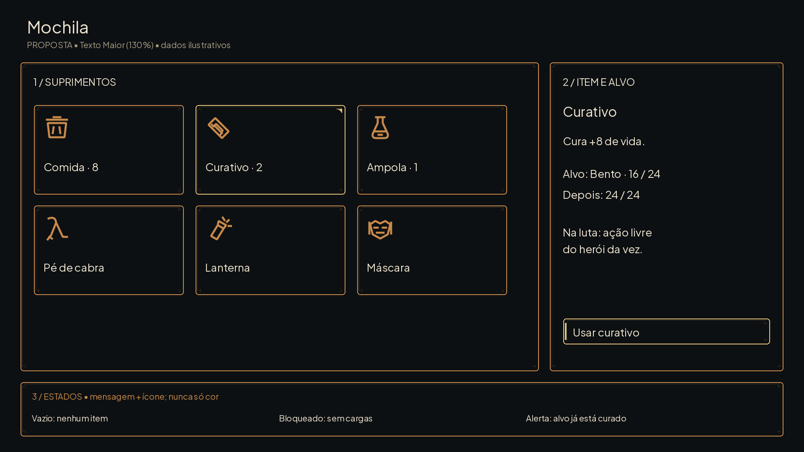
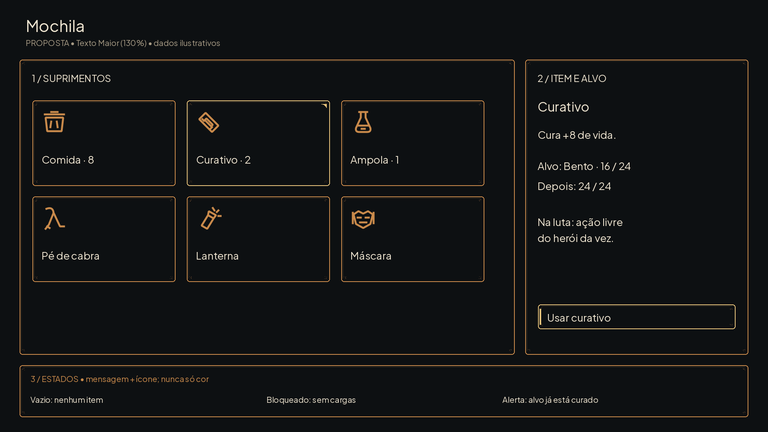
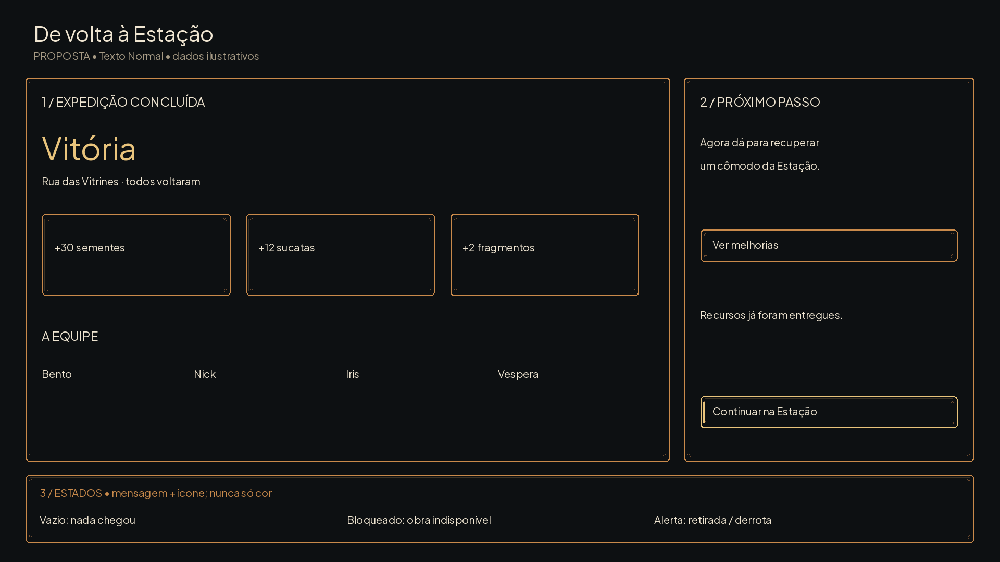
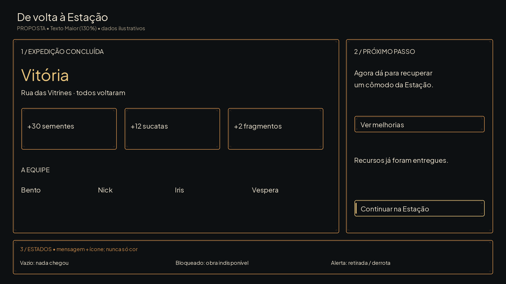
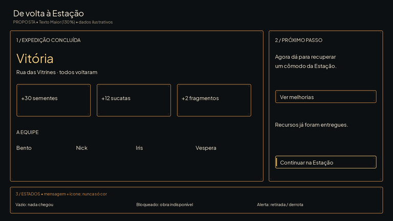
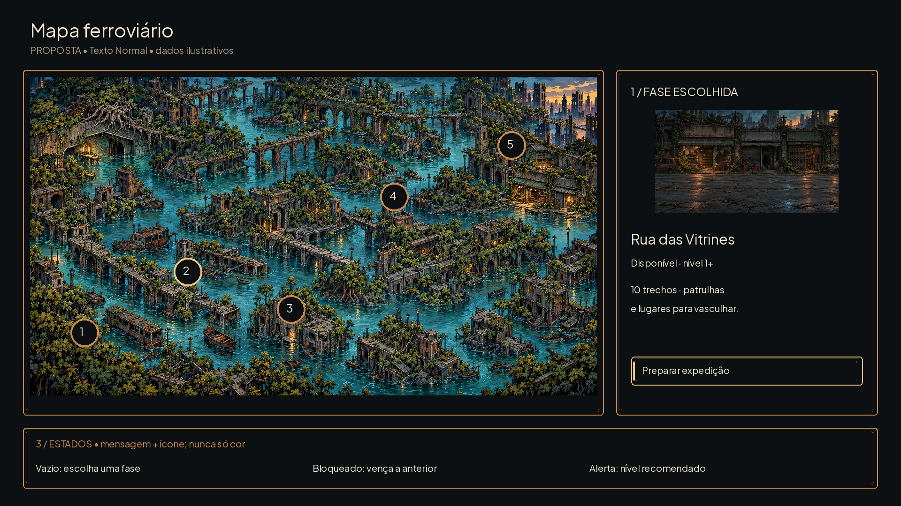
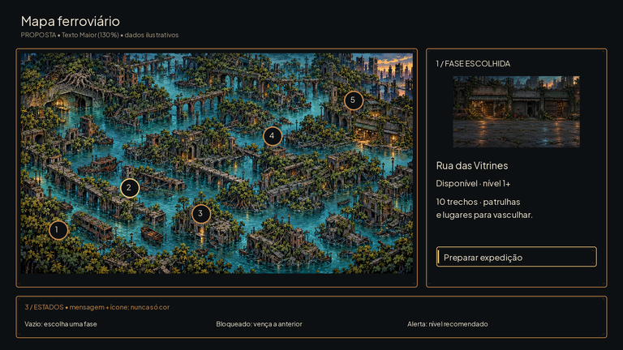

# Propostas de telas — #21

Propostas estáticas, não capturas do jogo. Usam apenas molduras #20, ícones #17, fontes e arte já versionadas. Dados e números são ilustrativos. Lucas aprova antes da integração #16.

| Tela | Normal | Texto Maior | Conferência a40% |
|---|---|---|---|
| preparation |  |  |  |
| inventory |  |  |  |
| return_report |  |  |  |
| phase_map |  |  |  |

Canvas1920×1080. Âncora topo esquerdo(0,0), sem9-slice nas propostas. Área principal(48,148,1240,740); decisão à direita(1312,148,560,740); CTA(1344,760,496,64); margem segura48; espaços24; anotação de estados na faixa y912–1044. A faixa de estados é anotação da proposta, não ocupa a tela final.

Hierarquia: Preparação começa pela ordem dos quatro heróis (fundo à esquerda), depois missão/foco/comida e Partir. Mochila começa pelo item selecionado, custo e alvo antes de Usar. Relatório destaca resultado e o que efetivamente voltou, depois libera o próximo passo. Mapa mantém o caminho e desloca a decisão para a ficha da fase. Números de hierarquia1/2/3 são anotações; remover na integração.

Normal20px; Maior26px(130%) no corpo, títulos30–60 e notas20. Os rótulos nunca ficam abaixo de18. O tamanho Maior usa as mesmas caixas com folga; descrições longas do jogo devem quebrar linhas e rolar no painel, sem diminuir a fonte. Benefício/perigo são mensagem e símbolo além da cor. No celular as prévias40% permitem reconhecer ação principal e agrupamento; a interface final precisa reflow, não apenas escala40%.

Estados por tela estão anotados em cada imagem: vazio mantém instrução; bloqueado mantém motivo textual junto do CTA; alerta não oculta informações nem usa apenas vermelho. Seleção/foco preservados ao voltar de uma tela. Escape volta sem descartar rascunho de preparação.

## QA de design

Rodada1 — VEREDITO: APROVADO. Conferidas quatro telas e respectivas versões Maior, resolução1920×1080, fontes locais, referências atuais e peças das issues17/20. Textos principais cabem em130%; CTA e hierarquia continuam reconhecíveis a40%. Estados estão anotados sem inventar mecânicas. Sem problemas altos/médios. Observação baixa: propostas requerem aprovação do Lucas e teste responsivo na integração; não são especificação de novas regras.
