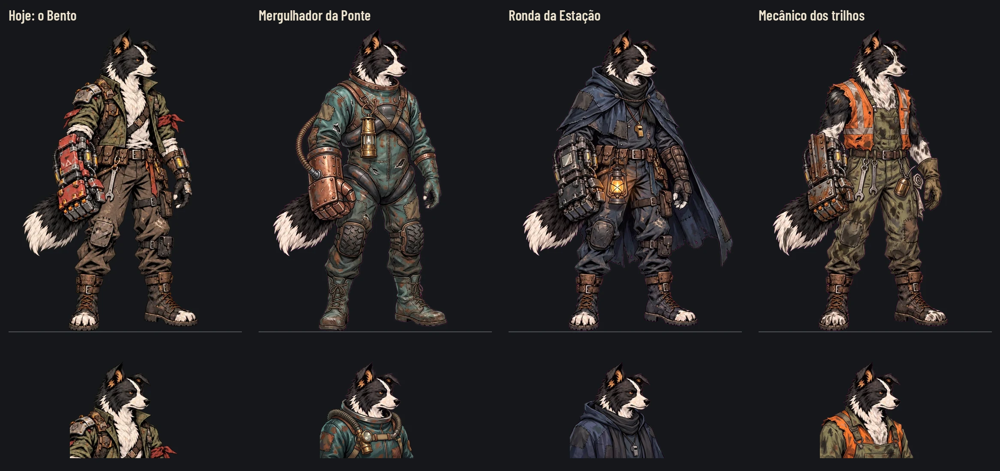

# Skins do Bento — Ronda da Estação escolhida

**Decisão atual do Lucas na #137:** Ronda da Estação (`watch`), substituindo a escolha anterior do Mergulhador. **[Entrega das16 poses, medidas, pranchas e QA](bento-watch.md).** A referência aprovada está em `docs/design/skins/watch/`; os arquivos para integração ficam em `art/skins/bento/watch/`.

## Histórico das propostas aprovadas no #192

# Skins: as três propostas do Bento (#137, 27/10/2026)

O Lucas pediu só skins completas, começando pelo Bento. Uma skin é o mesmo personagem com outra roupa, nas mesmas
poses: o corpo, a cara, a pose, a escala e o pé ficam; mudam a roupa e o equipamento. Esta é a primeira entrega: as
três propostas, só o idle e o retrato, para o Lucas escolher. As 16 poses vêm depois, só da escolhida.

Nada em `scripts/`, `data/` nem `tests/`. O sistema de skins no jogo é a #138.

## As propostas

| Proposta | Idle | Retrato | A roupa |
|---|---|---|---|
| **Mergulhador da Ponte** (`diver`) | [idle](skins/diver/idle.webp) | [retrato](skins/diver/portrait.webp) | Macacão emborrachado de câmara de ar e lona, remendado; a lâmpada de latão no peito; a mangueira que desce pelo braço até o punho, que vira de cobre rebitado com o engate dela; joelheiras de pneu e botas molhadas. Verde-água, ferrugem e marrom |
| **Ronda da Estação** (`watch`) | [idle](skins/watch/idle.webp) | [retrato](skins/watch/portrait.webp) | Capa de lona encerada com capuz, nas cores da noite (anil e carvão), remendada; o lampião no cinto, o cachecol, o apito no cordão; o punho de sucata escurecido, com uma chapa de refletor. O âmbar do lampião é o único ponto quente |
| **Mecânico dos trilhos** (`mechanic`) | [idle](skins/mechanic/idle.webp) | [retrato](skins/mechanic/portrait.webp) | O colete de sinalização velho e rasgado sobre o macacão de trabalho sujo de graxa; chaves, a lata de óleo e o pano pendurados; luvas grossas; o punho feito de chapas de trilho e parafusos. Laranja desbotado, oliva e marrom de graxa |

**A coerência com a história** (`docs/narrative/`, a regra de consistência da seção 14): as três roupas são feitas pelos
sobreviventes com o que sobrou (câmara de ar, lona, colete velho, chapa de trilho), sem nada novo nem limpo. Não há
texto, logotipo nem nada dos humanos vivos, e nenhuma delas revela a história antes da hora. O mergulhador é da Ponte
das Raízes, a ronda é a da noite da Estação e o mecânico é dos trilhos do trem: são lugares e funções que o jogo já tem. A
proposta da noite se chama "Ronda", e não "Vigia", para não ecoar a VIGIA da história.

**O que a prancha confere:**
- **a escala e o pé:** cada idle está no canvas do idle de hoje (543 × 724). O corpo tem a mesma altura (a caixa do
  alfa, de y 5 a 714), o pé fica na mesma linha (y 714) e a cabeça no mesmo x: a cara (a faixa de 20 a 70 px abaixo do
  alto do corpo, acima do capuz e da gola) e a bota da frente começam no mesmo x nas quatro. Por isso a âncora de `data/presentation/combat_art.json` serve sem ajuste:
  [473, 1429] no original, x 236,5 e y 714,5 neste canvas. O corpo de hoje vai de (31, 5) a (442, 714); a capa da ronda
  alarga a caixa até x 533, só do lado de trás;
- **o retrato:** está no canvas e no enquadramento do `bento.png` (256 × 256), com o alto da orelha em y 28;
- **a leitura pequena:** a [redução a 40%](skins/proposals_40.webp) e o [cinza](skins/proposals_gray_40.webp) ainda
  separam as três pela silhueta e pela cor. O mergulhador é o volume liso e verde-água, a ronda é a capa escura com o
  ponto de luz, e o mecânico é o laranja.

**O que observar na escolha:**
- **o mergulhador** troca a forma do punho: a luva rebitada é mais redonda que o punho de sucata de hoje. Se for a
  escolhida, as poses das habilidades do punho vão mostrar a luva nova;
- **o mergulhador** tem as botas fechadas, que escondem os dedos brancos do pé, parte da leitura do Bento;
- **a ronda** é a mais escura: na luta da noite, ela se apoia no lampião para se separar do fundo;
- **o mecânico** é o mais perto do Bento de hoje na silhueta, e o laranja o separa de longe. Com os braços de fora,
  as manchas no pelo são graxa; nas 16 poses, elas precisam continuar lendo como graxa, não como outra pelagem.

## O padrão para as próximas skins

- **O que muda:** a roupa e o equipamento. **O que fica:** o corpo, a cara, a pose, os ângulos, a escala e o pé.
  O punho de sucata (a arma do Bento) pode mudar de material, não de tamanho.
- **Os arquivos:** depois da escolha, em `art/skins/<herói>/<skin_id>/`, com o nome de cada pose igual ao de hoje
  (`idle.webp`, `cao_punho_sucata_preparacao.webp`, `cao_punho_sucata_execucao.webp`… `hurt.webp`, `death.webp`,
  `item.webp`, as poses da Estação e do acampamento e `portrait.webp`, que substitui `art/ui/portraits/bento.png`). São 16 imagens, cada uma no mesmo tamanho de tela
  do arquivo original e com a mesma âncora no pé. Os efeitos (`_vfx.webp`) e os sons são os mesmos em qualquer skin.
- **A prancha:** as poses da skin ao lado das de hoje, na mesma escala e na mesma linha do pé.
- **O método:** Nano Banana Pro, editando a pose de hoje sobre o magenta (#FF00FF), recortada por código, sem texto.
  As propostas só ficam em `docs/design/skins/<skin_id>/`; vão para `art/` depois da escolha.

## Como refazer

As imagens brutas ficam fora do Git, em `images/skins/` do projeto na Awesomic: `bento-idle-magenta-2x.png` e
`bento-portrait-magenta-4x.png` (o idle e o retrato de hoje sobre o magenta, ampliados) e, de cada proposta,
`skin-<id>-idle.png` e `skin-<id>-portrait.png` (edições deles).

Da raiz do repositório: `python3 -B docs/design/skins/cut_skins.py <pasta images/skins>`. Ele grava o idle e o retrato
de cada proposta, a prancha, a redução a 40% e o cinza.

**Sem captura do jogo:** a troca de roupa ainda não existe no jogo (#138), então as propostas não aparecem numa luta. A
prancha compara com a arte de hoje na escala do jogo. A captura entra com as 16 poses da escolhida, junto com a
integração.

## Escolha (histórico; já definida acima)

A escolha final é a Ronda; ver a entrega vinculada no topo. As três propostas abaixo permanecem como referência histórica.

## QA de design

As rodadas seguem [qa.md](qa.md) e ficam registradas abaixo e no PR.

### Rodada 1: REPROVADO

**Média, corrigido:** a ronda estava 32 px à esquerda, com a capa encostada na borda do canvas. O script centrava a
caixa inteira do alfa, que a capa alarga só de um lado. Agora o x vem da cara, e o script para com erro se a skin não
couber no canvas.

**Baixa, corrigidos:** o retrato no padrão como `portrait.webp`; as medidas na página (a âncora, a linha do pé, a caixa
do corpo e o retrato); a redução a 40% também em cinza; as botas do mergulhador e a graxa do mecânico em "O que
observar"; "Vigia da Estação" virou "Ronda da Estação", para não ecoar a VIGIA.

### Rodada 2: APROVADO

A ronda no lugar, sem encostar na borda; a página com as medidas; nada alto nem médio. Observações baixas:
- a ronda ainda ficava 8 px à direita, por causa do capuz na faixa da cabeça: a faixa passou para a cara (20 a 70 px
  abaixo do alto do corpo), e agora a cara e a bota da frente batem com as de hoje nas quatro (aplicado depois do
  veredito);
- um fio de 1 px roxo-escuro na borda da bota da frente da ronda, que só aparece sobre fundo claro: se ela for a
  escolhida, um despill mais forte nas bordas escuras quando for para `art/`;
- as rodadas registradas aqui.
