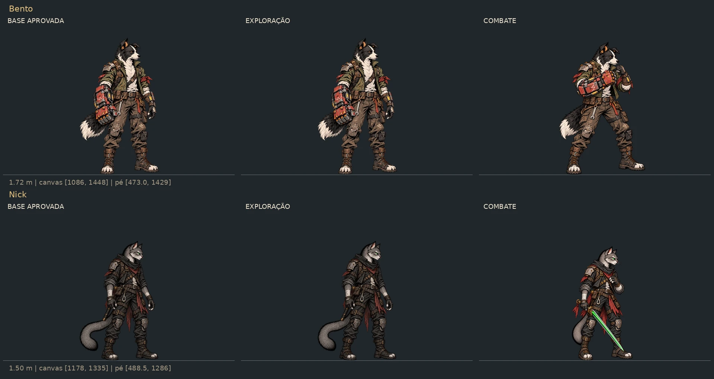
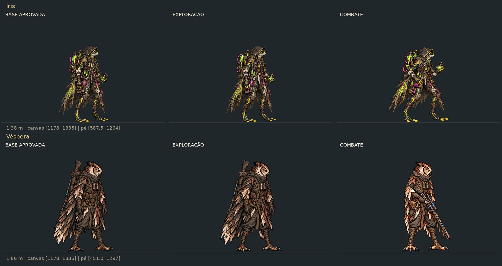
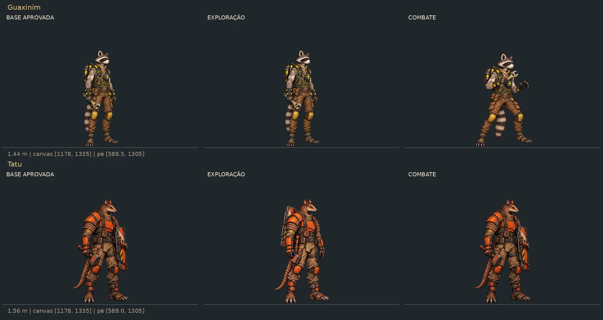
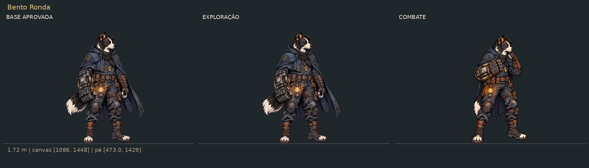
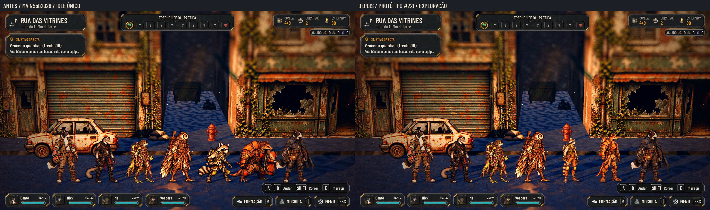
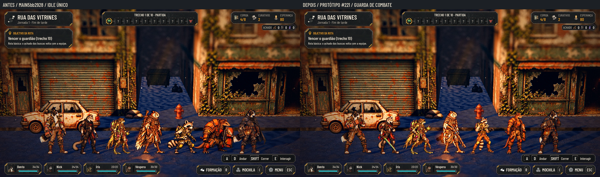
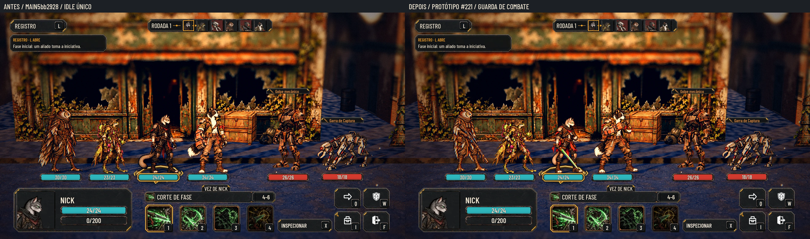
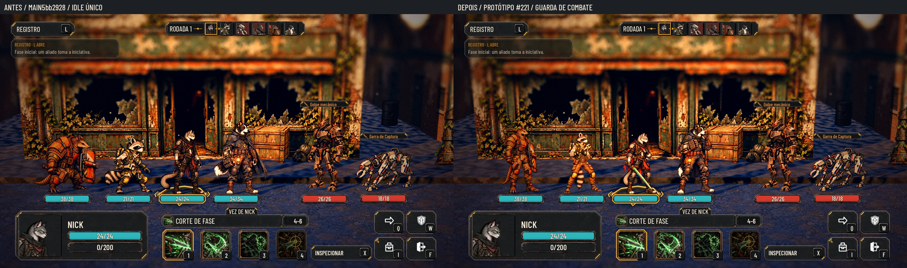

# Exploração e guarda de combate — #221

Sete poses novas, preservando os idles aprovados sempre que já cumprem uma das funções. O personagem não troca de roupa nem de equipamento ao entrar em combate: muda a postura e pega a arma que já carregava. Os feridos e as poses de ataque permanecem intactos.

**Proposta de arte; integração pelo Claude 2.** O PR contém somente pranchas, medidas e documentação. Os PNG ficam em tag/Release isolados. Nenhum arquivo de produção, id, script, dado ou teste é alterado nesta entrega.

## O que fica e o que muda

| Personagem | Exploração | Combate | Nova imagem |
|---|---|---|---|
| Bento | Idle atual, punho abaixado | Guarda de boxe com punho de sucata à frente | `bento/combat_idle.png` |
| Nick | Idle atual, espada guardada | Espada de fase desembainhada, em guarda baixa | `nick/combat_idle.png` |
| Íris | Idle atual, frasco abaixado | Frasco elevado e pernas prontas para reagir | `iris/combat_idle.png` |
| Véspera | Idle atual, rifle nas costas | Rifle nas duas mãos, em prontidão baixa, sem mirar | `vespera/combat_idle.png` |
| Guaxinim | Idle aprovado na #225, chave abaixada | Chave junto ao peito, mão livre protegendo, joelhos flexionados | `raccoon/combat_idle.png` |
| Tatu | Mãos livres, escudo nas costas e martelo preso no cinto | Idle aprovado na #225, escudo e martelo na mão | `armadillo/idle.png` |
| Bento Ronda | Idle atual da skin, punho abaixado | Guarda com punho escuro, capa recolhida e lampião no cinto | `watch/combat_idle.png` |

A regra da issue permite arma abaixada na exploração; por isso o frasco da Íris e a chave do Guaxinim não exigem outra pose. Para o Tatu o pedido é explícito: as mãos ficam vazias. Não há espada nova, arma adicional ou efeito de ataque. A espada do Nick e o rifle da Véspera seguem os desenhos dos próprios golpes atuais.

Em cada linha: base aprovada, exploração e combate, na mesma escala por metro e linha de contato. As bases dos recrutas são os PNG da #225, não os sprites antigos ainda presentes em produção nesta main. A nova pose é só uma das duas colunas; a outra reutiliza a arte aprovada. Reduções reais a40% e versões em cinza acompanham cada folha (`poses_N_40.webp` e `poses_N_gray_40.webp`).

## Medidas e registro

| Personagem | PNG de origem | Âncora x,y | Referência corporal | WebP previsto |
|---|---|---|---|---|
| Bento e Ronda |1086×1448 |473,1429 |1419px |543×724 |
| Nick |1178×1335 |488.5,1286 |1255px |589×668 |
| Íris |1178×1335 |587.5,1264 |1208px |589×668 |
| Véspera |1178×1335 |451,1297 |1271px |589×668 |
| Guaxinim |1178×1335 |588.5,1305 |1240px |589×668 |
| Tatu |1178×1335 |589,1305 |1240px |589×668 |

Canvas, referência e âncora são conservados por personagem. A imagem é normalizada com escala uniforme, sem esticar a anatomia; a posição horizontal alinha a área de apoio dos pés da base, não o centro de uma espada ou capa. A âncora declarada continua sendo a do idle. O alfa de uma postura ligeiramente flexionada ocupa naturalmente menos altura: não recalcular `body_reference_pixels` pela altura do seu alfa, pois isso faria a guarda crescer. A escala por pixel é mantida na conversão e na captura.

O contrato traz a caixa visível, escala/posição da normalização e hash de cada fonte nova. As referências dos recrutas são as da #225 (1,44m e1,56m), que dependem da integração daquele pacote. Não reutilizar os valores999/807 das imagens antigas. Os fundadores continuam a1,72/1,50/1,38/1,66m. 9-slice não se aplica a personagens. PNG RGBA sem chão ou sombra pintada; a luz e sombra do cenário continuam com a Godot.

## Antes/depois real

A fila de QA reúne sete cards (incluindo o Bento duas vezes para mostrar a skin); não é uma formação jogável de sete. As lutas usam equipes reais de quatro: os fundadores e, no segundo par, Ronda/Nick/Guaxinim/Tatu. O harness de QA carrega os protótipos externos como `ImageTexture` em memória, sem alterar scripts ou manifestos. O antes usa os arquivos/alturas de produção da main desta branch, e o depois usa as poses e a base dos recrutas da #225. A troca automática de pose ao entrar/sair da luta é implementação futura do Claude 2, não uma funcionalidade deste PR de arte.

Ambiente sem GPU física: Godot4.7.2, OpenGL Compatibility/Mesa llvmpipe CPU, Xvfb,1920×1080. Forward+ e o comportamento dinâmico final serão avaliados na integração no PC.

## Originais e integração

Tag `codex-pr<N>-originals`, pasta `art/combat/source/stances_20261028/`: sete PNG novos, registros, contrato e helpers de QA. O Release da tag oferece ZIP automático de uma árvore isolada de fontes, fora do histórico do PR para a main. As gerações brutas permanecem fora do Git.

1. Converter os sete PNG por `tools/sync_combat_art.py`, preservando canvas, âncora e referência acima. Não remedir a altura por uma guarda dobrada. O contrato detalha cada arquivo.
2. Manter os idles dos quatro fundadores e do Bento Ronda como exploração; registrar seus novos `combat_idle.webp`. A skin usa `art/skins/bento/watch/combat_idle.webp`.
3. Integrar primeiro a base da #225 pelo pacote `codex-pr229-originals`. Para o Guaxinim, manter aquele idle como exploração e adicionar esta guarda. Para o Tatu, reutilizar aquele idle como `combat_idle.webp`; a imagem nova de mãos livres passa a `idle.webp`. Os dois arquivos de referência da #225 não foram duplicados neste pacote.
4. A exploração/Estação usa idle; a luta usa combat_idle com fallback para idle. Essa seleção, a ida/volta e os testes pertencem ao PR de código do Claude 2. Não trocar feridos, ataques ou retratos por estas imagens.
5. As camadas dos recrutas continuam fora do escopo, como pedido na issue. Não sobrepor as camadas antigas à anatomia nova.

## QA de design

**Rodada1 — VEREDITO: REPROVADO.** Gravidade média: a espada do Nick e o rifle da Véspera projetavam-se demais para o próximo slot; a capa/cauda da Ronda abriam a silhueta. Correção: armas em diagonal mais vertical, capa e cauda recolhidas. A normalização também passa a alinhar o apoio dos pés, evitando que a largura de uma arma desloque o personagem.

**Rodada2 — VEREDITO: APROVADO.** Sem problemas altos ou médios. Conferidos: identidade/roupa/armas, postura distinta, reutilização das bases corretas, sete PNG RGBA nos canvases pedidos, âncoras e referências preservadas, contato com o chão, ausência de partículas isoladas a mais de4px do corpo, leitura a40% e em cinza, sete cards e duas equipes reais no cenário. Espada/rifle/capa recolhidos sem cortar os elementos. A área de apoio horizontal permanece alinhada à base; nenhuma pose foi esticada. Observações de integração: a seleção automática ainda é do Claude 2 e os recrutas dependem da #225; conferência final de Forward+ no PC. Aprovação artística final pelo Lucas.

## Verificação

Runner inteiro local: **92/92 em641,292s**, paridade **48/48 lutas,3351 passos**, Godot4.7.2, base `5bb2928`. O log inclui mensagens de erro dos testes que exercitam estados inválidos do tutorial; o runner termina aprovado. Auditoria dos sete PNG em [audit.json](stances/audit.json); contrato em [contract.json](stances/contract.json), capturas/metadados em [capture.json](stances/capture.json). Somente docs/pranchas no diff.
