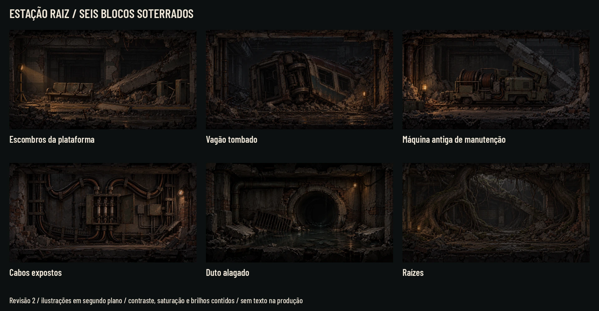
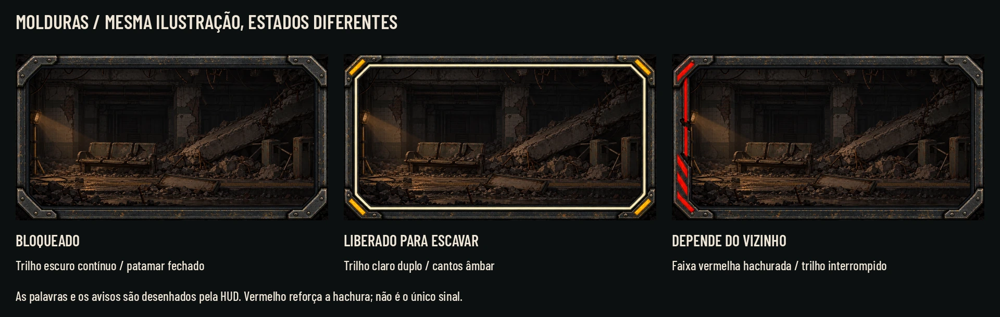
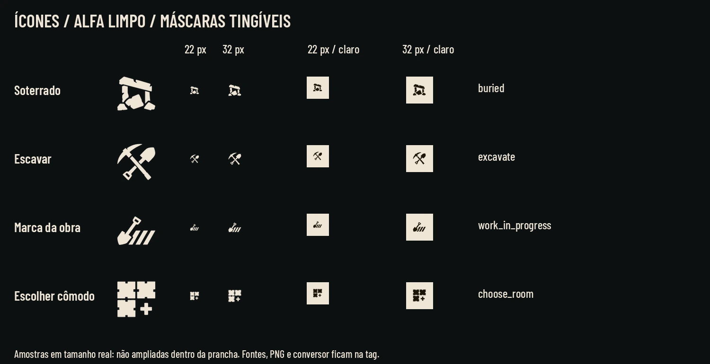
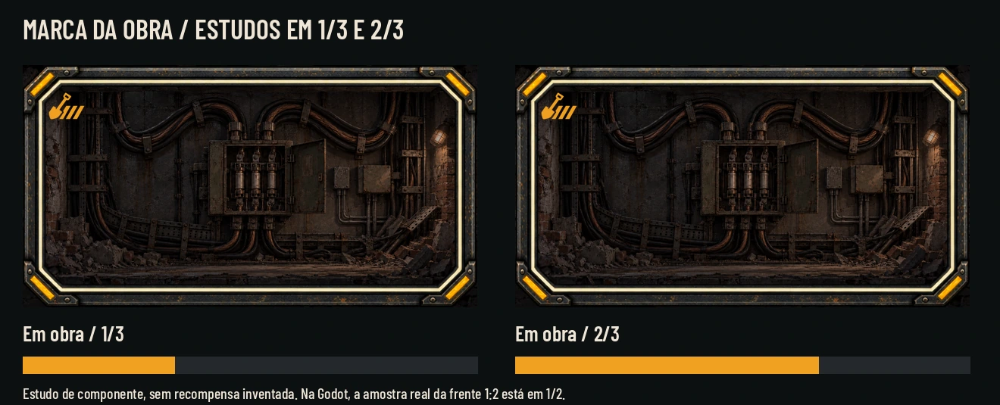
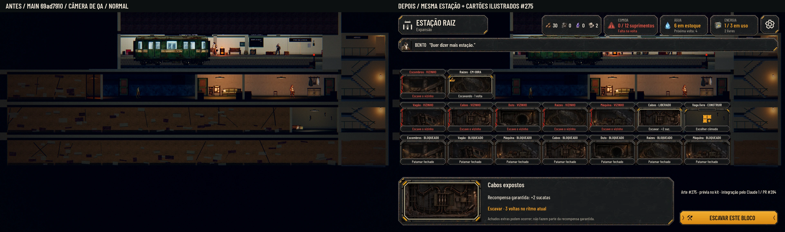
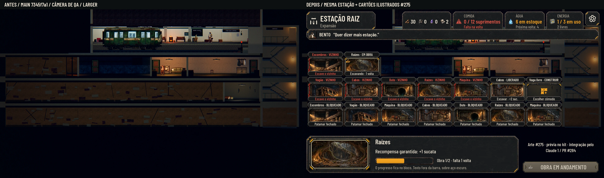
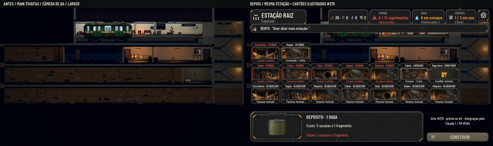
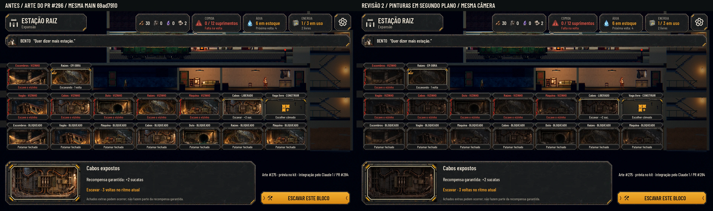

# Estação em grade — cartões soterrados (#275)

Entrega de arte para a direção do Lucas de 01/11, registrada na [issue #275](https://github.com/lucasyemz/after-humans-godot/issues/275) e no [PR de integração #284](https://github.com/lucasyemz/after-humans-godot/pull/284). **Uma ilustração própria por bloco**, com primeiro plano, objeto principal, fundo recuado e luz local. **Revisão 2, após o aceite do Lucas no #296:** as pinturas ficam em segundo plano, com menor contraste/saturação, véu carvão mais forte e brilhos contidos. Moldura, nome, estado e recompensa permanecem em primeiro plano. O tratamento já está nos PNG/WebP; não somar outro véu na integração. A grade fica sobre o corte real da Estação; não é uma única imagem cobrindo um trecho inteiro.

O PR de arte contém somente esta documentação e as pranchas/capturas. **Os 14 PNG normalizados, os PNG brutos, o contrato e as ferramentas de reprodução ficam na tag de originais**, fora da história do PR para a main. Nenhum arquivo de outro jogo foi adicionado. A integração continua com o Claude 1, no #284.

## Pranchas para o Lucas



[Arte reduzida a 40%](station_buried/art_board_40.webp) · [Arte em cinza](station_buried/art_board_gray.webp)







As pranchas de arte e de componentes são estudos rotulados, não capturas do jogo. As pinturas de produção não contêm palavras, números, interface ou personagens. O jogo desenha todos os textos por cima, com a Barlow e os componentes existentes do kit.

## Antes e depois dentro da Godot

Base das capturas revisadas: **main 69ad7910**, incorporada à branch `codex-275` antes da revisão. Mesma cena, câmera ortográfica de QA, elenco e tempo de jogo congelado nos dois lados. O antes mostra a cena da main sem patch; o depois carrega somente o protótipo externo dos cartões e a moldura da HUD. O enquadramento de QA é declarado: **não se alterou a câmera de produção nem a implementação do PR #284**.







Capturas reais de **Godot 4.7.2, 1920×1080, Compatibility/Mesa llvmpipe por CPU, sem GPU física**. A luz que separa os planos das ilustrações é pintada no próprio cartão; estas capturas não aprovam luz ambiente, glow/GI ou Forward+ de produção. Essa conferência continua com o PC do Lucas na integração.

| Vista completa | Normal | Maior (130%) | Daltonismo |
|---|---|---|---|
| Grade e bloco liberado | [Abrir](station_buried/overview_normal.webp) | [Abrir](station_buried/overview_larger.webp) | [Abrir](station_buried/overview_colorblind.webp) |
| Obra em andamento | [Abrir](station_buried/work_normal.webp) | [Abrir](station_buried/work_larger.webp) | [Abrir](station_buried/work_colorblind.webp) |
| Escolha do cômodo | [Abrir](station_buried/choice_normal.webp) | [Abrir](station_buried/choice_larger.webp) | [Abrir](station_buried/choice_colorblind.webp) |

[Grade a 40%](station_buried/overview_40.webp) · [Grade em cinza](station_buried/overview_gray.webp) · [Molduras em cinza](station_buried/frame_board_gray.webp)



## Hierarquia visual da revisão 2

As seis pinturas foram revisadas sem acrescentar objetos ou alterar a intenção narrativa. As lâmpadas e os reflexos deixaram de ser pontos de alto brilho. A luminosidade média dos arquivos caiu cerca de 43–49%, o contraste global (desvio de luminância) 52–59% e a saturação média 19–35%; medidas descritivas em 8 bits, não parâmetros de shader. A profundidade continua pintada, com identificação pela silhueta, sem disputar com o texto.

Molduras, ícones, tipografia, barras e cores dos estados **não receberam esse tratamento**. O cartão livre e a prévia do cômodo também conservam o desenho aprovado. Os textos continuam sobre os painéis opacos do kit, sem depender do escurecimento da pintura para atingir contraste.

## Lista final e passagem pela narrativa (§14)

Aplicada a [regra de consistência, §14](../narrative/narrative-design.md#14-regra-de-consistência), com a [Bíblia de Lore](../narrative/lore.md), especialmente os Remendadores (§14.1), a Estação Raiz e o Bairro Submerso (§17), e os achados já escritos em `data/station-grid.json`. Não se acrescentou revelação, facção, evento, inimigo ou recompensa.

| Ilustração | Silhueta e luz | Limite narrativo e vínculo com o que já existe |
|---|---|---|
| `platform_rubble` — escombros da plataforma | Banco de espera, laje diagonal, catraca e contraluz de inspeção à esquerda | Banco/catraca/painel já aparecem nos textos de `floor_1`. Não revela quem provocou o desabamento. |
| `overturned_wagon` — vagão tombado | Trecho de carroceria virado de lado, rodado elevado, fundo frio e lâmpada à direita | Só um trecho cabe na baia; o restante desaparece no entulho. Não promete recuperar outro trem, achar pessoas ou abrir transporte novo. Trilhos e sucata combinam com os achados de `floor_2`. |
| `maintenance_machine` — máquina antiga de manutenção | Carrinho baixo, bobinas de cobre e braço de manutenção recolhido | Máquina inerte, sem rosto, arma, tela ou luz de ativação. Não cria um inimigo nem explica o despertar de VIGIA. Bobinas/ferramentas combinam com `floor_3`. |
| `exposed_cables` — cabos expostos | Arcos grandes de cabo, caixa de fusíveis aberta e recorte lateral quente | Cabos sem faísca ou circuito ativo. A caixa de fusíveis e o painel de controle já existem em `floor_2`; não promete energia gratuita. |
| `flooded_duct` — duto alagado | Boca circular escura, grade caída e reflexo contido na água | Umidade e alagamento são coerentes com o Bairro Submerso. Água estagnada, sem símbolo de consumo, bomba ou recompensa de água. |
| `root_chamber` — raízes | Troncos em arco, alvenaria recuada e foco de inspeção baixo | Raízes naturais, sem brilho mágico ou explicação biológica. O nome Estação Raiz já vem das raízes da plataforma; não é um emblema da Raiz Livre. |

Resultado das seis perguntas para cada conteúdo: **não contradiz** a lore; **não antecipa** um mistério; **não transforma hipótese em fato**; **não promete gameplay novo**; **respeita** a cultura de reaproveitamento dos Remendadores; o contexto **pode reaparecer** como ruína/material já previsto, sem prometer uma missão futura. A lista está apta como arte de ambiente; o aceite artístico continua com o Lucas.

As lâmpadas são linguagem de inspeção do cartão, com luz recortada e sombras próprias. Não equivalem a uma instalação elétrica liberada no save. Todos os blocos continuam sujeitos às regras de escavação.

## Estados da moldura e marca da obra

| Estado | Sinais no desenho | Texto/uso no protótipo |
|---|---|---|
| Bloqueado | Aço escuro, trilho contínuo e placas de canto foscas | `BLOQUEADO` + motivo, como “Patamar fechado”. A pintura continua visível. |
| Liberado para escavar | Trilho interno claro duplo e cantos âmbar | `LIBERADO`; ação e recompensa garantida à vista. Não usa verde como único sinal. |
| Depende do vizinho | Trilho interrompido, lado vermelho com hachuras diagonais | `VIZINHO` e “Escave o vizinho”, também em vermelho. Hachura/palavra preservam o sentido em cinza. |
| Em escavação | Moldura liberada + marca de pá/hachuras + progresso | `EM OBRA`; tempo restante e pontos de obra. O texto fica fora do preenchimento âmbar, sobre aço escuro. |
| Vaga livre / escolher cômodo | Cartão próprio com plaqueta vazia e ícone de planta | “Escolher cômodo”; a prévia recebe o nome, o tamanho e o custo de um cômodo que caiba ali. |

A arte não codifica o estado do save. O Claude deriva os estados das regras existentes: patamar, adjacência, vaga aberta, progresso e frente escolhida. Uma frente com progresso que deixou de ser a atual deve ser distinguida como iniciada/pausada, sem dizer que todas estão sendo escavadas ao mesmo tempo. Nada permite atravessar um patamar fechado ou construir por cima de um bloco soterrado.

A recompensa não foi copiada da referência de outro jogo. O protótipo lê `AHStationGrid.block_rule()` e mostra **só o garantido**: andar 1, +1 sucata; andar 2, +2 sucatas; andar 3, +3 sucatas e +1 fragmento. Rolagens e raros continuam adicionais, não prometidos. Tempos e progresso também vêm das regras reais, sem novos números de balanceamento.

A fixture de QA tem o patamar 2 aberto, a vaga `2:7` livre e a frente `1:2` com **1/2** pontos. Assim mostra, na mesma tela, os cinco estados. É um estado preparado somente na memória e em save isolado. As amostras de **1/3 e 2/3** na prancha são estudos do componente; não mudam o custo da frente `1:2`.

## Medidas e arquivos para a integração

A referência física da ilustração é **uma vaga de 6 m × 3,2 m**, sem comprimir um veículo inteiro para fazê-lo caber. A grade continua com sete vagas por andar e três subsolos. Cômodos já existentes ficam visíveis; o pacote não os redesenha.

| Família / arquivos de origem | PNG normalizado | WebP convertido | Âncora e observações |
|---|---:|---:|---|
| `illustrations/platform_rubble`, `overturned_wagon`, `maintenance_machine`, `exposed_cables`, `flooded_duct`, `root_chamber` | 1200×640 RGB | 600×320 RGB | `(0,0)`, canto superior esquerdo do cartão; sem 9-slice. Redução uniforme, sem achatar a imagem. |
| `frames/frame_locked`, `frame_available`, `frame_neighbor` | 1200×640 RGBA | 600×320 RGBA | `(0,0)`; centro transparente. 9-slice da origem **96/96/96/96**, do WebP **48/48/48/48**. Área de conteúdo de referência do WebP `(24,24,552,272)`. |
| `frames/room_choice_card` | 1200×640 RGBA | 600×320 RGBA | `(0,0)`; centro transparente e plaqueta no alto. **Proporção fixa**, sem 9-slice: escalar uniformemente para preservar a plaqueta. Para outro aspecto, compor moldura + plaqueta independente do kit. |
| `icons/buried`, `excavate`, `work_in_progress`, `choose_room` | 192×192 RGBA | 96×96 RGBA | Centro `(96,96)` / `(48,48)`; conteúdo central até 160/80 px. Máscaras brancas para tingir, fundo e RGB transparente zerados. Sem 9-slice. Testadas a 22 e 32 px. |

O contrato `assets.json` da tag traz tamanho, hash, crop de origem, posição segura, modo de redimensionar e nome de cada arquivo. As fotografias de geração brutas são guardadas em `qa/raw`; o conversor usa **os 14 PNG normalizados**, não recorta a prancha de revisão.

**Pastas sugeridas ao Claude**, sem mudar nomes/ids atuais:

- Pinturas novas em `art/station/cards/buried/<nome>.webp`.
- Molduras e cartão em `art/ui/kit/station/excavation/frames/<nome>.webp`.
- Máscaras em `art/ui/kit/station/excavation/icons/<nome>.webp`, ligadas ao manifesto do kit pela integração.

Não transformar as seis pinturas numa faixa única, nem esticar uma imagem por vários blocos. As bordas de terra/alvenaria conversam pela paleta; **a separação entre cartões é intencional**, não um atlas de parede contínua. Num cartão com o mesmo aspecto, escalar a moldura inteira uniformemente; as margens acima se referem ao tamanho lógico 600×320. Se compuser um painel com outro aspecto, respeitar o 9-slice e manter texto/ícones independentes. Não usar os 48 px nativos como espessura física de uma borda num cartão já reduzido sem compensar a escala.

### Layout observado nas capturas

- Câmera ortográfica de QA, tamanho 28, em `(9.6,-6,40)`, inclinação -3°. Cada cartão é projetado sobre os cantos da vaga real; recuo horizontal de 3 px e recuo vertical proporcional, sem deformar a pintura.
- Cartões na grade: aproximadamente **225×120 px** em 1920×1080. Cabeçalho externo de 28 px no Normal / 36 px no Maior; rodapé de 32 px. Fonte mínima **18 px / 23 px**. Os nomes curtos da grade têm o nome completo no detalhe.
- Detalhe selecionado: `(28,810,1350,238)`; imagem 390×208; nome 32 px e corpo 25 px, com 130% no Maior.
- Ação principal: `(1402,972,486,76)`, com novo ícone de 32 px e texto/tinta `ON_AMBER` do kit para contraste. CONSTRUIR fica desabilitado quando as regras acusam falta de recursos; o exemplo do Depósito lê o custo real, **5 sucatas e 1 fragmento**, sem inventar preço.
- A prévia do Depósito usa um objeto que já existe no jogo, como amostra do cartão; não é arte nova de um cômodo pronto. A plaqueta fica sem palavras na textura e recebe o título pela HUD.
- As texturas e os rótulos da interface devem ficar na **camada da HUD, depois do pós do mundo**. Na Estação atual, pós na camada 1 e HUD na 2. Não aplicar desfoque/aberração cromática nos textos dos cartões por engano.

A fala de Bento é um exemplo já canônico de `station-grid.json`, não uma nova fala obrigatória a cada abertura; preservar os gatilhos existentes. O selo “Arte #275…” no canto é somente identificação da prancha, não conteúdo da interface do jogador.

A redução a 40% avalia silhuetas, luz e identificação dos estados; não garante leitura de toda nota miúda. Em viewport estreito, preservar fontes e alvos de toque e mostrar menos colunas com navegação/pan e detalhe ampliado, em vez de encolher sete colunas até a fonte ficar ilegível. Isso pertence à integração do #284.

## Originais e reprodução

**Originais: [tag `codex-pr296-originals`](https://github.com/lucasyemz/after-humans-godot/tree/codex-pr296-originals) · [Release](https://github.com/lucasyemz/after-humans-godot/releases/tag/codex-pr296-originals) · [ZIP](https://github.com/lucasyemz/after-humans-godot/archive/refs/tags/codex-pr296-originals.zip).** O arquivo de origem fica em `art/station/source/station_grid_20261101/` numa árvore Git independente, sem os arquivos do jogo. Não juntar essa tag na main.

O pacote inclui os 14 PNG prontos, os brutos/revisões, `assets.json`, `convert_webp.py` (Pillow) e as receitas de QA. A conversão foi repetida e os **14 WebP ficaram idênticos byte a byte** aos usados nas provas. Com os originais extraídos fora do repositório:

```bash
python convert_webp.py --out /tmp/station_275_prepared
```

O conversor exige uma pasta de saída nova, confere hashes e medidas antes de gravar e não escreve na produção. O capturador e o gerador das pranchas ficam na pasta `qa/` da tag; instruções no README do pacote. PNG, WebP de produção, scripts de protótipo e arquivos de outro jogo não entram neste PR de arte.

## QA e validação

[Rodadas da QA de design](station_buried/qa.md) · [Resumo verificável](station_buried/verification.json)

A suíte da **main 69ad7910 passou 105/105**, incluindo a paridade **48/48**, em 699,403 s. Não houve alteração em `scripts/`, `data/`, `tests/`, `tools/` ou arte de produção. A QA desta entrega avalia pinturas, transparência, legibilidade, coerência narrativa e composição dos cartões. O teste de integração e a conferência Forward+ no PC ainda pertencem ao Claude 1 / Lucas.
