# Rua das Vitrines: props vasculháveis — #49

Entrega de **12 props, 24 PNGs RGBA**, em `art/street/source/search_props/`, todos na tela **1024 × 1024 px**. Cada objeto tem `<nome>_closed.png` e `<nome>_open.png`. A pasta tem `.gdignore`: fontes não entram na importação nem no export da Godot. A integração, a conversão para WebP e a troca persistente de estado são da [#50](https://github.com/lucasyemz/after-humans-godot/issues/50).

## Direção e estados

Pintura envelhecida, ferrugem, creme, metal verde apagado e madeira escura; no cinema, verniz vermelho gasto e latão como nas molduras existentes. Referências **locais**: `art/rooms/{grocery,workshop,cinema}-*.webp`, fachadas em `art/street/` e o par `T_AL11_Supply_Cabinet{,_Open}.webp`. Nada foi buscado ou baixado do projeto Unreal.

Cada par foi gerado com a mesma câmera quase frontal, leve vista do topo/lateral e iluminação pintada suave. Os estados foram recortados e registrados pela base do corpo fixo, sem usar a tampa aberta como nova altura. A versão aberta reutiliza os pixels do fechado fora da região móvel/de armazenamento; o contato inferior e as partes protegidas são idênticos. Essa montagem elimina o salto de pés, rodas, moldura e altura que duas ilustrações independentes poderiam produzir. As regiões usadas estão registradas no contrato técnico.

A busca muda **forma e conteúdo visível**: gaveta projetada, porta/tampa aberta, vão escuro e estoque revirado/esvaziado. Nenhum estado depende de cor semântica ou de escurecer a imagem inteira. Não há brilho de loot, texto, logotipo, fundo ou sombra de chão incorporados. Os objetos que ainda mostram uma lata/caixa vazia não prometem uma recompensa específica.

- O caixa é um balcão com registradora fixa; abre a gaveta do balcão e o compartimento inferior.
- Geladeira e armário de peças expõem o interior; prateleiras perdem organização e abrem o armário inferior.
- Bancada abre gaveta/porta; o motor abre a tampa de inspeção, sem se desmontar.
- Bilheteria abre gaveta/alçapão; carrinho de pipoca abre o vidro e o armário, mantendo rodas/teto fixos.
- A escada é um módulo de três degraus com armário embaixo. **Mantém o ponto existente “a escada”**; não pede alteração em `SPOT_NAMES`, ids ou categorias de evento.
- Na rua: dois caixotes, latão articulado e caixa de correio. As tampas/portas permanecem presas, sem detritos soltos.

## Pranchas sobre as pinturas existentes

São **montagens 2D de contexto**, não capturas de integração. As paredes, pisos e fachadas são as pinturas reais do repositório; os objetos novos foram compostos sobre elas com escala comum de **120 px/m**, chão em **y = 865 px**. Em cada par: fechado à esquerda, vasculhado à direita. Não representam a posição final dos props na loja nem a iluminação dinâmica da Godot.

As pranchas medem **1920 × 1080**; as reduções reais a 40% medem **768 × 432**. Textos de legenda são anotações técnicas, não estão nos PNGs. Abra a imagem grande para inspecionar os detalhes.

### Mercearia

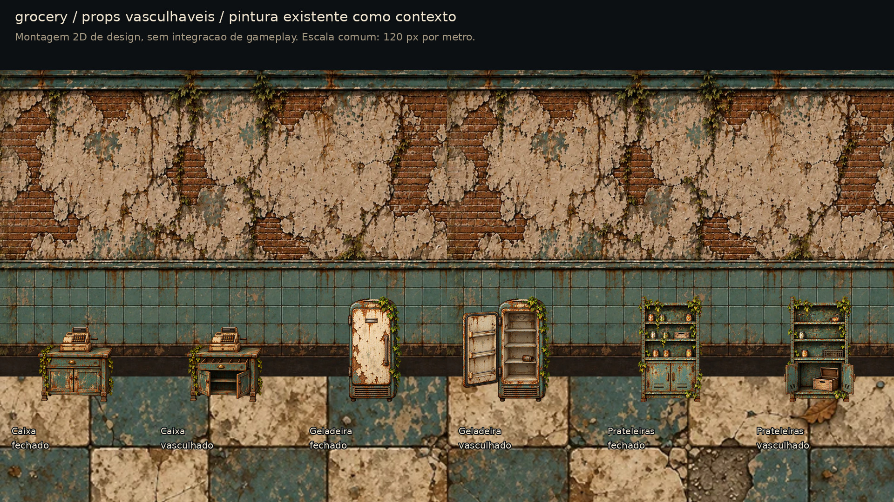

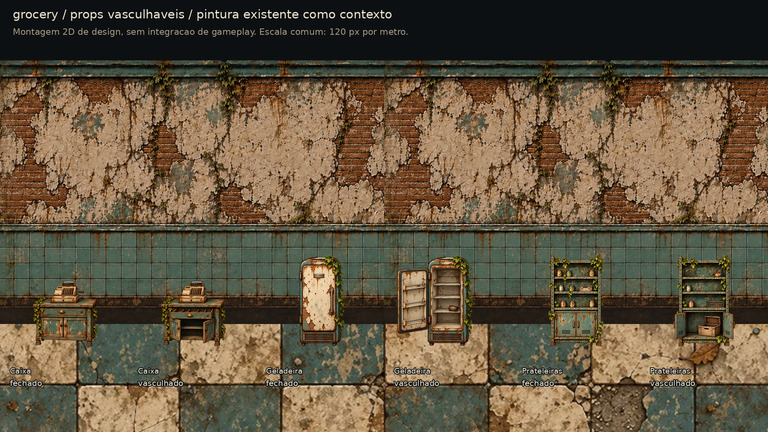

[Mesma prova em cinza a 40%](street_props_grocery_gray_40.jpg).

### Oficina

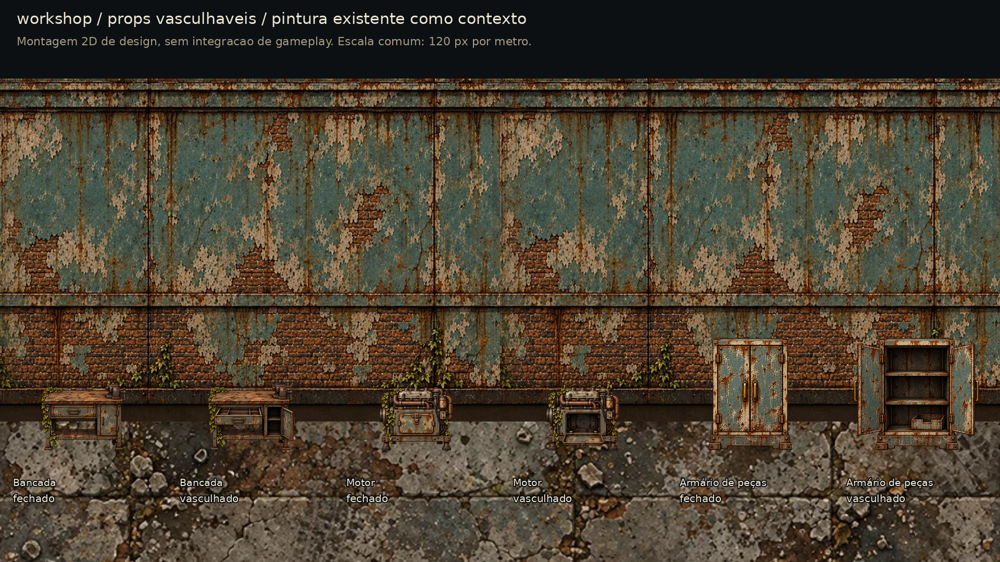

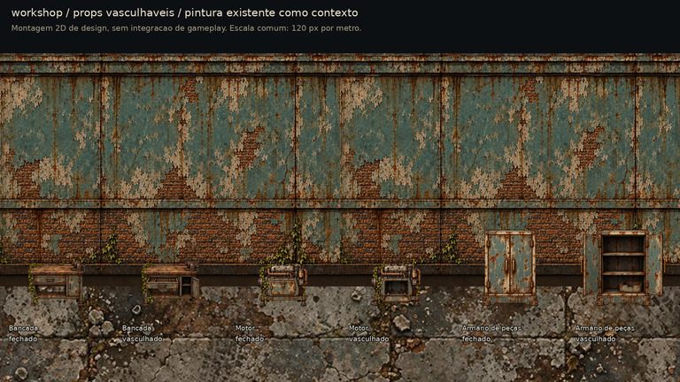

[Mesma prova em cinza a 40%](street_props_workshop_gray_40.jpg).

### Cinema

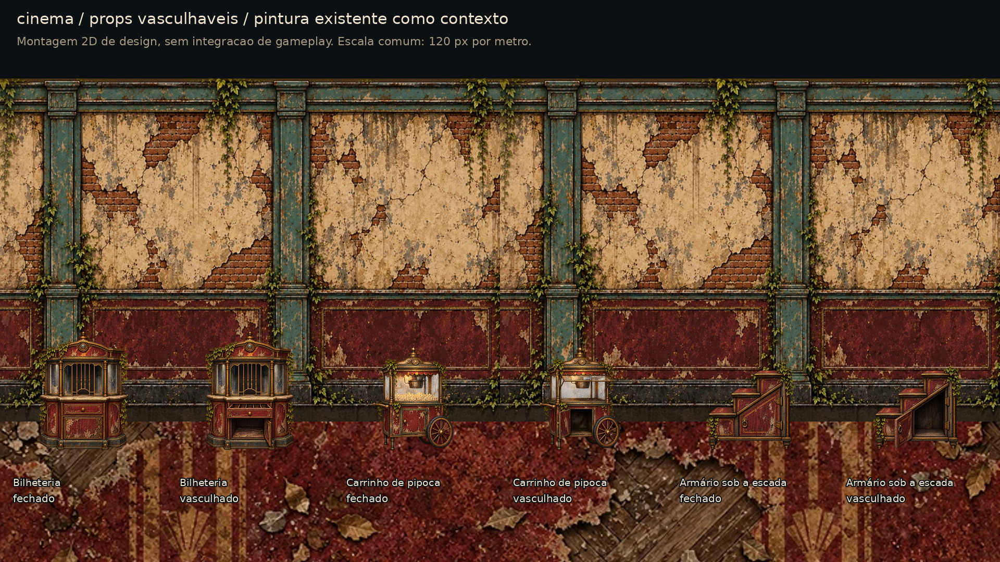

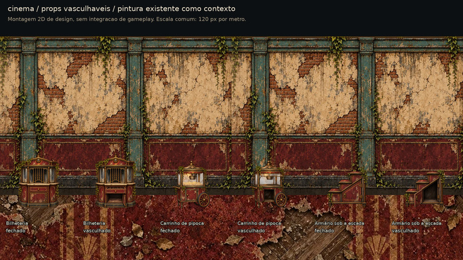

[Mesma prova em cinza a 40%](street_props_cinema_gray_40.jpg).

### Rua

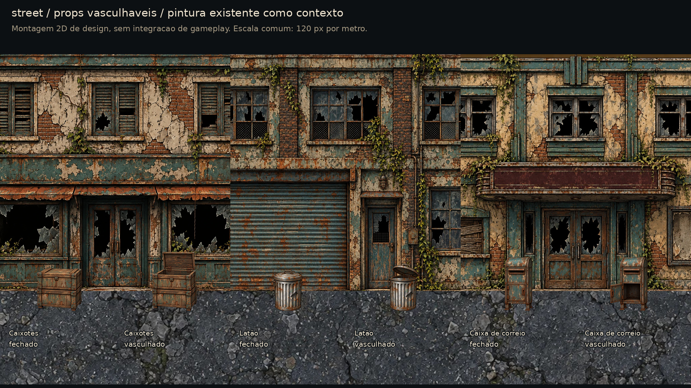

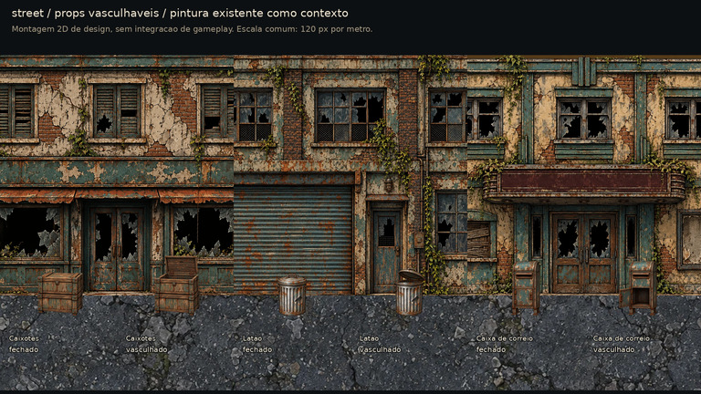

[Mesma prova em cinza a 40%](street_props_street_gray_40.jpg).

## Contrato de imagem e medidas

Origem `(0,0)` no canto superior esquerdo. **Âncora comum de chão: `(512, 960)` em ambos os estados de todos os props.** Tela inteira 1024², sem atlas, sem 9-slice e sem recortar pela transparência na importação. Margens de 9-slice: não se aplica. Área de conteúdo = silhueta de cada estado, especificada nos bounds abaixo; o restante é transparente.

A altura de referência é a distância entre a âncora e o topo **fechado**. Usar essa referência também no aberto: a tampa levantada pode aumentar o envelope, mas o corpo não encolhe nem cresce. Escala sugerida: `cm_por_pixel = altura_cm / altura_referencia_px`. Portanto, a altura do quad completo em metros é `10,24 × cm_por_pixel`; não é a altura física fechada do objeto. O deslocamento entre centro do quad e origem é `(0, (960−512) × cm_por_pixel / 100)` no eixo vertical. Um renderizador com contrato `{canvas, anchor, body_reference_pixels}` pode usar diretamente as medidas abaixo.

A largura sugerida foi derivada da proporção da silhueta fechada, para evitar esticar a arte; altura inclui a decoração fixa pintada. Profundidade é uma sugestão de volume/collision proxy para revisão do Claude, já que o PNG é um card, não um modelo 3D. Não usar folhas/hera como contorno físico de colisão. O losango sugerido aponta ao centro do topo fechado, **32 px acima dele**, sem ser desenhado na textura; o Claude decide a projeção/visibilidade da UI depois da busca.

| Nome-base dos dois PNGs | L × A × P sugeridos (cm) | Altura de referência (px) | Âncora do losango (px) |
|---|---|---|---|
| `grocery_cash_counter` | 136.5 × 135 × 65 | 645 | 512, 283 |
| `grocery_refrigerator` | 97 × 190 × 70 | 815 | 512, 113 |
| `grocery_shelving` | 115.7 × 190 × 45 | 806 | 512, 122 |
| `workshop_workbench` | 134.6 × 105 × 75 | 536 | 512, 392 |
| `workshop_engine` | 118.4 × 105 × 75 | 635 | 512, 293 |
| `workshop_parts_cabinet` | 133.3 × 180 × 50 | 805 | 512, 123 |
| `cinema_ticket_booth` | 144 × 190 × 65 | 785 | 512, 143 |
| `cinema_popcorn_cart` | 129.1 × 165 × 65 | 735 | 512, 193 |
| `cinema_stair_cabinet` | 142.6 × 135 × 70 | 642 | 512, 286 |
| `street_crates` | 103.8 × 100 × 60 | 575 | 512, 353 |
| `street_trash_can` | 70.3 × 95 × 60 | 635 | 512, 293 |
| `street_mailbox` | 65.6 × 125 × 45 | 735 | 512, 193 |

### Correspondência dos pontos existentes

| Loja (`shop_index`) | Ponto (`spot_index`) e nome atual | Arquivo-base | Fração X / posição relativa à sala |
|---|---|---|---|
| grocery (0) | 0: o caixa | `grocery_cash_counter` | 36% / 540 cm |
| grocery (0) | 1: a geladeira | `grocery_refrigerator` | 56% / 840 cm |
| grocery (0) | 2: as prateleiras | `grocery_shelving` | 74% / 1110 cm |
| workshop (1) | 0: a bancada | `workshop_workbench` | 36% / 540 cm |
| workshop (1) | 1: o motor | `workshop_engine` | 56% / 840 cm |
| workshop (1) | 2: o armário de peças | `workshop_parts_cabinet` | 74% / 1110 cm |
| cinema (2) | 0: a bilheteria | `cinema_ticket_booth` | 36% / 540 cm |
| cinema (2) | 1: o carrinho de pipoca | `cinema_popcorn_cart` | 56% / 840 cm |
| cinema (2) | 2: a escada | `cinema_stair_cabinet` | 74% / 1110 cm |

As posições X são as de `house_room.gd` (sala de 15 m), relativas à origem da sala, não coordenadas globais. Para a rua, os três novos arquivos-base são alternativas visuais para os pontos já existentes; a distribuição e a persistência ficam na #50. Não criar novos ids de loot nem trocar regras de recompensa por causa de um item desenhado.

### Bounds e região de mudança

Bounds `x0,y0,x1,y1` com alfa > 24; direita/base exclusivas. São medidas de conteúdo e **não** instruções para cortar a tela. Retângulo de mudança inclui portas/tampas, interiores e inventário; tudo fora dele é byte a byte igual. Regiões adicionais protegidas (roda) aparecem no [contrato JSON](street_props_contract.json). A faixa `y ≥ 942` é idêntica nos dois estados de todos os pares.

| Base | Fechado | Aberto | Região móvel/de armazenamento |
|---|---|---|---|
| `grocery_cash_counter` | 201, 315, 853, 961 | 201, 315, 853, 961 | 123, 573, 931, 941 |
| `grocery_refrigerator` | 324, 145, 740, 961 | 59, 145, 740, 961 | 0, 259, 715, 896 |
| `grocery_shelving` | 266, 154, 757, 960 | 242, 154, 785, 960 | 0, 299, 1024, 936 |
| `workshop_workbench` | 168, 424, 855, 961 | 168, 424, 876, 961 | 44, 607, 979, 941 |
| `workshop_engine` | 153, 325, 869, 961 | 153, 325, 869, 961 | 268, 548, 776, 941 |
| `workshop_parts_cabinet` | 214, 155, 810, 961 | 60, 155, 957, 961 | 0, 187, 1024, 937 |
| `cinema_ticket_booth` | 216, 175, 811, 961 | 216, 175, 811, 961 | 0, 529, 1024, 941 |
| `cinema_popcorn_cart` | 199, 225, 774, 961 | 199, 225, 774, 961 | 0, 387, 1004, 917 |
| `cinema_stair_cabinet` | 178, 318, 856, 964 | 180, 318, 856, 964 | 0, 492, 1024, 941 |
| `street_crates` | 237, 385, 834, 961 | 237, 169, 834, 961 | 58, 0, 1013, 633 |
| `street_trash_can` | 278, 325, 748, 961 | 278, 233, 757, 961 | 137, 0, 889, 452 |
| `street_mailbox` | 319, 225, 705, 961 | 195, 225, 705, 961 | 0, 461, 782, 858 |

O [contrato JSON](street_props_contract.json) é documentação de design, não tabela de produção nem mudança de ids. Contém nomes, telas, âncoras, alturas, volumes sugeridos e bounds; o Claude adapta o consumidor. Conversão sugerida a WebP em 50% resulta em **512 × 512**: preservar as medidas no espaço original, ou multiplicar **todas** por 0,5 se o consumidor trabalhar no espaço da textura. Nunca misturar os dois contratos nem cortar cada estado separadamente. Usar mipmaps e o filtro dos cards existentes.

## Inspeção por par e leitura

As pranchas individuais usam a mesma tela e escala para fechado/aberto, com a linha de chão indicada. A [prova sobre escuro e creme](street_props_readability.jpg) mantém **108 px de altura fechada**, mesma escala no aberto. [Versão em cinza](street_props_readability_gray.jpg): abertura e ausência de conteúdo não dependem de verde/vermelho. São props de cenário; os testes de ícone tintado a 22/32 px e o mínimo de fonte de UI não se aplicam a uma imagem sem texto.

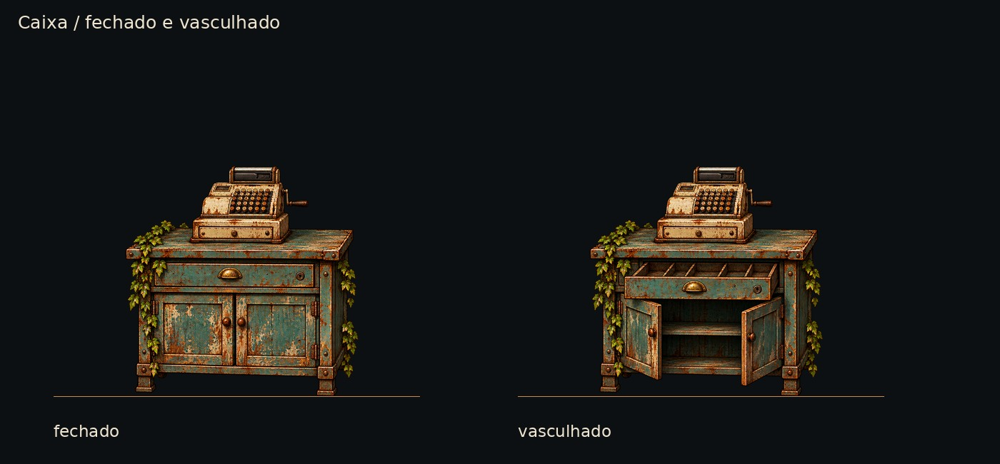

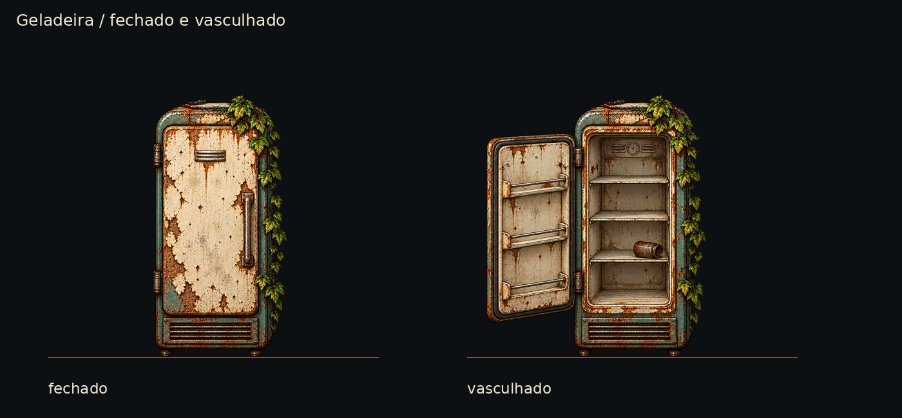

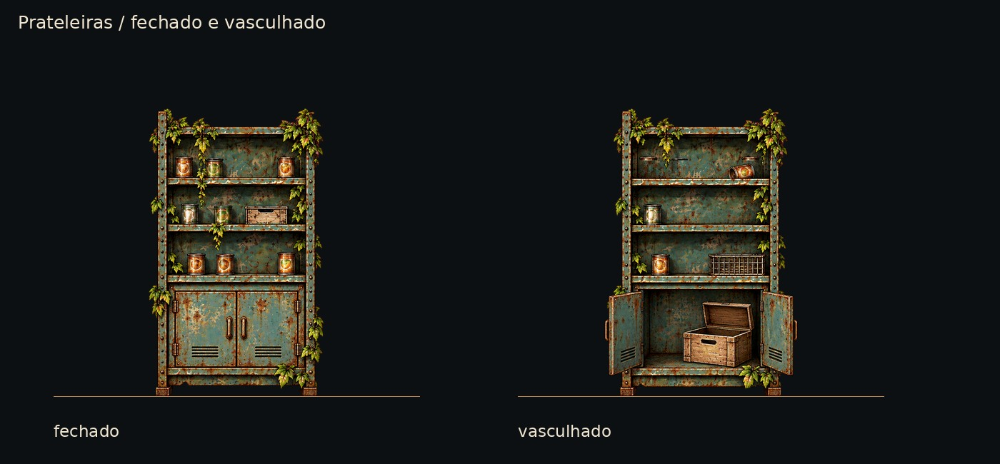

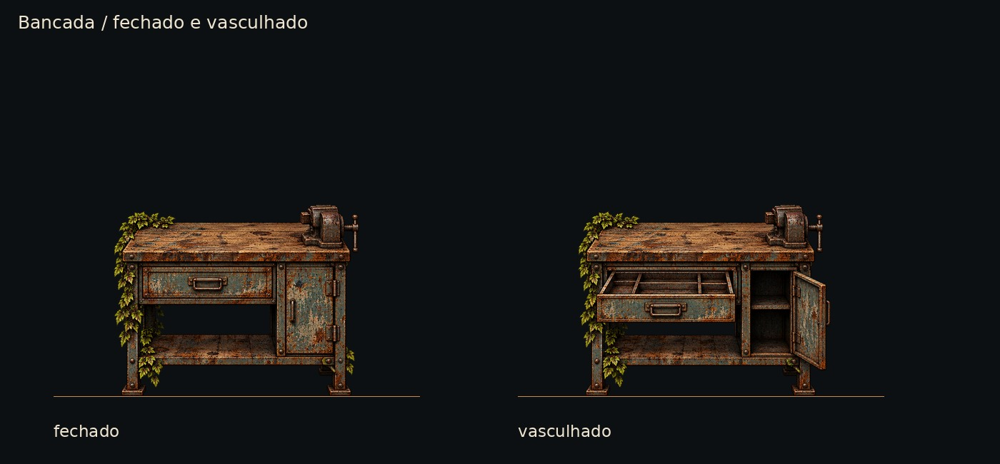

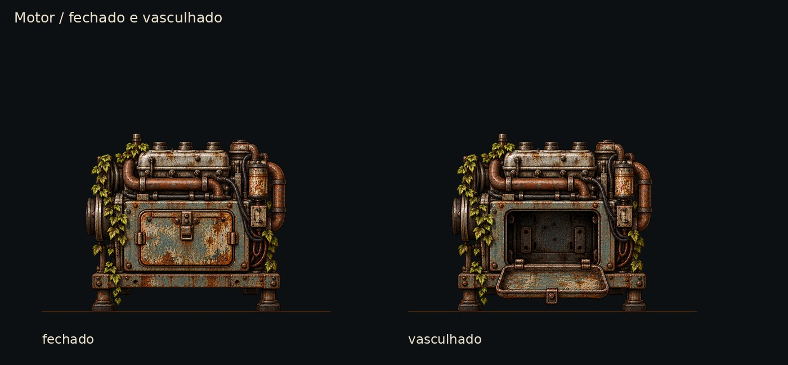

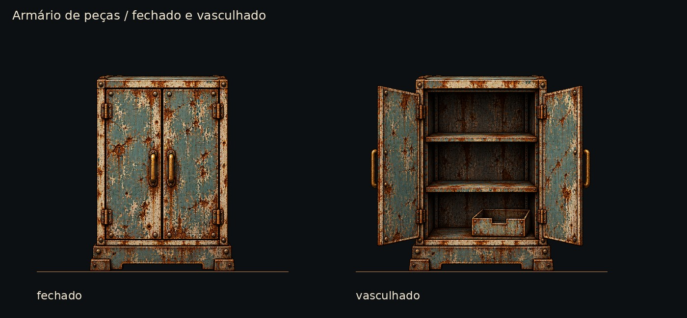

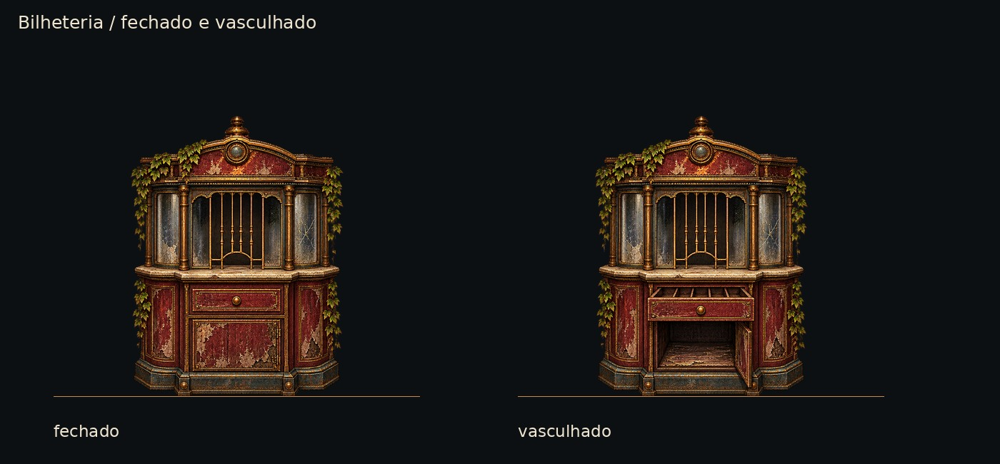

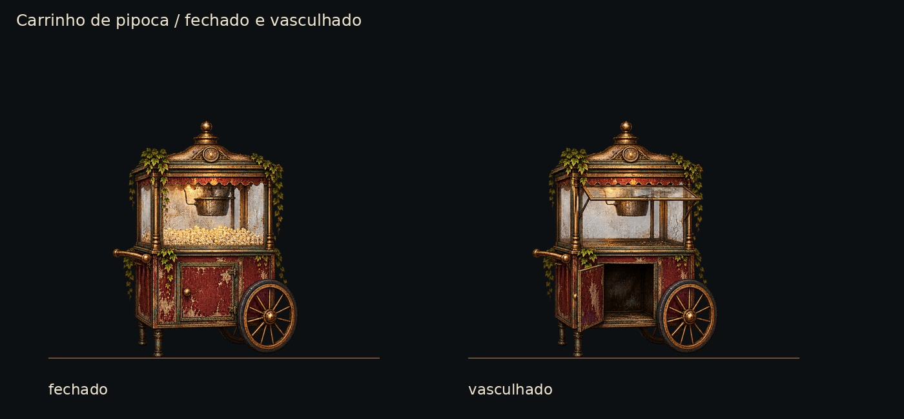

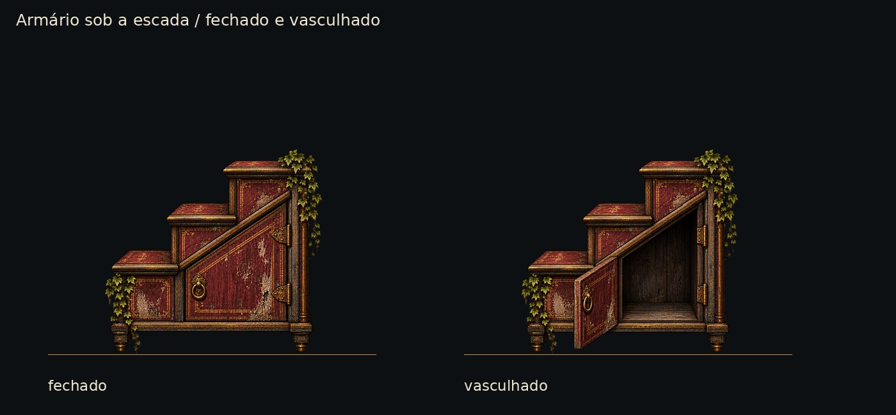

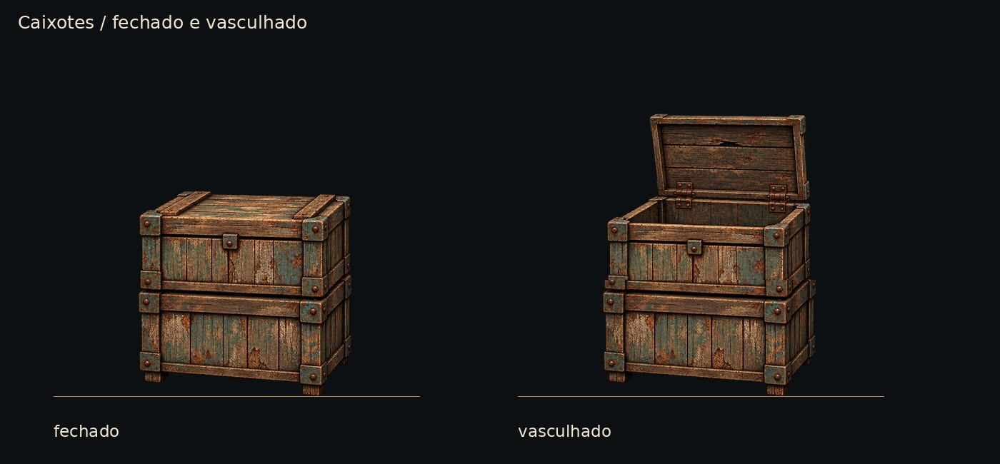

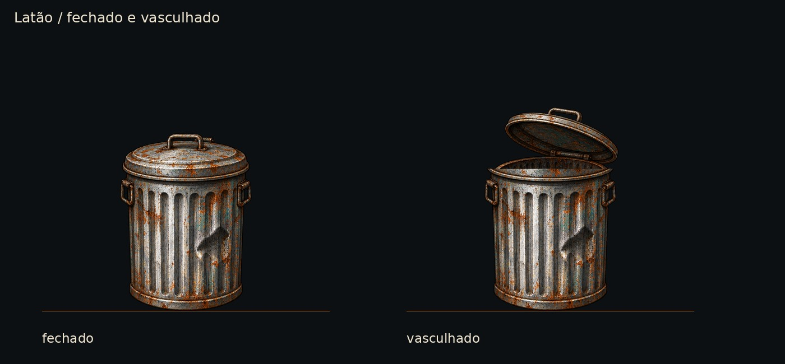

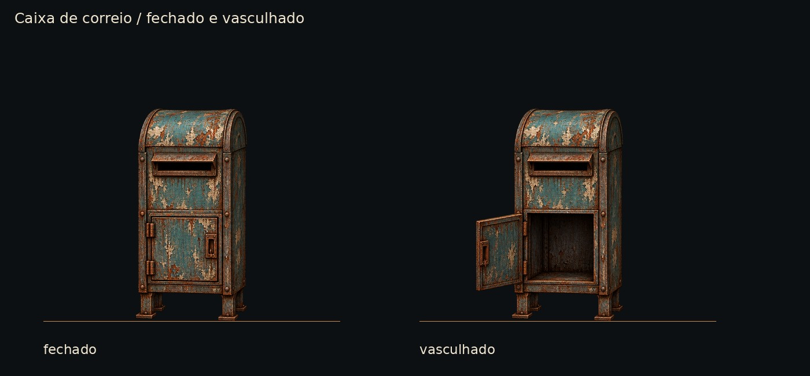

## QA de design

Segunda persona com o checklist de [qa.md](qa.md).

**Rodada 1 — VEREDITO: REPROVADO.**

| Arquivo | Problema | Gravidade | Sugestão/correção |
|---|---|---|---|
| `art/street/source/search_props/workshop_parts_cabinet_open.png` | O limite superior da região móvel cortava o topo das portas abertas, deixando uma faixa horizontal artificial. | Alta | Subir a região até o início real das portas; preservar somente o travessão fixo acima. Região ampliada e PNG/pranchas/contrato refeitos. |

As verificações técnicas de 24 PNGs já passavam, mas a inspeção visual reprovou esse recorte. Durante a preparação também foram corrigidos o limite inclusivo da máscara junto à base e resíduos de cor de matte em pixels quase transparentes; não foram deixados como defeitos de integração.

**Rodada 2 — VEREDITO: APROVADO.** Reinspecionados o armário corrigido, os 12 pares individuais, quatro montagens sobre as pinturas existentes, quatro reduções reais a 40%, suas versões em cinza e a prova sobre escuro/creme. Partes abertas inteiras e presas; estados identificáveis por silhueta, vão e inventário, sem depender de cor. As peças combinam com as pinturas, não contêm texto e mantêm escala/base entre estados.

Verificação repetida: 24/24 PNGs RGBA 1024², alfa 0–255, margens sem corte, RGB zero em pixels transparentes; base `y ≥ 942` e regiões fixas byte a byte idênticas entre fechado/aberto; diferenças confinadas à região de abertura, com roda protegida no carrinho. Âncoras, altura de referência, bounds e volumes sugeridos documentados. Nada alto ou médio pendente nas fontes.

Ícones a 22/32 px, texto de UI, cores semânticas do modo daltonismo e 9-slice: não se aplicam a estes props sem texto. A prova de forma/valor em cinza e a redução a 40% são as verificações pertinentes. Observação baixa: a ornamentação do cinema perde detalhe na redução, mas as portas/gavetas continuam distinguíveis; não usar os ornamentos como sinal de interação. A QA da #50 continua necessária dentro do jogo.

## Validação e limites

- **Base `7270342`, Godot 4.7.2:** `tests/run_all.gd` com **25/25 testes aprovados**, paridade **48/48**, save e jornada completa; **82966 ms**, saída 0.
- **Captura original da rua a 768 × 432 (40% de 1920 × 1080)**, Compatibility/llvmpipe, campanha e save isolados: **16 capturas**, saída 0. Carro: `PASS reached=26.22 limit=26.22`; fachada: `PASS reached=-3.02 limit=-3.02`. Combate: vitória em 2 rodadas; retorno com quatro heróis; entrada no cinema e busca concluídas. Essa execução valida a base existente, não a integração da arte nova.
- **Erros/avisos da base:** a suíte ainda registra chamadas diferidas de `_restyle` com `Cannot convert argument 1 from Object to Object`, recursos em uso e vazamentos de ObjectDB/RIDs ao encerrar. A captura também registra recursos/texturas/shaders ainda em uso na saída. Os processos retornaram 0; isso **não** é apresentado como log sem erros. Nenhum código foi alterado para ocultá-los.
- Arquivos fontes grandes estão apenas na pasta ignorada pela Godot; prévias e contrato apenas em `docs/design/`, que já tem `.gdignore`. `git diff --check` e os checks de arquivos/medidas passaram. Nenhum teste espelho foi acrescentado ao jogo.

Nenhuma textura que o jogo já usa foi substituída; nenhum arquivo em `scripts/`, `data/` ou `tests/`, nem id, foi alterado. A #50 deve conferir as três lojas e a rua antes/depois, o save/load do estado vasculhado, o losango acima do prop e as colisões/passagens com as portas abertas. A montagem de design e a captura da base **não validam a integração das novas texturas**.
