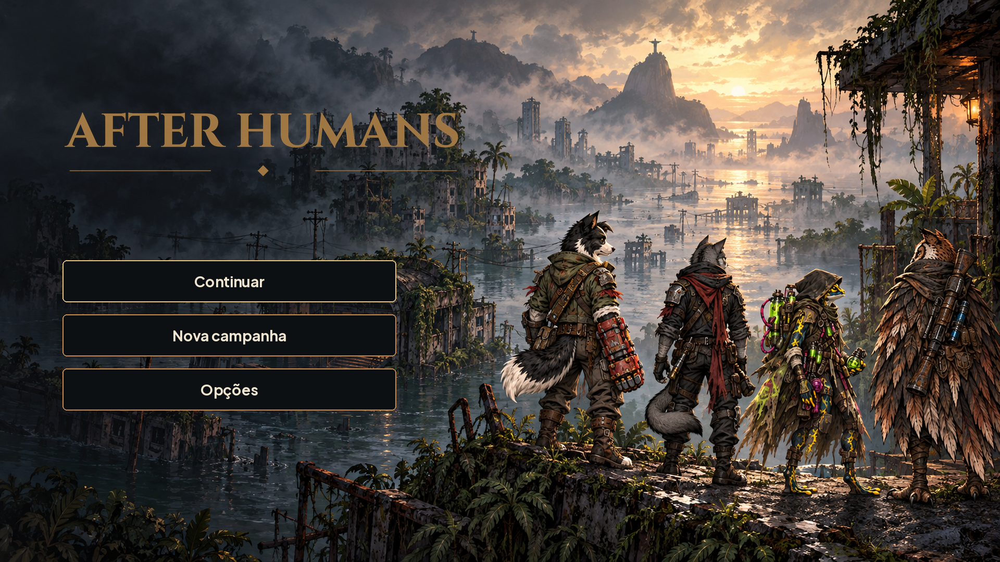
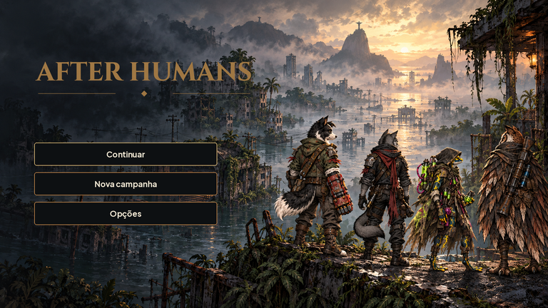

# Título e identidade — #19

## Arquivos e medidas

| Arquivo em art/ui/title/ | Canvas | Âncora / uso |
|---|---|---|
| after_humans_logo.png | 2048×560 RGBA | centro (1024,280); largura de uso 880 |
| after_humans_logo_small.png | 640×175 RGBA | centro (320,87,5); largura mínima 320 |
| title_background.png | 1920×1080 RGB | topo esquerdo (0,0), sem 9-slice |
| title_background_portrait.png | 1080×1920 RGB | versão alternativa de composição, ilustração inteira entre y600 e1208 |
| app_icon.png | 1024×1024 RGBA | centro (512,512); conferir a48 px |
| splash.png | 1920×1080 RGB | logo centrado, fundo #0d1012 |

Logo em Cinzel já licenciada no repositório, com cobre envelhecido da textura green_metal_rust. A assinatura textual é a exceção explícita da issue à regra de arte sem texto. Símbolo do app: trilho circular interrompido por uma raiz; não depende de letra nem cor de estado.

Na tela 1920×1080: logo (65,160), caixa880×241; botões (120,500/604/708), 640×80, intervalo24; rótulos Plus Jakarta Sans28. Margem segura64. Principal com filete dourado; demais cobre. Fundo é pintura nova usando os quatro idles atuais como referência; mantém o lado esquerdo escuro, sem letras embutidas.

No retrato: preservar a ilustração inteira, logo em (80,190), largura920; botões em (120,1320/1440/1560),840×96; mínimo de texto28. As faixas escuras são deliberadas, não uma nova pintura vertical. Nenhum botão vem gravado no fundo.

## QA de design

Rodada1 — VEREDITO: REPROVADO. Baixa: RGB oculto do logo mantinha textura fora do alfa, com risco de franja no filtro. Sugestão: zerar pixels totalmente transparentes. Correção aplicada.

Rodada2 — VEREDITO: APROVADO. Logo e tamanhos conferidos; fundo inspecionado lado a lado com Bento/Nick/Íris/Véspera; espaços de UI livres, PNG com alfa, paleta e fontes compatíveis. Sem problemas altos/médios. Observação baixa: versão vertical é composição com faixas, não ilustração vertical exclusiva. Aprovação visual final do Lucas e integração #16 pendentes.
