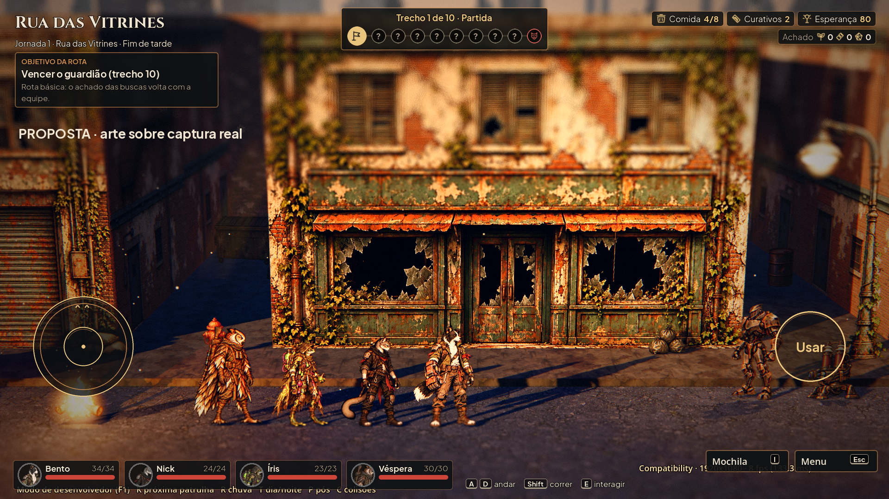
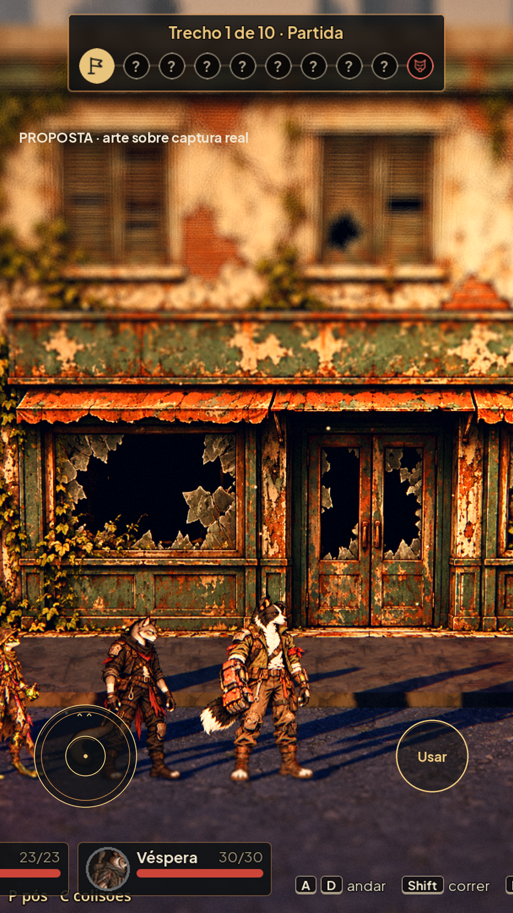

# Controles de toque — #23

PNG RGBA em art/ui/touch/, sem texto. Cada peça tem uma versão base e outra com sufixo _2x. Mesma linguagem de cobre escuro e metal discreto das molduras. O jogo continua escrevendo Usar/andar/correr; o rótulo da prévia é anotação.

| Peça | Base | 2x | Âncora central |
|---|---|---|---|
| stick_base_normal/active |220×220|440×440|(110,110)/(220,220)|
| stick_knob_normal/active |88×88|176×176|(44,44)/(88,88)|
| stick_run_mark |220×220|440×440|(110,110)/(220,220)|
| use_inactive/ready/pressed |156×156|312×312|(78,78)/(156,156)|

Sem9-slice. Base raio110, knob44, marca de correr93,5(85% do raio); Usar raio78. O limiar e as áreas de toque permanecem os existentes, inclusive fator1,15 do botão Usar. PNG2x desenhado com traço2× e reduzido com alfa; sem fundo ou franjas. Centro transparente nas bases permite ver a exploração. Ativo usa contorno dourado; pressionado acrescenta segundo anel, não depende só de cor.

Prévia sobre touch_capture.png, captura real da Rua das Vitrines em Godot4.7.2 Compatibility/llvmpipe, campanha isolada em /workspace/scratch/street-qa; nenhum save do jogador usado. A composição em pé recorta o centro da captura para simular o viewport: não é implementação do reflow.

Para a integração: em1080p usar centros originais(230,800)/(1790,800). Na prévia o controle fica a180/170px das bordas e330px do fundo para tornar visível a comparação. Em retrato, preservar pelo menos96px de margem segura, evitar HUD e exibir somente durante exploração. Texturas não alteram as zonas de input.

## QA de design

Rodada1 — VEREDITO: APROVADO. Conferidos16PNG, canvases, alfa, âncoras, marca85%, estados por duplo anel e prévias em duas orientações sobre captura real. Sem problemas altos/médios. Observação baixa: ajustes de safe area e HUD no retrato requerem validação do Claude em dispositivo; a proposta não declara esse layout implementado.
