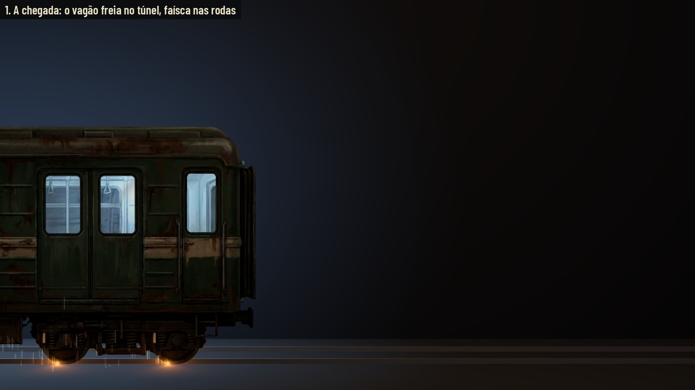
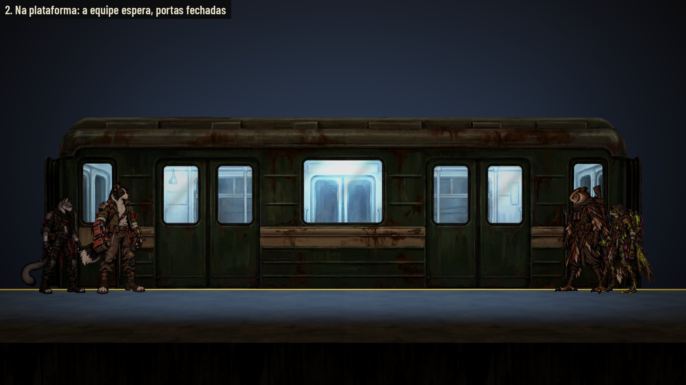
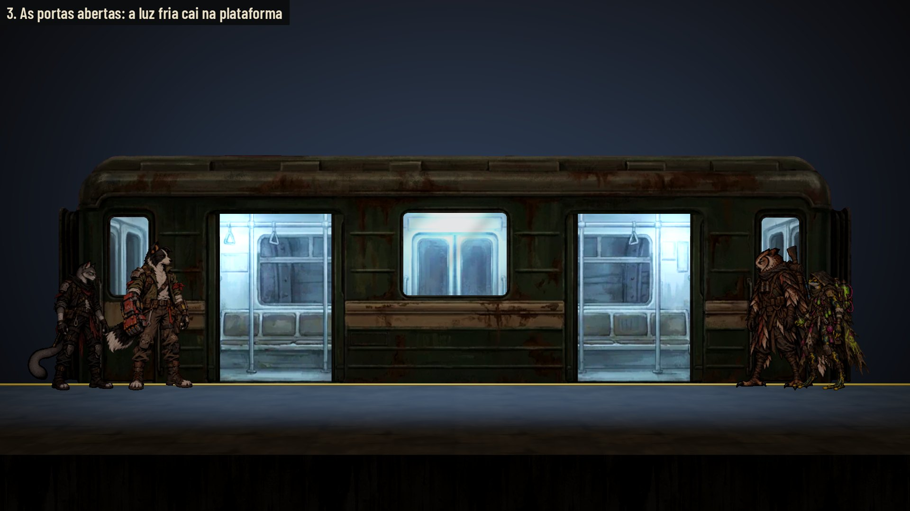
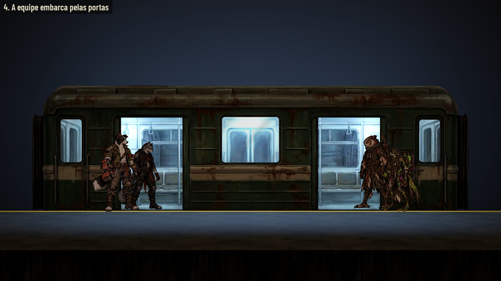
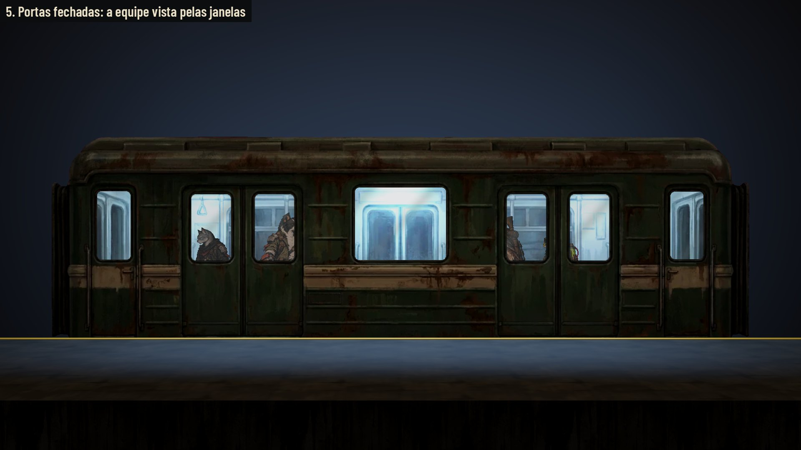
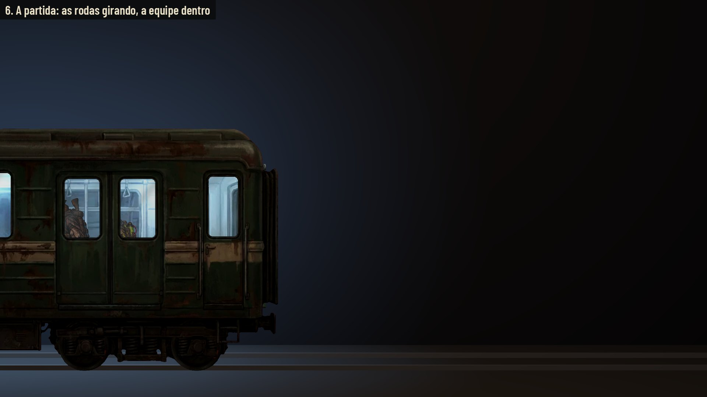
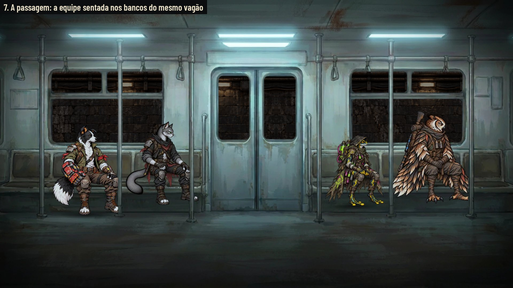
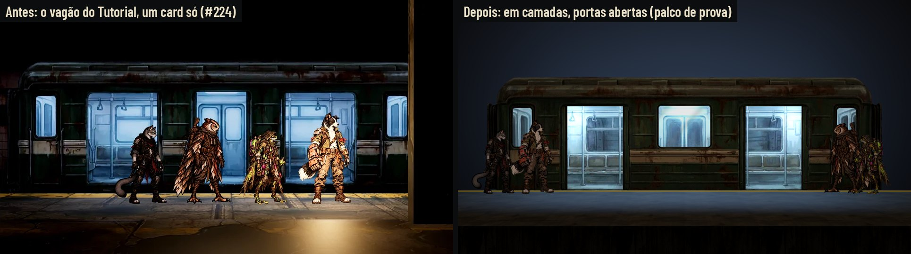
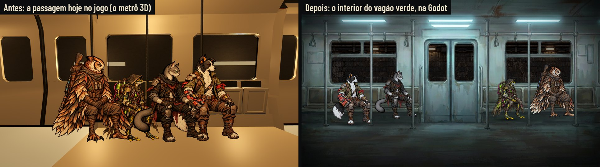
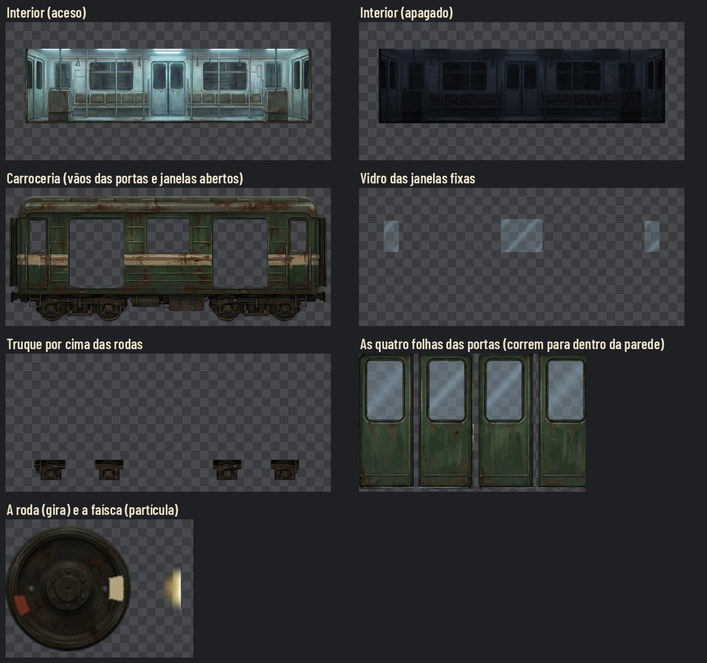

# O trem 2D — #149

O vagão verde do Tutorial em camadas, com profundidade: a equipe entra pelas portas, aparece pelas janelas, as portas
abrem e fecham, as rodas giram na partida e soltam faísca na freada. A cena de passagem é o interior do **mesmo** vagão.
Empilhado no #224 (é dele o vagão do Tutorial, `T_TU10`).

**Decisões do Lucas (29/10):**
- Sem estação no começo e no fim de cada mapa: o foco é só o vagão 2D.
- O trem oficial é o **verde do Tutorial**. O jogo tinha três trens que não combinavam (o metrô vermelho 3D da Estação
  Raiz, o vagão verde do Tutorial e o interior bege da passagem do #79); este vira o trem dos três lugares.
- As rodas aparecem na partida e na chegada, vistas do túnel. Na plataforma, o piso cobre as rodas, como no Tutorial.
- Na passagem, a equipe senta nos bancos presos à parede do vagão, e não num banco solto na frente.















As fotos 1 a 6 saem do motor (Godot 4.7.2, Compatibility, sem placa de vídeo) num **palco de prova**: a plataforma, a
parede e os trilhos são provisórios, e a equipe desliza com a pose de pé. O vagão, as camadas, a profundidade, as portas,
as rodas e a faísca são os do contrato. A 7 é a passagem montada pelo contrato, também na Godot. O movimento (as portas,
o giro das rodas, a faísca, o túnel correndo) está nos dois vídeos da prova, gravados quadro a quadro pelo mesmo script
e anexados no PR (fora do Git, pela leveza): a sequência do vagão, com 14 s, e a passagem, com 4 s.

## Antes e depois





Em cima, à esquerda, a captura do #224 no mapa do Tutorial (a equipe na porta aberta); à direita, o mesmo momento
(portas abertas, a equipe na plataforma) no palco de prova. A câmera e o fundo não são os do mapa: o lado a lado no mapa,
na câmera da exploração, fica para a integração. Embaixo, à esquerda, a passagem de hoje no jogo (`AHWagonRide`, o
metrô 3D da Estação), e à direita a passagem pintada.

## As camadas do vagão



Tudo em `art/train/`, num quadro só de **1280 × 543 px** (128 px/m: o vagão tem 10 × 4,24 m), origem no canto de cima à
esquerda. O trilho fica em y = 524,4 e o chão do vagão em y = 386,3 (1,08 m acima do trilho, a altura da plataforma).
Os números exatos estão em [trem-2d/contract.json](trem-2d/contract.json); os retângulos são [x0, y0, x1, y1] com o fim exclusivo.

| Camada | Arquivo | Profundidade (m) | O que é |
|---|---|---|---|
| Interior | `T_TR_Interior.webp` / `T_TR_Interior_Off.webp` | −0,9 | O fundo do vagão (bancos, janelas do outro lado, barras), aceso (frio) ou apagado. Só a parte de dentro; o resto é transparente |
| A equipe dentro | as poses de pé de sempre | −0,45 | Entre o interior e a carroceria: aparece pelas janelas e pelas portas abertas |
| Folhas das portas | `T_TR_Door_AL/AR/BL/BR.webp` | −0,03 | Quatro folhas, com o vidro já tingido, em mistura alfa. Atrás da carroceria: abrindo, correm para dentro da parede |
| Carroceria | `T_TR_Body.webp` | 0 | A lataria, com os vãos das portas e o vidro das janelas fixas abertos |
| Vidro | `T_TR_Glass.webp` | +0,01 | O reflexo das janelas fixas, em mistura alfa |
| Rodas | `T_TR_Wheel.webp` (104 px) | +0,02 | A mesma roda nos quatro centros do contrato |
| Truque | `T_TR_Bogie.webp` | +0,03 | O quadro do truque, as molas e as caixas de eixo, por cima das rodas |
| Faísca | `T_TR_Spark.webp` | — | A textura da partícula (16 × 64, a cabeça em cima, mistura aditiva) |

- **O interior** fica 0,9 m atrás e por isso aparece **maior na mesma proporção da distância** (×1,047 com a câmera da
  exploração a 19 m), centrado na câmera, para casar com as janelas visto de frente. Com o vagão andando, ele desliza
  um pouco atrás das janelas: é a profundidade. Não passe de 0,9 m: as janelas das pontas mostrariam a borda do interior.
- **As portas:** quatro folhas em **mistura alfa** (o vidro delas é semitransparente), atrás da carroceria. Cada folha
  tem 4 px de sobra para fora (em cima, embaixo e na borda de fora), escondidos sob o batente: fechada, não abre fresta.
  Abrindo, corre `open_offset_x` (−90/+88/−91/+88 px) em 0,8 s, ease in-out, e para antes da janela vizinha; uns 17 px da
  folha ficam à vista no vão aberto, como a borda da porta.
- **As rodas:** giram pelo que o vagão andou: ângulo = −distância / raio (raio 52 px = 0,406 m). Paradas, ficam paradas.
  O truque cobre o cubo; o giro se lê pela faixa de tinta clara, pela mancha de ferrugem e pelos furos no disco de fora.
- **A faísca:** na freada, da metade da velocidade até parar, no contato de cada roda com o trilho, para trás do
  movimento e subindo, 46 partículas por roda, vida 0,32 s, gravidade normal, mais uma luz laranja curta no trilho. Em
  `Reduzir efeitos`, sem faísca e sem a luz.
- **Aceso e apagado:** aceso, o interior emite (0,55) e três luzes frias (0,62; 0,8; 1,0) a 3 m de altura pintam a
  plataforma pelas portas. O apagado é para o vagão parado e abandonado (o Tutorial pode usar os dois).
- **Ordem de desenho:** interior → equipe dentro → folhas → carroceria → vidro → rodas → truque → faísca.

## A passagem

Mesmo contrato da #79 (`docs/design/departure/contract.json`), com o interior novo. Quadro 1920 × 1080, origem no canto
de cima à esquerda.

| Camada | Arquivo | Posição | Uso |
|---|---|---|---|
| Túnel | `art/transitions/train/tunnel_loop.webp` | (0, 262), escala 1,1 | Atrás de tudo, repetido em X, a 96 px/s; modulado em (0,55; 0,6; 0,68) para casar com a luz fria do vagão |
| Fundo | `art/transitions/train/carriage_background.webp` | (0, 0) | A parede, os bancos presos a ela, o chão; os oito vidros (as duas janelas e as duas da porta do fundo) com alfa 0 |
| Sombras | — | sob o quadril e o pé | Uma sombra suave de contato no assento e, quando o pé alcança o chão, no chão (largura 520 px × a escala) |
| A equipe | `art/station/poses/*_seat.webp` | ver os lugares | Sentada nos bancos, modulada em (0,84; 0,92; 1,0) |
| Barras | `art/transitions/train/carriage_poles.webp` | (0, 0) | As seis barras do corredor, **na frente** de quem está sentado |

`carriage_bench.webp` (o banco solto do #79) sai: os bancos agora são da parede.

**Os lugares** (o quadril no assento, 275 px/m, as alturas de `station_poses.json`): quatro vãos entre as barras, em
x = 305, 585, 1327 e 1611, com o assento em y = 692. O contrato traz, para cada um, a escala, o canto de cima do sprite e
onde cai o pé. Como no #79, os pés dos menores (o Nick e a Íris) ficam um pouco no ar: o banco é alto e não se estica a
perna. Mostrar só quem está na equipe.

## Para a integração (Claude)

1. **Tutorial (#147):** trocar o card `T_TU10` pelas camadas, no mesmo lugar do fosso (o chão do vagão na altura da
   plataforma). O embarque passa a ser a equipe entrando pela porta da direita, com as portas fechando depois.
2. **Passagem (`AHWagonRide`):** trocar o metrô 3D pela cena pintada do contrato. A partida e a chegada no túnel (com as
   rodas e a faísca) entram antes e depois do cartão, nos sons que já existem (`train_departure`, `train_brake`).
3. **A Estação Raiz:** o metrô vermelho 3D (`art/station/metro`) ainda é outro trem. Fica para o Lucas decidir se a
   plataforma da Estação ganha o vagão 2D também.

Para gravar a prova de novo:

```
xvfb-run -n 94 -s "-screen 0 1920x1080x24" "$GODOT" --path . --rendering-driver opengl3 --resolution 1920x1080 \
  -s res://docs/design/trem-2d/capture_train.gd -- --out=<pasta> [--stills] [--passage]
```

## Não verificado

- **Forward+:** as capturas são do Compatibility, sem placa de vídeo. A luz fria na plataforma e o brilho da faísca
  podem mudar no Forward+.
- **No mapa do Tutorial:** a prova é num palco próprio; o vagão no mapa de verdade, na câmera da exploração, é da
  integração.
- **Altura na janela:** quem é baixo (a Íris, 1,38 m) aparece só da cabeça para cima pelas janelas, que são altas.
- **Recrutas na passagem:** os lugares foram medidos com os fundadores; os recrutas sem pose sentada seguem a regra da #79.

## Origens

As pinturas de origem (o vagão fechado, o corte do interior, a roda e o interior da passagem) e os scripts que cortam as
camadas ficam fora do Git, no projeto da Awesomic (`images/trem-2d/`).

## Rodadas da QA de design

- **Rodada 1, REPROVADO.** Alta: abertas, as folhas apareciam nas janelas vizinhas (a parede entre a janela e a porta é
  mais estreita que a folha). Médias: uma fresta clara em volta das portas fechadas (a perspectiva abria 1 px entre a
  folha e o vão); o giro das rodas quase não se lia (o truque cobre o cubo); o antes e depois do vagão não era o mesmo
  momento. Baixas: a contagem das fotos e os vídeos na página, o vidro das folhas sumindo no corte de alfa, os arquivos
  da #79 ainda citando o banco, a convenção dos retângulos, o trilho da frente do palco e as sombras de contato na
  passagem. **Correções:** o curso de cada folha para antes da janela vizinha (a do meio também); as folhas recortadas
  de novo com 4 px de sobra sob o batente; uma faixa de tinta, uma mancha de ferrugem e dois furos no disco de fora da
  roda; o depois no mesmo momento (portas abertas); as folhas em mistura alfa; `superseded_by` nos JSON da #79; o fim
  exclusivo escrito no contrato; o trilho em z −0,06; as sombras de contato na passagem.
- **Rodada 2, APROVADO.** Ficaram observações baixas: as folhas de dentro param a 1 px da janela do meio (folga
  pequena, se a integração mudar a escala ou o filtro); a faixa de tinta da roda é limpa demais perto do resto; as
  sombras de contato da passagem quase não aparecem (opacidade da integração).

