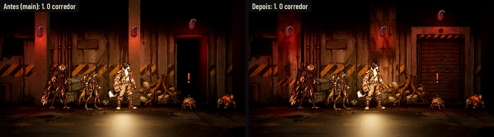
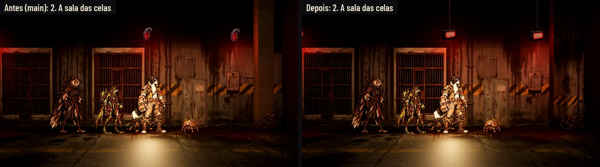
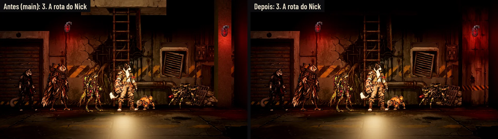
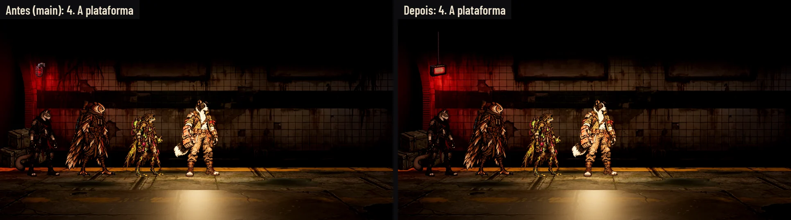
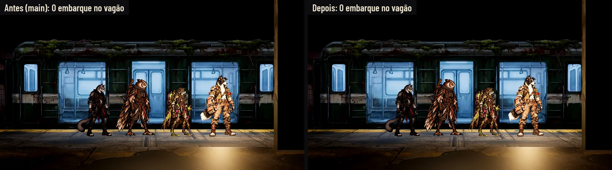
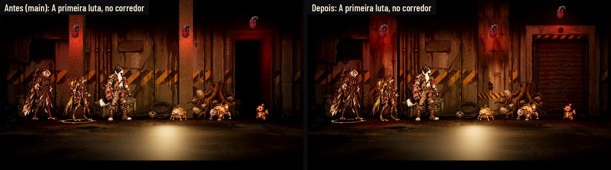
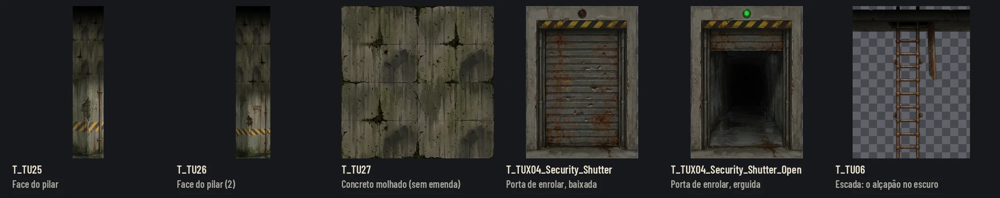
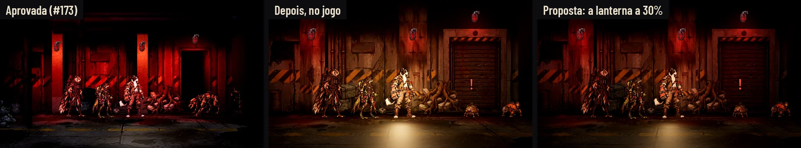
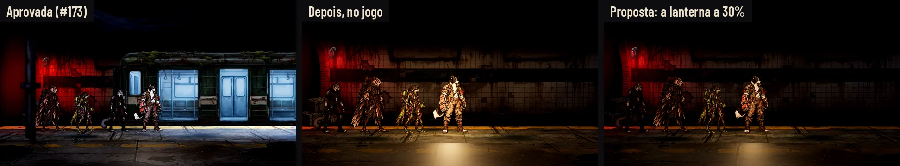
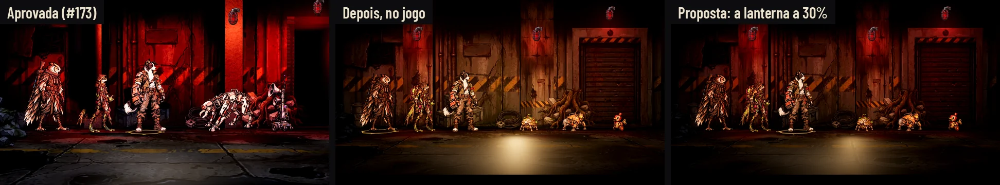

# O acabamento do Corredor de Contenção no jogo (#147, 28/10/2026)

O mapa do tutorial já está no jogo desde 27/10: a planta e as camadas pintadas do PR #173 (o corredor, a sala com
grades, o duto do Nick e a plataforma com o trem, a porta, o armário, o painel e as lâmpadas), com a camada de jogo do
Claude 2 por cima (`tools/build_containment_corridor.py`, commit 842a668). Esta entrega é o acabamento do que ainda
destoava **dentro do jogo**, com o antes e o depois tirados da Godot:
- **o concreto emprestado do Abrigo Lacrado** (`T_SH_rough_concrete`) nos pilares, nos recuos atrás das aberturas, nos
  blocos das pontas das zonas e no fosso: agora é pintura do lugar;
- **uma porta de segurança só**: agora são duas; a passagem do corredor ganhou a porta de enrolar baixada;
- **o alçapão da escada** (rota do Nick), uma laje clara boiando no escuro do teto;
- **a luz**: no jogo o mapa ficou mais quente e menos vermelho que nas capturas aprovadas. A causa é do código: a
  lanterna de mão do líder, que o jogo acende no Corredor (as capturas do #173 não a tinham). A proposta para o Claude
  (a lanterna a 30% no Corredor) vai com a captura e os números; do lado da arte, as lâmpadas sobem 30%.

Nada em `scripts/` nem `tests/`. **Exceção registrada:** em `data/`, só `data/scenarios/ContainmentCorridor.json`,
**gerado** pelo `python tools/build_containment_corridor.py` a partir do mapa de `docs/design/tutorial/map/`, sem
edição à mão (o caminho que o Claude 2 deixou para a arte entrar no comentário da #147: "é só rodar o script de novo").
Sem ele, a arte nova não aparece no jogo e não haveria o depois tirado de dentro do jogo. Se o Lucas preferir, o
Claude regenera o arquivo na integração e este PR o tira.

## Antes e depois, os dois dentro do jogo

O antes é a `main` de hoje; o depois, esta branch. A mesma ferramenta fotografa os dois
([capture_game.gd](tutorial-acabamento/capture_game.gd)): a jornada do tutorial de verdade (a campanha nova,
`AHTutorial.begin`, a cena da rua com `data/scenarios/ContainmentCorridor.json`), de noite como a fase, na câmera da
exploração, com a equipe da abertura no mesmo ponto de cada zona (o Bento, a Íris e a Véspera; da rota do Nick em
diante, o Nick também). As lâmpadas ficam paradas acesas nas fotos (o pisca pegaria cada foto numa fase diferente).

| Prova | Antes e depois | O depois inteiro (1920 × 1080) |
|---|---|---|
| 1. O corredor | [comparar](tutorial-acabamento/before_after_corridor.webp) | [corridor](tutorial-acabamento/corridor.webp) |
| 2. A sala das celas | [comparar](tutorial-acabamento/before_after_cells.webp) | [cells](tutorial-acabamento/cells.webp) |
| 3. A rota do Nick | [comparar](tutorial-acabamento/before_after_nick_route.webp) | [nick_route](tutorial-acabamento/nick_route.webp) |
| 4. A plataforma | [comparar](tutorial-acabamento/before_after_platform.webp) | [platform](tutorial-acabamento/platform.webp) |
| O embarque | [comparar](tutorial-acabamento/before_after_platform_exit.webp) | [platform_exit](tutorial-acabamento/platform_exit.webp) |
| A primeira luta | [comparar](tutorial-acabamento/before_after_fight.webp) | [fight](tutorial-acabamento/fight.webp) |

**O que muda em cada uma:**
- **O corredor:** os dois pilares deixam de ser caixas lisas do concreto do Abrigo e ganham a face pintada (a faixa de
  perigo na altura do joelho, a linha d'água no pé, o eletroduto, o vergalhão à mostra), com a lâmpada vermelha neles;
  o segundo é a outra pintura, espelhada, para os vizinhos não repetirem.
  A passagem do lado, que era um vão preto, está fechada pela porta de enrolar baixada: a contenção fechou as rotas.
- **As celas:** o fundo das celas é o concreto molhado do lugar; o pilar do fim da zona tem a face pintada (fica no
  escuro entre a lâmpada do painel e a ponta da zona).
- **A rota do Nick:** a laje do alçapão some no escuro do teto, como o alto das paredes; o pilar da direita tem a face
  pintada.
- **A plataforma e o embarque:** a beira e o fundo do fosso e os blocos das pontas usam o concreto do lugar (quase
  tudo atrás do vagão; a diferença aparece pouco).
- **A luz, em todas:** as lâmpadas vermelhas sobem 30% (`RED_BOOST` em build_map.py), porque as faces pintadas dos
  pilares são mais escuras que o concreto liso de antes. Isso sozinho não traz o vermelho de volta: com a lanterna do
  líder acesa como hoje, o quadro continua pardo (veja "Para integrar", 1, com as medidas).

**As capturas são da Godot sem placa de vídeo:** a máquina da Awesomic não tem GPU. O jogo roda no Compatibility
(OpenGL 3 por software, em Xvfb) a 1920 × 1080. O Alto, o Ultra e o Baixo numa máquina com placa de vídeo ficam com o
Orquestrador PC.

## A arte nova

Em `art/scenarios/`, no contrato do mapa (`docs/design/tutorial.md`, "A arte"): WebP qualidade 88, até 1024 px no lado
maior. As imagens brutas ficam fora do Git, em `images/tutorial/v4/` do projeto na Awesomic (Nano Banana Pro, com a
parede do corredor e a porta de hoje como referência). A pintura nova puxa para a cor da parede do corredor (a média e
o contraste de cada canal), para não destoar em verde.

| Arquivo | Medida no mapa (m) | px | Uso |
|---|---|---|---|
| `T_TU25` | 0,9 × 4,44 | 208 × 1024 | A face do pilar (o corredor, a primeira; as celas), opaca. A pintura vai até 2,85 m; acima, o concreto do lugar, indo para o preto |
| `T_TU26` | 1,0 × 4,44 | 231 × 1024 | A face do outro pilar (o corredor, o segundo; a rota do Nick), para os vizinhos não repetirem. A pintura vai até 2,2 m |
| `T_TU27` | placas de 2,4 m | 1024 × 1024 | O concreto molhado, sem emenda (a superfície projetada pelo mundo): os recuos, os lados dos pilares, os blocos das pontas, a beira e o fundo do fosso. Entra no lugar do `T_SH_rough_concrete` do Abrigo |
| `T_TUX04_Security_Shutter` (+ `_Open`) | 2,39 × 3,24 | 756 × 1024 | A porta de enrolar da passagem do corredor: baixada, ou erguida com a luz verde. O par tem o mesmo quadro, como os outros interativos |
| `T_TU06` | 3,32 × 4,32 | 788 × 1024 | A escada da rota do Nick, refeita da mesma imagem com o alçapão do alto indo para o preto |

**No mapa** ([build_map.py](tutorial/build_map.py)): os pilares têm 0,9 e 1,0 m de largura (eram 0,45 e 0,5), a face
pintada na frente do bloco, a 6 mm dele; cada face tem o material da sua zona (duas faces iguais em zonas diferentes
virariam uma malha só, e o Compatibility corta as luzes além de 8 por objeto: a face ficava apagada). A porta de enrolar
é um interativo novo (`TUX04`) na passagem do corredor; o `build_containment_corridor.py` de hoje não o lê, então ela
fica parada, baixada. [check_map.py](tutorial/check_map.py) passa a comparar o mapa com os mapas de hoje sem o próprio
Corredor (o `data/` dele já é este mapa com a camada de jogo, e as chaves dela davam erro).

## Para integrar (é do Claude, na #147)

1. **A lanterna do líder a 30% no Corredor.** É ela que esquenta o mapa: `street.gd` acende a lanterna de mão do
   Depósito e dos Dutos também no Corredor de Contenção (`_ready`, a linha com
   `["FloodedDepot", "SewerDucts", "ContainmentCorridor"]`: 1,0/0,8/0,55, 160 lm × 3, 10 m, presa ao líder), e a poça
   laranja dela manda na cena, por cima do vermelho das lâmpadas. As capturas aprovadas do #173 não tinham a lanterna
   (a captura punha o mapa no lugar do Abrigo Lacrado, que não a acende). A proposta: no Corredor, a lanterna com 30% da
   energia (o resto igual); a luz de leitura da noite fica como está. Apagada de vez, a lanterna devolvia o vermelho
   inteiro, mas a equipe sumia na plataforma antes de o trem chegar (o quadro caía para 11/3/2). O protótipo é o
   `_proto()` de [capture_game.gd](tutorial-acabamento/capture_game.gd) (`--proto`; `--lantern=` e `--key=` testam
   outras doses).

   
   
   

   Medido (o quadro inteiro, a média de vermelho, verde e azul de 0 a 255, e o vermelho dividido pelo verde; "equipe" é
   o brilho médio da área onde a equipe fica, x 300–1300, y 350–950):

   | Zona | Aprovada (#173) | Antes (main) | Depois (esta arte, com a lanterna) | Proposta (a lanterna a 30%) |
   |---|---|---|---|---|
   | Corredor | 33/7/6, R/G 4,8, equipe 33 | 49/23/10, R/G 2,1, equipe 49 | 52/22/9, R/G 2,3, equipe 50 | 36/10/4, R/G 3,6, equipe 29 |
   | Celas | 31/6/5, R/G 5,0, equipe 25 | 44/21/9, R/G 2,1, equipe 43 | 45/21/10, R/G 2,2, equipe 44 | 30/10/4, R/G 3,0, equipe 25 |
   | Rota do Nick | 29/6/5, R/G 4,8, equipe 21 | 48/23/10, R/G 2,1, equipe 41 | 47/21/9, R/G 2,3, equipe 42 | 31/10/4, R/G 3,2, equipe 23 |
   | Plataforma | 31/28/32, R/G 1,1, equipe 44 (com o vagão parado) | 32/18/8, R/G 1,8, equipe 35 | 32/18/8, R/G 1,8, equipe 35 | 19/8/4, R/G 2,2, equipe 18 |
   | Embarque | — | 40/39/37, R/G 1,0, equipe 68 | 40/39/37, R/G 1,0, equipe 68 | 31/33/34, R/G 0,9, equipe 63 |
   | Primeira luta | 50/16/14, R/G 3,1, equipe 35 | 47/23/10, R/G 2,1, equipe 54 | 49/22/10, R/G 2,3, equipe 54 | 35/11/5, R/G 3,1, equipe 34 |

   Com a lanterna a 30%, a equipe fica no brilho da aprovada (29 contra 33 no corredor, 34 contra 35 na luta) e o
   vermelho volta a mandar (R/G de 2,3 para 3,0–3,6; a aprovada, 4,8, também tinha a névoa baixa daquele protótipo). A
   plataforma escura é o momento antes de o trem chegar: ele entra assim que a equipe pisa nela, e a luz fria do vagão
   clareia o embarque (equipe 63). Testei também sem a lanterna (R/G 5,5 a 6,6, mas a plataforma some) e a lanterna a
   30% com a leitura a 50% (R/G 3,9, a equipe mais escura).

2. **A segunda porta (`TUX04`).** Hoje ela fica baixada e parada. Se o fluxo quiser, ela pode ser a porta que baixa
   quando a equipe passa pelo corredor; o `build_containment_corridor.py` levaria a dela para `security_doors` como leva
   a da rota do Nick. O `_Open` já entra para isso: o material dele está no mapa, mas nenhuma peça o mostra até lá.
3. **A sombra das lâmpadas no Compatibility** (o item 7 de "Para integrar" da página do tutorial) continua de fora: sem
   ela, no modo leve, objetos e inimigos parecem soltos do chão.

## O que fica de fora

- **O fim da plataforma** (o embarque): o lado do bloco da ponta continua uma barra lisa, e a frente dele é preto puro
  ao lado do vagão. Já era assim antes; fica para uma volta na plataforma.
- **O lado dos pilares fica no escuro** (uma faixa estreita entre o pilar e a parede, do lado oposto à lâmpada): lê
  como a sombra do pilar. Se incomodar no jogo, a face pintada pode ganhar um chanfro na borda.
- **O `T_TU27` se repete a cada 1,2 m** (a pintura tem quatro placas iguais em 2 × 2). Hoje ele só aparece no escuro
  dos recuos e nos lados dos pilares, e não se nota; se ganhar luz, pede uma pintura maior.

## Como refazer

Da raiz do repositório:
1. `python3 -B docs/design/tutorial-acabamento/cut_art.py <images/tutorial/v4>`: as texturas novas e a escada.
2. `python3 -B docs/design/tutorial/build_map.py`, `python3 -B docs/design/tutorial/check_map.py` e
   `python tools/build_containment_corridor.py`: o mapa e o `data/` do jogo.
3. A captura (no Linux sem tela, Xvfb), na `main` (o antes) e nesta branch (o depois), cada uma numa pasta:
   `xvfb-run -a -s "-screen 0 1920x1080x24" "$GODOT" --path . --rendering-driver opengl3 --resolution 1920x1080 -s res://docs/design/tutorial-acabamento/capture_game.gd -- --out=<pasta> --zones=0,1 --fight`
   e, com o Nick, `-- --out=<pasta> --zones=2,3 --nick --exit`. A proposta de luz: as mesmas, com `--proto`. Para rodar
   duas ao mesmo tempo, cada uma com o seu `xvfb-run -n <número>`.
4. `python3 -B docs/design/tutorial-acabamento/compose.py <antes> <depois> <proposta>` (cada pasta com as fotos das
   duas rodadas juntas).

## QA de design

### Rodada 1: REPROVADO

**Alta, corrigida:** a luz continuava longe do vermelho aprovado (R/G 2,5 no corredor, contra 4,8 da aprovada), e a
subida de 60% das lâmpadas deixava o quadro mais claro, não mais vermelho. A causa é a lanterna do líder (código): a
proposta passou a ser mexer nela, com o tríptico aprovada | depois | proposta e a tabela medida; as lâmpadas ficaram em
30% a mais.

**Médias, corrigidas:** uma fresta preta ao lado dos pilares (o lado do bloco subiu para tint 0,6); uma emenda dura a
2,2 m na `T_TU26` (a passagem para o concreto virou um degradê de um terço da pintura, e ela sai espelhada); um `.uid`
gerado pela Godot em `tests/` (apagado).

**Baixas, aplicadas:** a lâmpada da porta de enrolar acima do batente (ela tapava o sinal); o `_Open` justificado; a
`T_TU06` com 4,32 m nas duas páginas; a exceção do `data/` registrada; os `.import` novos em 0,75 como os outros; o fim
da plataforma e a repetição da `T_TU27` em "O que fica de fora".

### Rodada 2: REPROVADO

**Média, corrigida:** a proposta sem a lanterna apagava a equipe na plataforma antes de o trem chegar (o brilho da área
da equipe caía de 35 para 10), e a página dizia o contrário sem mostrar essa zona. A proposta passou a ser a lanterna a
30%, recapturada em todas as provas, com o tríptico da plataforma e a tabela das seis provas com o brilho da equipe.

**Baixa:** a fresta ao lado dos pilares, que agora lê como a sombra do pilar, ficou registrada em "O que fica de fora".

### Rodada 3: APROVADO

A tabela confere com as capturas brutas, número a número, e a equipe se lê em todas as provas da proposta, também na
plataforma reduzida a 40%. Observações baixas: a proposta ainda é menos vermelha que a aprovada (R/G 3,0 a 3,6, contra
4,8), e a dose da lanterna pode ser ajustada na integração; a plataforma antes do trem fica com metade do brilho de hoje
na área da equipe (vale o Lucas olhar no Play); as pendências registradas; o PR com as imagens e as rodadas.
