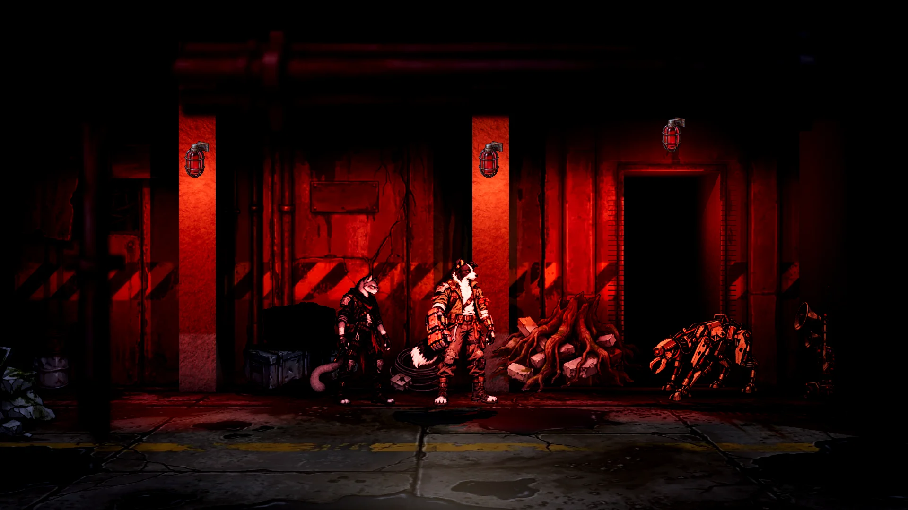
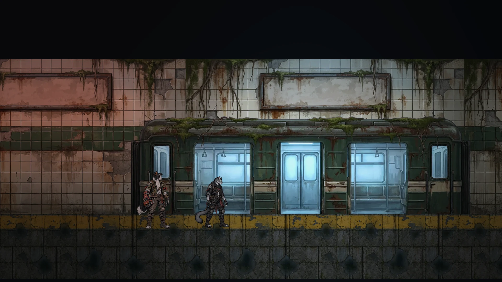
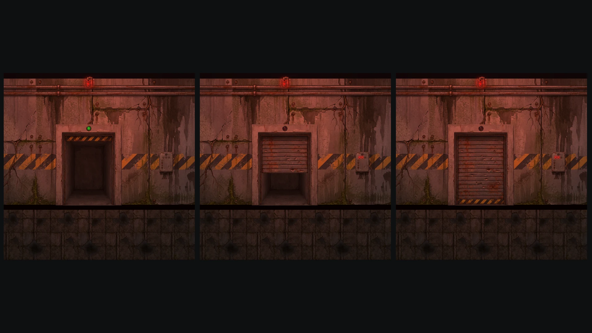
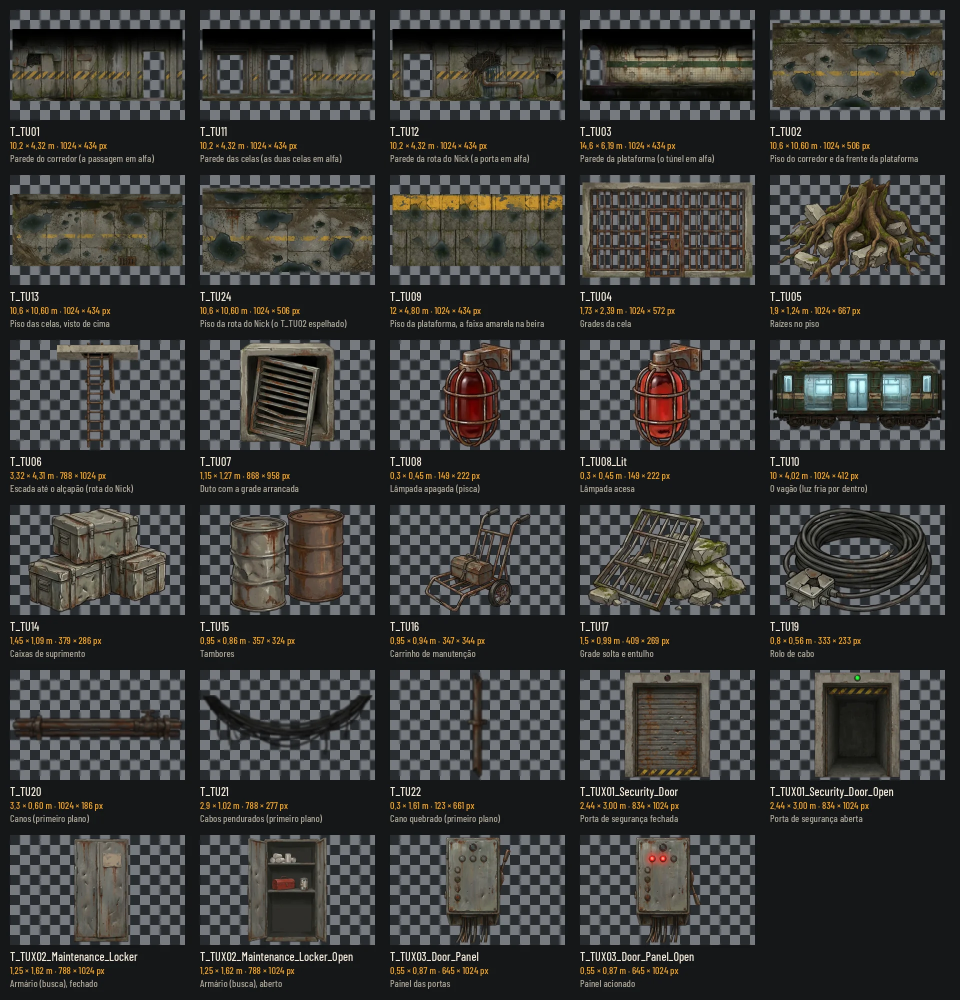
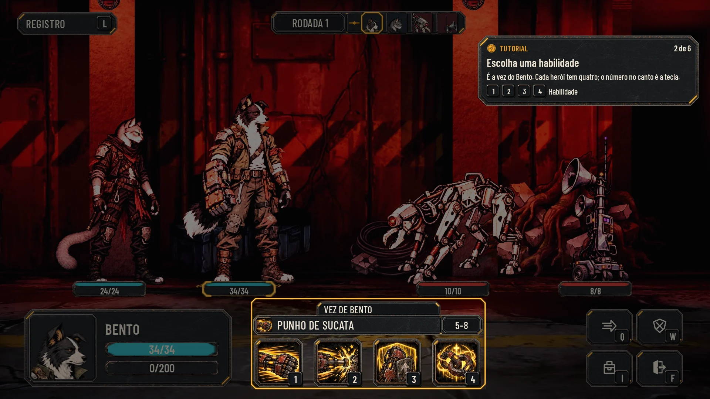
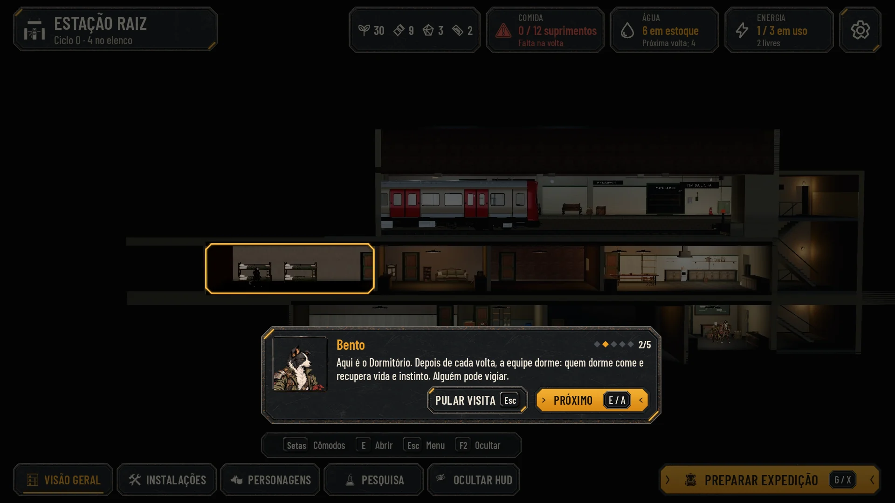

# O tutorial: o mapa da fuga e as telas da abertura (26/10/2026)

Duas issues num lote:
- **#147, a arte do mapa do tutorial:** a área de contenção de onde o Bento e o Nick fogem até o trem, nas peças dos
  cenários de hoje;
- **#146, as telas do tutorial:** os cartões da abertura, as dicas na exploração e na luta, a visita guiada da Estação e
  a campanha nova com Pular tutorial.

Só arte e docs: nada em `scripts/`, `data/` nem `tests/`. A arte segue o método do kit: Nano Banana Pro, os recortados
numa folha sobre magenta (#FF00FF) e recortados por código, sem texto nas imagens. As telas estão no kit da Awesomic
(`art/ui/kit/station`), sobre capturas reais, nos quatro perfis (Normal, Maior, daltonismo e Maior com daltonismo). A
integração é do Claude, nas issues #144, #145 e #147.

## 1. O mapa do tutorial (#147)

### O lugar

Um subsolo de manutenção dos Antigos, que entrou em contenção (`bento-nick-arc.md`, §3 e §4): corredores de concreto
com a faixa de perigo, uma sala com celas de grade, portas de segurança que baixam sozinhas, lâmpadas de emergência
vermelhas, raízes entrando pelas frestas e água no chão. No fim, uma plataforma de trem esquecida, com um vagão parado
e a luz fria acesa por dentro. Nada de humano, nada de nome de sistema: as máquinas e as portas são a contenção
automática, como pede a escada de revelações (`narrative-design.md`, §7 e §14).

**O nome (para o Lucas escolher):**
- **Corredor de Contenção** (a recomendação): diz o que o lugar é, conversa com o "protocolo de contenção" do arco e não
  colide com nenhum nome do mundo;
- Subsolo de Contenção.

"Galeria" ficou de fora porque as Galerias, na lore (§16), são o shopping; "Lacrado", porque o Abrigo Lacrado já existe.
As telas do tutorial usam "Corredor de Contenção".

### As zonas

Prévias montadas em 2D com as peças, nas medidas da tabela, a 130 px por metro (a altura do Bento e do Nick na
exploração), com a luz pintada por cima. Não são a cena 3D: provam que as peças fecham um lugar e dão as medidas para o
Claude montar o `data/scenarios/<Mapa>.json`.

| Zona | Prévia | O que tem |
|---|---|---|
| 1. O corredor de contenção | [zone_corridor](tutorial/zone_corridor.webp) · [apagada](tutorial/zone_corridor_dark.webp) | A parede com a faixa de perigo, as lâmpadas vermelhas (acesas e no meio do pisca), as raízes no piso e a porta de segurança aberta à frente |
| 2. A sala com grades | [zone_cells](tutorial/zone_cells.webp) | Duas celas no fundo, o armário de manutenção (a busca) e o painel das portas |
| 3. A rota do Nick | [zone_nick_route](tutorial/zone_nick_route.webp) | A porta baixada atrás da equipe, o duto com a grade arrancada e a escada até o alçapão aberto no teto |
| 4. A plataforma | [zone_platform](tutorial/zone_platform.webp) | A parede de azulejo da estação esquecida e o vagão no fosso dos trilhos, com as portas abertas e o chão na altura da plataforma; a equipe anda sobre a plataforma, com a faixa amarela na beira do lado do trem |
| As portas fechando | [zone_doors](tutorial/zone_doors.webp) | A mesma porta aberta, descendo e fechada, com o painel acionado |

### A arte

Em `art/scenarios/`, no contrato de `tools/sync_scenarios.py`: `T_<código>.webp`, WebP com qualidade 88, até 1024 px no
lado maior, e a importação da Godot como a dos outros cenários (`lossy_quality` 0,75). As superfícies são opacas e os
recortados têm alfa (os cards `masked`: o jogo corta o alfa em 0,333, então nada depende de transparência parcial; a
borda dos recortados foi limpa da sobra verde do magenta). O prefixo do mapa é **TU**. Os interativos (`T_TUX*`) vêm em par, fechado e `_Open`, do mesmo tamanho e
recortados pela mesma caixa, como os de hoje.

| Arquivo | Medida (m) | px | Tipo | Uso |
|---|---|---|---|---|
| `T_TU01` | 8,2 × 4,58 | 1024 × 572 | opaco, repete na horizontal | A parede do corredor e da sala |
| `T_TU02` | 2 × 2 | 1024 × 1024 | opaco, repete | O piso molhado, com raízes nas juntas |
| `T_TU03` | 8,2 × 4,58 | 1024 × 572 | opaco, repete na horizontal | A parede de azulejo da plataforma |
| `T_TU04` | 4 × 2,23 | 1024 × 572 | recortado | As grades da cela (atrás delas, o fundo escuro da cela) |
| `T_TU05` | 3 × 1,95 | 1024 × 667 | recortado | As raízes no piso |
| `T_TU06` | 3,54 × 4,6 | 788 × 1024 | recortado | A escada de lado, até o alçapão aberto na laje do teto (vista de baixo) |
| `T_TU07` | 1,4 × 1,55 | 868 × 958 | recortado | O duto com a grade arrancada |
| `T_TU08`, `T_TU08_Lit` | 0,3 × 0,45 | 149 × 222 | recortado | A lâmpada de emergência apagada e acesa (só o vidro clareia; o brilho em volta é a luz da cena) |
| `T_TU09` | 4,5 × 1,9 | 1024 × 434 | opaco, repete na horizontal | O piso da plataforma, com a faixa amarela na beira do lado do trem |
| `T_TU10` | 10 × 4,03 | 1024 × 412 | recortado | O vagão, com a luz fria por dentro e as portas abertas |
| `T_TUX01_Security_Door` (+ `_Open`) | 2,4 × 2,95 | 834 × 1024 | interativo | A porta de segurança: baixada, ou erguida com a luz verde |
| `T_TUX02_Maintenance_Locker` (+ `_Open`) | 1,45 × 1,88 | 788 × 1024 | interativo (busca) | O armário de manutenção: fechado, ou aberto com curativos, a caixa de ferramentas e uma ração |
| `T_TUX03_Door_Panel` (+ `_Open`) | 0,62 × 0,98 | 645 × 1024 | interativo | O painel das portas: a alavanca em cima, ou embaixo com duas luzes vermelhas |

São 17 arquivos. As portas de segurança ficam na parede do fundo, de frente: funcionam como as portas laterais de hoje
(passagem de uma zona para outra), não como um bloqueio que atravessa o corredor.

### A luz

- **A emergência:** uma luz pontual vermelha em cada lâmpada (proposta: cor [1, 0,28, 0,2], 900 lumens, raio de 6 m), que
  faz o brilho em volta, e o card troca `T_TU08` por `T_TU08_Lit` no mesmo ritmo da luz. O pisca sugerido: 0,6 s acesa e 0,4 s quase apagada (a 25%),
  fora de fase entre lâmpadas vizinhas. Com "Reduzir efeitos", fica acesa sem piscar. Ver
  [zone_corridor](tutorial/zone_corridor.webp) e [zone_corridor_dark](tutorial/zone_corridor_dark.webp).
- **O trem:** a luz fria por dentro do vagão (já pintada no card) e duas luzes pontuais azuladas
  ([0,75, 0,85, 1], 1200 lumens, raio de 8 m) nas portas, para clarear a plataforma.
- **O resto:** o ambiente baixo (cerca de 40% do de hoje), puxado para o vermelho perto das lâmpadas.

### Para integrar (é do Claude, na #147)

- **O cenário novo:** proposta de mapa `ContainmentCorridor` (nome de tela "Corredor de Contenção", se o Lucas aprovar),
  com a entrada em `MAPS` e `DISPLAY` de `tools/sync_scenarios.py` e de `scenario_world.gd`, e o prefixo TU.
- **As medidas** são as da tabela; a escala e a ordem das prévias valem para a montagem.
- **Os interativos:** a porta (`TUX01`) troca para o `_Open` quando abre e volta ao fechado quando a equipe passa (as
  portas que fecham atrás); o armário (`TUX02`) é uma busca ("Armário de manutenção"); o painel (`TUX03`) baixa as
  portas.
- **A rota do Nick:** a escada (`TU06`) e o duto (`TU07`) marcam a passagem; a cena decide se a equipe passa por cima ou
  por dentro.
- **A plataforma:** o piso `TU09` na faixa de andar, com a faixa amarela do lado do trem; o vagão fica no fosso, com o
  chão na altura da plataforma (o piso tapa as rodas).

## 2. As telas do tutorial (#146)

| Tela | Normal | Maior | Daltonismo | Maior e daltonismo | Antes e depois |
|---|---|---|---|---|---|
| A abertura: um cartão | [opening_card](tutorial/opening_card.webp) | [large](tutorial/opening_card_large.webp) | [colorblind](tutorial/opening_card_colorblind.webp) | [large_colorblind](tutorial/opening_card_large_colorblind.webp) | [comparar](tutorial/before_after_opening_card.webp) |
| A abertura: o lugar da tirinha | [opening_frame](tutorial/opening_frame.webp) | [large](tutorial/opening_frame_large.webp) | [colorblind](tutorial/opening_frame_colorblind.webp) | [large_colorblind](tutorial/opening_frame_large_colorblind.webp) | (tela nova) |
| A dica na exploração | [tutorial_explore](tutorial/tutorial_explore.webp) | [large](tutorial/tutorial_explore_large.webp) | [colorblind](tutorial/tutorial_explore_colorblind.webp) | [large_colorblind](tutorial/tutorial_explore_large_colorblind.webp) | [comparar](tutorial/before_after_tutorial_explore.webp) |
| A dica na luta: a habilidade | [tutorial_combat](tutorial/tutorial_combat.webp) | [large](tutorial/tutorial_combat_large.webp) | [colorblind](tutorial/tutorial_combat_colorblind.webp) | [large_colorblind](tutorial/tutorial_combat_large_colorblind.webp) | [comparar](tutorial/before_after_tutorial_combat.webp) |
| A dica na luta: o alvo | [tutorial_target](tutorial/tutorial_target.webp) | [large](tutorial/tutorial_target_large.webp) | [colorblind](tutorial/tutorial_target_colorblind.webp) | [large_colorblind](tutorial/tutorial_target_large_colorblind.webp) | (como a anterior) |
| A visita da Estação | [tour_room](tutorial/tour_room.webp) | [large](tutorial/tour_room_large.webp) | [colorblind](tutorial/tour_room_colorblind.webp) | [large_colorblind](tutorial/tour_room_large_colorblind.webp) | [comparar](tutorial/before_after_tour_room.webp) |
| O fim da visita | [tour_end](tutorial/tour_end.webp) | [large](tutorial/tour_end_large.webp) | [colorblind](tutorial/tour_end_colorblind.webp) | [large_colorblind](tutorial/tour_end_large_colorblind.webp) | (como a anterior) |
| A campanha nova com Pular tutorial | [new_campaign](tutorial/new_campaign.webp) | [large](tutorial/new_campaign_large.webp) | [colorblind](tutorial/new_campaign_colorblind.webp) | [large_colorblind](tutorial/new_campaign_large_colorblind.webp) | [comparar](tutorial/before_after_new_campaign.webp) |

Cada tela também tem a redução a 40% (`*_40.webp`) e o cinza (`*_gray.webp`). [checks.json](tutorial/checks.json) mede
cada texto e cada alvo de toque com as conferências do `lib.mjs`: as 32 telas (8 telas, 4 perfis) passam, sem texto
cortado ou fora da peça, sem alvo sobreposto ou menor que 56 px, com o menor texto em 20 px.

### As capturas

A abertura joga só com o Bento e o Nick (#144). [capture.gd](tutorial/capture.gd) captura a Rua das Vitrines com essa
equipe, que é o trecho que a #144 usa até o mapa do tutorial ficar pronto: a rua no começo e a primeira luta (contra o
Recreador e o Emissor de Comando), as duas com a interface escondida. Saiu de noite e com chuva, como o jogo sorteou. A
HUD da exploração já mostra o que vale no mapa do tutorial (o nome do lugar, sem clima, que é um subsolo); o fundo é o
da rua provisória. A Estação e o título usam as capturas de `hud-v2/before`.

### O que cada tela mostra

- **Os cartões da abertura:** no idioma do cartão de passagem (`passage_card.gd`): o aço escuro, a chapa do kit com o
  título grande (56 px), a divisa com o losango âmbar e a linha de baixo (30 px, na cor do texto, como no jogo). Embaixo,
  os quatro passos da abertura em losangos (o de agora em âmbar) e, no canto, E Avançar e Esc Pular abertura. Por
  enquanto só texto, com o fade de hoje.
- **O lugar da tirinha:** o quadro 16:9 no alto (1120 × 630 px, na moldura do kit) e a chapa do texto embaixo. Até a
  tirinha existir, o quadro mostra a prévia do corredor de contenção, na medida dela.
- **Os textos da abertura (para o Lucas aprovar):**
  1. "Antes da Estação": "As máquinas dos Antigos ainda cumprem ordens que ninguém cancelou." (lore §9)
  2. "Bento": "Saiu atrás de suprimentos. Uma área antiga entrou em contenção e baixou as portas com ele lá dentro."
  3. "Nick": "Viajava sozinho. Viu uma saída que as máquinas não vigiam, e voltou."
  4. "A plataforma": "No fim do corredor, um trem ainda espera."

  Passam pela regra de consistência (§14): não revelam nada além da fase 1 (máquinas antigas, contenção), não nomeiam
  sistema nem humanos e seguem o arco do Bento e do Nick. **Para o Lucas decidir:** no arco (§3), o Bento fica lá
  dentro por causa da Íris e da Amora; a #144 simplificou a abertura para os dois, e o cartão do Bento também.
- **A dica do tutorial:** uma chapa do kit (`panel_large`, 560 a 600 px de largura), com "Tutorial", o passo
  ("1 de 6"), o que fazer (30 px), a explicação de uma linha (22 px) e as teclas (`key`); na exploração, uma seta âmbar
  de 40 px aponta para o destaque. O destaque é a moldura de foco do kit (`focus_frame`) em volta do que se deve
  apertar, com o resto da tela escurecido (a 50%). A dica fica fora do destaque e das cabeças.
  - **O corredor da abertura:** cinco trechos, todos à vista: a partida, a primeira luta, a busca, a segunda e a terceira
    luta. A plaqueta diz "Corredor de Contenção · Abertura".
  - **Na exploração (1 de 6):** "Ande até o fim do corredor", com A/D e Shift, e o destaque na dupla.
  - **Na luta (2 de 6):** "Escolha uma habilidade", com as teclas 1 a 4; a HUD na vez do Nick ("Vez de Nick", nenhuma
    escolhida) e o destaque na aba e nas quatro habilidades. A dica fica no alto à esquerda, acima das cabeças.
  - **Na luta (3 de 6):** "Escolha o alvo", com as setas e E; a HUD na mira ("Escolha um alvo") e o destaque no
    Recreador.
  - Os seis passos, na ordem do corredor: 1 andar, 2 a habilidade e 3 o alvo (a primeira luta), 4 interagir (a busca),
    5 defender e a Mochila (a segunda luta), 6 o trem.
- **A visita guiada da Estação:** a primeira vez na Estação. A tela escurecida (a 62%), a moldura no cômodo (ou no
  botão), e a fala do Bento (`panel_large` de 860 px, retrato de 120 px), com o passo em losangos e "2/5", como o
  briefing aprovado, PULAR VISITA (Esc) e PRÓXIMO (E). Quem guia é o Bento: é o Nick que chega à Estação pela primeira
  vez. No último passo, o destaque vai para PREPARAR EXPEDIÇÃO, na medida do botão em cada perfil, e o botão da fala vira
  COMEÇAR. A Estação de baixo fica parada (sem alvos), sem cômodo escolhido nem os cartões da esquerda.
- **A campanha nova:** depois de escolher o espaço (e confirmar, se ele já tem campanha), a escolha entre começar pela
  abertura (o padrão, recomendado) e Pular tutorial, cada uma numa linha (`list_row`, a escolhida com `selected_frame`)
  com o que ela faz. Pular começa na Estação com os quatro fundadores, como hoje.

### Para integrar (é do Claude, nas #144 e #145)

- **A dica** é um componente só (a chapa, o passo, as teclas, a seta e o destaque); cada passo diz o alvo do destaque.
  Ela não tem "Entendi": não pausa a luta e some quando o jogador faz o que ela pede.
- **As dicas de primeira vez** (`tips_service.gd`) ficam desligadas durante a abertura e a visita, para não aparecerem
  junto com a do tutorial; os ids que o tutorial cobre ("explore", "combat", "search", "bag" e "station") contam como
  vistos. Pulando o tutorial, elas seguem como hoje.
- **O destaque** recorta o escuro em volta do alvo; a dica e a fala ficam fora dele.
- **A visita** usa o mesmo destaque, com a fala no lugar da dica; Esc pula.
- **Os cartões da abertura** reaproveitam o `passage_card.gd`, com os quatro passos e o pular.

## Como refazer

As imagens brutas ficam fora do Git, em `images/tutorial/` do projeto na Awesomic: as superfícies (`tu-wall-corridor`,
`tu-floor`, `tu-wall-platform`, `tu-platform-floor`), a folha dos recortados (`tu-props-sheet`: a referência das peças
e a fonte da lâmpada), cada peça em separado (`tu-bars`, `tu-roots`, `tu-ladder-2`, `tu-duct`), o vagão
(`tu-train-sheet-2`, com o interior pintado) e os pares fechado e aberto (`tu-door-*`, `tu-locker-*`, `tu-panel-*`; o
aberto é uma edição do fechado). `tu-ladder` e `tu-platform-edge` foram a primeira versão (a escada e a borda na
perspectiva errada para a câmera lateral). As
referências de estilo foram texturas de hoje (`T_DE*`, `T_PT*`, `T_AL*`).

Da raiz do repositório:
1. `python3 -B docs/design/tutorial/cut_scenario.py <pasta images/tutorial>`: a arte em `art/scenarios/`.
2. `python3 -B docs/design/tutorial/build_scenes.py`: as prévias das zonas e a prancha.
3. A captura (precisa de uma tela; no Linux sem tela, `xvfb-run`):
   `xvfb-run -a -s "-screen 0 1920x1080x24" "$GODOT" --path . --rendering-driver opengl3 --resolution 1920x1080 -s res://docs/design/tutorial/capture.gd -- --out=<pasta>`.
   Ela grava `explore_two.png`, `fight_two.png` e `fight_two.json`. Depois,
   `python3 -B docs/design/tutorial/prepare_before.py <pasta>` leva tudo para `before/`: os PNG em WebP (qualidade 88,
   com `_clean` no nome), o JSON como saiu e o `fight_two_hud.json`, o mesmo DTO no formato que `hud-luta/render.mjs`
   lê. A luta corre como o jogo sorteia (o clima e os inimigos podem mudar de uma corrida para outra).
4. `python3 -m http.server 8765 --bind 127.0.0.1` e, noutro terminal, `node docs/design/tutorial/render.mjs http://127.0.0.1:8765`.
5. `python3 -B docs/design/tutorial/compose.py`: as reduções, o cinza, o antes e depois e o `checks.json`.

**Fora desta pasta** (as telas desses lotes saem iguais):
- `hud-luta/render.mjs` aceita o caminho de um DTO e de um fundo (o nome com "/"), encolhe a faixa da rodada com menos
  de seis unidades e mostra a vez de quem age antes da mira (`aim: false`: a aba "Vez de <nome>");
- `hud-estacao/render.mjs`: `overview({ bare: true })` tira o cômodo escolhido e os cartões da esquerda.

## QA de design

As rodadas seguem [qa.md](qa.md) e ficam registradas abaixo e no PR.

### Rodada 1: REPROVADO

Aprovados na rodada: o escopo, o contrato e a reprodução byte a byte da arte, o estilo (sem texto nas imagens), a luta
da hud-luta igual e a cobertura das duas issues.

**Alta, corrigido:** o halo da lâmpada acesa virava um disco chapado (o jogo corta o alfa em 0,333). O card aceso só
clareia o vidro, no mesmo quadro do apagado; o brilho em volta é a luz pontual da cena.

**Média, corrigidos:**
- A franja verde nas bordas dos recortados: o recorte limita o verde ao maior dos outros canais nas bordas.
- A escada e a borda da plataforma na perspectiva errada: a escada refeita de lado, até o alçapão no teto; a borda virou
  o piso da plataforma (opaco), com a faixa amarela do lado do trem, e a prévia monta o vagão com o chão na altura da
  plataforma.
- A visita contradizia a fala: a Estação de baixo sem cômodo escolhido nem os cartões da esquerda.
- O destaque fora do alvo no Maior: no fim da visita, a moldura é do tamanho do botão em cada perfil; na luta, o destaque
  pega a aba e a barra.
- O passo da habilidade: a HUD na vez do Nick ("Vez de Nick"), e as dicas da luta no alto à esquerda, acima das cabeças.
- A rota e os passos: cinco trechos (três lutas e a busca) e os seis passos na ordem do corredor.
- A narrativa: "ordens que ninguém cancelou" (lore §9), e o nome proposto é Corredor de Contenção (Galeria e Lacrado
  colidiam com nomes do mundo).
- As dicas de primeira vez: desligadas durante a abertura e a visita (nota de integração).

**Baixa, corrigidos:** a plaqueta sem clima; o vagão em 1024 px; a importação com `lossy_quality` 0,75; as medidas das
peças na página; o passo da visita em losangos; o subtítulo do cartão na cor do texto; a faixa da rodada encolhendo com
quatro; "Como refazer" (a lâmpada sai da folha); as portas como passagem de zona; a Íris e a Amora levadas ao Lucas.

### Rodada 2: APROVADO

As correções da rodada 1 conferidas; a arte, as prévias e as telas reproduzem; as telas da hud-luta e da hud-estacao
saem iguais. Observações baixas:
- a fala da visita subia pouco no Maior e encostava na barra de baixo: agora sobe 24 px (aplicado depois do veredito);
- a prévia da plataforma empilhava dois pisos: a faixa de andar inteira usa o `T_TU09` (aplicado);
- o clareado do `T_TU08_Lit` deixa manchas no vidro, que não aparecem no tamanho de uso (cerca de 40 px): se a lâmpada
  for vista de perto, clarear o vidro por uma máscara da área dele.
