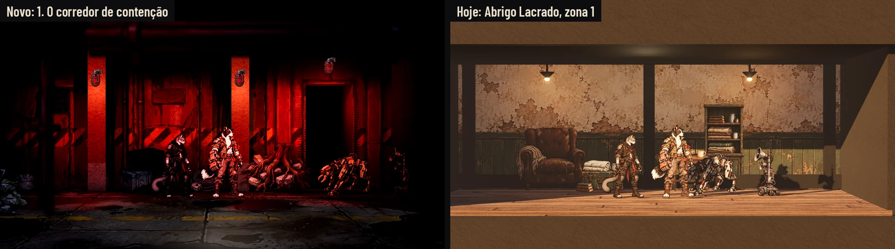
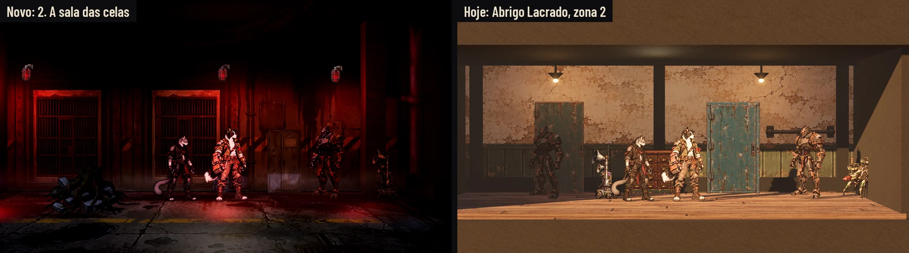
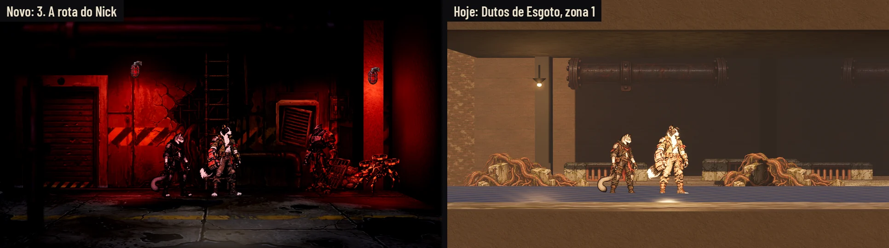
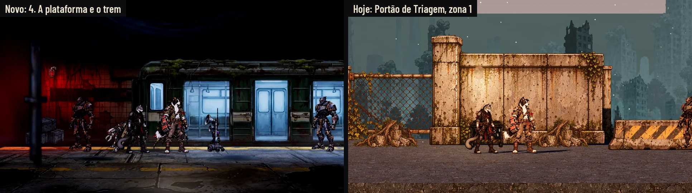
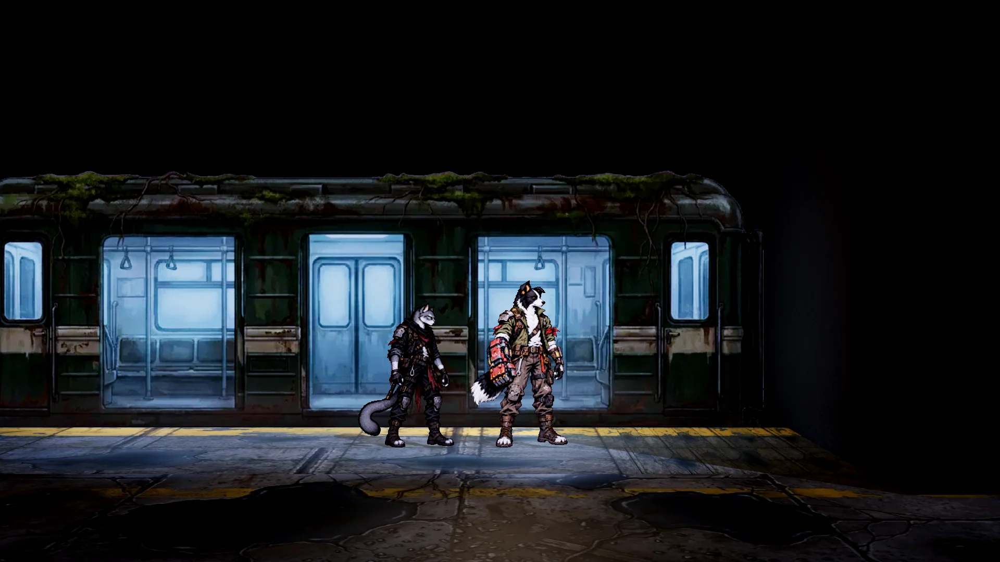

# O tutorial: o mapa da fuga e as telas da abertura (26/10/2026, ajustes do mapa e a equipe nova em 27/10)

Duas issues num lote:
- **#147, a arte do mapa do tutorial:** a área de contenção de onde o Bento foge com a Íris e a Véspera até o trem (o
  Nick chega no aperto), nas peças dos cenários de hoje;
- **#146, as telas do tutorial:** o cartão da abertura, as dicas na exploração e na luta, a visita guiada da Estação e
  a campanha nova com Pular tutorial.

Só arte e docs: nada em `scripts/`, `data/` nem `tests/`. A arte segue o método do kit: Nano Banana Pro, os recortados
numa folha sobre magenta (#FF00FF) e recortados por código, sem texto nas imagens. As telas estão no kit da Awesomic
(`art/ui/kit/station`), sobre capturas reais, nos quatro perfis (Normal, Maior, daltonismo e Maior com daltonismo). A
integração é do Claude, nas issues #144, #145 e #147.

**A equipe da fuga (a decisão do Lucas de 27/10, no PR #158):** o tutorial segue o arco (`bento-nick-arc.md`, §3 e
§26). O Bento foge com a Íris e a Véspera (ela faz o papel da Amora, que ainda não existe no jogo), e eles encontram o
Nick depois, em apuros: o Nick chega no aperto da sala das celas e mostra a rota dele. Nas capturas, as zonas 1 e 2 (o
corredor e a sala das celas) e a luta têm o trio; a rota do Nick e a plataforma, os quatro. Os lado a lado usam a mesma
equipe de cada zona.

**As capturas são da Godot sem placa de vídeo:** a máquina da Awesomic não tem GPU. As capturas rodam no renderizador
Compatibility (OpenGL 3, por software, em `xvfb-run`) a 1920 × 1080. O Forward+ (o Ultra) e o Baixo numa máquina com
placa de vídeo não foram capturados aqui: ficam com o Orquestrador PC, como pede a #147.

## 1. O mapa do tutorial (#147)

### Os ajustes do Lucas (26/10)

O Lucas aprovou a ambientação, mas o cenário não estava trabalhado como os outros: o fundo descolado do chão, alto
demais, tudo num plano só. Agora o mapa está **montado no motor**, no contrato de `tools/sync_scenarios.py`
([map/ContainmentCorridor.json](tutorial/map/ContainmentCorridor.json), gerado por
[build_map.py](tutorial/build_map.py)), e as provas são **capturas da Godot**, pela cena da rua de verdade, na câmera
da exploração dos outros cenários (19 m, 1,7 m acima do piso, 0,5°), com a equipe da fuga. Cada zona está ao lado de
um cenário que já existe, na mesma câmera, com a mesma equipe e no mesmo ponto da zona.

| O que o Lucas pediu | Como ficou |
|---|---|
| O chão em perspectiva até a parede, com poças e sujeira, e a base da parede encostada nele | O piso é um plano só, da parede até a frente da câmera, visto em perspectiva pelo motor. A pintura é vista de cima (concreto em placas, poças, lama, a faixa amarela gasta, ralo, raízes nas juntas) e cai inteira em cada zona, com a sujeira e a água do pé da parede encostadas nela. A parede desce 20 cm abaixo do piso (a base pintada com sujeira e linha d'água), e uma faixa de água parada corre no pé dela. O piso é úmido (a superfície da Estação com a umidade): as lâmpadas fazem a poça de luz nele |
| A câmera e a escala da exploração (heróis maiores, parede mais baixa, o alto no escuro) | As zonas têm a medida do Abrigo Lacrado (10 m de largura, 4,8 de fundo); a parede tem 4,3 m, com o terço de cima indo para o preto, e o teto fica no escuro. Os heróis saem do mesmo tamanho que nos outros cenários (ver os lado a lado) |
| Planos em profundidade | Pilares de concreto na frente da parede, com as lâmpadas neles; objetos no chão no pé da parede (caixas, tambores, carrinho, rolo de cabo, grade solta) e alguns na frente da faixa; o primeiro plano a 8 m da câmera (a faixa fica a 19 m), que passa rápido na frente dela: canos no alto, cabos pendurados e um cano quebrado, um pouco escurecidos e com o desfoque e o alfa macio na pintura (o card em alpha blend, para o desfoque aparecer inteiro, é do código; nas capturas ele já está assim); e as aberturas da parede (a passagem do corredor, as duas celas, a porta da rota do Nick, o túnel da plataforma) recortadas no alfa, com uma caixa funda de verdade atrás e uma luz fraca perto da boca, que some no escuro |
| A luz: poças vermelhas no chão e na parede, névoa baixa, reflexo na água, a luz fria do vagão no fim | Cada lâmpada é o card aceso e duas luzes vermelhas curtas, com sombra: uma sai da própria lâmpada, rente à parede (o cone que desce pela parede e pelo pilar), e uma logo abaixo e à frente dela (a poça no pé da parede, entrando na faixa); entre uma e outra, o escuro. A sombra delas encosta no chão os objetos, os inimigos e a equipe. A água do pé da parede e do fosso brilha com elas. A névoa rente ao chão e o ambiente baixo são do código (protótipo na captura, abaixo). O vagão é o card com o interior aceso e três luzes frias nas portas, que pintam a plataforma de azul e puxam o olho para a saída |
| A parede sem repetição | Uma parede pintada por zona, sem repetir: painel solto com a fiação, duto que dobra, canos que entram no chão, placas sem texto, manchas de umidade, o buraco com vergalhão e água, a caixa elétrica, a faixa de perigo interrompida e raspada |
| As lutas dentro do mapa | A luta do tutorial é no corredor de contenção, com a patrulha da zona 1 (a captura da luta e as telas da dica de luta foram refeitas sobre ela) |
| A saída é o trem | A última zona é a plataforma: a porta aberta da direita do vagão fica no fim da zona, sob uma luz fria; a equipe anda até ela e embarca ([zone_platform_exit](tutorial/zone_platform_exit.webp)). O resto do vagão entra no escuro do túnel |

### O lugar

Um subsolo de manutenção dos Antigos, que entrou em contenção (`bento-nick-arc.md`, §3 e §4): corredores de concreto
com a faixa de perigo, uma sala com celas de grade, portas de segurança que baixam sozinhas, lâmpadas de emergência
vermelhas, fissuras no concreto e água no chão. No fim, uma plataforma de trem esquecida, com um vagão parado
e a luz fria acesa por dentro: o embarque é a saída do mapa. Nada de humano, nada de nome de sistema: as máquinas e as
portas são a contenção automática, como pede a escada de revelações (`narrative-design.md`, §7 e §14).

**O nome:** **Corredor de Contenção** (a decisão do Lucas de 26/10). Diz o que o lugar é, conversa com o "protocolo de
contenção" do arco e não colide com nenhum nome do mundo. "Galeria" ficou de fora porque as Galerias, na lore (§16), são o shopping; "Lacrado", porque o Abrigo Lacrado já existe.
As telas do tutorial usam "Corredor de Contenção".

### As zonas, na Godot

Quatro zonas, como as do Abrigo (o corredor da exploração anda por elas). Cada uma tem a captura limpa, a captura com a
HUD da exploração e o lado a lado com um cenário de hoje.

| Zona | Na Godot | Com a HUD | Lado a lado (mesma câmera) | O que tem |
|---|---|---|---|---|
| 1. O corredor de contenção | [zone_corridor](tutorial/zone_corridor.webp) | [hud](tutorial/zone_corridor_hud.webp) | [com o Abrigo Lacrado](tutorial/compare_corridor.webp) | A passagem para o escuro do lado, os pilares com as lâmpadas, caixas, tambores e rolo de cabo no chão, a grade solta e o cano no primeiro plano. A primeira luta é aqui |
| 2. A sala das celas | [zone_cells](tutorial/zone_cells.webp) | [hud](tutorial/zone_cells_hud.webp) | [com o Abrigo Lacrado](tutorial/compare_cells.webp) | As duas celas fundas atrás das grades, o armário de manutenção (a busca), o painel das portas, o carrinho, os cabos no primeiro plano |
| 3. A rota do Nick | [zone_nick_route](tutorial/zone_nick_route.webp) | [hud](tutorial/zone_nick_route_hud.webp) | [com os Dutos de Esgoto](tutorial/compare_nick_route.webp) | A porta de segurança baixada atrás da equipe, o buraco com vergalhão e água, o duto com a grade arrancada, a escada até o alçapão, os canos e a grade de proteção no primeiro plano |
| 4. A plataforma e o trem | [zone_platform](tutorial/zone_platform.webp) · [o embarque](tutorial/zone_platform_exit.webp) | [hud](tutorial/zone_platform_hud.webp) | [com o Portão de Triagem](tutorial/compare_platform.webp) | A plataforma com a faixa amarela, o fosso com o vagão aceso por dentro, a parede de azulejo com o túnel no escuro. A porta aberta do vagão, no fim da zona, é a saída |

As patrulhas que aparecem nas capturas são as que o corredor do jogo sorteia (na plataforma e no Portão ao lado,
escondidas, para a equipe inteira ficar à vista) (a captura usa a rota de uma fase de hoje
enquanto o mapa não tem a sua); a equipe é a da abertura. O cenário de hoje ao lado está no fim de tarde, como na QA dos
cenários; o mapa novo, de noite e sem clima, que é um subsolo.

### A arte

Em `art/scenarios/`, no contrato de `tools/sync_scenarios.py`: `T_<código>.webp`, WebP com qualidade 88, até 1024 px no
lado maior, e a importação da Godot como a dos outros cenários (`lossy_quality` 0,75). O prefixo do mapa é **TU**. As
paredes são cards recortados (as aberturas em alfa; o jogo corta o alfa em 0,333, e a borda das aberturas é dura); os
pisos são opacos; os objetos e o primeiro plano têm alfa, com a borda limpa da sobra do magenta (o primeiro plano tem o
alfa macio do desfoque). Os interativos (`T_TUX*`) vêm em par, fechado e `_Open`, do mesmo tamanho, e no mapa são
iluminados pela cena (tipo `art`), como a parede. As medidas são as do mapa (`build_map.py`).

| Arquivo | Medida no mapa (m) | px | Uso |
|---|---|---|---|
| `T_TU01` | 10,2 × 4,32 | 1024 × 434 | A parede do corredor, com a passagem em alfa |
| `T_TU11` | 10,2 × 4,32 | 1024 × 434 | A parede das celas, com as duas celas em alfa (nova) |
| `T_TU12` | 10,2 × 4,32 | 1024 × 434 | A parede da rota do Nick, com a porta em alfa (nova) |
| `T_TU03` | 14,6 × 6,19 | 1024 × 434 | A parede de azulejo da plataforma, com o túnel em alfa |
| `T_TU02` | 10,6 × 10,6 | 1024 × 506 | O piso do corredor (e da frente da plataforma), visto de cima. A superfície projeta a pintura pelo mundo numa amostra quadrada de 10,6 m: ela estica a imagem no fundo, o que na câmera rasante não se vê |
| `T_TU13` | 10,6 × 10,6 | 1024 × 434 | O piso das celas, do mesmo jeito (novo) |
| `T_TU24` | 10,6 × 10,6 | 1024 × 506 | O piso da rota do Nick: o `T_TU02` espelhado, para as zonas não repetirem as mesmas poças (novo) |
| `T_TU09` | 12 × 4,8 | 1024 × 434 | O piso da plataforma, com a faixa amarela na beira do lado do trem (tipo `art`, na face de cima da caixa, como os pisos do Abrigo) |
| `T_TU04` | 1,73 × 2,39 | 1024 × 572 | As grades da cela, na abertura |
| `T_TU06` | 3,32 × 4,32 | 788 × 1024 | A escada até o alçapão aberto |
| `T_TU07` | 1,15 × 1,27 | 868 × 958 | O duto com a grade arrancada |
| `T_TU08`, `T_TU08_Lit` | 0,5 × 1,6 | 256 × 819 | A luminária de emergência apagada e acesa: a caixa de aço blindada com a lente vermelha e o eletroduto subindo para o escuro (a lâmpada antiga saiu em 28/10, `tutorial-acabamento.md`) |
| `T_TU10` | 10 × 4,02 | 1024 × 412 | O vagão, com a luz fria por dentro e as portas abertas |
| `T_TU14` a `T_TU17`, `T_TU19` | 0,8 a 1,5 | 233 a 409 px de altura | Os objetos do chão: caixas, tambores, carrinho, grade solta com entulho, rolo de cabo (novos) |
| `T_TU20` a `T_TU22` | 3,3 × 0,6; 2,9 × 1,02; 0,3 × 1,62 | 1024 × 186; 788 × 277; 123 × 661 | O primeiro plano: canos, cabos pendurados, cano quebrado, um pouco escurecidos e desfocados, com o alfa macio (novos) |
| `T_TUX01_Security_Door` (+ `_Open`) | 2,44 × 3 | 834 × 1024 | A porta de segurança, na abertura da rota do Nick: baixada, ou erguida com a luz verde |
| `T_TUX02_Maintenance_Locker` (+ `_Open`) | 1,25 × 1,62 | 788 × 1024 | O armário de manutenção (a busca) |
| `T_TUX03_Door_Panel` (+ `_Open`) | 0,55 × 0,87 | 645 × 1024 | O painel das portas |

O acabamento no jogo de 28/10 (as faces dos pilares `T_TU25` e `T_TU26`, o concreto do lugar `T_TU27` no lugar do
concreto do Abrigo, a porta de enrolar `T_TUX04` e a escada `T_TU06` refeita) está em
[tutorial-acabamento.md](tutorial-acabamento.md).

São 28 arquivos (12 novos; desde 28/10, sem o `T_TU05` das raízes; `T_TU01`, `T_TU02` e `T_TU03` refeitos, sem repetição). Da folha do primeiro plano, a grade
de proteção ficou de fora (no chão perto da câmera, ela sai do quadro), e da folha dos objetos, a raiz caída (igual à
`T_TU05`).

### Para integrar (é do Claude, na #147)

**Como o mapa entra no jogo:** pela integração da #147, não por este PR. Até lá, o JSON fica em `docs/` e nada aqui
toca em `data/`. O código do mapa já está no PR #158 (`tools/build_containment_corridor.py`, com peças provisórias e
outra planta: o corredor de 16 m, as celas de 18 m). A integração escolhe uma das duas:
- copiar [map/ContainmentCorridor.json](tutorial/map/ContainmentCorridor.json) para `data/scenarios/` (o recomendado:
  é o mapa destas capturas, com a luz, o piso projetado e a profundidade que o Lucas pediu);
- ou levar para o `build_containment_corridor.py` as medidas deste JSON (as zonas de 10 m a cada 21,2 m, 8 m para o
  fundo, as peças `T_TU11` a `T_TU24`, as luzes e o primeiro plano). Só rodar o script de novo troca as texturas de
  `T_TU01` a `T_TU10`, mas não traz as peças novas, a planta nem a luz.

**Como o contrato foi conferido:** [check_map.py](tutorial/check_map.py) compara o JSON com os mapas de hoje
(`data/scenarios/*.json`): as mesmas chaves do topo, nenhuma chave de peça, luz, zona ou prop que eles não usem (nos
materiais, só a chave `zone` a mais, que o jogo ignora), as malhas de `meshes.json`, os índices de material e de peça e
cada textura `res://` existindo ("106 peças, 48 materiais, 30 luzes, 4 zonas, 3 props; OK"). A prova de que o jogo monta
o mapa é a captura: [capture_map.gd](tutorial/capture_map.gd) carrega o JSON pela cena da rua de verdade, por um pacote
por cima do projeto, sem gravar em `data/`. O [checks.json](tutorial/checks.json) é outra coisa: são as conferências
das telas (seção 2).

**O mapa:** [map/ContainmentCorridor.json](tutorial/map/ContainmentCorridor.json) já está no formato de
`data/scenarios/<Mapa>.json` (as malhas básicas de `meshes.json`, os materiais, as peças, as luzes, as zonas e os
props). A integração copia para `data/scenarios/` (ou leva para a Unreal e exporta, com o mesmo resultado), com
`ContainmentCorridor` em `MAPS` e `DISPLAY` de `tools/sync_scenarios.py` e em `DISPLAY` de `scenario_world.gd` ("Corredor
de Contenção"), a fase do tutorial apontando para ele e `sheltered` (coberto, sem chuva).
Duas escolhas do JSON que a integração precisa manter:
- **o mapa está 8 m para o fundo** (as zonas em Z de -10,4 a -5,6): o piso usa a superfície projetada pelo mundo, e
  assim cada zona cai numa amostra só da pintura, com a sujeira do pé da parede em cima, encostada na parede. Por isso
  as zonas ficam a cada 21,2 m;
- **cada material de superfície é de uma zona** (a chave `zone`, que o jogo ignora): o mundo junta as peças fixas de
  mesmo material numa malha só, e uma malha que atravessa zonas soma as luzes de todas; o Compatibility usa até 8 luzes
  por objeto e corta o resto, e a poça de luz some.

**O que só o código faz** (o protótipo está em `_proto()` de [capture_map.gd](tutorial/capture_map.gd), com os valores
das capturas):
1. **O ambiente do lugar:** no Corredor de Contenção, o ambiente vem de uma cor neutra (`AMBIENT_SOURCE_COLOR`,
   0,36/0,34/0,33, energia 0,3), não do céu da noite (que puxava a névoa para o roxo), e a exposição 5% abaixo. A
   neblina da Environment fica rala (0,006), na cor 0,16/0,08/0,07.
2. **A névoa baixa:** dois véus por zona, rente ao chão (1,2 m atrás do meio da faixa e 1,4 m na frente; 0,7 m e
   0,6 m de altura, opacidade 0,2 e 0,18), transparentes e iluminados (`MIST_SHADER`: o ruído correndo devagar em X e
   sumindo para cima e na base). Fracos de propósito: mais fortes, clareavam a base dos objetos e eles pareciam soltos
   do chão. Ficam vermelhos perto das lâmpadas e somem no escuro. No Forward+, a neblina volumétrica com altura baixa faz
   o mesmo; com "Reduzir efeitos", os véus ficam parados.
3. **O pisca:** cada lâmpada é um card e duas luzes (a da parede e a do chão). O pisca sugerido: 0,6 s acesa e 0,4 s a
   25%, fora de fase entre lâmpadas vizinhas; o card troca `T_TU08_Lit` por `T_TU08` no mesmo ritmo. Com "Reduzir
   efeitos", fica acesa sem piscar.
4. **O reflexo na água:** a água (o pé da parede e o fosso) brilha com as lâmpadas pelo especular. O reflexo de espelho
   (a lâmpada e o vagão refletidos) é do Forward+: o SSR já liga com chuva; no Corredor, ligar sempre (ou uma
   `ReflectionProbe` por zona).
5. **A saída:** na plataforma, chegar à porta aberta da direita do vagão (o fim da zona 4, x1 − 0,6 m, sob a luz fria
   que fica ali) mostra "E Embarcar"; o embarque fecha o tutorial e leva à Estação (a #144 decide a passagem).
6. **As portas:** a da rota do Nick (`TUX01`) começa erguida (`_Open`) quando a equipe chega e baixa atrás dela, com o
   painel (`TUX03`) acionado na sala das celas; o armário (`TUX02`) é uma busca ("Armário de manutenção").
7. **As sombras das lâmpadas:** as luzes marcadas com sombra no JSON (as vermelhas e, na plataforma, a da porta do meio
   do vagão e a do embarque) precisam projetar sombra também no Compatibility (hoje `scenario_world.gd` só liga no Forward+): sem ela, no escuro do corredor, os objetos e os
   inimigos parecem flutuar. As capturas já mostram com a sombra ligada.
8. **A luta:** a primeira luta é na zona 1, com a patrulha dela (as capturas usaram a rota de uma fase de hoje; a do
   tutorial tem cinco trechos, ver a seção 2). Na luta, as máquinas recebem a luz de preenchimento neutra da arena,
   contra a cena vermelha: vale tingir o preenchimento com a cor do lugar.
9. **O primeiro plano:** os cards das peças a 8 m da câmera (`T_TU20` a `T_TU22`) em alpha blend, para o desfoque
   pintado aparecer (no corte em 0,333 de hoje, a silhueta fica dura). Eles já esmaecem quando tapam a equipe (#51).

## 2. As telas do tutorial (#146)

| Tela | Normal | Maior | Daltonismo | Maior e daltonismo | Antes e depois |
|---|---|---|---|---|---|
| A abertura: um cartão | [opening_card](tutorial/opening_card.webp) | [large](tutorial/opening_card_large.webp) | [colorblind](tutorial/opening_card_colorblind.webp) | [large_colorblind](tutorial/opening_card_large_colorblind.webp) | [comparar](tutorial/before_after_opening_card.webp) |
| A abertura: o lugar da tirinha | [opening_frame](tutorial/opening_frame.webp) | [large](tutorial/opening_frame_large.webp) | [colorblind](tutorial/opening_frame_colorblind.webp) | [large_colorblind](tutorial/opening_frame_large_colorblind.webp) | (tela nova) |
| A dica na exploração | [tutorial_explore](tutorial/tutorial_explore.webp) | [large](tutorial/tutorial_explore_large.webp) | [colorblind](tutorial/tutorial_explore_colorblind.webp) | [large_colorblind](tutorial/tutorial_explore_large_colorblind.webp) | [comparar](tutorial/before_after_tutorial_explore.webp) |
| A dica na luta: a habilidade | [tutorial_combat](tutorial/tutorial_combat.webp) | [large](tutorial/tutorial_combat_large.webp) | [colorblind](tutorial/tutorial_combat_colorblind.webp) | [large_colorblind](tutorial/tutorial_combat_large_colorblind.webp) | [comparar](tutorial/before_after_tutorial_combat.webp) |
| A dica na luta: o alvo | [tutorial_target](tutorial/tutorial_target.webp) | [large](tutorial/tutorial_target_large.webp) | [colorblind](tutorial/tutorial_target_colorblind.webp) | [large_colorblind](tutorial/tutorial_target_large_colorblind.webp) | (como a anterior) |
| A visita da Estação | [tour_room](tutorial/tour_room.webp) | [large](tutorial/tour_room_large.webp) | [colorblind](tutorial/tour_room_colorblind.webp) | [large_colorblind](tutorial/tour_room_large_colorblind.webp) | [comparar](tutorial/before_after_tour_room.webp) |
| O fim da visita | [tour_end](tutorial/tour_end.webp) | [large](tutorial/tour_end_large.webp) | [colorblind](tutorial/tour_end_colorblind.webp) | [large_colorblind](tutorial/tour_end_large_colorblind.webp) | (como a anterior) |
| A campanha nova com Pular tutorial | [new_campaign](tutorial/new_campaign.webp) | [large](tutorial/new_campaign_large.webp) | [colorblind](tutorial/new_campaign_colorblind.webp) | [large_colorblind](tutorial/new_campaign_large_colorblind.webp) | [comparar](tutorial/before_after_new_campaign.webp) |

Cada tela também tem, no Normal, a redução a 40% (`*_40.webp`, a leitura no celular) e o cinza (`*_gray.webp`), as
provas que a QA usa (`qa.md`); os outros perfis não guardam a redução. [checks.json](tutorial/checks.json) mede
cada texto e cada alvo de toque com as conferências do `lib.mjs`: as 32 telas (8 telas, 4 perfis) passam, sem texto
cortado ou fora da peça, sem alvo sobreposto ou menor que 56 px, com o menor texto em 20 px.

### As capturas

A abertura começa com o Bento, a Íris e a Véspera (o Nick chega no aperto, a decisão do Lucas de 27/10), e tudo acontece
**dentro do mapa de contenção** (os ajustes do Lucas de 26/10: nada mais na Rua das Vitrines).
[capture_map.gd](tutorial/capture_map.gd) monta o Corredor de Contenção na Godot e fotografa, com o trio e a interface
escondida, a zona 1 (o fundo da dica na exploração) e a primeira luta, nela
(contra o Rastreador Quadrúpede e o Emissor de Comando, na vez do Bento): o corredor com a faixa de perigo e a luz
vermelha. A HUD da exploração mostra o que vale no mapa do tutorial (o nome do lugar, sem clima, que é um subsolo). O
quadro da tirinha mostra a zona 1 capturada. A Estação e o título usam as capturas de `hud-v2/before`.

### O que cada tela mostra

- **A abertura, um cartão só** (a decisão do Lucas de 26/10, no lugar dos quatro propostos): "Você precisa escapar.",
  no idioma do cartão de passagem (`passage_card.gd`): o aço escuro, a chapa do kit com a frase grande (56 px, na cor do
  texto, sem caixa alta) e a divisa com o losango âmbar. Sem os passos em losango (é um cartão só); no canto, E Avançar
  e Esc Pular abertura. O fade continua o de hoje, e a tirinha entra depois. A frase passa pela regra de consistência
  (§14): não revela nada e não nomeia sistema nem humanos.
- **O lugar da tirinha, depois do cartão:** o quadro 16:9 no meio (1440 × 810 px, na moldura do kit), sem texto por
  cima, e o E Avançar e o Esc Pular abertura no canto. Até a tirinha existir, o quadro mostra a zona 1 do corredor,
  capturada na Godot.
- **A dica do tutorial:** uma chapa do kit (`panel_large`, 560 a 600 px de largura), com "Tutorial", o passo
  ("1 de 6"), o que fazer (30 px), a explicação de uma linha (22 px) e as teclas (`key`); na exploração, uma seta âmbar
  de 40 px aponta para o destaque. O destaque é a moldura de foco do kit (`focus_frame`) em volta do que se deve
  apertar, com o resto da tela escurecido (a 50%). A dica fica fora do destaque e das cabeças.
  - **O corredor da abertura:** cinco trechos, todos à vista: a partida, a primeira luta, a busca, a segunda e a terceira
    luta. A plaqueta diz "Corredor de Contenção · Abertura".
  - **Na exploração (1 de 6):** "Ande até o fim do corredor", com A/D e Shift, e o destaque no trio ("A equipe anda
    junta").
  - **Na luta (2 de 6):** "Escolha uma habilidade", com as teclas 1 a 4; a HUD na vez do Bento ("Vez de Bento", nenhuma
    escolhida) e o destaque na aba e nas quatro habilidades. A dica fica no alto à direita, acima das máquinas (na
    câmera da luta do corredor, as cabeças da equipe ficam logo abaixo do REGISTRO).
  - **Na luta (3 de 6):** "Escolha o alvo", com as setas e E; a HUD na mira ("Escolha um alvo", Punho de Sucata) e o
    destaque no Rastreador, com a dica no alto à direita, acima do destaque.
  - Os seis passos, na ordem do corredor: 1 andar, 2 a habilidade e 3 o alvo (a primeira luta), 4 interagir (a busca),
    5 defender e a Mochila (a segunda luta, o aperto, quando o Nick chega), 6 o trem.
- **A visita guiada da Estação:** a primeira vez na Estação. A tela escurecida (a 62%), a moldura no cômodo (ou no
  botão), e a fala do Bento (`panel_large` de 860 px, retrato de 120 px), com o passo em losangos e "2/5", como o
  briefing aprovado, PULAR VISITA (Esc) e PRÓXIMO (E). Quem guia é o Bento: é o Nick que chega à Estação pela primeira
  vez. No último passo, o destaque vai para PREPARAR EXPEDIÇÃO, na medida do botão em cada perfil, e o botão da fala vira
  COMEÇAR. A Estação de baixo fica parada (sem alvos), sem cômodo escolhido nem os cartões da esquerda.
- **A campanha nova:** depois de escolher o espaço (e confirmar, se ele já tem campanha), a escolha entre começar pela
  abertura (o padrão, recomendado) e Pular tutorial, cada uma numa linha (`list_row`, a escolhida com `selected_frame`)
  com o que ela faz. Pular começa na Estação com os quatro fundadores, como hoje.

### Para integrar (é do Claude, nas #144 e #145)

- **A dica** é um componente só (a chapa, o passo, as teclas, a seta e o destaque); cada passo diz o alvo do destaque.
  Ela não tem "Entendi": não pausa a luta e some quando o jogador faz o que ela pede.
- **As dicas de primeira vez** (`tips_service.gd`) ficam desligadas durante a abertura e a visita, para não aparecerem
  junto com a do tutorial; os ids que o tutorial cobre ("explore", "combat", "search", "bag" e "station") contam como
  vistos. Pulando o tutorial, elas seguem como hoje.
- **O destaque** recorta o escuro em volta do alvo; a dica e a fala ficam fora dele.
- **A visita** usa o mesmo destaque, com a fala no lugar da dica; Esc pula.
- **O cartão da abertura** reaproveita o `passage_card.gd`, com um cartão só ("Você precisa escapar.") e o pular; a
  tirinha vem depois dele.

## Como refazer

As imagens brutas ficam fora do Git, em `images/tutorial/` do projeto na Awesomic. A segunda versão (os ajustes de
26/10) está em `images/tutorial/v2/`: as paredes de cada zona (`tu2-wall-corridor`, `tu2-wall-cells`, `tu2-wall-route`,
`tu2-wall-platform`, com as aberturas em magenta), os pisos vistos de cima (`tu2-floor-corridor`, `-2`), a folha dos
objetos do chão (`tu2-props-sheet`) e a do primeiro plano (`tu2-foreground-sheet`); as variantes `-2` das paredes ficaram
de fora. Da primeira versão seguem o piso da plataforma (`tu-platform-floor`), a folha dos recortados (`tu-props-sheet`: a referência das peças
e a fonte da lâmpada), cada peça em separado (`tu-bars`, `tu-roots`, `tu-ladder-2`, `tu-duct`), o vagão
(`tu-train-sheet-2`, com o interior pintado) e os pares fechado e aberto (`tu-door-*`, `tu-locker-*`, `tu-panel-*`; o
aberto é uma edição do fechado). `tu-ladder` e `tu-platform-edge` foram a primeira versão (a escada e a borda na
perspectiva errada para a câmera lateral). As
referências de estilo foram texturas de hoje (`T_DE*`, `T_PT*`, `T_AL*`).

Da raiz do repositório:
1. `python3 -B docs/design/tutorial/cut_scenario.py <pasta images/tutorial>`: a arte em `art/scenarios/`.
2. `python3 -B docs/design/tutorial/build_map.py`: o mapa em `map/ContainmentCorridor.json`; e
   `python3 -B docs/design/tutorial/art_sheet.py`: a prancha.
3. `python3 -B docs/design/tutorial/check_map.py`: o contrato do JSON (seção 1, "Para integrar").
4. As capturas na Godot (precisam de uma tela; no Linux sem tela, `xvfb-run`). O mapa entra por um pacote por cima do
   projeto, e `data/` não muda (`git status` limpo):
   `xvfb-run -a -s "-screen 0 1920x1080x24" "$GODOT" --path . --rendering-driver opengl3 --resolution 1920x1080 -s res://docs/design/tutorial/capture_map.gd -- --out=<pasta> --zones=0,1 --fight`
   grava as zonas 1 e 2 com o trio (`TU-<zona>.png`, sem e com a HUD) e a luta (`fight_two.png` e `fight_two.json`);
   na mesma pasta, com `--team=bento,nick,iris,vespera`, `--zones=2` grava a rota do Nick e `--zones=3 --no-patrols`
   a plataforma (sem as patrulhas, a equipe inteira à vista) e o embarque, com os quatro. Os cenários de hoje, numa
   pasta por mapa, com a mesma equipe: `--ref=SealedShelter --zones=0,1` (o trio), `--ref=SewerDucts --zones=0` e
   `--ref=TriageGate --zones=0 --no-patrols` (os quatro). Depois,
   `python3 -B docs/design/tutorial/compose_map.py <pasta do mapa> <pasta das referências>` grava as zonas e os lado a
   lado; para as telas, copie `TU-0.png` como `explore_two.png` na pasta do mapa e rode
   `python3 -B docs/design/tutorial/prepare_before.py <pasta do mapa>`, que leva tudo para `before/`: os PNG em WebP
   (qualidade 88, com `_clean` no nome), o `fight_two.json` como saiu da Godot (a fonte do passo seguinte, guardada
   para refazer as telas sem a Godot) e o `fight_two_hud.json`, o mesmo DTO no formato que
   `hud-luta/render.mjs` lê. As patrulhas e a luta correm como o jogo sorteia.
5. `python3 -m http.server 8765 --bind 127.0.0.1` e, noutro terminal, `node docs/design/tutorial/render.mjs http://127.0.0.1:8765`.
6. `python3 -B docs/design/tutorial/compose.py`: a redução a 40% e o cinza do Normal (as provas que a QA usa), o antes e
   depois e o `checks.json`.

**Fora desta pasta** (as telas desses lotes saem iguais):
- `hud-luta/render.mjs` aceita o caminho de um DTO e de um fundo (o nome com "/"), encolhe a faixa da rodada com menos
  de seis unidades e mostra a vez de quem age antes da mira (`aim: false`: a aba "Vez de <nome>"); o rosto do
  Rastreador Quadrúpede (`cao_eco`) entrou na tabela dos recortes da ordem da rodada;
- `hud-estacao/render.mjs`: `overview({ bare: true })` tira o cômodo escolhido e os cartões da esquerda.

## QA de design

As rodadas seguem [qa.md](qa.md) e ficam registradas abaixo e no PR.

### Rodada 1: REPROVADO

Aprovados na rodada: o escopo, o contrato e a reprodução byte a byte da arte, o estilo (sem texto nas imagens), a luta
da hud-luta igual e a cobertura das duas issues.

**Alta, corrigido:** o halo da lâmpada acesa virava um disco chapado (o jogo corta o alfa em 0,333). O card aceso só
clareia o vidro, no mesmo quadro do apagado; o brilho em volta é a luz pontual da cena.

**Média, corrigidos:**
- A franja verde nas bordas dos recortados: o recorte limita o verde ao maior dos outros canais nas bordas.
- A escada e a borda da plataforma na perspectiva errada: a escada refeita de lado, até o alçapão no teto; a borda virou
  o piso da plataforma (opaco), com a faixa amarela do lado do trem, e a prévia monta o vagão com o chão na altura da
  plataforma.
- A visita contradizia a fala: a Estação de baixo sem cômodo escolhido nem os cartões da esquerda.
- O destaque fora do alvo no Maior: no fim da visita, a moldura é do tamanho do botão em cada perfil; na luta, o destaque
  pega a aba e a barra.
- O passo da habilidade: a HUD na vez do Nick ("Vez de Nick"), e as dicas da luta no alto à esquerda, acima das cabeças.
- A rota e os passos: cinco trechos (três lutas e a busca) e os seis passos na ordem do corredor.
- A narrativa: "ordens que ninguém cancelou" (lore §9), e o nome decidido é Corredor de Contenção (o Lucas, 26/10) (Galeria e Lacrado
  colidiam com nomes do mundo).
- As dicas de primeira vez: desligadas durante a abertura e a visita (nota de integração).

**Baixa, corrigidos:** a plaqueta sem clima; o vagão em 1024 px; a importação com `lossy_quality` 0,75; as medidas das
peças na página; o passo da visita em losangos; o subtítulo do cartão na cor do texto; a faixa da rodada encolhendo com
quatro; "Como refazer" (a lâmpada sai da folha); as portas como passagem de zona; a Íris e a Amora levadas ao Lucas.

### Rodada 2: APROVADO

As correções da rodada 1 conferidas; a arte, as prévias e as telas reproduzem; as telas da hud-luta e da hud-estacao
saem iguais. Observações baixas:
- a fala da visita subia pouco no Maior e encostava na barra de baixo: agora sobe 24 px (aplicado depois do veredito);
- a prévia da plataforma empilhava dois pisos: a faixa de andar inteira usa o `T_TU09` (aplicado);
- (até 28/10, com a lâmpada antiga) o clareado do `T_TU08_Lit` deixa manchas no vidro, que não aparecem no tamanho de uso (cerca de 40 px): se a lâmpada
  for vista de perto, clarear o vidro por uma máscara da área dele.

### Rodada 3 (os ajustes do Lucas de 26/10): REPROVADO

O mapa refeito no motor e as telas de luta no corredor. Conferidos e certos: o escopo (nada em `scripts/`, `data/`,
`tests/` nem `tools/`; o `SealedShelter.json` intacto), a importação, o alfa das peças, a escala dos heróis igual à dos
cenários ao lado, as paredes sem repetição e sem texto, a narrativa, o formato do JSON e as telas de luta nos quatro
perfis.

**Alta, corrigidos:**
- Uma linha dura atravessava o chão em todas as zonas: era a base dos véus de névoa, mais opaca onde tocava o piso. Os
  véus agora somem também na base (e ficaram dois, um atrás e um na frente da faixa), e o pé da parede aparece.
- O primeiro plano não estava perto da câmera, nem desfocado, e sumia no preto: as peças foram para 8 m da câmera (a
  faixa fica a 19 m), um pouco escurecidas, com o desfoque e o alfa macio na pintura, e uma luz fora do quadro, entre a
  câmera e elas, as recorta. A grade de proteção saiu (no chão perto da câmera, ela sai do quadro). O card em alpha
  blend, para o desfoque aparecer inteiro, entrou nas notas do código (as capturas já mostram assim).

**Média, corrigidos:**
- O alto da parede do corredor terminava numa reta, com a lâmpada cortada: o terço de cima das quatro paredes vai para
  o preto no recorte, e a reta era o primeiro plano escuro na frente, que mudou.
- Os interativos não pegavam a luz: a porta, o armário e o painel são do tipo `art`, iluminados como a parede.
- A saída caía numa porta fechada: a porta aberta da direita do vagão fica no fim da zona, sob uma luz fria, e a
  captura do embarque ([zone_platform_exit](tutorial/zone_platform_exit.webp)) mostra a equipe nela.

**Baixa, corrigidos:** o piso da rota do Nick é o do corredor espelhado (`T_TU24`; as zonas repetiam as mesmas poças);
a plataforma continua depois da zona até um bloco que fecha a vista; as aberturas com o fundo mais claro e a luz perto
da boca; os blocos dos lados menos pretos; a dica da exploração à esquerda da dupla (cobria a patrulha); a página diz
como os pisos são projetados, o tipo do `T_TU09` e o primeiro plano; a luz neutra das máquinas na luta foi para as
notas do código. A mancha no pé do pilar era a névoa, que mudou.

### Rodada 4: REPROVADO

As correções da rodada 3 conferidas nas capturas: a névoa sem a linha no chão, o primeiro plano perto da câmera,
desfocado e recortado pela luz, o alto da parede no escuro, a porta e o armário iluminados, o embarque na porta aberta.

**Média, corrigido:** o painel das portas (`TUX03`) ainda era um card sem luz e virava um retângulo preto: agora é
`art`, como a porta e o armário, e a captura das celas foi refeita.

**Baixa (observações):** uma faixa mais clara na base do armário (o véu de trás da névoa); a emenda reta entre o piso da
plataforma (`T_TU09`) e o da frente; o `T_TU24` ainda se reconhece como o `T_TU02` espelhado. O cartão único da
abertura ("Você precisa escapar.") é a decisão do Lucas de 26/10, feita no mesmo branch.

### Rodada 5: APROVADO

O painel das portas iluminado (os três interativos são `art`, fechados e abertos), as capturas e o lado a lado das
celas refeitos, as telas com 32 de 32 nas conferências. As observações baixas da rodada 4 ficam registradas acima.

### Depois da aprovação: o encaixe no cenário (pedido do Lucas, 27/10)

O Lucas viu que as luzes não encaixavam e que os objetos e os inimigos pareciam voar. As causas e o que mudou:
- **Ninguém projetava sombra:** no escuro do corredor, sem o sol, nada encostava no chão. As luzes vermelhas, e na
  plataforma a luz fria da porta do meio e a do embarque, agora projetam sombra (nas capturas; no jogo, a nota 7 do código), e os objetos, os inimigos e a equipe
  ganham a sombra no chão e na parede.
- **A luz não saía das lâmpadas:** a luz da parede saiu da frente da lâmpada para a própria lâmpada, rente à parede
  (o cone desce dela), e a poça do chão foi para logo abaixo e à frente dela, no pé da parede. A luz do primeiro plano
  ficou mais fraca e alta, sem a poça solta na frente.
- **A névoa clareava a base de tudo:** os véus ficaram mais baixos e fracos.
- **No corredor, as poças se juntavam:** as lâmpadas ficam mais perto ali, e o raio menor deixa o escuro entre elas.

A QA conferiu na rodada 6 (REPROVADO: a plataforma ainda sem sombra; corrigido) e na rodada 7 (registrada abaixo).

### Rodada 7: APROVADO

A sombra de contato em todas as zonas, inclusive na plataforma (a equipe projeta sombra no embarque), e o escuro de volta
entre as poças do corredor; nada regrediu. Observação baixa: na plataforma, as máquinas longe da porta do meio quase não
têm sombra (só as duas luzes da direita projetam), além das observações anteriores.

### Rodada 8 (a entrega nova, nas regras de 27/10): APROVADO

O #152 foi fechado sem entrar, e esta entrega sai da `main` com o mesmo trabalho, refeito nas regras de 27/10: o Bento
foge com a Íris e a Véspera e o Nick chega no aperto, e os seis pedidos da revisão do #152 foram atendidos. Conferidos e
certos: o escopo (nada em `scripts/`, `data/` nem `tests/`); a captura sem gravar em `data/` (o pacote por cima do
projeto); o `check_map.py` OK; o nome decidido; a abertura com um cartão só; só as provas que a QA usa; o trio nas
zonas 1 e 2 e na luta e os quatro depois, com a mesma equipe nos lado a lado; a nota de que não há placa de vídeo; as
telas com 32 de 32 nas conferências.

**Baixa, corrigidos:**
- a patrulha sorteada caía no meio da equipe no lado a lado da plataforma: a zona 4 e o Portão ao lado foram
  capturados sem as patrulhas (`--no-patrols`);
- um comentário do `render.mjs` ainda chamava o nome de proposta;
- a página dizia "à direita" do destaque do alvo, e a dica fica no alto à direita, acima dele;
- a página não dizia para que serve o `before/fight_two.json` (a fonte do `prepare_before.py`, para refazer as telas sem
  a Godot).
