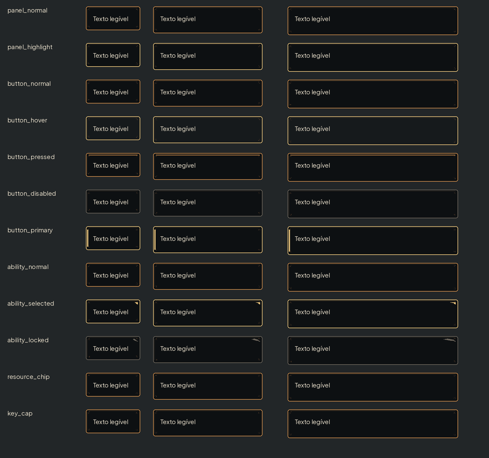

# Molduras de metal envelhecido — #20

Peças RGBA em art/ui/frames/. Metal escuro de baixo contraste, cobre e marcas de oxidação só nos cantos; o centro é calmo para o texto. Sem letras nos assets. Âncora: topo esquerdo (0,0) para todas.

| Arquivo | Canvas | 9-slice E/D/T/B | Margem de conteúdo E/D/T/B |
|---|---|---|---|
| panel_normal.png | 128×128 | 16 / 16 / 16 / 16 | 20 / 20 / 18 / 18 |
| panel_highlight.png | 128×128 | 16 / 16 / 16 / 16 | 20 / 20 / 18 / 18 |
| button_normal.png | 128×64 | 16 / 16 / 16 / 16 | 20 / 20 / 18 / 18 |
| button_hover.png | 128×64 | 16 / 16 / 16 / 16 | 20 / 20 / 18 / 18 |
| button_pressed.png | 128×64 | 16 / 16 / 16 / 16 | 20 / 20 / 18 / 18 |
| button_disabled.png | 128×64 | 16 / 16 / 16 / 16 | 20 / 20 / 18 / 18 |
| button_primary.png | 128×64 | 16 / 16 / 16 / 16 | 20 / 20 / 18 / 18 |
| ability_normal.png | 128×160 | 16 / 16 / 16 / 16 | 20 / 20 / 18 / 18 |
| ability_selected.png | 128×160 | 16 / 16 / 16 / 16 | 20 / 20 / 18 / 18 |
| ability_locked.png | 128×160 | 16 / 16 / 16 / 16 | 20 / 20 / 18 / 18 |
| resource_chip.png | 96×48 | 16 / 16 / 16 / 16 | 20 / 20 / 18 / 18 |
| key_cap.png | 64×64 | 16 / 16 / 16 / 16 | 20 / 20 / 18 / 18 |

Sem expand_margin. Tamanho mínimo de exibição: 48×48 (key_cap), 64×40 (resource_chip), botões96×48, painéis96×64, habilidades96×128. As margens de conteúdo são insets sobre a caixa final; área útil é [20,18,W−20,H−18]. Texto nunca abaixo de18; botões ao menos56px de altura quando há rótulo. Não reduzir a peça inteira: aplicar 9-slice com centro e bordas esticados.

Estados distintos por forma além da cor: principal com barra lateral; pressionado com filete interno deslocado; habilidade escolhida com canto triangular; bloqueado com corte diagonal. O texto de motivo e o ícone de bloqueio serão escritos pelo jogo; não depender apenas da borda. Normal/hover também precisam de foco via teclado no código do Claude.

## QA de design

Rodada1 — VEREDITO: REPROVADO. Média: ui_frames_preview.png tinha sobreposição de duas colunas. Correção: separação das posições para280/500/940px.

Rodada2 — VEREDITO: APROVADO. Conferidos 12 PNG RGBA, cantos limpos, margens16, centro estável em três proporções. Texto da prancha20px em creme sobre #0d1012, sem textura atrás que reduza leitura. Sem problemas altos ou médios. Observação baixa: desgaste deliberadamente discreto para sobreviver ao9-slice. Integração #16 e revisão em contexto pendentes.
