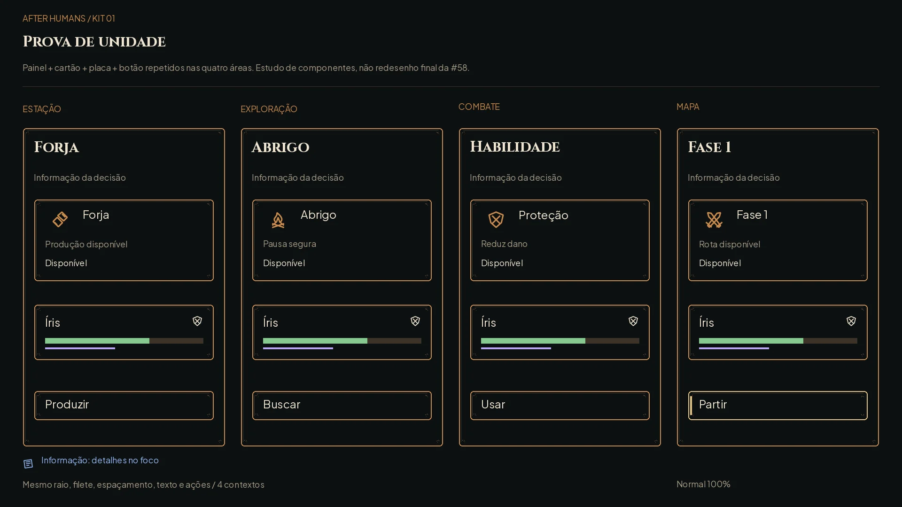
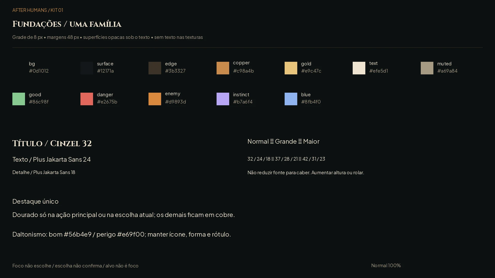
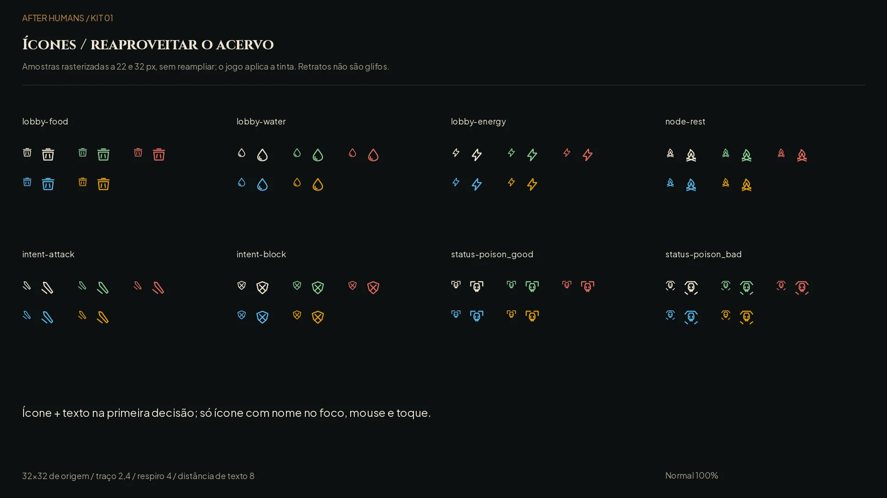
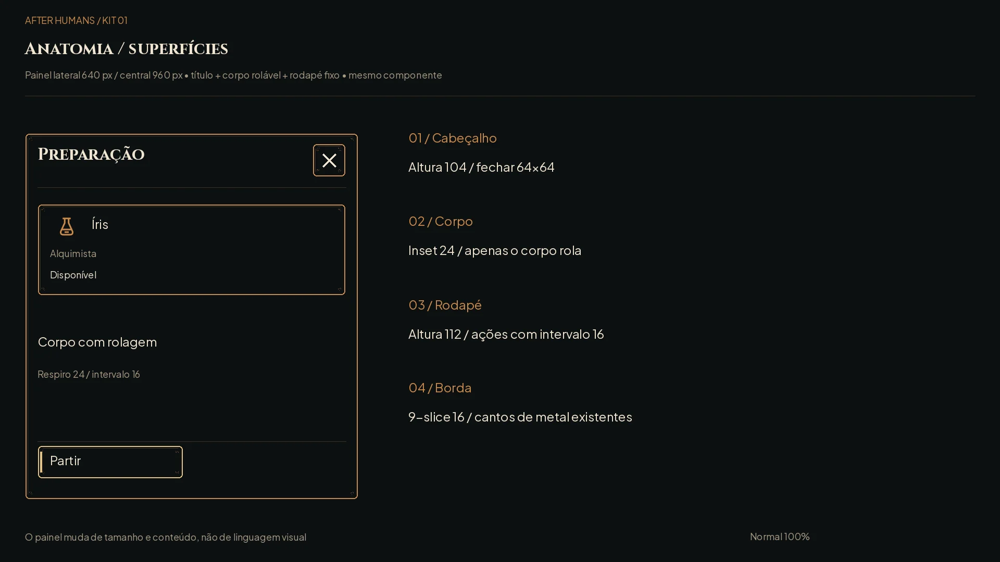
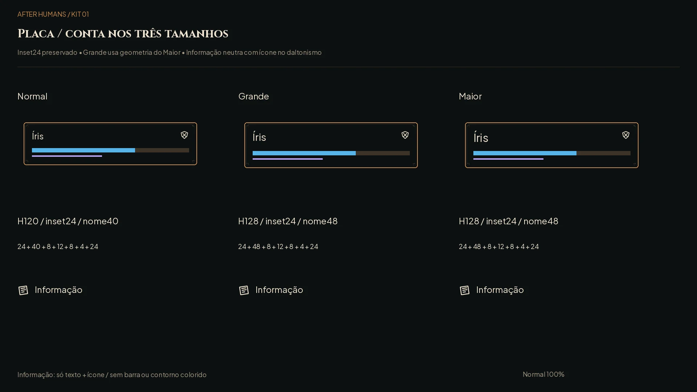
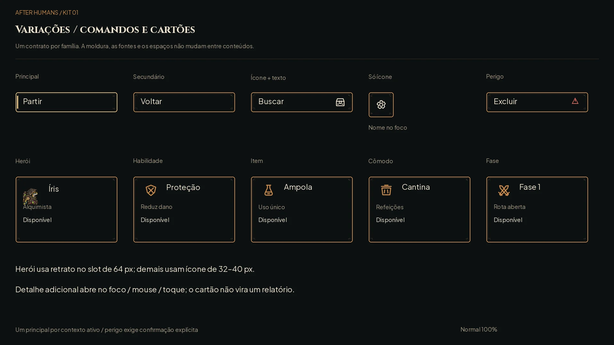
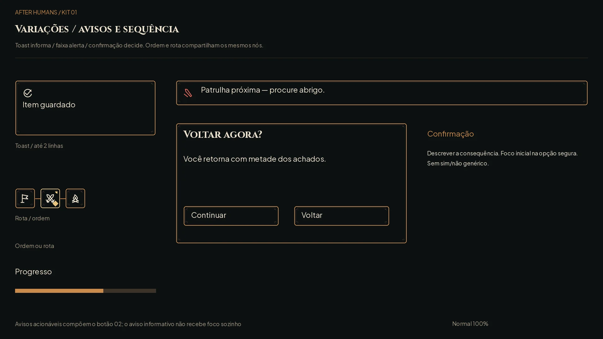
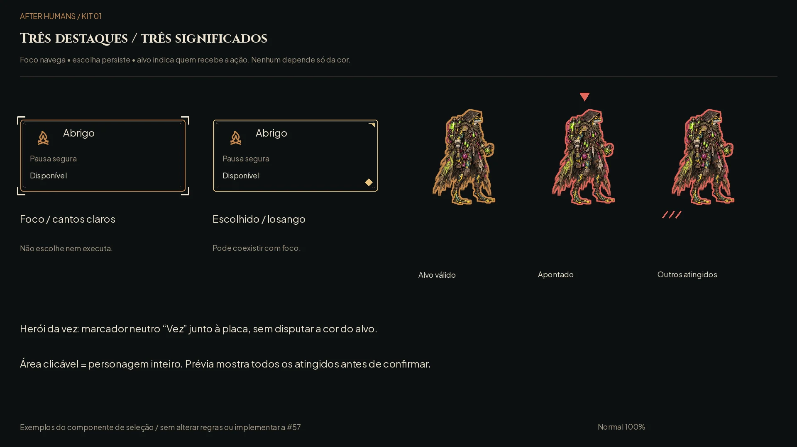

# Kit único de componentes — #59

> **Referência atual do combate:** [alvo aprovado de aço chanfrado](hud-target.md), com fonte condensada OFL e [peças/margens](hud-target/assets.json). Substitui a aparência de latão da C. O kit v1 abaixo fica como histórico.

**Versão 01, proposta para aprovação do Lucas. QA de design: APROVADO na rodada 4 (revisão do PR #65).** Base de leitura: commit `fceda77`, 24/10/2026. A #58 monta as telas com este kit após a aprovação; a #60 implementa os componentes no jogo. Esta entrega não muda a HUD em execução.

Estação, exploração, combate e mapa usam **o mesmo painel, cartão, placa e botão**. As quatro colunas são amostras independentes de contexto, não quatro janelas abertas ao mesmo tempo. As pranchas de estados são catálogos: vários destaques coexistem para comparação, não como proposta de HUD carregada.

## Fundações

- Base 1920×1080, origem superior esquerda. Grade de 8 px; intervalos 8/16/24/32/48. Margem externa 48; intervalo entre regiões 24; conteúdo das superfícies 24; ícone–texto 16 (8 nas fichas). Linhas de 1–3 px, barras finas de 4/12 px e o foco legado são exceções ópticas à grade, não novas grades de layout.
- Safe area soma-se aos 48 px; não pode ser coberta por botões. Painel lateral ancorado à direita e ao topo da área segura; central no centro da área segura; placa no centro inferior projetado do personagem; dica no controle de origem com afastamento 16; aviso no centro superior; ações no rodapé do painel. Evitar sobreposição com personagem, alvo e interação.
- **Três papéis de texto:** título Cinzel Bold 32 px / entrelinha 48; texto Plus Jakarta Sans Regular/Bold 24 / 40; detalhe Plus Jakarta Sans 18 / 32. Cinzel somente no título de tela/painel/modal, nunca em nomes de cartões, botões ou números. Nome de cartão usa texto; estado e detalhe usam detalhe.
- Grande usa **a geometria inteira do Maior**, incluindo slots e alturas reservadas, sem interpolar. Só a tipografia usa 115%. Grande = 115%: 37/28/21 px; Maior = 130%: 42/31/23 px, seguindo `Settings.TEXT_SCALE` e arredondamento de `AHUiStyle.px()`. Entrelinhas correspondentes: 56/40/32 e 64/48/40. Nunca encolher a fonte para caber. Aumentar a caixa, quebrar a linha ou rolar o corpo. Nada essencial fica acessível só por hover.
- No máximo esses três tamanhos em uma tela. Detalhe é informação secundária, não o tamanho padrão de leitura. Conteúdo essencial de decisão usa texto 24, inclusive números de custo quando determinam a ação.

| Papel | Cor Normal | Daltonismo | Regra de uso |
|---|---|---|---|
| Fundo | `#0d1012` | igual | Fora das superfícies |
| Superfície | `#12171a` | igual | Opaca sob texto; molduras atuais têm centro próximo ao fundo |
| Divisor/borda silenciosa | `#3b3327` | igual | Separar áreas; nunca única pista de interação |
| Filete de metal | `#c98a4b` | igual | Borda e estrutura; não destacar tudo |
| Texto | `#efe5d1` | igual | Leitura principal |
| Texto secundário | `#a69a84` | igual | Detalhe e explicação; também no desligado |
| Destaque | `#e9c47c` | igual | Uma ação principal no contexto ativo; destaque passa ao alvo durante a mira |
| Bom/vida | `#86c98f` | `#56b4e9` | Barra/benefício + forma de estado e nome acessível |
| Perigo | `#e2675b` | `#d55e00` | Triângulo/efeito negativo + consequência escrita |
| Inimigo | `#d9893d` | igual | Identidade da facção, não substitui perigo ou mira |
| Instinto | `#b7a6f4` | igual | Segunda barra fina, identificada na dica |
| Informação | `#8fb4f0` | `#efe5d1` | Apenas texto acompanhado de ícone; nunca barra, preenchimento ou contorno de estado |

Uma cor de atenção por contexto: a ação primária usa dourado em repouso; uma crise pode assumir o destaque; na mira, o alvo assume o destaque e os botões perdem a ênfase dourada. Vida, instinto e símbolos de estado mantêm suas tintas funcionais, sem preencher painéis inteiros. Não recolorir retratos nem cenários para indicar seleção.

Texto e texto secundário medem, respectivamente, **14,44:1 e 6,51:1** sobre `#12171a` (luminância sRGB, cores opacas; valores exatos no contrato). Nenhuma leitura depende da transparência sobre o cenário. Os nomes e as formas acompanham as cores; daltonismo troca a paleta, não a regra do jogo.

### Ícones, retratos e movimento

[Mesmos ícones em cinza](ui-kit/icons_gray.webp). Reusar SVG de `art/ui/icons/`, viewBox 32×32, traço 2,4, respiro 4; tamanhos 22 (estado denso), 32 (padrão), 40 (cartão). Slot do cartão 64×64; glifo centralizado, retrato 64×64. Nenhuma arte nova necessária em `art/ui/kit/`: as peças existentes cobrem o kit. Não duplicar PNG com textos ou cores de estado gravados.

Ícone + rótulo na primeira decisão e quando a consequência puder ser ambígua. Só ícone para ações conhecidas, com nome/dica em mouse, foco e toque. O primeiro toque revela e seleciona; a ação com consequência só confirma no comando explícito. Não exigir hover no celular. Estados das #17/#18 conservam formas distintas de benefício e prejuízo.

Hover: 100 ms, ease-out cúbica; pressionado: 60 ms, deslocamento visual de 2 px; abrir painel/dica: 160 ms, ease-out cúbica; fechar: 100 ms; barra: 180 ms entre valores já confirmados. Nada de espera antes da entrada. Dica após 250 ms de mouse parado, imediata no foco. Toast 4 s, pausado quando focado; pode ser consultado no registro. Faixa crítica persiste até o evento acabar. **Reduzir efeitos:** duração de transições 0, sem deslocamento, pulso, tremor ou cintilação; foco/alvo continuam visíveis estáticos. Nunca piscar a barra de vida.

## Anatomia e medidas comuns

O painel real desenhado acima mede 640×704. As matrizes abaixo usam amostras compactas para comparar estados; não representam os tamanhos mínimos de todos os componentes. Fonte e bordas das amostras continuam em escala de 1080p. Rótulos de anatomia escritos dentro de amostras pequenas não substituem o título Cinzel do painel real.

Todas as molduras vêm da #20: **9-slice E/T/D/B 16/16/16/16**, sem expand margin, âncora de textura (0,0). O conteúdo do novo kit usa **24 px em todas as bordas**, substituindo os insets divergentes das telas. Separar a área clicável de 48 px lógicos da arte pequena. Cantos e desgaste vêm do PNG existente, sem acrescentar ornamentos por tela.

| ID / componente | Normal na base 1080p | Grande (115%) | Maior | Anatomia e ancoragem |
|---|---|---|---|---|
| 01 Painel | lateral 640×704; central 960×704; máximo H=984 | Mesma geometria do Maior; texto 115% | mesma largura; título 104, rodapé 112; corpo rola | Cabeçalho 104 + corpo flexível + rodapé 112; inset 24; fechar 64×64 (80×80 no Maior); intervalo 16. Título e ações não rolam. Lateral à direita, central no centro seguro. |
| 02 Botão | H64, largura mínima 192; só ícone 64×64 | Mesma geometria do Maior; texto 115% | H80; só ícone 80×80 | Ícone opcional 32 + espaço 16 + rótulo; inset 24; clique ocupa caixa inteira. Botão de duas linhas cresce para H112/128. |
| 03 Cartão | W320 mínimo, H176; horizontal W480; slot 64 | Mesma geometria do Maior; texto 115% | H208; mesmo W mínimo, pode expandir | Slot à esquerda, título a x=104; uma linha de detalhe e um estado abaixo; inset 24. Com nome longo, crescer largura ou abrir segunda linha e acrescentar 48 px de altura; não cortar custo/efeito. |
| 04 Placa | W240..320, H120 | Mesma geometria do Maior; texto 115% | H128; nome longo cresce largura | Nome + 1 slot de estado/intenção 24..32; vida H12; instinto H4; separação 8; inset 24. Centro inferior preso ao mesmo ponto do ator em todos os modos, com afastamento de chão 16. |
| 05 Barras | vida H16, instinto H8, progresso H12; W mínimo 160 | Mesma geometria do Maior; texto 115% | largura cresce se houver texto; alturas iguais | Trilha escura + preenchimento + nome/valor acessível. Nome acima, 8 px de separação. Na placa usar a variante fina acima. Valores exatos na dica/foco; custo de decisão nunca ocultado. |
| 06 Ficha | H64, W mínimo 128 | Mesma geometria do Maior; texto 115% | H80 | Ícone 32 + espaço 8 + valor; padding horizontal 24. Sem texto repetido “Comida” em cada ficha; nome acessível/dica e primeiro uso identificado. |
| 07 Dica | W320..480, H conforme conteúdo | Mesma geometria do Maior; texto 115% | W480..640; altura cresce | Título em texto 24; até 3 linhas de corpo; inset 24. Até 2 termos explicados abaixo se indispensáveis; excedeu: abrir painel 01. Distância 16 do gatilho, reposicionar dentro da tela. |
| 08 Aviso | toast W448, H mínimo 112; faixa W variável H80; confirmação W736,H384 mínimo | Mesma geometria do Maior; texto 115% | toast H144; faixa H96; confirmação cresce H até caber | Ícone + mensagem; confirmação = painel 01 + dois botões 02. Sem nova moldura. Aviso com ação usa botão normal, não torna toda a faixa clicável. |
| 09 Sequência | nó 64×64; ligação 16; passo 80; até 8 visíveis | Mesma geometria do Maior; texto 115% | nó 80×80; passo 96 | Ícone/retrato ou posição no nó; marco atual; concluído com sinal de visita; futuro bloqueado com riscos + motivo. Rota e iniciativa só trocam conteúdo, não estrutura. |
| 10 Tecla | desenho 64×64; texto a 16; intervalo entre dicas 24 | Mesma geometria do Maior; texto 115% | desenho 80×80 | Glifo real do binding; rótulo da ação em texto/detalhe. Linha de dicas H64/80. Teclas longas aumentam largura; não abreviar binding sem legenda. |
| 11 Seleção | foco gap6, traço3, braço18; reserva externa16 | Mesma geometria do Maior; texto 115% | mesmas marcas; caixa acompanha controle | Foco: cantos claros; escolha: losango18×18, centro a24 do canto inferior direito; alvo: contorno do corpo 3px + marcador distinto. Pivô do alvo no personagem, não na placa. |
| 12 Abas/lista | aba H64; linha H64 mínimo; intervalo8 | Mesma geometria do Maior; texto 115% | H80; linhas de 2 textos H112 | Aba = botão 02 + marca escolhida; lista = cartões 03 em coluna compacta. Reusar dica e seleção. Área de rolagem só no corpo do painel; foco deve permanecer visível. |

Geometria relativa dos cartões em repouso: slot x24,y24; título x104,y24; detalhe x24,y88; estado x24,y128. No Maior, H208 conserva essas posições para linhas únicas (texto ocupa 31/23 px); com quebra, os elementos seguintes descem junto. As amostras de estado de W232 não são a largura recomendada de produção W320. A versão horizontal preserva a ordem de leitura, sem um novo tipo de cartão.

A placa fecha a conta com inset24: **Normal 24+40+8+12+8+4+24=120 px**; **Grande/Maior 24+48+8+12+8+4+24=128 px**. No Grande, a linha de nome reserva48 (a fonte28 usa entrelinha40); os8px restantes são folga do slot. Vida começa em y72 no Normal e y80 no Grande/Maior; instinto começa em y92/y100; fim do alfa de conteúdo em y96/y104, deixando24px inferiores.

## Onde usar, onde não usar

| Componente | Usar | Não usar |
|---|---|---|
| Painel | Cômodo, Mochila, mapa, Preparação, relatório, Opções e evento; variante lateral/central do mesmo contrato | Painel persistente só para exibir uma ficha ou intenção; nova moldura por sala |
| Botão | Principal: 1 no contexto ativo; secundário: voltar/cancelar; ícone+texto; só ícone com nome acessível; perigo com consequência | Botão principal em toda linha; seleção persistente depois de comando instantâneo |
| Cartão | Herói/retrato, habilidade/ícone, item/ícone, cômodo/ícone, fase/ícone | Cinco formatos diferentes para o mesmo conjunto título/detalhe/estado; empilhar estatísticas no cartão |
| Placa | Sob personagem na rua, arena e fila da Estação; nome, barra e um slot | Três HUDs de personagem; texto detalhado de intenção sempre aberto; exibir barra não aplicável (instinto de máquina) |
| Barras | Vida/instinto/progresso; só valores relevantes ao contexto; dica para valores exatos | Barra de progresso confundida com vida; barra sem nome acessível; converter instinto em percentagem sem indicar unidade |
| Ficha | Recurso + número, alerta com triângulo e explicação | Cor de alerta sem dizer qual falta/custo; repetir uma lista de recursos em vários cantos |
| Dica | Explicar ícone, intenção, termo, custo e previsão ao apontar/focar/tocar | Informação indispensável acessível apenas por mouse; relatório longo ou botões escondidos dentro de tooltip |
| Aviso | Resultado breve, crise/patrulha persistente, confirmação com consequência | Toast para uma decisão que exige resposta; modal para cada achado; “Sim/Não” sem verbos claros |
| Sequência | Ordem da rodada e trilha de trechos; clicar só quando há uma decisão permitida | Dois desenhos diferentes; nó de iniciativa como comando para trocar a ordem do jogo |
| Tecla | Dica de ação com binding efetivo, equivalência de controle | Teclas fixas pintadas na textura; mostrar teclado no modo toque sem necessidade |
| Seleção | Foco navega, escolha persiste, alvo recebe ação | Mesma marca para três significados; só colorir a placa para selecionar um personagem |
| Abas/lista | Mochila, Opções, Plano; uma escolha por grupo com foco independente | Abas escondendo custos de confirmação; listas com foco cortado ou scroll horizontal obrigatório |

Nas confirmações, usar verbos específicos e a consequência: “Continuar” / “Voltar”, não um Sim/Não genérico. Enter confirma o botão focado, nunca o perigo por padrão; Escape volta sem confirmar. Restaurar foco no controle de origem. Com modal aberto, só esse contexto pode ter ação principal.

Os 12 itens são contratos de composição, não 12 controles independentes a implementar: abas usam botão e seleção; listas usam cartão; confirmação usa painel e botões; avisos e placas usam barras/ícones. Não criar outra classe visual quando uma composição já resolve.

## Estados: um contrato, sem duplicar componentes

**Normal:** filete cobre, superfície calma. **Mouse:** `button_hover`, sem informação exclusiva. **Foco:** quatro cantoneiras claras de #25, sem mexer no conteúdo; se o scroll recortaria, cantos passam para dentro. **Pressionado:** `button_pressed`, deslocamento visual 2 px; volta ao estado anterior após soltar. **Desligado:** `button_disabled`, riscos e motivo alcançável por foco de leitura/dica; nunca apenas baixar opacidade. **Alerta:** triângulo ou glifo de perigo + mensagem/consequência, com `DANGER` da paleta ativa. **Escolhido:** `ability_selected` + losango persistente; foco pode coexistir.

Precedência: desligado impede ativação; alerta não impede automaticamente; pressionado só enquanto há acionamento; escolhido persiste; foco é uma camada independente; mouse não remove foco. Um comando comum não tem “escolhido”. As matrizes abaixo desenham cada estado aplicável; **“Não se aplica” é deliberado**, para não transformar barras, textos e superfícies em botões.

| Família | Estados aplicáveis | Observação |
|---|---|---|
| Painel | Normal, alerta | Foco fica em seus controles; painel não pode ser escolhido/pressionado/desligado |
| Botão | Normal, mouse, foco, pressionado, desligado, alerta | Escolha persistente pertence à aba/cartão, não ao comando |
| Cartão | Todos | Seleção só quando o cartão representa escolha; detalhes mantêm mesma estrutura |
| Placa | Normal, mouse, foco, alerta, escolhido | O personagem recebe o clique; placa pode receber foco de inspeção. Alerta ocupa o slot da intenção e a dica preserva ambas as informações |
| Barras | Normal, alerta | Foco de leitura vem da placa/gatilho, sem transformar a barra em botão |
| Ficha | Normal, mouse, foco, alerta | Clique só se abrir uma explicação; nesse caso compor botão 02 sem inventar nova pele |
| Dica | Normal, alerta | Não recebe foco/seleção/pressionado; aparece a partir do controle que já tem foco |
| Aviso informativo | Normal, alerta | Confirmação/ação usa os estados de botão e painel, não outra família |
| Sequência | Todos, no nó pertinente | Rota escolhida pode persistir; iniciativa só admite inspeção, sem pressionado/escolha de turno |
| Tecla | Normal, pressionado, desligado | Tecla ilustra binding; botão de remapear usa 02. Sem hover/foco no desenho puro |
| Seleção | Normal, mouse, foco, alerta, escolhido | Pressionado/desligado pertencem ao componente que recebe a marca |
| Abas/lista | Todos, na aba/linha pertinente | Tabuleiro/lista não recebe o estado inteiro por causa de uma linha |

| Grupo | Normal | Maior | Daltonismo | Maior + daltonismo |
|---|---|---|---|---|
| Painel / cartão / dica | [Prancha](ui-kit/states_01_normal.webp) | [Prancha](ui-kit/states_01_large.webp) | [Prancha](ui-kit/states_01_colorblind.webp) | [Prancha](ui-kit/states_01_large_colorblind.webp) |
| Botão / ficha / tecla | [Prancha](ui-kit/states_02_normal.webp) | [Prancha](ui-kit/states_02_large.webp) | [Prancha](ui-kit/states_02_colorblind.webp) | [Prancha](ui-kit/states_02_large_colorblind.webp) |
| Placa / barras / avisos | [Prancha](ui-kit/states_03_normal.webp) | [Prancha](ui-kit/states_03_large.webp) | [Prancha](ui-kit/states_03_colorblind.webp) | [Prancha](ui-kit/states_03_large_colorblind.webp) |
| Sequência / abas / seleção | [Prancha](ui-kit/states_04_normal.webp) | [Prancha](ui-kit/states_04_large.webp) | [Prancha](ui-kit/states_04_colorblind.webp) | [Prancha](ui-kit/states_04_large_colorblind.webp) |

Alvos no corpo: válido = contorno fino e nome no foco; apontado = contorno forte + seta acima; outros atingidos = contorno + três riscos junto aos pés. O herói da vez ganha marcador textual “Vez” junto à placa. Bom/perigo usa a paleta ativa; mira aliada usa bom em vez de perigo. A arte não é deformada; hitbox abrange o corpo inteiro, sem exigir clique na placa. O exemplo de Íris é apenas o manequim local de demonstração, não uma mudança de facção/regra. A prévia de atingidos aparece antes de confirmar e não pode omitir chance, dano, custo, posições válidas ou efeitos relevantes à decisão. Detalhamento de tela fica para #58/#57.

## Reuso e mudança em relação ao que já existe

| Entrega anterior | Fica | Muda e motivo |
|---|---|---|
| #20 molduras | Todos os PNG, filete, desgaste, 9-slice16 e estados de botão | Unificar inset em24; `ability_*` vira pele da família cartão, não um segundo sistema; sem troca de nomes |
| #17 ícones | Formas monocromáticas, tintas no runtime, nomes atuais inclusive hífens legados | Padronizar slots/tamanhos; não usar ícone desconhecido sem nome acessível |
| #18 estados/intenção | Os símbolos e formas de bom/ruim | Um slot na placa; demais estados ficam em fila curta na inspeção. Intenção abre previsão no foco, não parágrafo fixo |
| #25 foco | Cantos gap6/traço3/braço18; losango de escolha | Aplicar o mesmo contrato em todas as telas; alvo do personagem tem contorno/seta próprios |
| #26 retratos | PNG256×256 e identidade; uso64 padrão, sem máscara gravada | Slot único para cartões e sequência; sem retratos gigantes em toda ficha; nunca tratar rosto como glifo22 |
| AHUiStyle atual | Fontes, paleta, semântica, bindings e acessibilidade | Substituir estilos locais por estas famílias na implementação #60, sem novos ids |

## Índice, acessibilidade e reprodução

Todas as pranchas principais são WebP 1920×1080, sem assets de produção novos. [Contrato de tokens e componentes](ui-kit/contract.json) contém medidas, papéis, estados e contraste. [Gerador de pranchas](ui-kit/render.py) é ferramenta de documentação; depende de Python, **Pillow 13.0.0 e CairoSVG 2.9.1**. Prévias finais em WebP; originais mantidos em `/workspace/scratch/round79_80/kit-originals/`, fora do repositório. Rodar da raiz: `python docs/design/ui-kit/render.py`. Não lê saves nem altera o jogo. Textos só nas pranchas, jamais nas texturas.

| Prancha | Normal | Maior | Daltonismo | Maior + daltonismo |
|---|---|---|---|---|
| Anatomia | [Abrir](ui-kit/anatomy_normal.webp) | [Abrir](ui-kit/anatomy_large.webp) | [Abrir](ui-kit/anatomy_colorblind.webp) | [Abrir](ui-kit/anatomy_large_colorblind.webp) |
| Variações | [Abrir](ui-kit/variants_normal.webp) | [Abrir](ui-kit/variants_large.webp) | [Abrir](ui-kit/variants_colorblind.webp) | [Abrir](ui-kit/variants_large_colorblind.webp) |
| Avisos | [Abrir](ui-kit/feedback_normal.webp) | [Abrir](ui-kit/feedback_large.webp) | [Abrir](ui-kit/feedback_colorblind.webp) | [Abrir](ui-kit/feedback_large_colorblind.webp) |
| Seleção | [Abrir](ui-kit/selection_normal.webp) | [Abrir](ui-kit/selection_large.webp) | [Abrir](ui-kit/selection_colorblind.webp) | [Abrir](ui-kit/selection_large_colorblind.webp) |
| Unidade | [Abrir](ui-kit/unity_normal.webp) | [Abrir](ui-kit/unity_large.webp) | [Abrir](ui-kit/unity_colorblind.webp) | [Abrir](ui-kit/unity_large_colorblind.webp) |
| Unidade a 40% | [Abrir](ui-kit/unity_normal_40.webp) | [Abrir](ui-kit/unity_large_40.webp) | [Abrir](ui-kit/unity_colorblind_40.webp) | [Abrir](ui-kit/unity_large_colorblind_40.webp) |
| Unidade cinza | [Abrir](ui-kit/unity_normal_gray.webp) | [Abrir](ui-kit/unity_large_gray.webp) | [Abrir](ui-kit/unity_colorblind_gray.webp) | [Abrir](ui-kit/unity_large_colorblind_gray.webp) |

As reduções são reais, 768×432; verificam hierarquia e reconhecimento, não tornam uma fonte de18px confortável em celular. No dispositivo, manter alvo mínimo **48×48 px lógicos**, gap8, com fonte respeitando a escala do sistema; reorganizar em coluna e rolar em vez de apenas encolher toda a HUD. A #58 precisa mostrar esse arranjo em telas reais, além da redução pedida. Controle usa os mesmos cantos de foco; toque mostra nome/efeito sem depender de mouse; texto Grande usa escala intermediária do mesmo contrato.

## QA de design

Registro após avaliação com `docs/design/qa.md`, acrescida dos critérios da #59. Histórico e validação final em [qa.md](ui-kit/qa.md). A aprovação técnica de design não substitui a aprovação visual do Lucas nem a QA em jogo da implementação #60.

## Variante do mapa — #69

A família Sequência recebe etiquetas disponível/bloqueada/concluída/refúgio, compostas com Painel e Seleção, sem textura nova. [Pranchas, medidas, idiomas e QA](map_labels.md). Normal 240×96; Grande/Maior 272×112; 9-slice 16; ícone 24; foco externo 6. Contrato em `components.sequence.map_label_variant`.

## Variantes compactas — #58

A QA da primeira montagem da HUD identificou medidas compactas ainda sem contrato. Antes da montagem corrigida, estas variantes passaram a fazer parte das mesmas famílias, reutilizando todas as texturas, fontes, ícones e estados existentes:

| Família | Variante e medidas |
|---|---|
| Placa | 160×72 aliado;208×72 inimigo; padding16; posição18/21/23; vida12, trilha de instinto4; nome e valores no foco; mesma geometria nas três escalas |
| Botão | ícone de habilidade104×104, arte64; ação136×104, ícone40; tecla18/21/23; motivo de bloqueio no foco |
| Ficha | altura64, ícone32, valor24/28/31; nome e previsão no foco |
| Sequência | faixa544×96, até6 retratos48, passo56; atual marcado por losango, retrato e luz no corpo |

[Prancha das variantes](ui-kit/hud_compact.png). O contrato guarda as coordenadas locais. Não é outra HUD ou família visual: é a apresentação resumida dos mesmos componentes, que revela os detalhes ao apontar/focar. Dica mantém largura480 Normal/640 Maior, conforme o kit; o detalhe longo usa18/23 e não cobre o herói atual.

QA das variantes — rodada1: **VEREDITO: APROVADO**. Conferidos Normal/Maior, fontes mínimas, 9-slice16, ícones32/40/64, barras distintas por espessura, foco e escolha separados, geometria sem corte. Cinza e daltonismo continuam apoiados em formas e texto no foco. Sem novos assets de runtime. Esta aprovação antecede a segunda montagem das telas #58.

Toque na HUD v2: a revisão usa alvos112×112 e passo128 (44,8px a40%), com a mesma família de botão. [Prancha e QA da HUD](hud-v2/qa.md). O contrato registra essa medida; não usar88px para os controles de toque reduzidos.

## Composições do laço — #96

Antes das telas, foram registradas as variantes nas famílias existentes: cartão de carga320×272/296, arte224×192 com âncora112,184; cartão de melhoria432×240/272; sequência de3 estrelas32, passo48, com rótulo numérico; ligações de Pesquisa entre cartões320×176/208 (208/240 com título quebrado); iniciativa até8 retratos na faixa656×96. Não há moldura nova. Painel, barras, fichas, aviso, seleção e foco continuam os mesmos.

[Prancha dos componentes](loop-screens/components.webp). QA dos componentes: **VEREDITO: APROVADO**, Normal/Maior, caixas alinhadas, estrelas cheias/vazias distintas sem cor, conteúdo e seleção dentro da moldura. Os números novos mostrados na prancha são exemplos de layout, não uma tabela de progressão. As telas da #96 são montadas depois desta validação.
