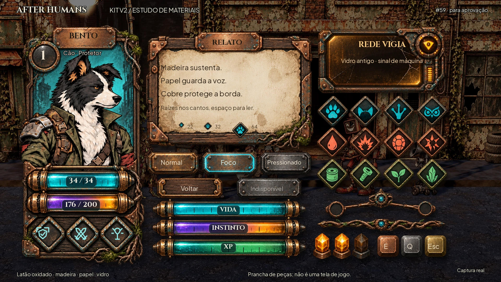

# Kit v2 — prancha inicial de estilo (histórico)

**[HUD C consolidada](../hud-c.md)** é a referência atual de combate.

**[Ver agora as três variações de HUD em uso](../hud-variations.md)** — A ornamentada, B gráfica, C compacta. Lucas escolheu **C**; foco atual somente na HUD, com os ícones do Nick reservados para o futuro.

**Etapa de direção de arte da #59. Aguarda aprovação do Lucas.** Segue [hud-direction.md](../hud-direction.md), incorporado de `origin/main` antes do desenho. As telas da #96 não foram refeitas nesta etapa.

A proposta trata a interface como objetos feitos pelos sobreviventes: cobre e latão oxidados, ferragens rebitadas, madeira escura, papel gasto e vidro antigo. Cada material tem um papel; cada peça tem uma silhueta. O retrato ocupa a carta, as contagens ficam em medalhões, e a luz tem origem no mundo.

## O que avaliar nesta prancha

- A carta de Bento com retrato grande, nome em plaqueta, nível em medalhão, barras e passivos em losango.
- A janela grande de papel com aba saliente e raízes discretas nos cantos; a janela média de vidro de terminal; o pequeno encaixe de metal.
- Botão principal com volume e foco ciano, secundário mais quieto, pressionado e desabilitado distinguíveis pela forma/material.
- Vida, Instinto e XP em tubos com encaixes, vidro, marcações e brilho contido; Instinto aquece na aproximação da crise.
- Famílias de glifos riscados em losango: espécies, estados e recursos, com símbolos diferentes além da cor.
- Divisor com nó de raízes, conector ramificado, gemas acesas/apagadas e teclas em moedas soltas.

Ciano das raízes identifica equipe/Estação/ação disponível. Âmbar identifica a Rede VIGIA e suas máquinas. Ambos precisam de forma e símbolo; cor sozinha não distingue alvo, bloqueio ou seleção. Não há magia nem glifos com significado narrativo novo.

As referências fornecidas pelo Lucas orientam material, hierarquia, volume e qualidade de acabamento. Não foram copiadas nem adicionadas ao repositório.

## Alcance desta entrega

Esta é uma **prancha de estilo**, não uma tela jogável ou um atlas pronto para integração. A composição reúne peças em exposição, lado a lado, sobre um frame verdadeiro da luta. Não representa posicionamento final da HUD. Textos e números são demonstrações de tipografia/encaixe, sem regras novas.

O kit anterior e as telas v1 permanecem como histórico. A aprovação técnica da QA não substitui a aprovação visual do Lucas. Só depois da aprovação da prancha serão preparados recortes de produção, métricas de 9-slice por material, estados completos, texto Maior e equivalentes de daltonismo, antes de remontar a #96.

## QA de design

A revisão desta etapa confere a direção nova, os materiais, a hierarquia, os símbolos, o fundo real, a legibilidade e o escopo. As regras anteriores de cor cedem à direção nova expressa por Lucas em `hud-direction.md`; mínimos tipográficos e leitura por forma continuam.

### Composição e medidas do estudo

[Manifesto](v2/composition.json): canvas1920×1080; arte de estudo1672×940 em(64,88), sem distorção. O fundo é [o frame limpo da luta](../loop-screens/before/combat_clean.webp), com brilho48% e saturação80%; enquadramento e personagens do cenário não foram redesenhados. O manifesto guarda hash da captura e da composição. O retrato ampliado é um estudo ilustrado a partir do Bento existente; nenhum retrato usado pelo jogo foi substituído.

A carta ocupa aproximadamente448×920; a janela de papel640×440; terminal500×260. Essas são **dimensões da exposição**, não tamanhos finais dos componentes. Na prancha, o mesmo losango aparece em22/32/64; o painel de famílias mostra os glifos maiores para avaliar a linguagem. Texto de detalhe mínimo18, corpo22–28 e Cinzel nos nomes/títulos; sem fonte nova. Os valores34/34 e176/200 exemplificam encaixe de números no vidro, não o estado medido daquela luta. As barras isoladas expõem material e marcações, não percentuais finais de jogo.

Os cantos, o relevo, as raízes e os encaixes serão recortados em camadas depois da aprovação. Não esticar a imagem inteira como 9-slice: raízes e parafusos devem ficar em cantos/capas independentes, e o vidro precisa separar trilha, preenchimento e reflexo. O número terá uma área de leitura no vidro, sem graduação atravessando as letras. No Instinto, a ponta quente acompanha a proporção e o aviso de crise; não usar o tubo inteiro luminoso para indicar zero.

A [cópia a40%](v2/style_board_40.webp), a [cópia em cinza](v2/style_board_gray.webp) e a [prova de ícones22/32 em fundo claro/escuro](v2/glyph_readability.webp) acompanham a prancha. O contraste ciano/âmbar expressa origem; espécies/estados/recursos continuam identificáveis por desenho. A definição completa dos perfis acessíveis pertence à próxima etapa do kit, após aprovar a linguagem visual.

### Rodada1 — VEREDITO: REPROVADO

| Arquivo | Problema | Gravidade | Correção |
|---|---|---|---|
| `v2/style_board.webp` | Legenda superior direita ultrapassava o canvas. | Média | Reposicionar dentro da margem. |
| `v2/style_board.webp` | Título longo da janela avançava nos parafusos; graduações disputavam a leitura dos números no vidro. | Média | Plaqueta com título curto e área de leitura própria no vidro. |
| `v2/style_board.webp` | Conector de três pontos era linear, sem ramo de Pesquisa. | Média | Remontar o metal pintado em pai e dois filhos, com junção e encaixes. |
| `v2/glyph_readability.webp` | Recortes pequenos carregavam fragmentos de peças vizinhas. | Média | Limitar o alfa de cada amostra ao seu losango. |

### Rodada2 — VEREDITO: APROVADO para a prancha de estilo

Conferidos a direção do Lucas, os materiais lado a lado, as três escalas de moldura, o retrato dominante, as barras, medalhões, gemas, teclas soltas, conector, divisor e famílias de losango. Textos dentro do canvas, mínimos18; nome e número com áreas de leitura; figura e símbolo continuam distintos em cinza e na redução. Raízes/musgo só nas peças grandes; máquinas identificadas pelo vidro e sinal geométrico. Não há faixas de ponta a ponta, cópia das referências, código de jogo ou assets de produção substituídos.

Sem problema alto ou médio pendente **no escopo desta prancha**. A aprovação da QA é técnica para apresentar o estudo; **a direção ainda aguarda aprovação do Lucas**. Estado pressionado/desabilitado, pequenas silhuetas e comportamento do brilho serão refinados em suas escalas de uso na etapa seguinte, junto com texto Maior e daltonismo; esta folha não certifica um kit integrado.

Godot4.7.2:43/43 testes em235,294s, paridade48/48 (3351 passos), saída0. Avisos de recursos/RID/ObjectDB no encerramento permanecem. Só `docs/` nesta entrega; originais PNG fora do Git e referências privadas fora do repositório público. `docs/.gdignore` continua protegendo as provas da importação da Godot.

Reprodução: `python docs/design/ui-kit/v2/compose.py` com Pillow e CairoSVG refaz a composição a partir do estudo WebP e do frame já versionados. O PNG mestre externo não é necessário. A ordem permanece: Lucas aprova esta prancha → detalhar o kit v2 → refazer a #96.
