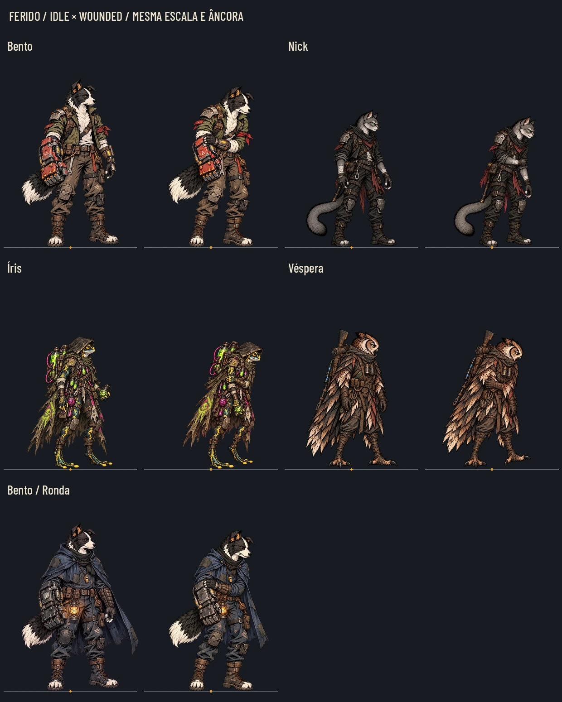

# Fundadores feridos, mas de pé (#195)

Cinco arquivos `wounded.webp`: Bento, Nick, Íris, Véspera e Bento com a Ronda. A versão da skin usa a mesma pose ferida do Bento comum, trocando só o traje; completa a entrega da Ronda no PR #204. Nenhuma pose idle, hurt ou death foi substituída.

[Prancha a40%](wounded/poses_40.webp) · [Cinza40%](wounded/poses_gray_40.webp) · [Leitura na noite/claro](wounded/readability.webp) · [Contrato e hashes](wounded/contract.json) · [Auditoria](wounded/audit.json).

## O gesto

Peso apoiado numa perna, outro joelho relaxado, ombros caídos/assimétricos, tronco pendendo e mão amparando o braço ou flanco. O rosto mostra dor contida. O personagem continua de pé e pronto para um deslocamento manco; não há recuo de golpe ou queda ajoelhada.

- **Bento:** a mão menor ampara o antebraço do punho de sucata, que pesa perto do corpo; roupa/equipamento atuais. A faixa vermelha original é tecido, sem manchas novas de sangue.
- **Nick:** uma mão ampara o outro braço; escápulas e cabeça caem para a frente; olhos verdes, bainha, lenço e cinto preservados, sem sacar arma.
- **Íris:** o braço é amparado e o frasco verde fica baixo na mão fraca; mantidos pele manchada, capuz, tanques, tubos e frascos químicos. Nenhum detalhe rosa/verde é ferida.
- **Véspera:** asa/braço amparado junto ao flanco, cabeça baixa; plumagem, bico, binóculos, rifle nas costas e garras preservados.
- **Bento/Ronda:** mesma postura e expressão do Bento ferido, com a capa anil/carvão, apito e lampião. Não usa o Mergulhador.

Sem sangue, gore, cortes abertos, curativos inventados ou novos acessórios. O balanço de mancar, a velocidade, o limiar de vida e reduzir efeitos são código da #194, não animação embutida nesta imagem estática.

## Medidas para integrar

Cada `art/combat/heroes/<nome>/wounded.webp` usa o canvas exato do idle da classe. A skin vai em `art/skins/bento/watch/wounded.webp`. O contrato preserva o canvas/âncora canônicos e a altura de referência do idle; o pé e o tamanho da cabeça são a referência. **Não aumentar o personagem para compensar a cabeça naturalmente mais baixa do gesto.** A conversão para textura usa a razão uniforme da largura do canvas, como o motor.

| Variante | Canvas final | Âncora canônica x,y | Âncora na textura x,y |
|---|---|---|---|
| bento | 543×724 | 473, 1429 | 236.500, 714.500 |
| nick | 589×668 | 488.5, 1286 | 244.250, 643.000 |
| iris | 589×668 | 587.5, 1264 | 293.750, 632.000 |
| vespera | 589×668 | 451, 1297 | 225.500, 648.500 |
| bento_watch | 543×724 | 473, 1429 | 236.500, 714.500 |

Não há9-slice. As fontes PNG usam os canvases originais declarados no contrato. Na conversão para WebP, preservar exatamente o tamanho final indicado por arquivo, inclusive os arredondamentos dos canvases de altura ímpar.

A prancha compõe pares na mesma escala e marca a mesma âncora em âmbar. A cabeça mais baixa e os joelhos dobrados são a pose, sem redimensionamento pela altura do alfa. O Bento/Ronda recebe a mesma translação do Bento comum, sem recentrar pela capa. A prova de leitura usa recortes reais de noite/claro, sem alegar que a regra de ferido já foi integrada.

## Fontes fora da main

Tag `codex-pr<N>-originals`; pasta `art/combat/source/wounded_20261028/`, somente num commit isolado de fontes. O Release usa o ZIP automático dessa tag, cuja árvore contém só originais/contrato. Os PNG não entram no PR nem no histórico da branch para a main. Tag/link serão preenchidos ao abrir o PR.

Reprodução depois de extrair a tag: `python docs/design/wounded/build_delivery.py --sources art/combat/source/wounded_20261028`. Dependências: Pillow, numpy e scipy. Os arquivos individuais PNG são as fontes normalizadas para o pipeline do Claude; os brutos da ferramenta de imagens permanecem fora do Git.

## QA de design — VEREDITO: APROVADO (rodada1)

Checklist de [qa.md](qa.md): conferidos lado, espécie, rosto, roupas, equipamentos, apoio do pé, proporção/cabeça, mãos e garras, canvas, alfa, corpo inteiro, sem sangue e leitura reduzida. Comparados os cinco pares,40%/cinza e claro/noite. O gesto lê como ferido de pé, distinto de hurt/death. As diferenças de espécie são mantidas: mãos/pele da Íris e asas/plumas/garras da Véspera, sem anatomia mamífera nova. O rosto e o punho do Bento persistem entre traje comum e Ronda. As âncoras canônicas e os idles originais foram conferidos por contrato/hash. Sem texto nas artes, sem problema alto ou médio pendente na entrega. A aprovação artística final é do Lucas e a QA dinâmica é da integração #194.

## Validação e limites

Cinco WebP RGBA nos canvases exatos; auditoria em audit.json, fontes PNG e hashes no contrato; originais de referência intactos. Nada em scripts/data/tests, nenhum id alterado. A importação foi conferida. A base20890be altera só documentação em relação à base177c70d já testada na entrega da Ronda; a situação do runner e o resultado da execução desta branch ficam registrados no PR. A integração da regra, do passo e do aviso de recuperação permanece com o Claude na #194. Os recrutas em camadas seguem na #191.

**Runner desta branch:**78/79 em513,032s, paridade48/48. Falhou somente test_faces pela ausência de retratos/caixas da cara do Guaxinim e Tatu, já presente na base antes da arte. Importação final concluída; avisos de recursos/ObjectDB e lambda liberada no Treino registrados. Sem mudança em scripts/data/tests.
