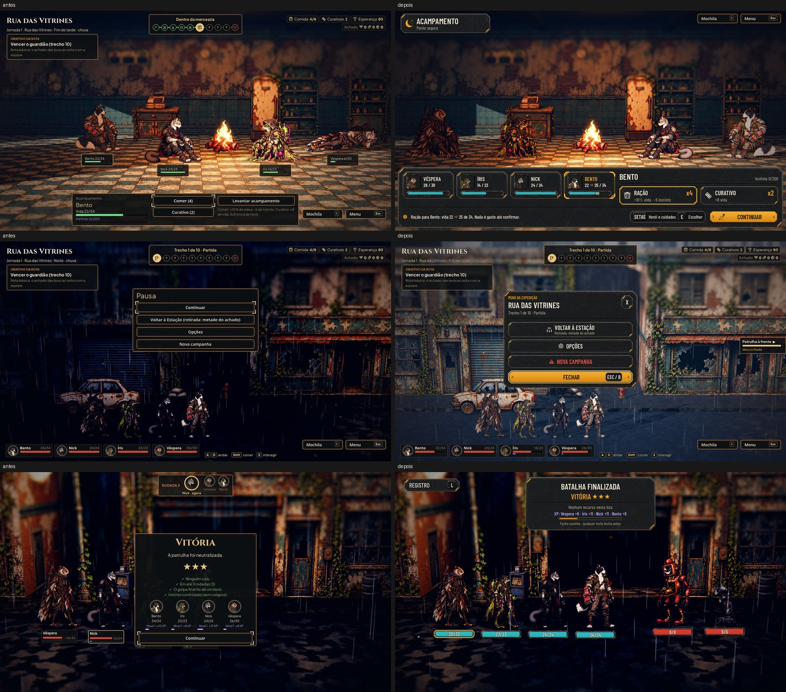

# Acampamento, Menu da expedição e popup de fim de luta (#109)

A integração de [hud-ajustes.md](../design/hud-ajustes.md), no kit da Awesomic (`art/ui/kit/station`).

As maquetes (à esquerda) e o jogo (à direita), nas oito telas: o acampamento com a Ração em foco e com o Nick de vida
cheia e instinto em 0, o Menu da expedição, e o popup da patrulha, do nível novo (os quatro com o Treino pronto), do
guardião, da fuga e da derrota.
- [Normal](adjustments/target_game.jpg)
- [Maior](adjustments/target_game_large.jpg)

As fotos saem de `tools/capture_109.gd` (o daltonismo e o Maior com daltonismo também, com `--colorblind`).

## O acampamento

- **A cena:** uma fileira de lado, como a luta: Véspera e Íris à esquerda da fogueira, Nick e Bento à direita, todos
  na mesma linha do chão e virados para o fogo (`AHCampScene.SLOTS`). Com menos gente, os lugares de dentro primeiro. A
  câmera fica parada na fogueira (`FOCUS_PULL` 0), e o escolhido se marca pela luz da escolha e pela carta. Ao abrir, o
  escolhido é o líder.
- **Quem chega deitado** (até um quarto da vida) num lugar da ponta chega 0,45 m para dentro (`LIE_INSET`): a pose
  deitada é mais larga e sairia do quadro.
- **O painel de baixo** (`AHCampHud`): as cartas na ordem da cena, o herói escolhido com o instinto, RAÇÃO e
  CURATIVO grandes com o estoque, a linha de estado, a dica das teclas e CONTINUAR.
- **A prévia:** com o foco (ou o mouse) num cuidado, a carta mostra a vida prevista na barra (`bar_preview`) e no
  número ("22 → 25 / 34"), sem gastar nada. A conta é a de `AHJourneyRules.camp_preview`, a mesma de
  `camp_use_food` e `camp_use_bandage`.
- **Sem estoque:** a linha diz que a comida ou os curativos acabaram, e a carta não mostra prévia nenhuma.
- **Sem efeito:** o véu com riscas e o tom apagado. A Ração só fica sem efeito com a vida cheia **e** o instinto em
  0; com o instinto acima de 0 ela continua ativa e a linha diz que só baixa o instinto. O Curativo fica sem efeito com
  a vida cheia.

## O Menu da expedição

No lugar da Pausa: o título pequeno em âmbar, o lugar, o trecho, o X, VOLTAR À ESTAÇÃO com o custo na sublinha (ou
apagado no meio de uma luta ou evento), OPÇÕES, NOVA CAMPANHA em alerta e FECHAR. O pé do painel fica em
y 720, acima das cabeças da equipe. O foco abre em FECHAR, e a tecla dele é a do Menu nas Opções (com o B do controle).

## O popup de fim de luta

- Um painel pequeno no alto (y 24), no lugar da ordem da rodada (que some enquanto ele está aberto).
- "BATALHA FINALIZADA", o resultado (Vitória com as estrelas, Fuga, Derrota em alerta), os recursos da luta em chips ou
  "Nenhum recurso nesta luta", o XP numa linha na ordem da cena, "Treino pronto" de quem fechou o nível (numa linha
  só: até dois, os nomes; mais que isso, quantos) e, depois do guardião, o aviso da carga.
- Fuga e derrota mostram o que se perdeu, em chips na cor de alerta (a fuga sem nada carregado não fala em perda).
- **Decisão do Lucas:** a vitória e a fuga fecham sozinhas em cerca de 2,5 s (a linha âmbar é o tempo que falta; a
  velocidade 2x encurta pela metade) ou com qualquer tecla, clique ou toque (a roda do mouse não fecha). A derrota
  espera um toque, menos na luta automática, que não tem quem toque. Sem botão.

## Testes

- `tests/test_camp_scene.gd`: a fileira, o líder escolhido, a câmera na fogueira, as cartas e o estoque; a prévia da
  Ração e do Curativo sem gastar nada e igual ao que a regra faz; sem estoque, nenhuma prévia; a Ração ativa com a
  vida cheia e o instinto acima de 0 (e o Curativo com o véu); nada com efeito no instinto 0; o painel não cobre
  nenhum corpo e ninguém sai da tela, nem deitado, no Normal e no Maior.
- `tests/test_fight_popup.gd`: os recursos do popup batem com `end_combat`; a vitória fecha sozinha em cerca de 2,5 s,
  qualquer tecla fecha antes e a derrota espera um toque; a ordem da rodada some e volta; nenhum botão; com os quatro
  de Treino pronto, o XP e a carga, o popup não cobre ninguém (com 8 px de folga), no Normal e no Maior; numa vitória
  de verdade contra o guardião, a carga abre só depois que o popup fecha.
- `tests/test_fight_rewards.gd`: numa luta de verdade, as estrelas, o XP na ordem da cena, nenhum botão e o fechamento
  sozinho.
- `tests/test_keyboard_navigation.gd`: o foco do Menu abre em FECHAR.

## Fica para o lote da exploração (#106)

Os botões MOCHILA e MENU do canto ainda são os de antes; entram no kit com o resto da exploração.

## Rodadas da QA

### Rodada 1: REPROVADO

**Média, corrigidos:**
- Com vários heróis de Treino pronto, o popup descia sobre as cabeças. Agora os prontos ficam numa linha só, o popup
  sobe para y 24 e fica mais compacto (o divisor de baixo só aparece na derrota, que não tem a linha do tempo). Um
  teste confere o pior caso (os quatro prontos, o XP e a carga) contra os corpos, no Normal e no Maior.
- O FECHAR do Menu mostrava "Esc / B" fixo; agora mostra a tecla do Menu das Opções.
- Sem estoque, a carta ainda mostrava a vida prevista; agora não mostra, e um teste confere.
- Faltavam o teste da carga do guardião depois do popup e a captura do nível novo; os dois entraram.

**Baixa, corrigidos:**
- "Ração no Íris" virou "Ração para Íris".
- Os comentários de `end_combat` e `camp_use_food` voltaram para cima das suas funções.
- A derrota da luta automática fecha sozinha (as capturas não travam mais).
- A roda do mouse não fecha o popup.
- A fuga sem nada carregado não fala em perda.

**Ficam como estão:** "%s is at full health." já existia no jogo; o Menu do acampamento cobre a Íris no Maior, mas
é um modal.

### Rodada 2: REPROVADO

**Média, corrigido:**
- No Maior, com os recrutas de nome mais longo, o popup com os quatro de Treino pronto ainda descia sobre a cabeça do
  herói da frente: a linha do XP quebrava cedo. Agora o popup alarga com o texto até 900 de largura antes de quebrar,
  e, com mais de dois prontos, a linha diz quantos ("4 heróis: Treino pronto"), pois os nomes estão no XP logo acima.
  O teste usa os quatro nomes mais longos de `NAME_POOLS` e confere o Normal, o Maior e o Maior em inglês.

**Baixa, corrigido:**
- A captura passa as três estrelas, para comparar com a maquete.

### Rodada 3: APROVADO

O popup com os quatro nomes mais longos, os quatro prontos e o guardião não cobre ninguém no Normal (pé em y 363), no
Maior e no Maior em inglês (pé em y 432; as cabeças começam em y 446).

**Para o Lucas decidir:** o "Treino pronto" volta em toda vitória enquanto o herói não treina no Alojamento, como na
tela antiga. Se ficar repetitivo, dá para mostrar só para quem fechou o nível nesta luta.
