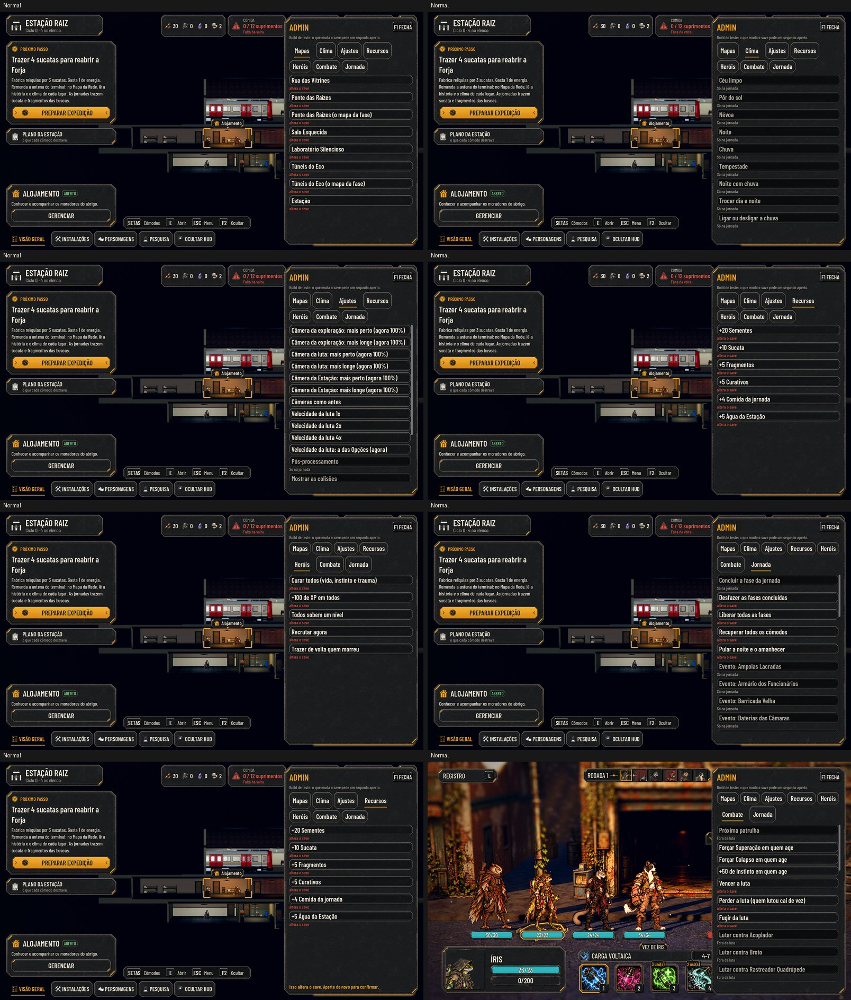

# A barra de Admin para testes (#130)

O pedido do Lucas (26/10): a barra de Admin da Unreal (o `AHAdminWidget`, F1), para testar tudo.

No texto Maior: [large.jpg](admin/large.jpg). As fotos saem de `tools/capture_130.gd` (`--text-size=2`,
`--colorblind`).

## Onde vale

- **A ação `admin_toggle`** (F1, em `tools/define_input.gd`) abre e fecha a barra por cima de tudo: o título, a
  Estação, a rua e a luta. Ela fica numa camada acima da passagem e das dicas.
- **Só na build de teste:** a do editor e as exportações de depuração (`OS.is_debug_build()`), ou a do jogador aberta
  com `--admin` na linha de comando. Na build do jogador, o F1 não abre nada.
- **O F1 antigo** (o "modo de desenvolvedor", que ligava em qualquer build as teclas R, T, P, C e K da rua) saiu da
  tecla. As teclas ainda podem ser ligadas pela barra, em Ajustes; a #129 decide o fim delas.

## As abas

- **Mapas:**
  - cada fase, numa expedição nova com a formação;
  - nas fases com travessia, também direto ao mapa da fase (a Ponte, os Dutos);
  - a Estação.
- **Clima:**
  - os sete tempos da rua;
  - trocar dia e noite (o antigo T);
  - ligar e desligar a chuva (o antigo R).
- **Ajustes:**
  - a câmera da exploração, da luta e da Estação, mais perto ou mais longe (de 60% a 160%), e "como antes";
  - a velocidade da luta, em 1x, 2x e 4x;
  - o pós-processamento (o antigo P) e as colisões (o antigo C);
  - a qualidade;
  - as teclas de teste antigas da rua.
- **Recursos:** somar sementes, sucata, fragmentos, curativos, a comida da jornada e a água da Estação.
- **Heróis:**
  - curar todos (vida, instinto e trauma);
  - +100 de XP;
  - o XP para todos subirem um nível no Alojamento;
  - recrutar agora;
  - trazer de volta quem morreu.
- **Combate:**
  - a próxima patrulha (o antigo K);
  - forçar a Superação ou o Colapso em quem age;
  - +50 de Instinto;
  - vencer, perder e fugir;
  - lutar contra um inimigo escolhido: a próxima patrulha vem toda com ele, nos mesmos lugares.
- **Jornada:**
  - concluir a fase da jornada;
  - desfazer as fases concluídas;
  - liberar todas as fases;
  - recuperar todos os cômodos;
  - pular a noite e o amanhecer;
  - abrir cada evento.

## Como se comporta

- **O que muda o save** leva a etiqueta "altera o save". O primeiro aperto avisa ("Isso altera o save. Aperte de novo
  para confirmar."), e o segundo faz.
- **Cada ação** diz o que fez num aviso curto no pé da barra.
- **O que não vale na tela de agora** fica apagado, com o motivo: "Só na jornada", "Fora da luta", "Só na vez de um
  herói, na luta", "Só na Estação".
- **Aberta, o jogo fica pausado:** a tela de baixo não recebe as teclas nem anda (a equipe parada, a luta esperando).
  O que a barra mudou aparece ao fechar, como a câmera e o golpe forçado. Aberta pelo teclado, o foco vai para o
  primeiro botão.
- **Fechar** (o F1 ou Voltar) tira a pausa e devolve o foco a quem o tinha antes. Voltar fecha a barra sem abrir o
  Menu de baixo.
- **Os botões de alternar mostram o valor de agora** (a câmera em %, a velocidade, a qualidade). A ação armada vale
  por 5 s.
- **Fica para quando as issues entrarem:** o herói Caído e a recuperação (#118, #121) e o recruta chegando no trem
  (#122). Cada uma entra na aba Heróis, no PR dela.
- **Português, sem inglês:** a barra é ferramenta de teste e não aparece para o jogador, por isso não entrou na lista de
  telas traduzidas.

## Testes

- `test_admin` (novo):
  - as abas e as ações (cada uma com aba, texto, onde vale e id único);
  - o F1 antigo saiu;
  - na build do jogador, o F1 não abre;
  - o F1 abre e fecha na Estação, na rua e por cima da luta;
  - a barra fica à direita;
  - o primeiro aperto só arma, e o segundo soma e grava;
  - curar, +100 de XP, liberar e desfazer fases e recuperar os cômodos;
  - a câmera da Estação aproxima;
  - vencer a luta, fora dela, fica apagado e não faz nada;
  - a comida da jornada;
  - a próxima patrulha toda com o inimigo escolhido;
  - +50 de Instinto, forçar a Superação e o Colapso;
  - vencer a luta acaba em vitória;
  - fechar some com a barra.

## Rodadas da QA

### Rodada 1: REPROVADO

**Médias, corrigidas:**
- **Com a barra aberta, as teclas iam para a tela de baixo:** a equipe andava, cômodos e a Mochila abriam, e a luta
  agia. Na chegada do trem e no briefing, a tela engolia o F1.
  - Agora a barra pausa o jogo e é o último nó da raiz, então recebe o F1 antes de todos.
  - Aberta pelo teclado, ela fica com o foco.
  - O teste aperta teclas de verdade na Estação, na rua e na luta.
- **As teclas de teste antigas valiam na build do jogador,** com o modo gravado de antes.
  - Agora exigem a build de teste, e a faixa e o README dizem que elas vêm da barra.
- **"Lutar contra X" ficava armado quando a patrulha não vinha** e dizia que vinha.
  - Agora só arma quando a equipe anda, e limpa ao trocar de cena.
- **O inimigo grande entrava em posições sobrepostas e no desenho errado.**
  - Agora as posições contam o tamanho, como em `journey_rules`.
  - Os cartões são os do inimigo escolhido, e o "· Guardião" fica.
- **"Recrutar agora" não recrutava** e saía sem nome.
  - Agora recruta de graça uma classe liberada, com o nome, respeitando o limite de 12 vivos.
- **Faltavam testes:** do título, das teclas que não vazam, do foco, do recrutamento, do inimigo que não veio e do
  grande.

**Baixas, corrigidas:**
- **Pular a noite** e **ir a um mapa** (com a troca de cena em andamento) não dizem que fizeram quando não fizeram.
- **A velocidade** não mexe na escolha das Opções, vale na luta aberta e não quebra sem campanha.
- **O instinto** usa o máximo das regras.
- **A crise forçada numa máquina** não faz nada e diz isso.
- **No Maior:** o nome da ação inteiro, com o motivo embaixo.
- **A ação armada** vale por 5 s.
- **Os botões de alternar** mostram o valor de agora.
- **"Perder a luta"** diz que quem lutou cai de vez.

**Fica:** uma ação remapeada para o F1 nas Opções perde a tecla na build de teste.

### Rodada 2: REPROVADO

**Média, corrigida:** com a barra aberta no turno do inimigo, a luta continuava por trás: o inimigo tirava vida, o
registro andava e o turno passava.
- As esperas da arena usavam timers que ignoram a pausa. Agora respeitam (`create_timer(t, false)`), inclusive a
  parada do golpe forte e o popup do fim.
- O `test_admin` abre a barra no meio do turno do inimigo e confere que a vida, o registro e o turno não mudam até
  fechar.

**Baixas, corrigidas:**
- **Sem patrulha à frente** (tudo vencido), "próxima patrulha" e "lutar contra" dizem que nada mudou.
- **Os cartões trocados** da patrulha original saem da cena.

### Rodada 3: APROVADO

A QA conferiu:
- a luta parada com a barra aberta: três turnos seguidos, 8 s em cada, sem mudar o turno, o registro ou a vida;
- as rodadas anteriores de novo: a rua, a Estação, o título e a build do jogador;
- o inimigo escolhido em patrulhas seguidas: O Porteiro nas posições 1 e 3, depois o Rastreador.

**Fica:** uma ação remapeada para o F1 nas Opções perde a tecla na build de teste.
