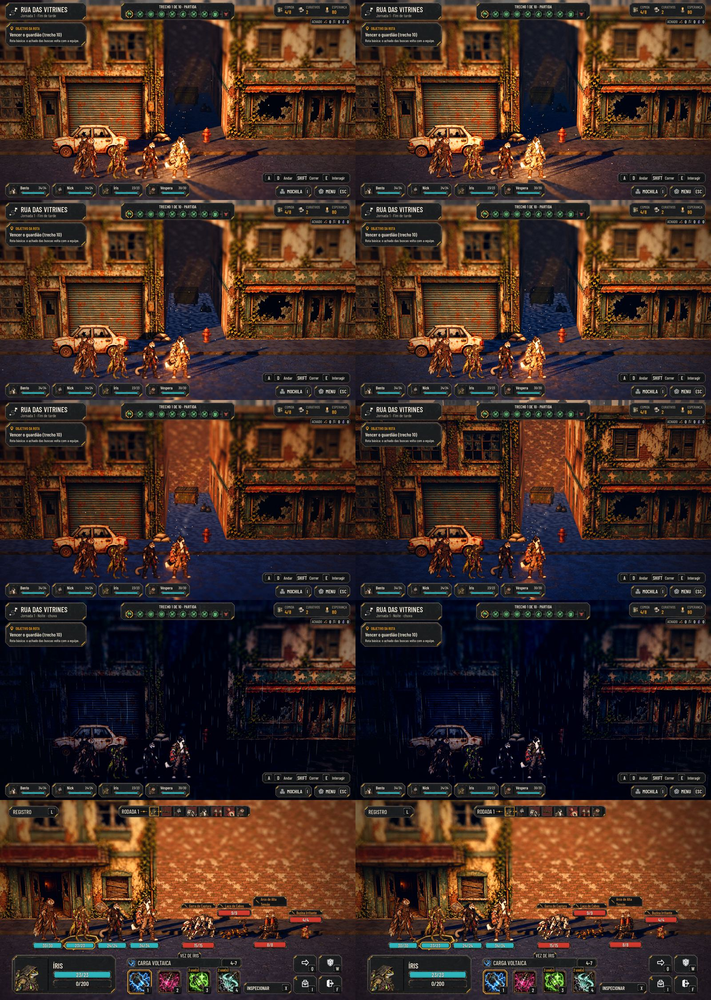
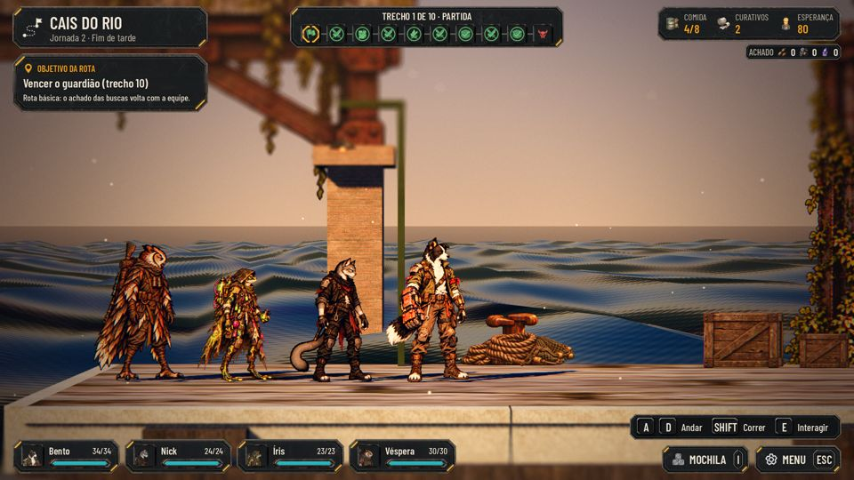

# A câmera de cinema por lugar (#153)

Fase 1 do plano de ambientação ([docs/design/ambience.md](../design/ambience.md)), com a Rua das Vitrines de piloto.

## O que muda

- **Um perfil por lugar** em `data/presentation/ambience.json`:
  - o `default` vale para quem não tem perfil e tem os mesmos números de antes, então um mapa sem perfil fica igual;
  - cada mapa (e a Estação) troca só o que muda;
  - os campos:
    - o grading do pós (saturação, contraste, a força da cor e a cor das sombras e das luzes);
    - o glow (o limiar e a força);
    - a névoa (a densidade e a volumétrica multiplicam a do clima; a névoa no chão vem da altura e da densidade);
    - o desfoque de profundidade (a faixa nítida e o máximo);
    - a vinheta, o grão e a aberração;
    - o ar: a poeira, as folhas (que param na chuva), as fagulhas da fogueira da rua e os respiros de vapor.
- **`AHAmbience`** (`scripts/world/ambience.gd`) monta o perfil (o default, o lugar e o Admin por cima) e aplica no pós,
  no Environment e nas partículas. A rua aplica junto com o clima: a hora e a chuva continuam mandando, e o perfil
  multiplica.
- **O piloto, a Rua das Vitrines:**
  - o grading mais quente nas luzes e mais frio nas sombras;
  - mais grão e vinheta;
  - um glow que pega mais cedo;
  - uma névoa rasteira de 1 m;
  - mais névoa volumétrica no Forward+;
  - folhas secas caindo e dois respiros de vapor nos becos.
- **Os outros mapas:** só um toque de cor e de névoa. A afinação deles fica para depois do piloto aprovado.
- **A qualidade manda:**
  - no Baixo, sem o desfoque de profundidade (a passada mais cara do pós) e com 35% das partículas (a poeira, as
    folhas, o vapor e as fagulhas);
  - a Estação também reaplica o pós dela quando a qualidade muda, e o glow dela vem do perfil;
  - a névoa volumétrica continua só no Forward+ e a partir do Alto.
- **A aba Ambiência do Admin** (#151), na jornada:
  - cada campo tem mais e menos, e mostra o valor de agora; as frações das partículas não passam de 1;
  - "Calor das luzes" deixa as luzes mais laranja e as sombras mais frias ao mesmo tempo;
  - "Copiar o perfil" põe na área de transferência só o que saiu do default, para o Lucas mandar os números;
  - "Voltar ao perfil do arquivo" desfaz.

## Como foi afinado

- A primeira versão do piloto usava uma névoa por altura forte (`fog_height_density` 0,25 a partir de 4 m). Ela
  lavava a tela inteira de branco e apagava a equipe, mais ainda na luta.
- Com capturas lado a lado, ela ficou em 0,05 a partir de 1 m: uma névoa no chão, sem tirar o contraste.
- O Admin ganhou "Névoa no chão" para o Lucas afinar jogando.

## Testes

- `tests/test_ambience.gd` (novo, 47 verificações):
  - os perfis carregam e só têm campos conhecidos;
  - a Rua abre com o perfil dela no pós, no glow, no vapor e nas folhas;
  - o Baixo tira o desfoque e o Ultra o devolve;
  - as folhas, o vapor e as fagulhas: inteiros no Ultra e menos no Baixo; as folhas param na chuva, e as folhas e o
    vapor param com "Reduzir efeitos" e no coberto;
  - o Admin muda a saturação, o calor e as fagulhas ao vivo, não passa de 1 nas frações, copia o perfil e volta ao do
    arquivo;
  - a Estação abre com o perfil dela e perde o desfoque no Baixo na hora.
- `test_admin` e `test_i18n` passam com a aba nova.
- **Capturas:** `tools/capture_153.gd`, também na main de antes. A Rua no fim de tarde, de noite, na chuva e na noite
  com chuva no Ultra; o fim de tarde no Baixo e no Alto; uma luta; o Cais.
  - As capturas daqui são do Compatibility em software, porque a nuvem não tem GPU.
  - A névoa volumétrica, o SSR e o tempo de quadro de verdade aparecem no Forward+.
  - **Fica para o PC do Orquestrador:** as capturas e o `--perf` no Forward+, para o Lucas validar.
  - **De dia:** a Rua tem duas horas, o fim de tarde e a noite (o céu limpo e o pôr do sol são o mesmo fim de tarde,
    `street.gd`, `MOODS`), cada uma seca ou com chuva. As capturas cobrem as quatro.
  - As folhas são pequenas (9 × 5 cm) e poucas, para não brigar com a equipe: aparecem caindo em Play, quase nada numa
    captura parada. O Lucas aumenta pela aba Ambiência ("Folhas"), se quiser.
- **Desempenho:** a seção da #153 em `docs/perf.md` (no Compatibility em software, as chamadas de desenho e as
  primitivas; o tempo de quadro de verdade fica para o Forward+ do Orquestrador).

## Rodadas da QA

- **Rodada 1, reprovada:**
  - o campo `embers` não fazia nada: agora é a quantidade das fagulhas da fogueira da rua, com o passo no Admin;
  - faltavam a captura do Alto na folha, a medição em `docs/perf.md` e a explicação de "de dia": acrescentadas acima;
  - faltavam testes das partículas na cena: o `test_ambience` ganhou a qualidade, a chuva, o "Reduzir efeitos", o
    coberto e a Estação;
  - as baixas também foram corrigidas: a Estação reaplica o pós ao trocar a qualidade e usa o glow do perfil; o Admin
    não passa de 1 nas frações; as folhas param na chuva.
  - Fica como estava: com o teclado, o foco do painel do Admin volta ao primeiro botão a cada toque (já era assim em
    todas as abas).
