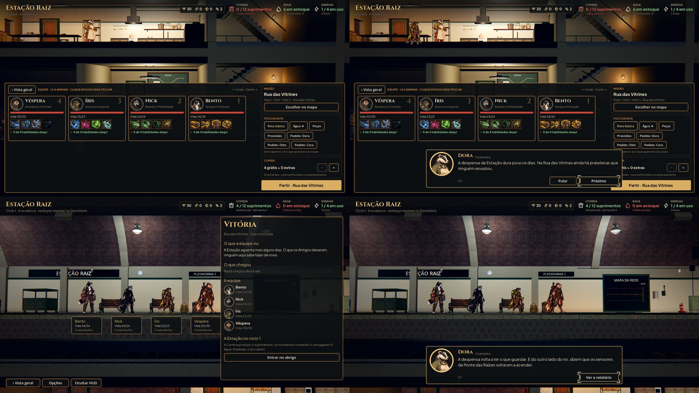
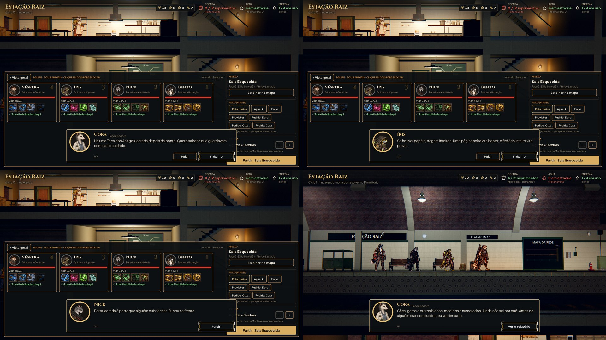

# Briefing e debriefing com retrato (#88)

Fotos de `tools/capture_briefing.gd` (1920x1080, gl_compatibility). O caso: a Estação com a Dora, o Otto e a Cora
morando lá, a Preparação da fase com os quatro fundadores, o Partir, as falas, e a volta com a vitória.

- **Em cima:** à esquerda, o antes, na `main`: Partir leva direto ao vagão. À direita, o depois: o briefing da
  Rua das Vitrines, com a Dora (Cozinheira) na primeira fala.
- **Embaixo:** à esquerda, o relatório (antes, ele abria direto depois da chegada). À direita, o depois: a fala do
  debriefing na plataforma, com a equipe na fila, e Ver o relatório.

Na Sala Esquecida, as três falas (a Cora, a Íris e o Nick, com Partir na última) e o debriefing da Cora na volta.

## Como funciona

- **As falas** ficam em `data/briefings.json`, uma linha por fase:
  - Briefing: duas ou três falas antes da saída;
  - Debriefing: a fala da vitória;
  - mais as linhas `retreat`, `fled` e `defeat`, com a fala da retirada, a da fuga e a da queda;
  - e `defeat_none`, a fala de um morador quando ninguém voltou.
- **Quem fala:** cada fala lista quem pode falar, na ordem, e fala o primeiro que pode:
  - o morador que mora na Estação;
  - antes da saída, o herói que vai;
  - na volta, o herói que voltou vivo.

  Sem a Dora na Estação, o Bento fala por ela. Quem acabou de falar não fala de novo se houver outro. Sem ninguém, a
  fala sai.
- **O que as falas dizem** segue a escada de revelações (`docs/narrative/narrative-design.md` §7), uma camada por fase:
  - **antes da saída:** por que a equipe vai (a despensa, os sensores, a porta lacrada, os papéis da Peste, a água que
    corre);
  - **na volta:** o que se conseguiu e o que muda.
  - Nenhuma fala cita o que a lore guarda para depois (VIGIA, Théo, humanos vistos), e os nomes próprios são os da lore
    (`test_narrative_terms` confere).
- **`AHBriefing`** (`scripts/flow/briefing_rules.gd`) monta as falas. **`AHBriefingDialog`**
  (`scripts/ui/briefing_dialog.gd`) é a caixa: o retrato (o recorte da #26 nos heróis, o rosto da arte nos moradores),
  o nome e o papel, a fala, "n/total", Pular e Próximo. Na última fala, o botão de quem chamou: Partir ou Ver o
  relatório. Usa os tokens do `AHUiStyle`, para trocar pelo kit da #59/#60.
- **Os controles:**
  - **mouse e toque:** os botões, ou um clique ou toque na caixa, que passa a fala;
  - **o toque:** o clique que a Godot cria de cada toque não conta, e um toque passa uma fala só;
  - **teclado e controle:** Interagir (E, Enter, o A do controle) passa a fala. Voltar (Esc, B) desiste da partida no
    briefing (fica na Preparação, como no resto do jogo) e pula o debriefing;
  - **a carência:** nos primeiros 300 ms, o toque que pulou a cena de antes (a chegada, um duplo Partir) não passa a
    fala, e os botões também esperam.
- **Na Estação:**
  - **Partir:** confere a partida numa cópia do estado (nada muda ainda), abre o briefing e só parte depois dele;
    pular também parte. O segundo clique em Partir não abre outro.
  - **A volta:** depois da chegada da equipe (ou dela pulada), a fala do debriefing aparece na plataforma, sem a dica
    de pular da chegada, e o relatório vem depois.
- **As missões curtas (#92)** entram na mesma tabela, com o id da missão.

## Testes

`tests/test_briefing.gd` (62 verificações) confere:
- cada fase com duas ou três falas e a da vitória, mais a retirada e a queda;
- quem fala é fundador ou morador, e cada texto tem a versão em inglês;
- quem fala quando o morador não está, o herói morreu (a fala sai), o herói não vai ou não voltou;
- ninguém falando duas vezes seguidas;
- a fuga e a queda, com ou sem quem voltou;
- a caixa:
  - a ordem das falas;
  - Próximo, e Partir na última;
  - Interagir e a carência;
  - o clique e o toque na caixa;
  - o toque de verdade pela tela, com o clique emulado, que passa uma fala só;
  - os botões na carência;
  - Voltar e Pular;
- na Estação:
  - Partir abre o briefing sem partir;
  - Voltar fica na Preparação;
  - o segundo Partir não abre outro;
  - pular parte para a fase;
- na volta, o debriefing antes do relatório.

O `test_full_journey` passa pelo briefing com Próximo e Partir, e pelo debriefing com Ver o relatório. Os testes da
volta e da navegação por teclado desligam a caixa (`AHBriefing.enabled`, como o `Tips.enabled`), porque conferem outras
coisas. O `test_departure` e o `test_station_scene` pulam o briefing.

## Rodadas da QA

- **Rodada 1 (reprovada):**
  - um toque de verdade passava duas falas, porque o clique emulado contava junto. Agora o clique emulado não conta, e
    o teste manda o par de eventos pela tela;
  - quem fala ignorava quem ia e quem voltou: o Nick dizia "eu vou na frente" sem ir, e a Dora dizia "trouxemos"
    numa queda sem ninguém de volta. Agora os heróis só falam se vão, ou se voltaram vivos, e há a fala de ninguém de
    volta;
  - a fuga voltava sem fala. Agora tem a dela.
  - Também de gravidade baixa:
    - Voltar no briefing desiste da partida;
    - os botões esperam a carência;
    - ninguém fala duas vezes seguidas;
    - a fala da fase 5 não afirma a manutenção como fato ("parece que alguém troca aqueles filtros").
- **Rodada 2 (reprovada):** a fala da fuga dizia que o achado chegou, e na fuga nada chega (o relatório mostra 0%).
  Agora é "A patrulha fechou o caminho e a gente correu. Largamos a carga para conseguir voltar.", e o teste confere
  que a fala não promete achado.
- **Rodada 3 (aprovada):** a fala da fuga conferida contra a regra (o relatório com 0%), e as rodadas anteriores sem
  regressão. Ficam para o Lucas: o briefing a cada saída (a fala da fase 1 cita a ponte mesmo depois de vencida), o
  Mapa da Rede como quem fala e a fala "defeat", de reserva (hoje a queda é sempre sem ninguém de volta).
