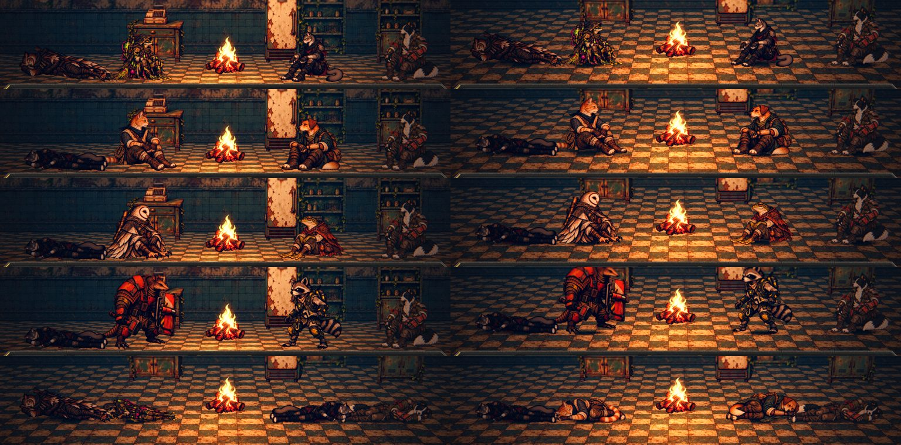

# As poses do acampamento no chão (#205)

## A causa

Levantamento com `tools/capture_205.gd`: o acampamento numa casa com os fundadores, os recrutas com pose (cão e gato,
sapo e coruja) e o Guaxinim e o Tatu (#196), cada equipe com o último ferido (deita) e com todos feridos (as 16 poses).

- **A âncora e a escala estão certas.** Em todas as 16 poses (`data/presentation/camp_poses.json`), o último pixel
  opaco da arte cai a no máximo 3 px da âncora (o pé), num corpo de cerca de 1.400 px. O deitado que vem da Estação
  também.
- **O apoio do corpo fica acima do pé na arte.** A arte das poses é vista de cima: o quadril do sentado e o tronco do
  deitado ficam acima do pé (até 15 cm no gato sentado, 14 no Nick). Numa carta plana de pé no chão, esse apoio cai
  no chão que a câmera vê atrás do pé. Com a câmera do acampamento quase reta (4°), isso era chão a mais de 1 m atrás
  do corpo: o chão aceso aparecia por baixo do quadril, e o corpo parecia voar.
- **Sem contato com o chão.** A fogueira e a luz da sala não fazem sombra embaixo do corpo, e sob teto o sol fica sem
  sombra (#175).

## O que muda

- **O apoio nos dados.** `tools/build_camp_poses.py` mede em cada pose o `support`: a linha onde o corpo apoia (na faixa
  do meio do corpo visível, a mediana da última linha opaca de cada coluna). Fica em `camp_poses.json` com o resto.
- **A câmera do acampamento olha do ângulo da arte** (`AHCampScene.FOCUS_PITCH`, 15°), na casa e na parada de
  descanso: o apoio de cada pose cai no chão a até 0,6 m atrás do pé (`MAX_SUPPORT_DEPTH`), embaixo do corpo. O alvo
  desceu (`FOCUS_HEIGHT` 0,35 m) para a fileira ficar no mesmo lugar da tela, acima do painel.
- **Nas paradas de descanso com água** (`AHCampScene.stop_pitch`): com o lago pintado no fundo (o Cais), a câmera olha
  de 8° (`WATER_STOP_PITCH`), para o fundo continuar no quadro; com a fogueira no chão alagado (o Depósito Inundado), do
  ângulo de antes (4°, `FLOODED_STOP_PITCH`), com a água fina como era. A sombra acompanha o ângulo, até 1,2 m atrás do
  pé. A água do chão vem do mapa (`AHScenarioWorld.water_floor`).
- **A sombra de contato** (`AHCampScene._contact`): uma mancha escura e macia no chão, do pé até um pouco atrás do apoio
  (`support_depth`), na largura do corpo visível. Acompanha a pose de cuidar (de pé, a do pé) e sai ao levantar
  acampamento.
- **O Guaxinim e o Tatu**, sem pose de acampamento, ficam de pé em volta da fogueira, com a sombra sob o pé.

## Para o Codex (#210)

As poses de acampamento do Guaxinim e do Tatu (sentado no chão e deitado).

## Para o Lucas

- No Depósito Inundado, a parada de descanso monta a fogueira no chão alagado, e a equipe senta na água (já era assim
  na `main`). Ali a câmera fica como era; tirar a fogueira da água pede outra issue.
- O enquadramento do acampamento ficou mais de cima (mais chão, menos parede).
- Com todos deitados, os vizinhos de dentro se sobrepõem (a Íris na Véspera, o Nick no Bento). Isso já acontecia
  antes, com a câmera reta; dá para afastar os lugares de quem deita, se ele quiser.

## Testes

- `tests/test_camp_ground.gd` (novo, 75 verificações):
  - em cada pose, o ponto mais baixo do corpo na linha do chão (até 2 cm) e o apoio do dado igual ao medido na arte;
  - o apoio de cada pose cai no chão embaixo do corpo (até 0,6 m atrás do pé) na câmera do acampamento: com a câmera
    antiga (4°), dez poses falham;
  - o ângulo da parada por cenário: o Depósito (chão alagado), o Cais (lago pintado) e o Abrigo (seco);
  - na cena, com o Bento, o Guaxinim, o Tatu e o Nick deitado: a câmera no ângulo da arte, a sombra de cada um no chão,
    na largura do corpo e chegando ao apoio, a troca da sombra na pose de cuidar e a saída ao levantar acampamento.
- `tests/run_all.gd` inteiro e o modo de captura da Rua, com o teste de colisão.
- `tools/capture_205.gd` (as 16 poses) e `tools/capture_143.gd` (a parada de descanso no cenário, de noite e com chuva).

## QA

- **Rodada 1: REPROVADO.** A sombra estava bem montada, mas só cobria a linha do pé: nos sentados o apoio ficava de 7 a
  15 cm acima, e o teste media o pé. Faltavam as fotos com todos deitados. Correção: o apoio nos dados, a câmera no
  ângulo da arte e a sombra até o apoio; o teste mede o apoio; a ferramenta fotografa as 16 poses; a sombra acompanha a
  pose de cuidar; as poses que faltam vão para o Codex (#210).
- **Rodada 2: REPROVADO.** O apoio no chão, a sombra, o enquadramento e o clique ficaram certos (`run_all` 80/80), mas
  a câmera de 15° nas paradas com água mostrava o lago no lugar do fundo (Cais) e a água como placa lisa (Depósito).
  Correção: o ângulo da parada por cenário (8° com água pintada, 4° com a fogueira no chão alagado).
