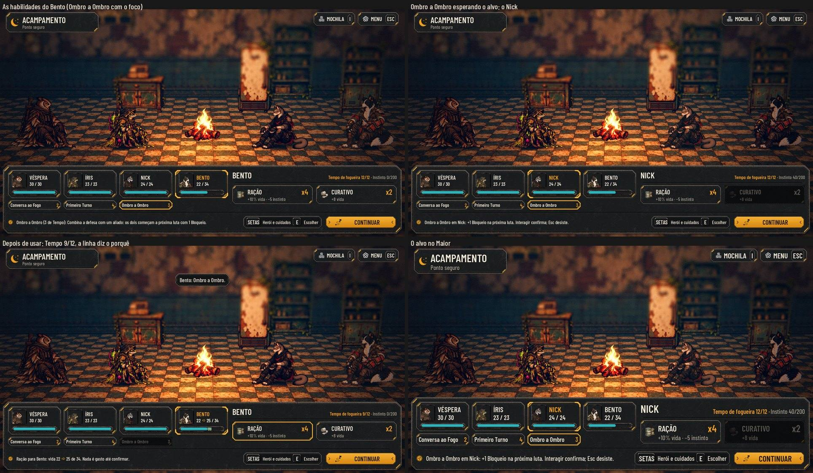
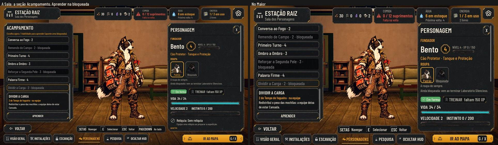

# As habilidades de acampamento (#261)

A proposta aprovada pelo Orquestrador em nome do Lucas (01/11) está na #261. Cada papel tem 7 habilidades de
acampamento, separadas das 7 de combate da #259. A regra é a mesma para fundadores e recrutados (#189).

As fotos saem de `tools/capture_261.gd`, com `--case=camp` ou `--case=room` e, para o Maior, `--text-size=2`.

## A regra (`scripts/flow/camp_skills.gd`, `AHCampSkills`)

| O quê | Como | Onde fica |
| --- | --- | --- |
| Catálogo | 2 comuns e 5 do papel; 3 na chegada (a Conversa ao Fogo e 2 do papel) | `data/camp-skills.json` |
| Aprender | uma por nível 2, 4, 6 e 8, de graça, à escolha na Sala | `data/hero-skills.json`, linha `camp`; no herói, `camp_unlocked` |
| Levar | 4, trocadas na Sala, fora da expedição | no herói, `camp_loadout` (`[]` são as primeiras que sabe) |
| Usar | Tempo de fogueira 12 por acampamento; cada herói usa cada uma uma vez | no trecho, `camp` |
| Próxima luta | Bloqueio, Esquiva, velocidade, a Marca no inimigo da frente, a abertura | no trecho, `camp_next`; sai quando a luta começa |
| A noite | 1 em 3 de Noite mal dormida (Exposto), a menos que alguém vigie | no trecho, `camp_night`, para o aviso |

- **O sorteio da noite** sai da semente da fase. Por isso a mesma partida dá sempre a mesma noite.
- **O aviso do Treino:** subir para um nível par diz "Nova habilidade de acampamento: escolha na Sala dos Personagens".
- **Saves de antes:** abrem com as 3 da chegada. Quem já está no nível 2 ou acima ganha as escolhas que ficaram para
  trás, para fazer na Sala.
- **A Ração e o Curativo** não gastam Tempo e continuam como antes.
- **A luta de base não muda:** os bônus entram na sessão sem sortear nada no motor, e a paridade continua 48/48.

## Na tela

- **No acampamento:** as 4 do herói escolhido ficam embaixo das cartas, e o Tempo de fogueira fica ao lado do
  instinto, então o painel não cresce.
  - Com o foco ou o mouse numa habilidade, a linha de estado diz o que ela muda. Se não der para usar, diz o motivo:
    "Já usada", "Sem Tempo", "Só em quem está Ferido" ou "Não faria diferença agora".
  - Para a habilidade de aliado, escolha o alvo pela carta, pelo corpo ou pelas setas e Interagir. Esc desiste.
  - Depois de usar, quem mudou de vida ou de instinto responde na cena, e o escolhido volta para quem usou.
- **Ao levantar acampamento,** o aviso diz se a noite foi mal dormida ou se quem vigiou segurou a equipe.
- **Na Sala, a seção Acampamento** mostra as 7 do papel: as levadas, as que ficam na Estação e as bloqueadas, com o
  Tempo de cada uma.
  - Com escolha do nível pendente, aparece "Escolha agora", e a bloqueada apontada tem Aprender.
  - A troca funciona como a das habilidades de luta: "Trocar por" e "Levar no lugar de".

## A arte

Os 32 ícones vão para o design. Até lá, a tela mostra o nome e o custo, sem ícone.

## Como testar

- **`tests/test_camp_skills.gd`** (296 checagens):
  - os dados: 7 por papel, 2 comuns, 3 da chegada, custos de 2 a 4 e só efeitos da lista;
  - o aprender e a troca;
  - o Tempo, o uso único e os alvos (incluindo "só Ferido");
  - o teto de 3 fichas e os bônus da próxima luta, que saem depois dela;
  - a abertura;
  - a noite: cerca de 1 em 3, a mesma para a mesma semente, evitada por quem vigia;
  - o save;
  - a Sala.
- **`tests/test_camp_scene.gd`:** as habilidades no acampamento. O alvo pelo clique e pelo teclado, o Tempo e a linha
  de estado.
- **`tests/run_all.gd`:** passa inteiro, com a paridade 48/48.
