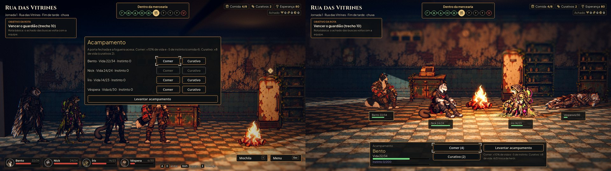
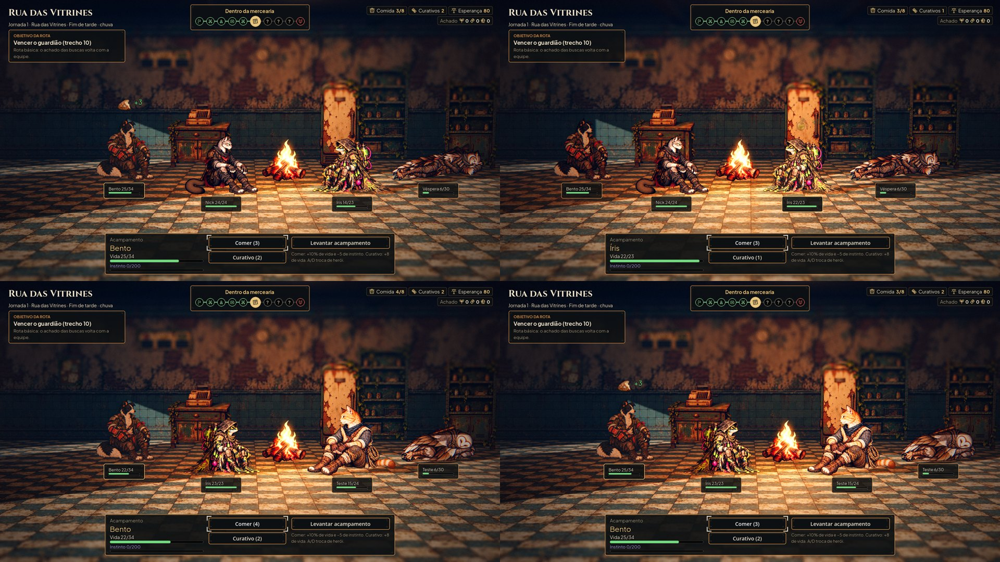

# Acampamento encenado (#77)

Fotos de `tools/capture_camp.gd` (1920x1080, gl_compatibility). O caso: a casa com fogueira da Rua das Vitrines, o Bento
e a Íris feridos e a Véspera muito ferida. À esquerda, o antes, na `main`: o painel do acampamento por cima da equipe em
pé. À direita, o depois.

- **Em cima:** comer no Bento (o pedaço de comida e o +3 verde sobre a cabeça) e o curativo na Íris (a ampola dela).
- **Embaixo:** o Bento e a Íris com dois recrutas. O gato senta no chão e a coruja, muito ferida, deita, com as poses da
  #80.

## Como funciona

- **A cena:** o acampamento é a equipe em volta da fogueira da casa (`scripts/street/camp_scene.gd`, `AHCampScene`). Ao
  acampar, um fade leva cada um ao lugar de descanso: dois atrás, nas pontas, e dois na frente, dos lados do fogo, como
  no desenho da #82. Os da direita olham para o fogo.
- **As poses:**
  - os fundadores sentam no chão com as poses da #82;
  - quem chegou com até um quarto da vida deita, com as poses `*_sleep` que já existiam;
  - os recrutas usam as poses sentada e deitada da #80, pela variação de arte;
  - sem pose, fica de pé com o idle.
- **De onde vêm as poses:** `data/presentation/camp_poses.json`, gerado do contrato do Codex por
  `tools/build_camp_poses.py`. A pasta `docs/` não entra no jogo. Cada pose tem o canvas, a âncora e a referência do corpo
  do idle, sem recalcular nada, e a caixa do corpo visível, medida do alfa com o limite 24 do contrato.
- **O HUD** (`scripts/ui/camp_hud.gd`, `AHCampHud`), no padrão da luta:
  - a placa com o nome, a vida e a barra violeta do instinto embaixo dos pés de cada um, como na luta;
  - a área do clique no corpo visível. Onde dois corpos se encostam na tela, a área se divide no meio, para cada clique
    ser de um só;
  - embaixo, o escolhido, com a vida, o instinto e os botões Comer (com a comida que resta), Curativo (com os curativos)
    e Levantar acampamento.
  - Durante o acampamento, a fila da equipe e os botões Mochila e Menu do canto saem; voltam ao levantar.
- **Escolher o herói:** com o clique no corpo, ou com as setas ←/→ (ou A/D, o direcional e o analógico). Cada toque
  troca um herói só: o analógico precisa voltar ao centro, e segurar a tecla não gira a roda. Cima e baixo andam entre
  os botões, e Interagir (E, ou o A do controle) confirma, como na luta. A troca de herói é um fade curto (0,12 s para cada lado), como na Unreal, e a câmera
  puxa um pouco para o escolhido sem tirar ninguém do quadro. O escolhido ganha a luz da escolha, a mesma do alvo na
  luta.
- **A resposta:** cada comida ou curativo mostra no herói o efeito da #80 (a comida, o curativo ou, na Íris, a ampola),
  o número verde da vida e o do instinto subindo, e o som. Com "Reduzir efeitos", o efeito e os números ficam parados
  por 400 ms, sem subir nem crescer.
- **As regras não mudam:** comer dá +10% da vida e −5 de instinto; o curativo, +8 de vida
  (`AHJourneyRules.camp_use_food` e `camp_use_bandage`).
- **Levantar acampamento:** um fade devolve cada um à arte de pé e à fila, que recomeça à direita da fogueira, sem
  ninguém em cima do fogo. Levantar no meio da troca de herói espera a troca acabar, para o preto cobrir a volta das
  poses. Lá fora,
  o tempo muda, como antes.
- **Save no meio:** o jogo reaberto no meio do acampamento já abre com a equipe em volta da fogueira, sem o fade.

## Testes

`tests/test_camp_scene.gd` confere:
- as poses do manifesto com as medidas do idle;
- acampar abre a cena e o HUD, e a equipe não anda;
- cada um sentado ou deitado, perto da fogueira e virado para o fogo;
- as áreas do clique sem sobreposição;
- o manifesto igual ao `show_art` do contrato;
- as setas e o clique no corpo trocando de herói, com a câmera indo junto;
- um toque no analógico troca um herói só, também com "Reduzir efeitos";
- a placa de cada um com a barra do instinto;
- comer com o A do controle; levantar com ele no meio da troca, com o preto cobrindo;
- comer e o curativo com os números das regras, o efeito, a ampola da Íris e o número verde;
- o curativo apagado com a vida cheia;
- "Reduzir efeitos" parado;
- levantar acampamento de volta à fila com a arte de pé, ninguém em cima da fogueira;
- o save do meio reaberto já no acampamento.

## Rodadas da QA

- **Rodada 1 (reprovada):**
  - com o controle, o A não apertava Comer, Curativo nem Levantar. Agora o HUD confirma o botão com foco, como na luta;
  - com "Reduzir efeitos", um toque no analógico passava por vários heróis. Agora cada toque troca um só;
  - levantar no meio da troca de herói mostrava a troca de pose sem o preto. Agora espera a troca acabar;
  - a placa não mostrava o instinto. Agora tem a barra violeta, e embaixo "Instinto n/200" com a barra;
  - menores: o manifesto conferido contra o contrato no teste, a fila fora da fogueira ao levantar, e as marcas dos
    objetos da sala apagadas durante o acampamento.
- **Rodada 2 (aprovada):** as quatro correções conferidas com o controle, o analógico, o levantar no meio da troca e as
  placas. Ficam de gravidade baixa: um piscar a mais ao levantar no meio da troca, W/S não andam entre os botões, a dica
  mostra as teclas do teclado com o controle, e com três heróis o lugar da direita fica vazio.
