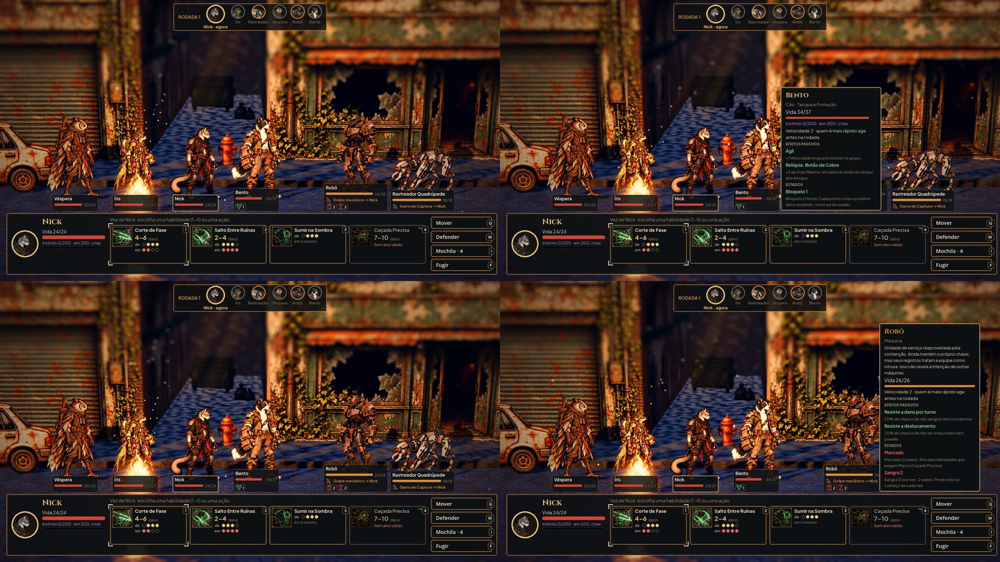
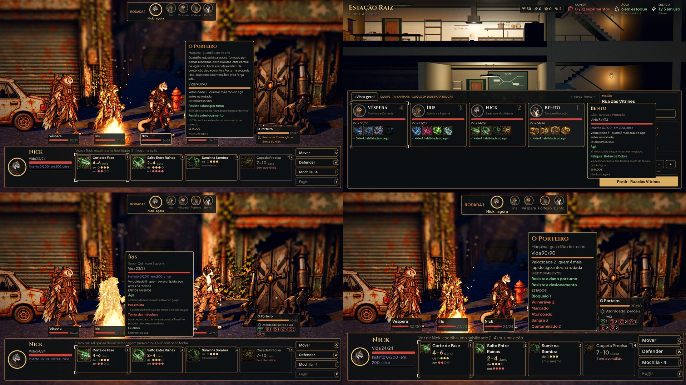
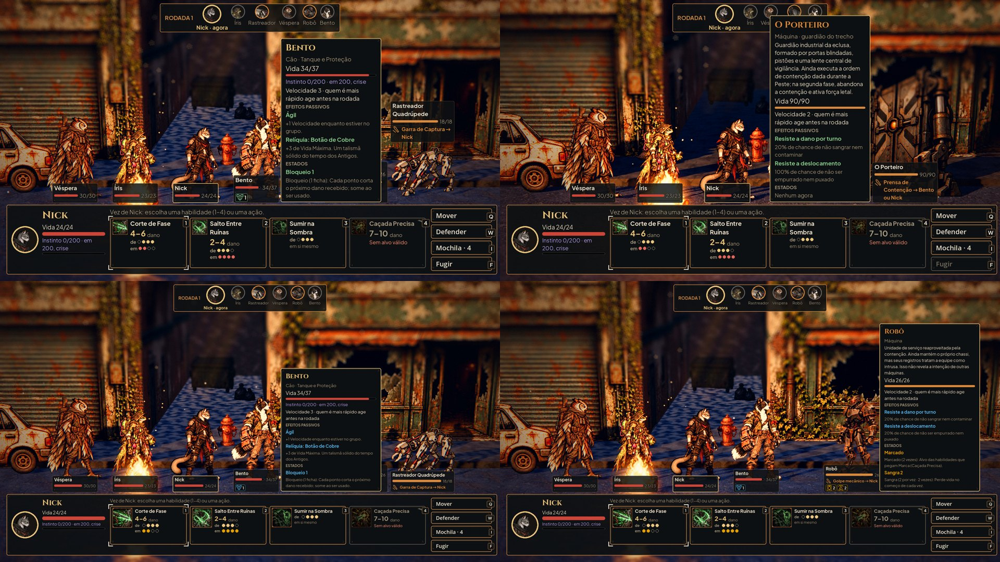

# Ficha do personagem ao apontar (#89)

Fotos de `tools/capture_sheet.gd` (1920x1080, gl_compatibility). Na rua, a equipe contra um robô e um rastreador, na
vez do Nick, com o mouse:
- no Bento, que tem o traço Ágil, a relíquia Botão de Cobre e um bloqueio;
- no robô, sangrando e marcado;
- numa segunda luta, no Porteiro, o guardião.

Depois, a Preparação com o mouse num cartão.

À esquerda, o antes, na `main`: apontar não mostra nada além da placa. À direita, o depois: a ficha do Bento e a do
robô.

- **Em cima:** o Porteiro e um cartão da Preparação.
- **Embaixo:** à esquerda, Examinar pelo teclado, com a Íris destacada; à direita, o Porteiro com seis estados no texto
  Maior. A ficha encolhe para caber acima do painel.

Em cima, com o texto Maior. Embaixo, no daltonismo: os efeitos bons em azul e os ruins em laranja, com o nome de cada
um no texto.

## Como funciona

- **A ficha** (`scripts/ui/character_sheet.gd`, `AHCharacterSheet`) mostra:
  - o nome;
  - a espécie e o papel (`Cão · Tanque e Proteção`), ou a máquina, e no chefe "guardião do trecho";
  - nos inimigos, a descrição da máquina;
  - a vida com a barra, o instinto (heróis) e a velocidade, com o que ela faz;
  - os efeitos passivos:
    - os traços, com o que fazem;
    - a relíquia;
    - os laços desta jornada com quem está na luta, com o que fazem em +3 e −3;
    - os treinos da Pesquisa da classe;
    - nas máquinas, as resistências a dano por turno e a deslocamento;
  - os estados de agora, com o que cada um faz (o mesmo texto da dica do ícone na placa), mais o Último Fôlego e o
    Trauma, que o painel de baixo só mostra de quem age.

  Bom e ruim vêm na cor de bom e ruim, que o daltonismo troca para azul e laranja, e o texto diz o que é. O nível
  (#90) entra quando existir.
- **Muitos estados ou o texto Maior:** a ficha encolhe até caber acima do painel:
  - primeiro sem a descrição e as explicações dos passivos;
  - depois sem as dos estados;
  - por fim, com os nomes numa linha só.
- **Na luta,** a ficha abre:
  - com o mouse em cima do corpo (a área do corpo da #57);
  - com o alvo que tem o foco do teclado ou do controle, na mira;
  - com **Examinar** (X, ou L3 no controle; remapeável nas Opções), na vez de um herói: o foco passa pelos
    personagens de pé, com as setas, a começar por quem age, e a ação de novo ou Voltar fecham;
  - com o toque longo (0,45 s) no corpo, até soltar. Soltar não escolhe o alvo nem usa a habilidade.

  Ela fica ao lado do corpo, sem cobrir o painel das habilidades, e some ao tirar o mouse. A placa do personagem
  também conta como ele. A dica do sistema com o nome, no botão do alvo, saiu: o nome está na ficha.
- **Na Preparação,** os cartões da equipe e os botões de quem está fora:
  - abrem a ficha com o mouse em cima e com o foco do teclado ou do controle;
  - abrem com o toque longo; soltar fecha sem escolher nem trocar o cartão.
- **O toque:** o mouse que a Godot cria de cada toque não abre a ficha. Só o toque longo abre.

## Testes

`tests/test_character_sheet.gd` (46 verificações) confere:
- **o que a ficha diz:** a espécie e o papel, o traço com o que faz, a relíquia, o treino da Pesquisa, a velocidade
  com o traço Ágil, o Trauma e o Último Fôlego, a máquina sem instinto, as resistências, os estados com o que fazem e
  o chefe;
- **o tamanho:** com oito estados e o texto Maior, a ficha cabe acima do painel;
- **as cores:** o estado ruim na cor de ruim, com e sem daltonismo;
- **na luta:**
  - o mouse no corpo abre e fora fecha;
  - o alvo com foco do teclado abre, e Voltar da mira fecha;
  - na mira, o toque longo no alvo já escolhido abre a ficha, e soltar não usa a habilidade;
  - Examinar abre a ficha de quem age, as setas passam, e Voltar fecha com a vez seguindo e a instrução da vez de volta;
  - o toque curto não abre e o longo abre até soltar;
  - o mouse emulado do toque não abre;
- **na Preparação:**
  - o mouse e o foco no cartão abrem e fecham;
  - o toque longo pela tela abre, e ao soltar não escolhe nem troca o cartão.

## Rodadas da QA

- **Rodada 1 (reprovada):**
  - o toque longo trocava o herói na Preparação ao soltar (o próprio toque solto aperta o botão) e usava a habilidade
    na mira da luta. Agora o soltar do toque longo é engolido nos dois lugares, e os testes mandam o toque pela tela;
  - com muitos estados no texto Maior, a ficha passava do painel e da tela. Agora ela encolhe até caber;
  - faltavam o Trauma e o Último Fôlego na luta, e os treinos (que vêm da Pesquisa, não de `hero.trainings`);
  - o teclado e o controle só viam a ficha dos alvos na mira. Agora há a ação Examinar.
  - Também de gravidade baixa:
    - a placa do personagem conta como ele;
    - os laços dizem o que fazem em ±3;
    - os títulos das seções saíram do cobre, que ficava perto do laranja do daltonismo;
    - a ficha ficou opaca.
- **Rodada 2 (reprovada):** fechar o Examinar apagava a instrução da vez. Agora ela volta, com teste. A luz do Examinar
  ficou a de quem age, mais leve que a do alvo apontado.
- **Rodada 3 (aprovada):** a instrução da vez volta ao fechar o Examinar, e as correções das rodadas anteriores seguem
  certas. Fica para o Lucas: a frase da vez não diz que X (L3) examina.
