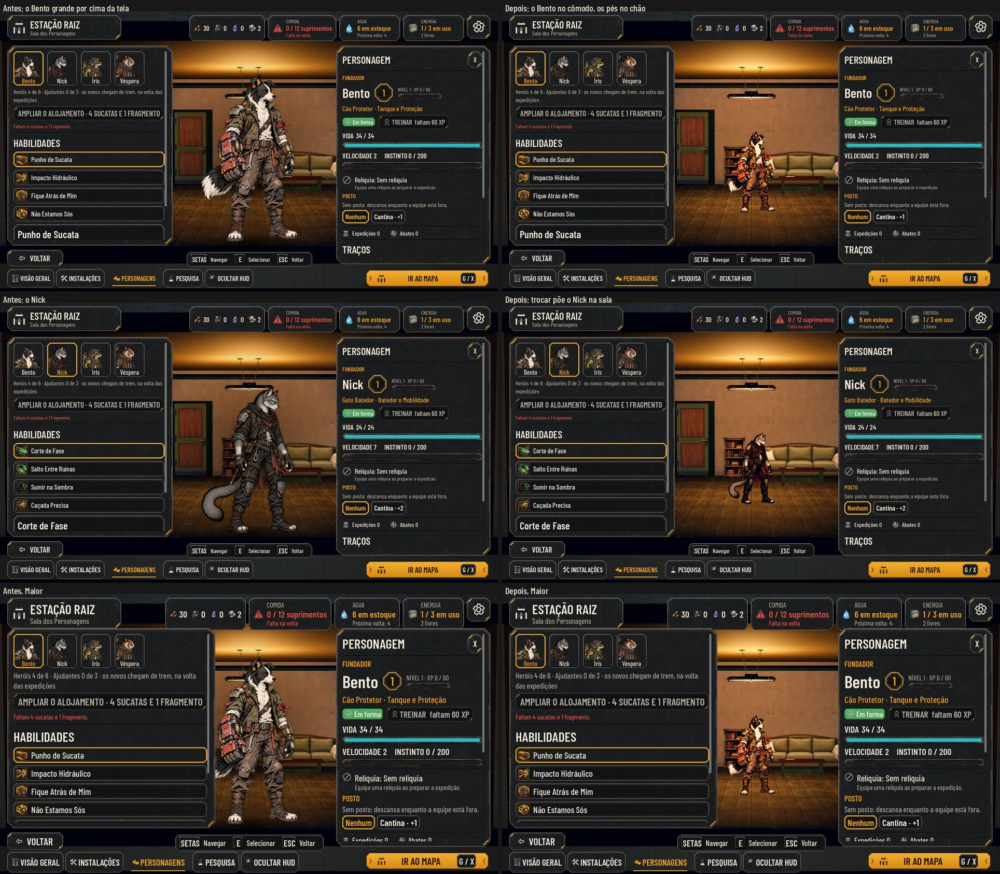

# O herói no cômodo da Sala dos Personagens (#181)

O pedido do Lucas (27/10): "Ele deveria estar no cômodo, assentado no cômodo, para a gente ver ele tocando os pés no
chão. Quando a gente sair, ele sai dali ou volta para o cômodo em que já estava."

As fotos saem de `tools/capture_181.gd` (`--text-size=2`). O antes é a `main`.

## O que muda

- **No cômodo:**
  - o herói escolhido na aba PERSONAGENS é uma placa da própria Estação (`AHStation.show_stage_hero`), de pé no meio da
    Sala dos Personagens, com os pés no chão dela;
  - ele tem a altura dele (`AHCharacterHeights`), a mesma escala dos moradores, e respira como eles;
  - a câmera do `focus_room_stage` já punha o meio da sala entre os dois painéis, e é ali que ele fica;
  - saem a figura grande da interface, a sombra e o escurecido.
- **Trocar de herói:** a placa do de antes sai, e a do novo entra, num corte simples.
- **Ao sair** (VOLTAR, Esc, IR AO MAPA, outra aba):
  - a placa do escolhido sai;
  - os moradores reaparecem onde estavam. Enquanto a tela cobre a Estação eles só ficam escondidos, sem passear, então
    cada um volta para o cômodo e o lugar de antes;
  - quem já estava na Sala dos Personagens continua lá;
  - o caído em recuperação volta para a Enfermaria ou o Dormitório;
  - quem está na fila da plataforma (#131) volta para ela.

## Testes

- **`test_character_stage` (novo), no Normal e no Maior:**
  - o escolhido no cômodo, de pé no chão, na altura dele, sem figura na interface;
  - os pés na tela, entre os painéis;
  - os moradores escondidos enquanto a tela está aberta;
  - trocar tira o de antes e põe o novo;
  - o caído em recuperação também entra na sala;
  - ao sair, ninguém fica na sala, e cada morador está onde estava.
- **`test_station_view`:** a Sala abre com o herói no cômodo, e o mapa a fecha com o herói fora dele.

## Rodadas da QA

### Rodada 1: APROVADO

A QA rodou o `run_all` (76/76, com a paridade 48/48) e um script próprio, que fez o seguinte:
- saiu da Sala por VOLTAR, Esc, IR AO MAPA, as três abas da Estação e as Opções, com a volta;
- trocou de herói rápido;
- chamou `refresh` e `_place_residents` com a tela aberta;
- recrutou um herói com `art_variant`.

Também fez capturas do caído escolhido, do caminho do relatório até a Sala e da noite com vigia. Em todos os casos, a
placa sai, os moradores voltam onde estavam, os pés ficam no chão e nada tapa o herói.

**Baixas:**
- Corrigido: ao trocar de herói, a placa nova perdia o nome "StageHero", porque a antiga ainda estava na árvore. Agora
  a antiga sai da árvore antes, e o teste confere que fica uma placa só.
- Fica: o `en.po` regenerado atualiza números de linha de outros arquivos, que já estavam desatualizados.
