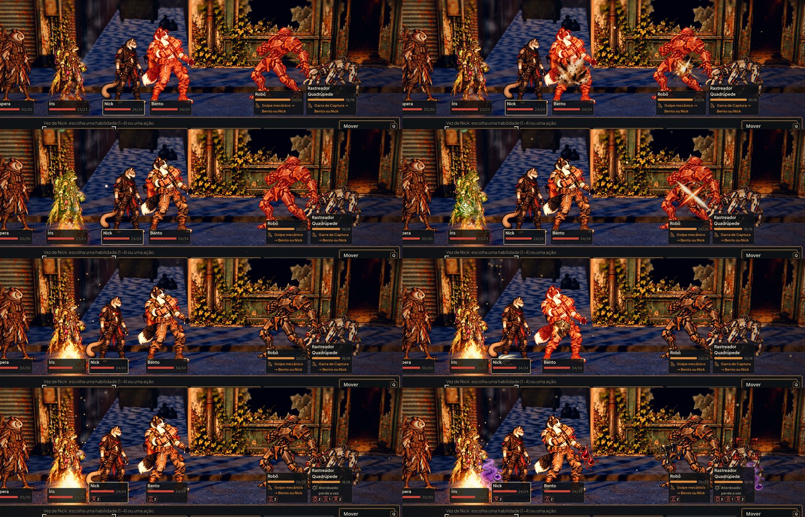
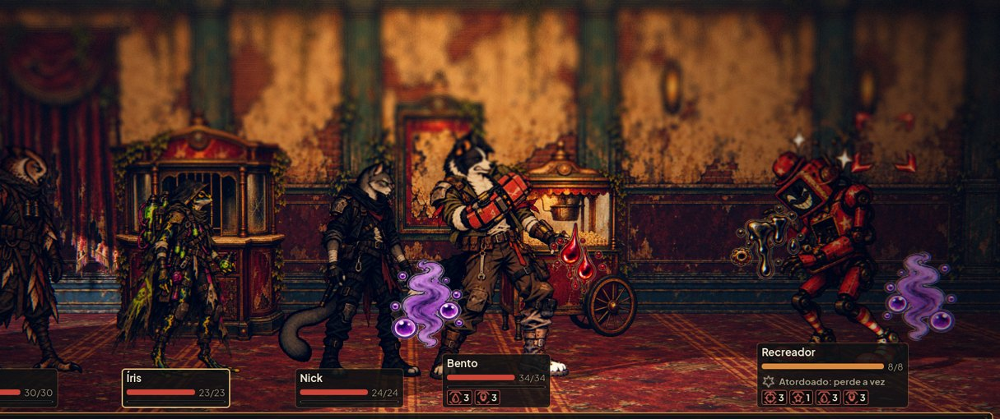
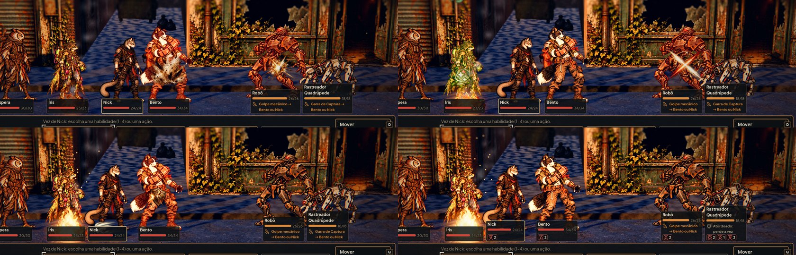

# Efeitos de impacto e de estados na luta (#84)

Fotos de `tools/capture_effects.gd` (1920x1080, gl_compatibility, `--fixed-fps 30`, recortadas na luta). O caso: a
equipe contra um robô e um rastreador na Rua das Vitrines, na vez do Nick. Cada efeito é tocado por um evento da luta, no
terceiro quadro dele. À esquerda, o antes, na `main`: só o número e o clarão vermelho da #33. À direita, o depois.

- **Linha 1:** o acerto no robô (faíscas) e no Bento (poeira).
- **Linha 2:** o crítico no robô (o corte cruzado) e a cura na Íris (folhas e sinais de mais).
- **Linha 3:** o golpe bloqueado no Bento (o escudo de cobre no lugar da poeira) e a esquiva do Nick (o rastro nos pés).
- **Linha 4:** os estados em loop:
  - o Bento sangra (gotas ao lado do corpo);
  - o Nick e o rastreador estão contaminados (o vapor embaixo, do lado de trás);
  - o robô sangra óleo;
  - o rastreador está atordoado e marcado (estrelas e cantos na cabeça, lado a lado).

Na casa, com os quatro estados no Recreador e o sangramento e o veneno na equipe:

Com "Reduzir efeitos", cada acerto mostra só um quadro parado por 0,25 s, e os loops de estado não aparecem: o estado
fica no ícone e no texto do HUD.

## Como funciona

- **A arte:** as onze folhas da #41 (`art/combat/effects/`) viraram WebP na mesma resolução, com quadros de 256 px. Na
  tela, o efeito fica com 64 a 192 px, e a metade da resolução borraria os loops. As folhas foram de 2,6 MB para
  1,1 MB, e os PNG saíram.
- **As medidas:** `tools/build_combat_effects.py` grava `data/presentation/combat_effects.json` com a tabela de
  `docs/design/combat-effects.md` (quadros, âncora, FPS, loop).
- **`AHCombatEffects`** (`scripts/combat/combat_effects.gd`):
  - escolhe o efeito do evento:
    - o dano dá faíscas no robô e poeira nos outros, e o crítico troca os dois pelo corte;
    - a cura, o bloqueio e a esquiva têm o efeito deles;
  - o tamanho segue o documento em pixels da tela de 1080: impactos 176 px, crítico 192, cura, bloqueio e esquiva 128.
    Nos estados, o desenho ocupa uns 120 dos 256 px do quadro: com o quadro em 192 px, a forma fica com uns 90 px (os
    64 a 96 do documento). A conta usa a distância da câmera;
  - a posição é o tronco, mais baixo na poeira, nos pés na esquiva;
  - **um efeito por alvo em cada lance**, o mais forte: crítico, depois bloqueio, acerto, esquiva e cura. O golpe
    bloqueado mostra só o escudo, no lugar do acerto;
  - **sem golpe, sem efeito de golpe:** o sangramento e o veneno do começo da vez e o dano em quem age não tocam o
    acerto, e o bloqueio ganho por habilidade não toca o escudo;
  - o efeito é filho do personagem e anda com ele. Some sozinho em 0,5 s, que encurta a 2x.
- **Os estados:** a arena mantém um loop por estado enquanto ele dura:
  - o sangramento (óleo no robô) ao lado do corpo;
  - a contaminação embaixo, do lado de trás;
  - o atordoado e a marca na cabeça. Acima dela, os dois caíam no desfoque do alto da tela e perdiam a forma.

  Quem cai perde os loops. Com a luta decidida, eles não voltam mais: nem na tela do resultado, nem depois dela, na
  rua.
- **Daltonismo:** os efeitos não mudam de cor. A forma diz o que cada um é, como pede o documento da #41, e o HUD tem o
  nome do estado.
- **Pausa, tremor e clarão:** a pausa e o tremor da #33 seguem iguais. O clarão branco também, a não ser com "Reduzir
  efeitos".

## Testes

`tests/test_combat_effects.gd` (69 verificações) confere:
- as onze folhas com os quadros, a âncora, o FPS e o loop do documento, e que os PNG saíram;
- cada evento com o efeito certo;
- numa luta de verdade na rua:
  - o efeito no alvo, no tronco e com o tamanho do documento;
  - a esquiva nos pés;
  - o efeito some sozinho;
  - um efeito por alvo (o golpe bloqueado só com o escudo);
  - nenhum efeito de golpe sem golpe;
  - "Reduzir efeitos" com um quadro parado e sem loops;
  - os loops de estado entrando e saindo com o estado, sem recolorir no modo daltonismo;
  - uma luta jogada até o fim com estados ativos, sem loop na tela do resultado nem nas placas da rua depois dela.

## Rodadas da QA

- **Rodada 1 (reprovada):**
  - os loops de estado voltavam na tela do resultado e ficavam nos heróis e na patrulha depois da vitória e da fuga.
    Agora a arena não os recria com a luta decidida, e o teste joga uma luta até o fim;
  - o atordoado e a marca, acima da cabeça, ficavam borrados pelo desfoque do alto da tela. Agora ficam na cabeça,
    com a forma no tamanho do documento;
  - o escudo e o acerto empilhavam no golpe bloqueado. Agora é um efeito por alvo.
  - Também de gravidade baixa: o tique de sangramento e o bloqueio ganho não tocam mais efeito de golpe, e o veneno
    subiu para não ficar atrás da ficha.
- **Rodada 2 (aprovada):** lutas reais em seis sementes a 2x, a fuga com estados ativos, os estados forçados até o fim e o
  golpe bloqueado, com capturas na casa e na rua. Ficam de gravidade baixa: no quadrúpede, os loops seguem o centro da
  placa (as costas), e `docs/design/combat-effects.md` ainda lista os `.png`.
