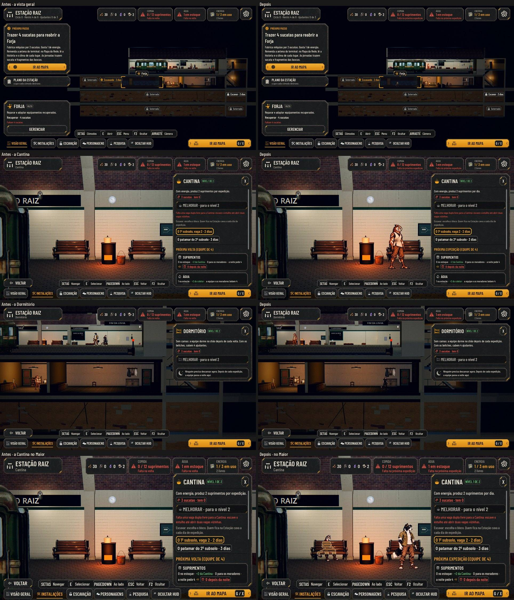

# "Dia" no jogo todo

Decisão do Lucas (01/11, no #284): os textos que diziam "volta" no sentido de tempo passam a dizer "dia". Os ids e os
saves não mudam. Na Estação, um dia é o ciclo: a volta de uma expedição ou o "Esperar um dia", que também produz e
gasta. A escavação não anda no "Esperar um dia", e a tela diz isso desde o #284.

## O que mudou

- **O que produz e gasta a cada ciclo conta por dia:**
  - os postos: "+2 fragmentos por dia" e "−1 dia de recuperação para 1 caído por dia";
  - a Cantina: "produz 2 suprimentos por dia" e "rende mais 1 suprimento por dia";
  - o que a Dora come e bebe;
  - o Depósito: "o excesso estraga a cada dia";
  - o "Esperar um dia": "gasta e produz como um dia de expedição".
- **A previsão de comida e água diz "Próxima expedição":** o topo ("Próxima expedição: 4", "! Falta na próxima expedição"),
  a dica e a seção da Cantina.
  - A conta é de uma volta: a equipe bebe e a noite pede comida. Por isso ela é da próxima expedição, e não do próximo
    dia.
- **O Dormitório e o tutorial: "depois de cada expedição".** Só a volta abre a noite; no "Esperar um dia" ninguém dorme.

## O que continua "volta"

"Volta" continua quando quer dizer o acontecimento, a volta da expedição:
- "entregue na volta" e "a noite da volta";
- "os novos chegam de trem, na volta das expedições";
- a dica "A volta";
- "segue junto até a volta";
- "desde a primeira volta", num evento.

"Volta" também continua quando é verbo: "volta em 3 dias", "volta à Estação".

## Para o Lucas

A previsão do topo conta sempre uma expedição com 4. Quando o único próximo dia possível é o "Esperar um dia" (todos
caídos), a previsão pode avisar uma falta que não acontece. O texto diz "próxima expedição", então não engana. Mudar a
conta para prever o "Esperar um dia" é outra regra.

## QA

- **Rodada 1: REPROVADO**, com 3 problemas médios:
  - a previsão dizia "próximo dia", mas contava uma expedição;
  - a Cantina dizia "por expedição" ao lado de "por dia";
  - o Dormitório dizia "depois de cada dia", mas a noite só existe depois de uma expedição.

  Os três foram corrigidos, com teste em `test_station_rules`.
- **Rodada 2: APROVADO.**
