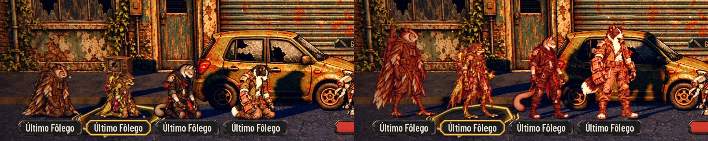
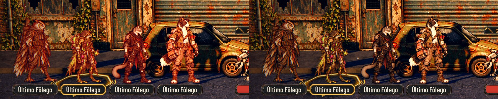
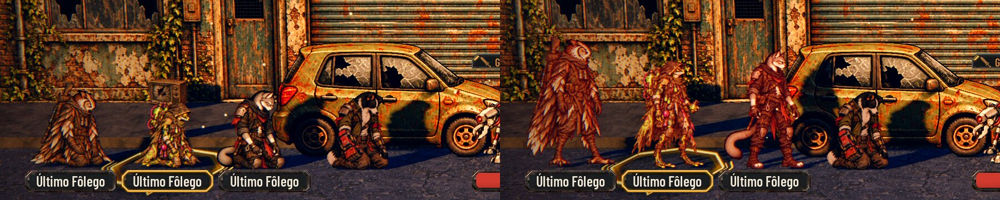

# O Último Fôlego de pé, piscando em vermelho (#281)

Pedido do Lucas (31/10/2026): no Último Fôlego o personagem continua de pé, na pose normal de combate, em destaque e
piscando em vermelho, como a Porta da Morte do Darkest Dungeon. Só cai quando é derrotado depois do Último Fôlego.

Antes (a `main`, à esquerda), os fundadores ficavam ajoelhados na pose de caído e os recrutas, de pé e escurecidos.
Depois (à direita), todos ficam de pé, na cor normal, com o pulso vermelho (aqui no ponto mais forte):

O pulso no ponto mais forte e no mais fraco (um ciclo de 1,1 s):

Derrotado de vez depois do Último Fôlego, o herói cai, fica cinza e perde a placa, como antes. Os outros continuam
piscando:

As fotos saem de `tools/capture_281.gd` (a luta da Rua das Vitrines com a equipe toda no Último Fôlego). O antes é o
mesmo roteiro no código da `main`.

## O que muda

- **`AHSpriteCard.set_danger()`:** um pulso de luz vermelha no desenho (de 0,04 a 0,3, num seno de 1,1 s), somado ao
  destaque da mira (#57). O piscar do acerto volta para ele. Com os efeitos reduzidos, fica um brilho fixo no meio do
  pulso, sem piscar.
- **`AHCombatArena.rest_pose()`:** no Último Fôlego, a pose parada, a cor normal e o pulso. Derrotado de vez, a pose de
  caído e o cinza. A cura desliga o pulso, e o fim da luta também (quem sobrevive volta para a rua com 1 de vida, sem a
  luz).
- **O #70 (PR #278):** com o herói de pé no Último Fôlego, o ALVO e o clique já ficam na altura certa. O #278 deixa de
  ser necessário.

## Testes

- `tests/test_deaths_door_pulse.gd`: o pulso vai e volta, soma ao destaque da mira, volta depois do acerto, fica fixo
  com os efeitos reduzidos e apaga ao desligar.
- `tests/test_deaths_door_fight.gd`: uma luta da rua termina com um herói no Último Fôlego, e o pulso apaga.
- `tests/test_street_scene.gd`: o recruta no Último Fôlego fica de pé, na pose parada, na cor normal e com o pulso.
