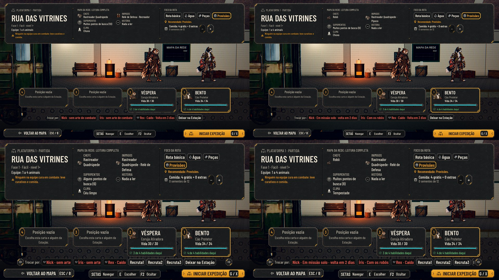

# Na partida, quem está fora diz por quê (#183)

Pela decisão do Lucas de 01/11, a missão solo e a expedição principal correm ao mesmo tempo. Quem está fora fica
indisponível na escolha da equipe, com o motivo.

## O que muda

- **A lista da Estação na partida** mostra o motivo de quem está fora. O texto sai de `AHSideMissions.away_short`:
  - "Em missão solo · volta em N dias" (no singular, "volta em 1 dia");
  - "Com os robôs".

  Antes, os dois apareciam como "sem arte de combate". A dica do mouse continua com o texto longo
  (`deploy_block`), que traz o nome da missão. "Chega no trem" entra com o #288.
- **O rascunho velho:** a equipe sugerida é montada ao abrir o Mapa da Rede. Quem era mandado à missão solo depois
  disso continuava na carta e de pé na plataforma, e o motivo só aparecia ao travar o INICIAR EXPEDIÇÃO. Agora, ao abrir
  a partida, ele sai da equipe, e a vaga é preenchida por quem pode ir, como no rascunho novo.

## Testes e QA

- `tests/test_preparation_flow.gd`, na tela da partida de verdade:
  - o Risco em missão solo e com os robôs, com o motivo e sem entrar na equipe;
  - a Íris mandada à missão depois do rascunho sai da equipe e da plataforma e aparece na lista. O teste falha sem a
    correção.
- `tests/run_all.gd` inteiro.
- **QA** (feita sobre o mesmo ajuste no #288):
  - **Rodada 1: REPROVADO.** O rascunho velho (acima) foi o caso alto. Ficaram observações baixas:
    - no modo compacto, o motivo vem inteiro e o chip ocupa um terço da linha, mas a lista rola e nada corta;
    - "volta em 1 dia" no lugar de "0 dias" não acontece no jogo, porque a missão volta no início do dia.
  - **Correção:** a partida tira quem está fora, com o teste.
