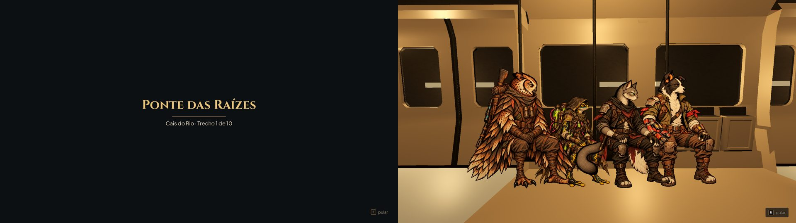
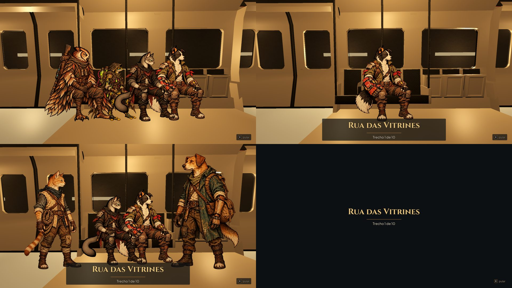

# Partida: a equipe no vagão em movimento (#75)

Fotos de `tools/capture_departure.gd` (1920x1080, gl_compatibility): a Preparação confirmada na Estação e a passagem
até a fase.

À esquerda, o antes: a partida era o cartão preto da passagem (#74) com o título da fase. À direita, o depois: a equipe
escolhida sentada no banco do metrô em movimento, a caminho da fase.

- **Em cima à esquerda:** os quatro fundadores, a caminho da fase. Passada a carência de 0,3 s, o canto já mostra a
  tecla de pular.
- **Em cima à direita:** um herói sozinho, com o título da fase aceso por cima depois do passeio.
- **Embaixo à esquerda:** dois fundadores e dois recrutas. Os recrutas ainda não têm pose sentada e ficam de pé nas
  pontas, olhando para o meio.
- **Embaixo à direita:** com "Reduzir efeitos", sem o vagão e sem movimento, só o título.

## Como funciona

- **O vagão** (`scripts/station/wagon_ride.gd`, `AHWagonRide`) usa o mesmo metrô Bombardier da Estação, com os
  materiais de lá. Muda só o vidro, escuro, para o túnel aparecer.
- **O movimento:** a parede do túnel escorre, as luminárias passam pelas janelas e a câmera balança com o trilho.
- **Quem embarca:** a equipe da Preparação. Os mortos não embarcam.
  - Os fundadores usam a pose sentada (`station_poses.json`, `*_seat`), lado a lado dentro do assento medido do
    banco (de 1,2 a 2,8 m no modelo), na ordem da equipe: a posição 1 à direita dos sentados.
  - Os recrutas usam o idle de pé até a arte do Codex (#79). Ficam fora do assento, nas pontas, com mais folga que
    os sentados: o primeiro da equipe na ponta direita, o seguinte na esquerda, e assim por diante (com só recrutas,
    a posição 1 é a da ponta direita).
  - Vizinhos que se sobrepõem ficam em profundidades um pouco diferentes.
- **O quadro:** o lado de perto do vagão (banco, barras e divisória entre a câmera e o corredor) fica inteiro fora do
  quadro (o corte da câmera a 1,3 m). A câmera olha quase na horizontal (uns 2,4° para baixo, fov 60) para o chão da
  borda de baixo ficar além do corte, mesmo com o balanço. O título da fase acende no chão, embaixo da equipe, e a dica do canto tem
  fundo escuro para ler sobre o chão claro.
- **O tempo:** o vagão fica 2,8 s sozinho (pelo relógio), depois o título da fase acende por cima. A fase só monta por
  baixo com o título já aceso, então o quadro travado da montagem não para o vagão no meio do passeio. Sem pular, a
  passagem fica no mínimo 4,6 s e nunca fecha antes de o título acender (numa máquina lenta, em que os quadros chegam
  com o tempo cortado, o título atrasado ainda aparece).
- **Pular:** nos primeiros 0,3 s do cartão, pular não vale (o duplo Interagir da confirmação não pula o vagão antes de
  ele aparecer). Depois disso, o canto já diz que dá para pular, e no passeio pular encerra o passeio. O título acende na hora, a fase monta (o quadro travado) e a
  passagem fecha assim que ela estiver pronta. Depois do passeio, é como em toda passagem.
- **Save no meio:** a Preparação confirmada já grava a expedição antes da passagem. Um save gravado no meio, reaberto,
  segue direto para a fase (o Continuar e o redirecionamento da Estação).
- **Antes da passagem:** a fila da partida na plataforma (a Preparação) continua igual.
- **Captura do título:** a foto do título (e a de "Reduzir efeitos") sai de um cartão aberto sozinho, com o mesmo vagão
  por trás. Sem GPU, a montagem da fase trava a tela vários segundos logo depois de o título acender, e a foto da
  passagem de verdade pegava o fade.

## Testes

`tests/test_departure.gd` confere:
- a equipe certa no vagão, com 1, 2 e 4 heróis e com recrutas;
- os fundadores sentados e os recrutas de pé nas pontas, todos no quadro e com a arte carregada;
- que os mortos ficam de fora;
- que, da Preparação confirmada na Estação, a passagem mostra o vagão com a equipe e o título da fase, e o título espera
  o passeio;
- que a fase só monta depois do passeio;
- que o pular logo que o cartão abre não vale, que a dica de pular aparece no passeio e que o pular no meio do passeio
  acende o título na hora e abre a fase antes do fim do passeio;
- que o chão nos cantos de baixo da tela fica além do corte da câmera;
- que os sentados ficam dentro do assento, quem está de pé não se sobrepõe a ninguém, todos ficam no quadro e a
  posição 1 fica à direita (com 1 a 4 heróis, só fundadores, só recrutas e misturados);
- que, pulada ou não, a passagem abre a mesma fase da expedição;
- que o save do meio já é o da expedição e abre a fase;
- que "Reduzir efeitos" fica só com o título.
