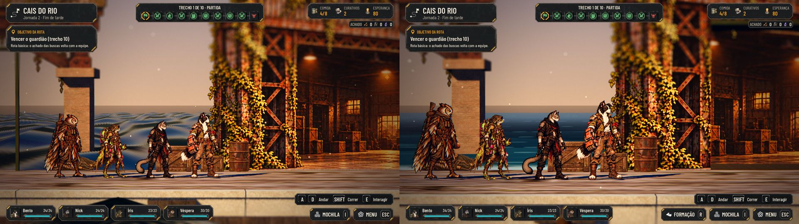
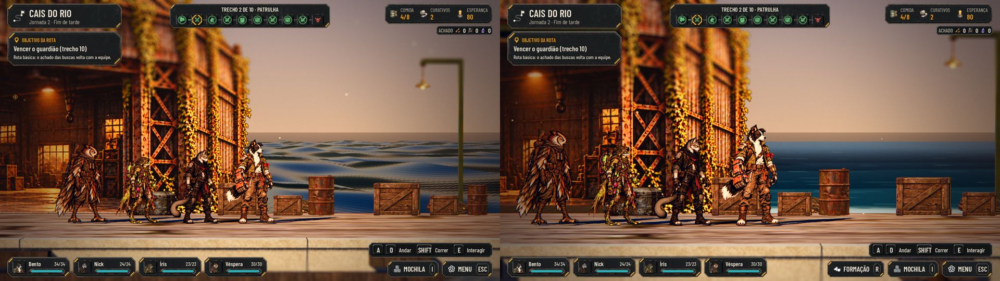
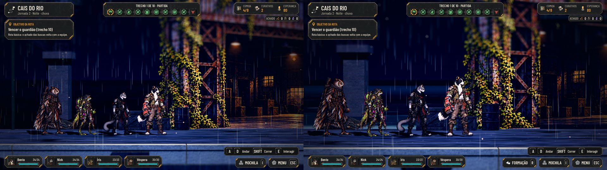
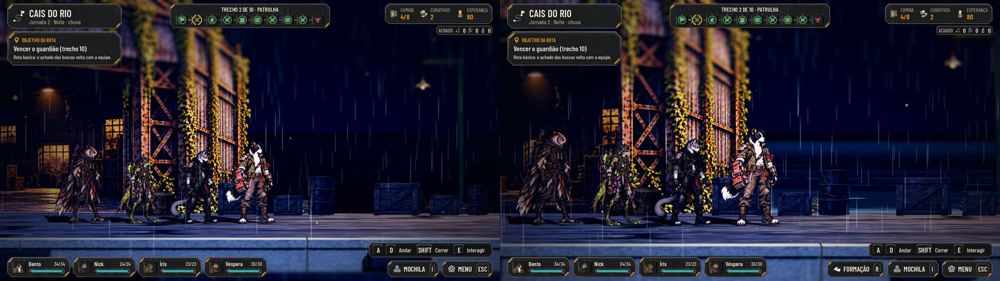
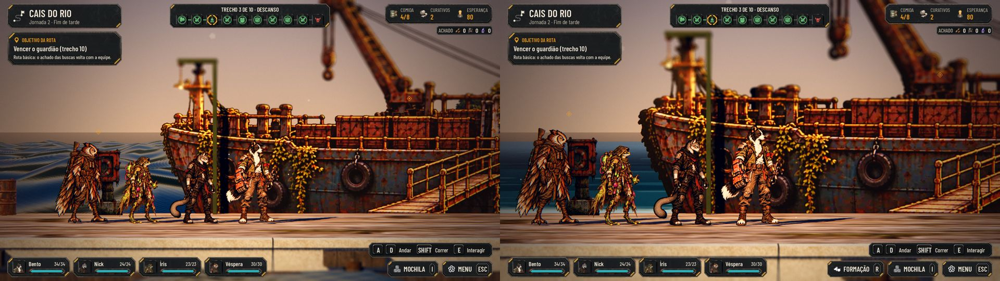
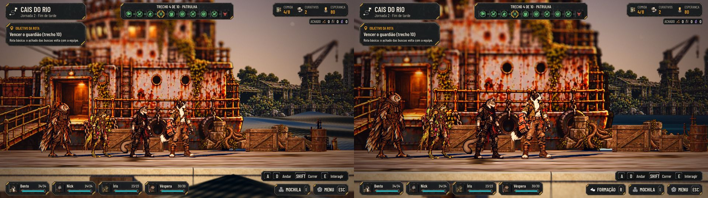
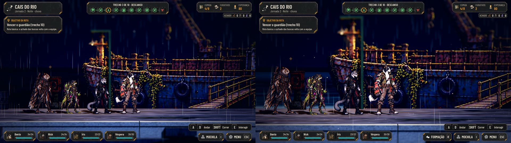
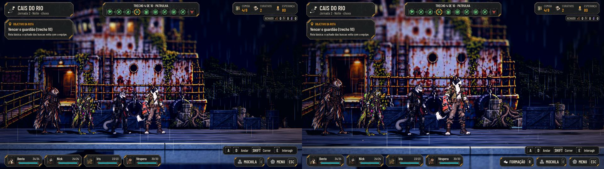
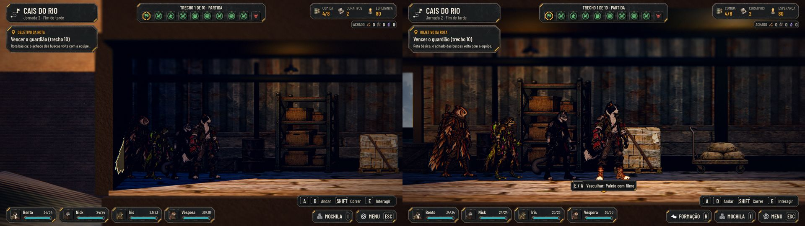
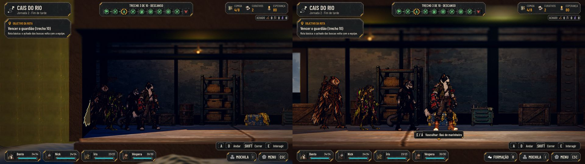

# O Armazém e o Navio do Cais em camadas, e os interiores ligados ao Cais (#141)

## O que muda

- **O Armazém** (a porta do Galpão) sai do card chapado para camadas da mesma pintura (`T_CD15`), cortadas nas bordas
  de verdade: os pilares na frente, a viga e a soleira um pouco atrás e o vão (o interior pintado) recuado 1,6 m, com
  os batentes, o teto e o piso do recuo em volumes de metal. Quando a câmera passa ao lado, o vão aparece fundo. Os
  volumes do recuo não fazem sombra: o interior pintado (as lâmpadas e as janelas acesas) continua aceso no vão.
- **O Navio** (`T_CD14`) fica com a pintura inteira e uma silhueta escura atrás, que dá a espessura do casco e da
  cabine. Cortar a pintura em linha reta (o casco, o convés e a cabine em planos separados) abria emendas: o pedaço de
  trás desloca e pega outro desfoque de profundidade. As camadas de verdade esperam a arte com máscaras, pedida ao
  design na #164.
- **A luz do cenário** vale para os dois: cada fachada é uma malha só, iluminada como a arte do mapa (o clima e a hora
  mudam a cor). Numa malha só, a fachada inteira recebe as mesmas luzes do cais; no Compatibility, cada malha pega no
  máximo 8.
- **Os interiores ligados ao Cais:**
  - ao entrar, a equipe anda até a porta do Cais e passa por ela; do lado de dentro, sai da porta de dentro (à
    esquerda, no fundo) para a sala;
  - a porta de dentro mostra o lado de fora (o céu e a água pintada da #140), com a luz de fora entrando
    (`doorways` no mapa, `door_view.gdshader`). Ela não escurece com o interior: é o lado de fora, com a hora e a chuva
    de lá (mais clara que a sala no fim de tarde, azul e com os riscos da chuva de noite), e a luz que entra acompanha;
  - do lado de dentro, a equipe para longe o bastante da porta para a fila inteira deixá-la à vista;
  - ao sair, a equipe anda até a porta de dentro, passa por ela e sai da mesma porta do Cais para a faixa de andar.
- Só os interiores com a porta de dentro no mapa (os dois do Cais) entram andando. Os outros (o Depósito) entram e
  saem como antes, com o escuro e a equipe já na sala.
- Tudo sai de `tools/build_riverdock_depth.py`, que reescreve o `RiverDock.json` (rodar de novo refaz igual).

## Antes e depois

| | |
|---|---|
| Armazém, da esquerda  | Armazém, da direita  |
| Armazém, de noite com chuva  |  |
| Navio, da esquerda  | Navio, da direita  |
| Navio, de noite com chuva  |  |

| Galpão, por dentro  | Navio, por dentro  |

Entrar e sair: [o Galpão](dock-depth/warehouse-sequence.jpg) e [o Navio](dock-depth/ship-sequence.jpg) (a porta do
Cais, a passagem, a sala com a porta de dentro, a volta e a equipe de novo na frente da porta).

Os dois climas e as duas horas (o fim de tarde e a noite, secos e com chuva) e a porta de dentro de dia e na noite com
chuva: [o Armazém](dock-depth/warehouse-weather.jpg) e [o Navio](dock-depth/ship-weather.jpg).

## Testes

- `tests/run_all.gd`: todos verdes, com a paridade 48/48.
- `tests/test_dock_depth.gd` (novo, 50 verificações):
  - as camadas sem pedaço dobrado e em mais de uma profundidade;
  - a colisão: os volumes novos (os pedaços em camadas e as caixas do recuo) ficam atrás da faixa de andar e do passo
    para a porta, e o passo não cai numa caixa. Empurrado para o fundo na frente do Armazém e do Navio, o líder para na
    faixa, antes deles;
  - as portas de dentro, com a hora, a chuva e a luz de fora mesmo com a equipe dentro;
  - a entrada e a saída andando dos dois interiores do Cais: a equipe vai até a porta, sai da porta de dentro, para
    ao lado dela e volta para a mesma porta do Cais, na faixa de andar;
  - os três interiores do Depósito, que não têm porta de dentro, entram e saem do jeito antigo, sem andar para o
    fundo.
- `tools/capture_141.gd`: as capturas acima (também roda na main de antes).
- O modo de captura da rua, com o teste de colisão, passa.

## Rodadas da QA

- **Rodada 1, reprovada:**
  - a porta de dentro escurecia com o interior;
  - o vão do Armazém ficava preto, pela sombra das caixas do recuo;
  - no Depósito, a equipe saía da parede;
  - faltava o teste de colisão dos volumes novos.
  Tudo corrigido como descrito acima.

## Para o Lucas

- O Navio só ganha as camadas (casco curvo, convés, cabine e mastro) com a arte da #164.
- Este PR vem por cima do da #140 (a água), que vem por cima do da #129 (a câmera).
