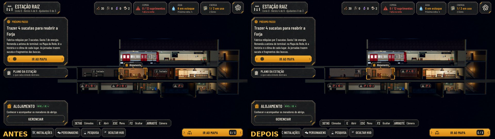
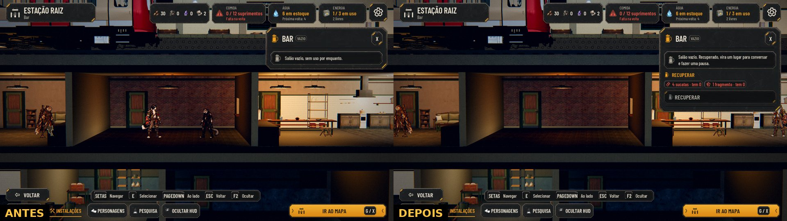
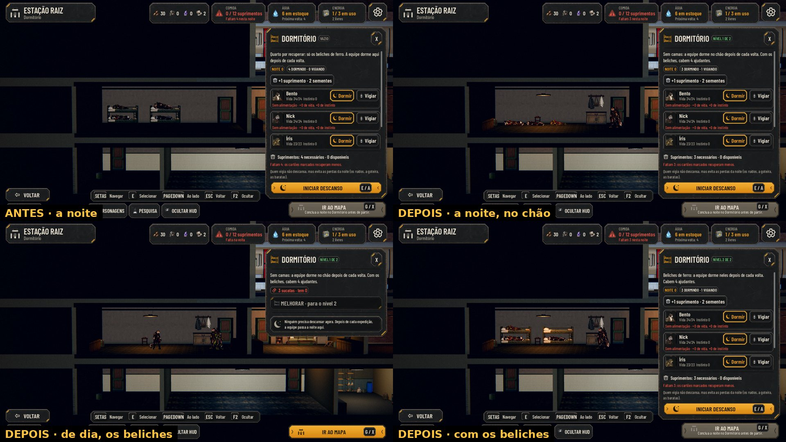
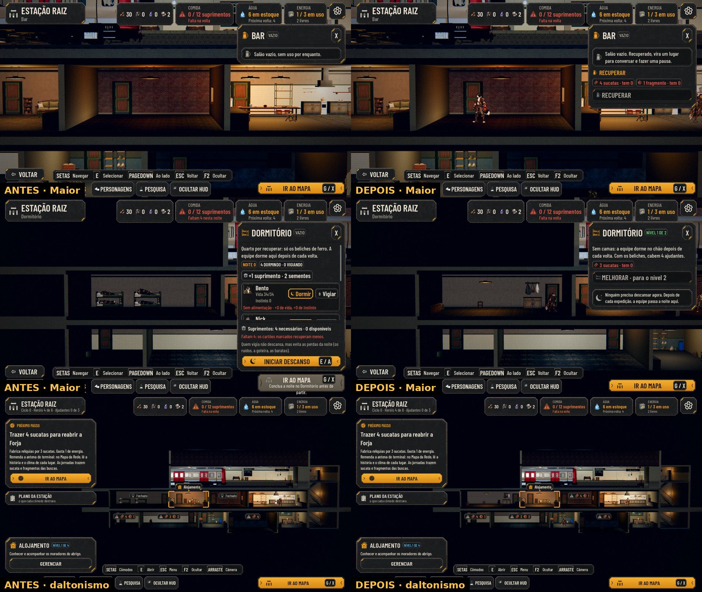

# O Dormitório sem camas e o Bar com custo (#176)

Decisões do Lucas (28/10): o Dormitório existe desde o começo, sem camas, e a equipe dorme no chão; os beliches chegam
quando ele é melhorado. O Bar tem custo para ser recuperado. Com isso, nenhum cômodo mostra mais "Fechado".

As capturas são do jogo, pela cena de verdade (`tools/capture_176.gd`, o mesmo roteiro no código de antes e no de
agora), em 1280x720, por software (sem placa de vídeo). O trem vermelho no alto é o da `main` desta branch; o vagão
verde está no PR #266.

## A vista geral

- **Antes:** o Dormitório e o Bar diziam "Fechado", sem custo, e o Dormitório ficava escuro e sem os móveis.
- **Agora:** o Dormitório já existe (sem marcador, aceso, com o armário, os ganchos e a mesa). O Bar mostra o marcador
  de construir, com o custo em ícones e o que falta em vermelho, como a Forja e a Pesquisa.

## O Bar

O painel do Bar vazio mostra o custo (4 sucatas e 1 fragmento, proposta) e o botão de recuperar. Recuperado, ele vira
"um lugar para conversar e fazer uma pausa"; o efeito dele no jogo segue em aberto (#11).

## O Dormitório

- **Antes:** "Quarto por recuperar", com os quatro dormindo nos beliches.
- **Agora, no nível 1:** sem camas. Quem dorme deita no chão, nos quatro lugares entre a mochila do canto e a faixa do
  vigia, que fica de pé perto da porta (na foto, três dormem e o Bento vigia).
- **De dia,** o painel oferece os beliches (3 sucatas, proposta em `data/hero-jobs.json`). Com a noite pendente, o
  painel abre direto no plano da noite, e a melhoria fica para o dia.
- **Com os beliches (nível 2),** quem dorme volta para eles, e cabem 4 ajudantes em vez de 3.

O caído sem leito na Enfermaria deita num lugar que ninguém ocupa nesta noite. Sem lugar livre, fica de pé, à parte.

## Maior e daltonismo

O painel do Bar e o do Dormitório no texto Maior, e a vista geral com as cores de daltonismo. O "o que falta" do
marcador do Bar segue a cor de alerta do kit, como o da Forja.

## Em aberto

- **O que os beliches dão hoje:** só existem 3 ajudantes (Dora, Otto e Cora), e o nível 1 já comporta 3. O quarto
  ajudante dos beliches ainda não tem quem ocupar. A pergunta ao Lucas está no PR.
- **A cama no chão:** quem dorme deita direto no piso de madeira, com a pose de dormir que o acampamento também usa. Um
  colchonete ou cobertor embaixo é trabalho de design.
