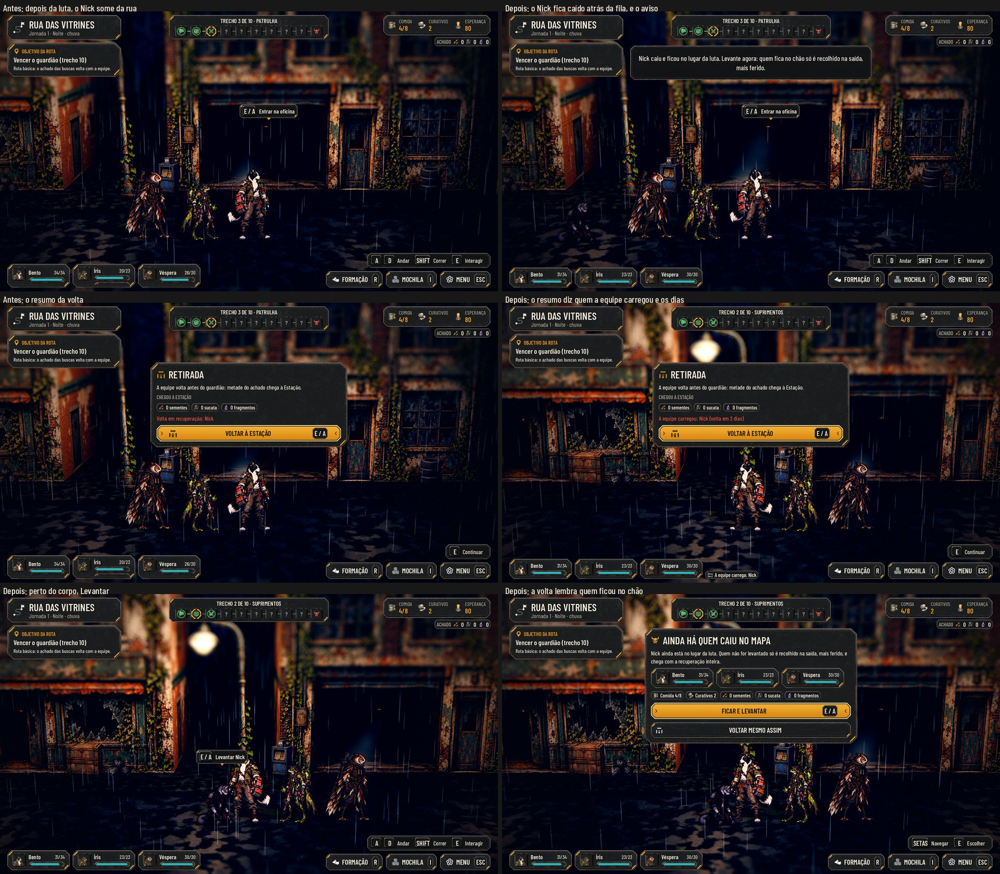

# Os caídos no mapa (#179)

O pedido do Lucas (27/10): "Eles caíram no mapa, onde ficaram. Eu poderia tentar levantar eles para levar para a
Estação. Se não forem levantados, vão direto para a Enfermaria."

No Maior: [larger.jpg](downed/larger.jpg). As fotos saem de `tools/capture_179.gd` (`--text-size=2`). O antes é o mesmo
roteiro no código da `main`: o Nick cai na patrulha e some da rua, e nada avisa.

## O que muda

- **O corpo no mapa:**
  - quem cai numa luta (a patrulha, a casa ou o guardião) fica deitado no lugar dela, na pose de queda, acinzentado como
    na luta (um pouco mais claro, para ler na noite e na chuva);
  - a equipe se refaz no mesmo trecho, então o corpo fica logo atrás da fila (1,5 m), e não embaixo de quem está de pé.
    Com dois caídos, um ao lado do outro;
  - ele não segue a equipe, e o resto da exploração continua igual.
- **O aviso logo depois da luta:** "Nick caiu e ficou no lugar da luta. Levante agora: quem fica no chão só é recolhido
  na saída, mais ferido." (no plural, "Nick e Íris caíram…"). Na luta do guardião, ele vem junto com o aviso do
  guardião, num só.
- **Levantar:** perto do corpo, "E  Levantar Nick" na tecla de interagir. Levantado, o corpo sai do mapa, e a equipe
  mostra um selo "A equipe carrega: Nick" ao lado das plaquinhas. Ele não luta e segue fora até a volta. Levantar não
  custa nada.
- **A volta:** com alguém ainda no chão deste mapa, voltar (o Menu, o fim da rua ou depois do guardião) abre "Ainda há
  quem caiu no mapa", com "Ficar e levantar" (a primeira, na tecla de interagir, para o mesmo E não largar ninguém) e
  "Voltar mesmo assim". Sem ninguém no chão, a volta segue direto.
- **Seguir para o próximo mapa** (as fases com mapa de passagem, como o RiverDock da fase 2): o mapa seguinte não volta,
  então, com alguém no chão, a equipe para na borda com "Ainda há quem caiu neste mapa": "Ficar e levantar" ou "Seguir
  mesmo assim". Quem fica para trás não conta mais no lembrete da volta (não está ao alcance).
- **O nó do personagem no mapa:** o corpo é um `AHMapActor` (`scripts/world/map_actor.gd`), a placa com a pose, o
  texto da ação de interagir e o ponto do marcador. Ele serve também para o herói preso da #188 (Claude 2).
- **O resumo da volta** separa as listas, cada nome com os dias:
  - "A equipe carregou: Nick (volta em 2 dias)";
  - "Foram para a Enfermaria: …" (com leito);
  - "Foram para o Dormitório, em recuperação: …" (sem leito).
- **O save:** os caídos ficam em `expedition.downed` (o mapa, a posição e a casa) e os levantados em
  `expedition.carried`. Salvar e abrir no meio da exploração mantém os dois. O save antigo, sem esses campos, abre como
  antes: quem já tinha caído não vira corpo (só quem cai numa luta depois da atualização) e volta com a recuperação
  inteira.
- **A narrativa:** o `docs/narrative/narrative-design.md` (#118) dizia "a equipe o carrega de volta". Agora diz que o
  levantado segue carregado e chega menos ferido, e quem fica no chão só é recolhido na saída, mais ferido, com a
  recuperação inteira.

## A recuperação (proposta para o Lucas)

Uma regra nova em `data/recovery.json`, `carried`, com `Factor: 0.5`: o levantado chega com metade dos dias, para cima,
no mínimo 1. Com os números de hoje:

| Onde se recupera | Deixado no mapa | Levantado |
|---|---|---|
| Enfermaria (leito) | 2 dias | 1 dia |
| Dormitório | 3 dias | 2 dias |

## Testes

- **`test_downed` (novo):**
  - a regra: quem cai entra no mapa uma vez só, com o mapa, a posição e a casa; levantar passa para os carregados, uma
    vez; quem cai depois entra no mapa;
  - a recuperação: na Enfermaria e no Dormitório, o levantado chega com os dias do `recovery.json`, e o deixado com os
    dias inteiros;
  - a volta: `finish_return` entrega os dois, com o carregado marcado;
  - o save: o caído e o levantado voltam iguais;
  - a cena: depois da luta, o corpo no mapa, atrás da fila; o aviso com o nome; a volta que lembra, com Ficar primeiro;
    "Levantar" perto do corpo; o selo da equipe; o save já gravado; a volta sem lembrete e o resumo com "A equipe carregou".
- `tests/run_all.gd` inteiro verde.

## Rodadas da QA

### Rodada 1: REPROVADO

**Médias, corrigidas:**
- **Save antigo:** quem tinha caído antes da atualização "caía de novo" na luta seguinte, no ponto (0,0,0), com aviso.
  Agora só marca quem caiu nesta luta.
- **O aviso do caído apagava o do guardião** (o caso do Lucas). Os dois vêm num aviso só.
- **O mapa de passagem:** o caído ficava sem alcance, e o lembrete ainda oferecia "Ficar e levantar". Seguir agora
  pergunta antes, e o lembrete conta só quem está neste mapa.
- **A narrativa:** o texto contradizia "a equipe o carrega de volta". O cânone foi atualizado, e os textos dizem como
  quem fica chega à Estação.

**Baixas:**
- Corrigido: o lembrete juntava os nomes com vírgula; agora usa "e", como o aviso.
- Corrigido: "volta direto para a recuperação inteira" virou "chega com a recuperação inteira".
- Ficam:
  - Esc não fecha o lembrete. É o padrão das escolhas (`show_choice`), que pedem um botão.
  - O selo da equipe fica pequeno no Maior, no tamanho dos outros selos da caixa da equipe.
  - Pergunta para o Lucas, abaixo: o Factor quando o carregado ganha um leito depois.

### Rodada 2: APROVADO

A QA refez cada caso com scripts próprios:
- o save antigo;
- a borda da passagem andando, com o E repetido, Ficar, Seguir, a recarga e a volta no mapa seguinte, sem lembrete e
  com a recuperação inteira;
- o guardião com e sem caído, na fase 1 e na fase 2;
- a casa: sair, voltar, recarregar dentro e levantar.

**Baixas, corrigidas:**
- O resumo dizia "Foram…" e "Carregados…" com um nome só. Agora é "Foi…" no singular. O carregado vira "A equipe
  carregou: …", que serve para um ou vários e não erra o gênero.
- "O próximo mapa não volta para cá" virou "a equipe não volta para cá depois de seguir".

**Ficam:**
- Abandonar pelo Menu com caído no chão faz duas perguntas seguidas ("Abandonar a expedição?" e o lembrete).
- Segurar a seta depois de "Ficar" leva de volta à borda, e a pergunta vem de novo.

## Para o Lucas

- O `Factor` de 0,5 é uma proposta. Hoje ele vale na chegada. O carregado que chega ao Dormitório (2 dias) e ganha um
  leito depois fica com 2, não com 1. Quer que o leito também conte a parte?
- O texto novo do cânone (quem fica no chão só é recolhido na saída, mais ferido) precisa do seu ok.
- O visual do carregado é o selo na HUD da equipe (o corpo sai do mapa). Se preferir, ele pode ir junto do herói que
  o levantou.
- Esta entrega mexe em `scripts/street/street_corridor.gd` (o mapa é do Claude 2, #175).
