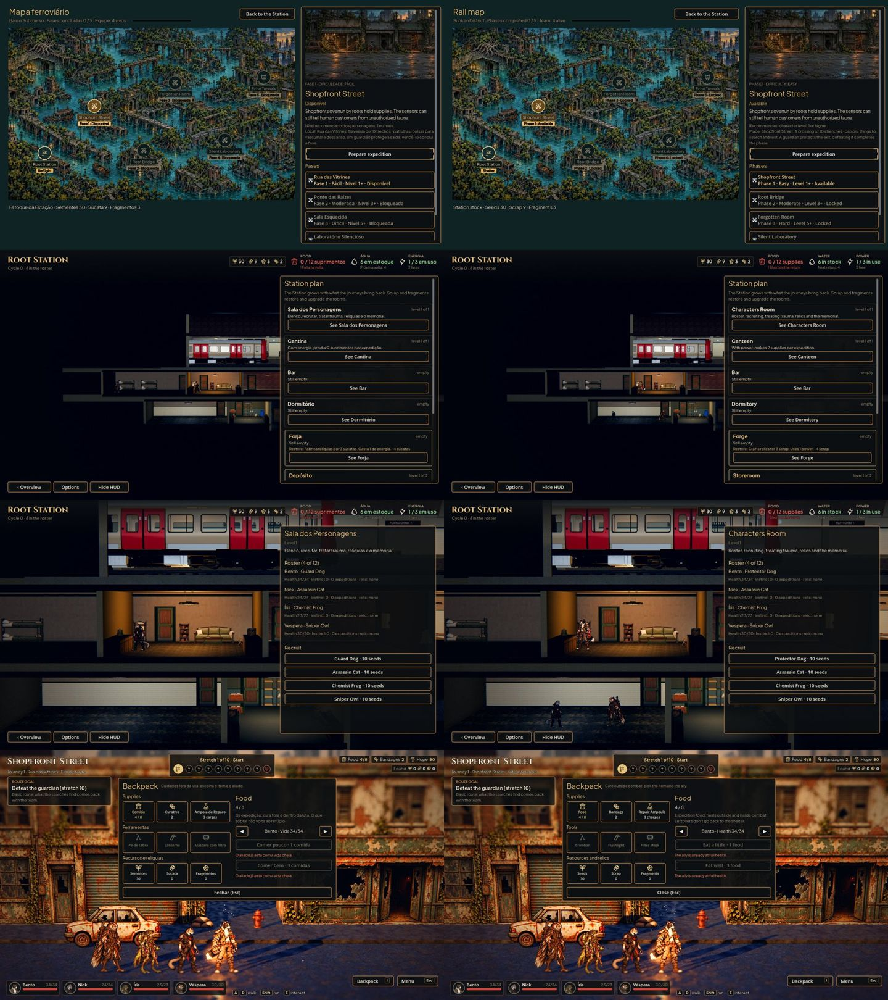

# As telas restantes em inglês (#35)

Capturas de `tools/capture_ui.gd --language=en`, antes (169eee8) à esquerda e depois à direita: o mapa de fases, o
Plano da Estação, a Sala dos Personagens e a Mochila. Antes, o mapa, os cômodos, os campos dos civis e a Mochila saíam
em português no jogo em inglês; agora todas as telas e as regras que montam texto passam pela tradução (1168 textos no
`data/i18n/en.po`). O save continua em português: o que é gravado é traduzido só na hora de mostrar.
