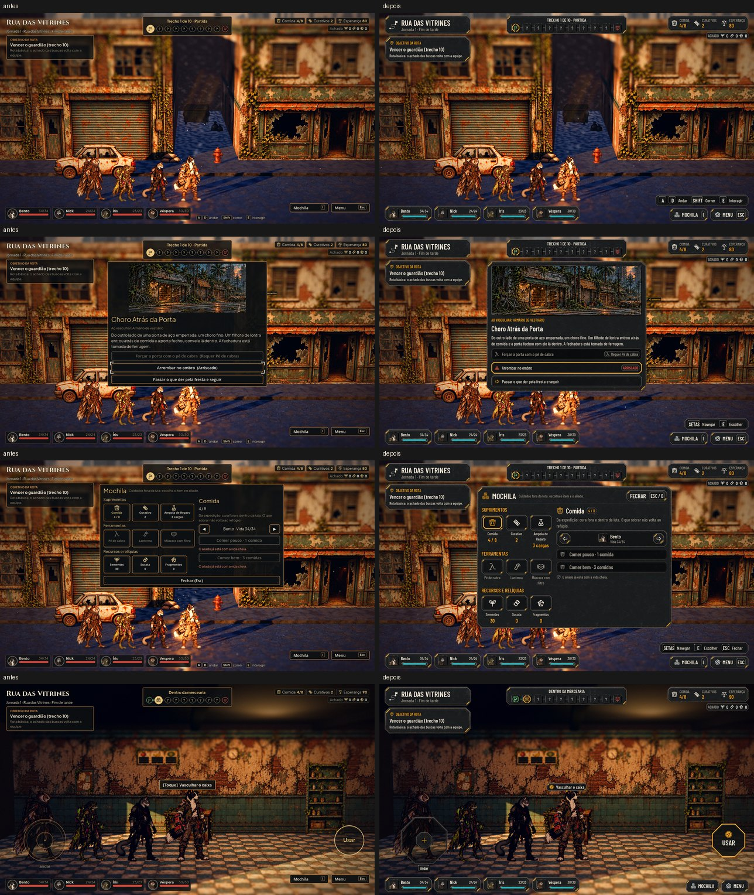

# A exploração no kit (#106)

A integração de [hud-exploracao.md](../design/hud-exploracao.md): a moldura da rua, dos interiores e dos cenários, os
painéis por cima dela (o evento, o resultado, a Mochila, abandonar, diante do guardião, o guardião vencido) e os
controles de toque, no kit da Awesomic (`art/ui/kit/station`).

As maquetes (à esquerda) e o jogo (à direita), nas catorze telas:
- [Normal](exploration/target_game.jpg)
- [Maior](exploration/target_game_large.jpg)

As fotos saem de `tools/capture_106.gd` (o daltonismo e o Maior com daltonismo também, com `--colorblind`).

## O que mudou

- **No alto, à esquerda:**
  - a plaqueta do lugar, com a rota, o nome, a jornada e o tempo;
  - o cartão OBJETIVO DA ROTA com o pino. Cumprido, vira OBJETIVO CUMPRIDO com o check verde (a forma também diz).
- **No meio, o corredor numa faixa só:** as dez casas ligadas por elos.
  - A resolvida mostra o tipo em verde com o check no canto, e a de agora tem a moldura âmbar.
  - A ainda não alcançada mostra "?", e o guardião, sempre conhecido, fica em alerta.
- **À direita:** Comida, Curativos e Esperança numa ficha (a Comida em alerta quando acaba) e o Achado embaixo.
- **Embaixo:**
  - a equipe em plaquinhas com o retrato, o nome, a vida e a barra;
  - a barra das teclas: a da primeira jornada (#56) e, com um painel aberto, as teclas dele;
  - MOCHILA e MENU com a tecla dentro (sem a tecla no toque);
  - CONCLUIR JORNADA · VOLTAR À ESTAÇÃO, o botão âmbar sem tecla.
- **Por cima:**
  - o aviso de interação: a etiqueta do cômodo com a tecla (no toque, a bússola do Usar). O que já foi feito leva o
    check e o texto apagado;
  - a patrulha à frente, com a seta, a barra e o estado;
  - os avisos, numa chapa;
  - o achado, em chips que voam até o Achado;
  - as marcas, no losango âmbar do mapa.
- **Os painéis:**
  - **Evento:** a ilustração na moldura dos retratos, AO VASCULHAR, o título, o texto e as escolhas em linhas de
    lista. A que pede ferramenta mostra o pedido num chip, e a arriscada leva o triângulo e o chip ARRISCADO.
  - **Resultado do evento:** o texto, o que mudou em chips (em alerta quando foi perda) e CONTINUAR.
  - **Mochila:** os itens em quadrados de recurso (o escolhido com a moldura âmbar, o que falta no tom apagado), o
    detalhe com o aliado entre as setas, as ações em linhas, o motivo de não dar uma vez só, e FECHAR (Esc / B).
  - **Abandonar a expedição:** o triângulo, a pergunta, CONTINUAR A EXPEDIÇÃO (âmbar, na tecla de voltar) e VOLTAR À
    ESTAÇÃO (de aço, sem tecla).
  - **Diante do guardião:** a equipe como está, os suprimentos e o achado em chips, SEGUIR EM FRENTE e a volta com
    metade.
  - **Resultado da expedição:** no kit, com o que chegou em chips.
- **Toque:** o analógico é o octógono de aço com o pegador da cruz âmbar e "Andar" embaixo. O Usar fica apagado sem
  nada por perto e com o âmbar por cima perto de um objeto. As áreas de toque não mudaram. A arte antiga
  (`art/ui/touch`) saiu do jogo.
- **Uma dica de tecla só:**
  - o objetivo do guardião vencido diz "volte à Estação com todo o achado pelo Menu (Esc)", no lugar do "(botão ou
    Esc)";
  - o aviso do guardião caído nos cenários diz "pelo Menu (Esc)", no lugar do "(E)".
  - A tecla segue a troca nas Opções.

## O que mudou no resultado do evento (o save)

- `AHJourneyRules.choose_event_option` grava `event.changes`, a lista do que mudou de fato: [{kind, amount, hero}].
- Os limites contam: a Comida não passa de 8, a Esperança de 100 e a vida não cai abaixo de 1.
- O campo é opcional. Um evento salvo antes não tem a lista, e o resultado mostra só o texto. Nenhum id nem número de
  balanceamento mudou.

## A trava do padrão

A exploração, a Mochila e os controles de toque saíram de `tools/kit_guard_exceptions.txt`. Antes eram 32, 21 e 5
ocorrências; agora é zero.

## Testes

- `tests/run_all.gd`: 55 de 55, com a paridade 48/48.
- `test_events`:
  - em todos os eventos e escolhas, com sucesso e falha, a lista do que mudou é a diferença de fato no estado;
  - no jogo, um chip por mudança e CONTINUAR;
  - o evento salvo sem a lista abre sem os chips.
- Atualizados para o kit:
  - `test_touch_controls`: as peças do kit;
  - `test_full_journey`: o resultado em chips;
  - `test_camp_scene`: os botões do kit em caixa alta.

## Rodadas da QA

### Rodada 1: REPROVADO

**Média, corrigidos:**
- No acampamento, a plaqueta do lugar e o cartão do objetivo voltavam a aparecer (regressão da #109): a moldura
  esconde agora a plaqueta e o cartão. O `test_camp_scene` confere.
- A barra das teclas dizia "Esc Fechar" em painéis que o Esc não fecha, com o "Esc" fixo. Agora ela segue o painel:
  - o menu, a Mochila e as Opções: Navegar, Escolher e Fechar na tecla do Menu (segue a troca nas Opções);
  - o evento e as escolhas: Navegar e Escolher;
  - os resultados: Continuar.
  
  O `test_events` confere os três casos, com a tecla do Menu trocada para P.

**Baixa, corrigidos:**
- O toque trocado nas Opções no meio da rua tira ou põe a tecla de MOCHILA e MENU na hora.
- O chip do instinto é a mudança de fato (o limite de 200 conta) e leva o nome do herói. O teste compara o instinto
  também.
- O Cancelar de "Começar uma campanha nova?" mostra a tecla do Menu, que segue a troca.
- "Diante do guardião" no Maior fica centrado na largura de verdade, sem cobrir o cartão do objetivo.
- O retrato de um herói sem a arte do parado (visto numa rodada da suíte) não derruba mais a plaquinha da equipe:
  `face_texture` devolve vazio.

**Para o Lucas:** o texto do resultado de alguns eventos já diz o número ("(+10 de Esperança)"), e o chip repete.
Tirar o número do texto é mudança no `events.json`; fica para a decisão dele.

### Rodada 2: APROVADO

O acampamento, a barra das teclas por painel (Menu em P e Interagir em F), Esc e B no evento, a troca do toque nas
Opções, "Diante do guardião" no Maior, save e load de `event.changes`, o foco na Mochila e a Mochila da luta no Maior.

A observação baixa da rodada (no limite de 200, o texto do evento dizia o instinto dos dados e o chip o de fato) foi
alinhada: o `{Instinto}` do texto também é a mudança de fato.
