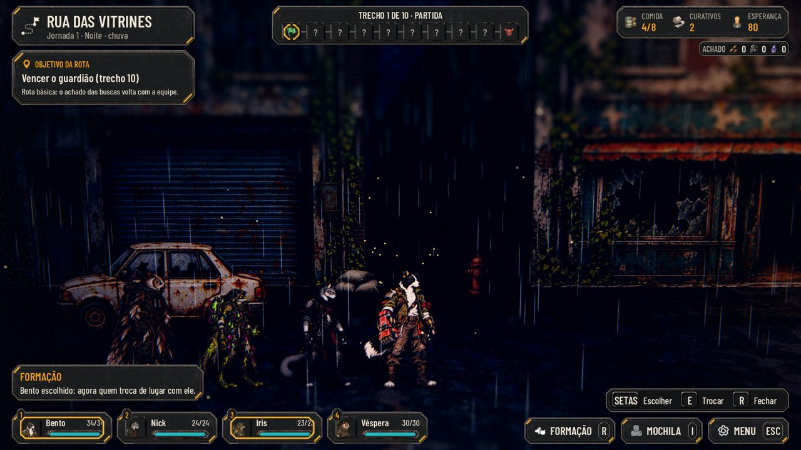
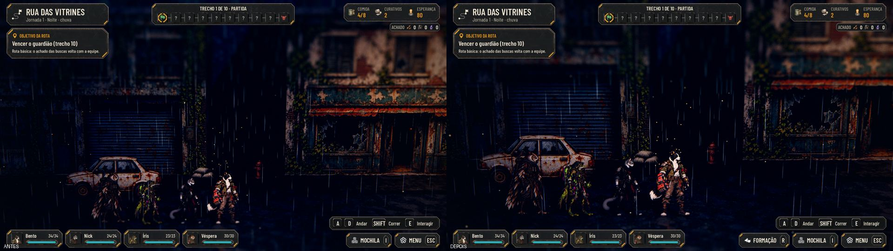
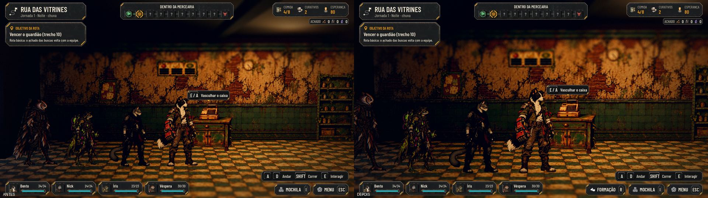
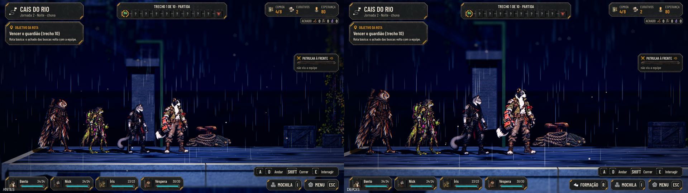
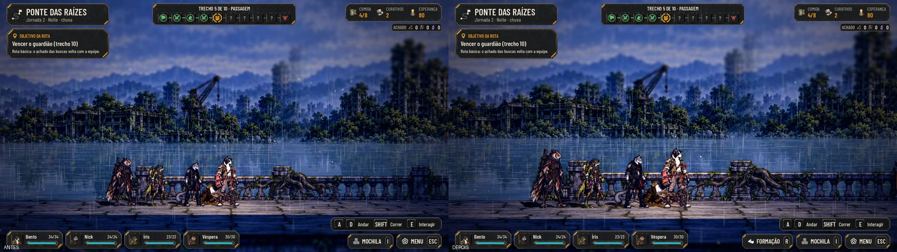
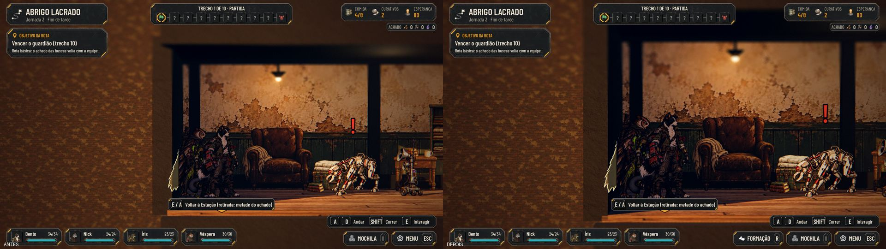
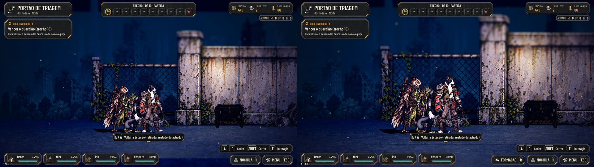
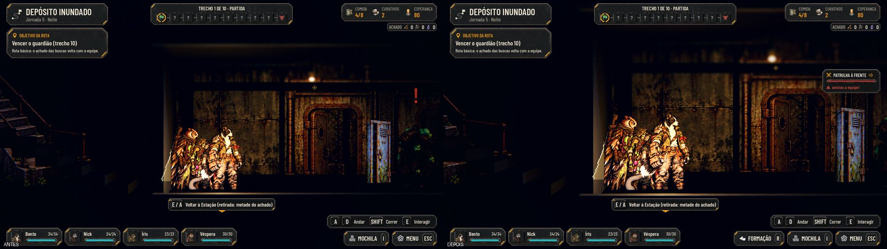
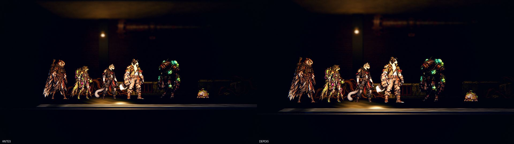

# A formação na exploração, a câmera mais perto e o fim das teclas de teste antigas (#129)

## O que muda

- **A formação na exploração:**
  - a ação nova FORMAÇÃO (R ou X no controle, trocável em Opções > Controles) e o botão FORMAÇÃO no canto abrem a
    ordem da equipe nas plaquinhas de baixo, com a posição de cada um (1 vai na frente);
  - clicar em dois heróis troca os dois; as setas andam o cursor e Interagir escolhe e troca; R, Voltar ou o Menu fecham;
  - a ordem vale para a fila que anda na rua e para a próxima luta (as posições 1 a 4) e fica no save da expedição
    (`AHJourneyRules.swap_team`);
  - não abre na luta, num evento, no acampamento nem com um painel aberto; aberta, a equipe não anda.
- **Saem as teclas de teste antigas da rua:** a linha "Teclas de teste (Admin) K R T P C", as ações `debug_rain`,
  `debug_time`, `debug_post`, `debug_colliders` e `debug_combat` (o `tools/define_input.gd` agora tira do projeto a ação
  que sai da tabela), o modo de desenvolvedor gravado nas opções e o "Teclas de teste da rua" da barra de Admin. O F1
  abre a barra de Admin (#130), que já tinha a chuva, o dia e a noite, o pós, as colisões e a próxima patrulha; o
  contador de quadros entrou nela.
- **A câmera da exploração mais perto,** com os valores num lugar só (`street.gd`, `EXPLORE_CAMERA`):

  | Onde | Antes (distância, altura do alvo) | Agora |
  |---|---|---|
  | Rua das Vitrines | 18,5 m, 2,5 m | 15,4 m, 1,7 m |
  | Cenários | 19 m, 1,7 m | 15,8 m, 1,45 m |
  | Ponte das Raízes | 28 m, 2,7 m | 23,3 m, 2,3 m (a #140 iguala a Ponte aos outros) |
  | Dentro das lojas | 11 m, 1,6 m | 9,2 m, 1,45 m |

  A equipe fica inteira na tela e os pés acima das plaquinhas da equipe (na rua, os pés em y≈930 de 1080; as
  plaquinhas começam em 988). A barra de Admin continua aproximando ou afastando por cima disso.

## Antes e depois

| | |
|---|---|
| Rua das Vitrines  | Dentro de uma loja  |
| Cais do Rio  | Ponte das Raízes  |
| Abrigo Lacrado  | Portão de Triagem  |
| Depósito Inundado  | Dutos de Esgoto  |

## Testes

- `tests/run_all.gd`: todos verdes, com a paridade 48/48.
- `tests/test_formation.gd` (novo): as regras da troca, a formação pela tecla, pelas setas e pelo clique, a fila e o
  save, a próxima luta nas posições novas, sem abrir na luta, num evento ou com a Mochila, e a câmera (a equipe na tela
  e os pés acima das plaquinhas) na rua e num cenário.
- `test_admin` e `test_game_flow`: nenhuma ação `debug_*` antiga sobra, e R não liga mais a chuva.
- A captura da rua (`-- --capture=`), com a colisão.
- `tools/capture_129.gd`: as capturas acima (também roda na main de antes).
