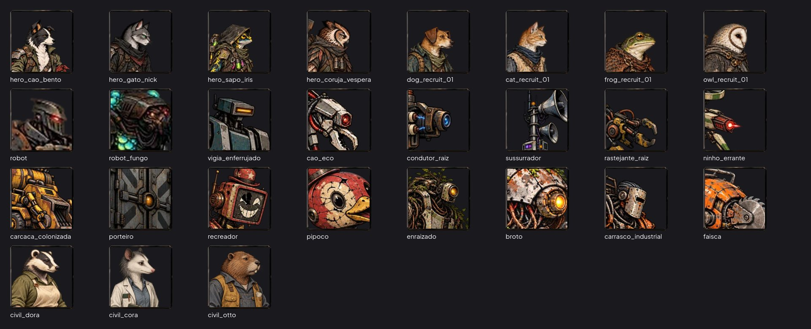
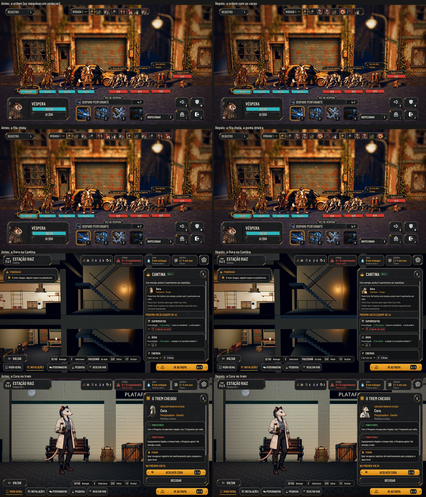

# A cara em todo ícone de personagem (#193)

O pedido do Lucas (27/10): "Todo ícone tem que mostrar visualmente a cara do personagem, ou algo que represente a cara
dele." Ele também pediu que a barra da ordem tenha sempre a parte final.

## A prancha

O ícone de cada personagem com arte, como o jogo o desenha. A foto sai de `tools/face_sheet.gd`.

Antes (o recorte automático): [sheet_before.jpg](faces/sheet_before.jpg).

## O que muda

- **Os inimigos** ganham uma caixa da cara nos dados, em `data/presentation/face_boxes.json`, com `[x, y, lado]` em
  pixels do canvas da pose parada (nas folhas de quadros, a do quadro). O ícone recorta esse quadrado em todo lugar que
  usa `AHUiStyle.face_texture`: a ordem de turno, as placas e os alvos, o Mapa da Rede, a inspeção e o fim da luta. O
  recorte automático (o terço de cima do corpo) fica só de reserva para quem não tiver caixa. O que faz as vezes de
  cara em cada um:

  | Inimigo | A cara |
  |---|---|
  | Robô, Robô Fungo, Sentinela de Triagem, Enraizado, Demolidor Industrial | a cabeça |
  | Rastreador Quadrúpede | a cabeça com a mandíbula |
  | Relé de Defesa, Broto, O Porteiro | a lente ou o olho |
  | Emissor de Comando | os alto-falantes e a tela |
  | Rastejante de Cabos | as pinças da frente |
  | Drone de Expurgo | a frente com o olho vermelho |
  | Coletor de Sucata | a frente do caminhão |
  | Recreador | a tela com o sorriso |
  | Pipoco | a cabeça do pato |
  | Faísca | a frente com a serra |

- **Os moradores na Estação** (a Dora, o Otto e a Cora, nos cômodos e no trem): o retrato do kit mostrava a arte
  inteira cortada no meio do corpo. Agora o ícone recorta o rosto pela `portrait_uv` que já estava em
  `data/presentation/civilians.json`, a mesma do briefing.
- **Os heróis e os recrutas** seguem com o retrato de `art/ui/portraits`.
- **Os inimigos de teste sem arte** (o Acoplador, os Eco, a Felina de Ferro e outros protótipos de `enemies.json` sem
  entrada em `combat_art.json`) não têm desenho nenhum, nem no combate; ficam fora até ganharem arte.
- **A faixa da ordem:**
  - a área de conteúdo da peça `round_strip` entrava 10 px na ponta da direita, e o último retrato cobria o fecho. A
    faixa ganha uma folga no fim, e a ponta aparece inteira;
  - com mais retratos do que cabem, eles encolhem até 36 px, sempre quadrados; no menor retrato, o espaço entre eles
    também encolhe. A faixa fica dentro da margem de 24 px até 20 unidades (a maior luta de `encounters.json` tem 13:
    9 máquinas e 4 heróis). Com 30, nenhuma luta chega lá, e o teste só confere que ela cabe na tela com a ponta livre.
  - O jogo escala a tela da base de 1920×1080 (`canvas_items`), então 1280×720 e 2560×1440 têm a mesma geometria.

## Capturas

No Maior, em 1280×720 e em 2560×1440: [larger.jpg](faces/larger.jpg). As fotos saem de `tools/capture_193.gd`. A
fila cheia repete os retratos de uma luta de quatro máquinas até 14.

## Testes

- **`test_faces` (novo):**
  - os dados: todo herói e recruta tem retrato; todo inimigo tem a caixa, dentro do canvas, e o ícone sai dela; o
    recorte não é fundo vazio; nenhuma caixa sobra;
  - os moradores: a caixa no alto da arte e o ícone quadrado na Estação;
  - a faixa da ordem: no Normal e no Maior, com a fila da luta, com 14 e com 30, ela cabe na tela, o último retrato
    termina antes da ponta e os retratos ficam quadrados.
- `test_kit_guard` verde: a faixa usa a peça do kit (`AHKit.style`), sem caixa solta.

## Rodadas da QA

### Rodada 1: APROVADO

A QA rodou o `run_all` (76/76, com a paridade 48/48). Depois:
- desenhou as 16 caixas sobre a arte dos inimigos;
- conferiu o tamanho e o quadrado dos ícones, o recorte dos três moradores e o cache dividido com o briefing;
- testou a faixa da ordem com 1 a 40 unidades, no Normal, no Médio e no Maior, com daltonismo;
- conferiu as capturas da fila cheia e do trem no Maior.

**Baixas:**
- Corrigido: o `test_faces` devolvia o texto ao Normal; agora devolve o tamanho de antes.
- Corrigido na doc: a faixa cabe até cerca de 20 unidades, acima das 13 da maior luta; com 26 ou mais, passa da
  margem.
- Fora desta entrega: erros "Lambda capture … was freed" no log, perto do `test_train`.

### Revisão do PR

**Baixas, corrigidas:**
- O espaço entre os retratos não encolhia. No menor retrato, ele encolhe agora também (até 2 px).
- Os caches das caixas e dos moradores ganham a marca de "carregado" e conferem o tipo do JSON (um arquivo inválido
  não quebra).
- O teste confere a margem até 20 unidades.

## Para o Lucas

- Nenhum personagem precisou de retrato novo: todos têm a cara dentro da própria arte. Se algum ícone da prancha não
  parecer a cara, dá para trocar a caixa dele em `face_boxes.json` ou pedir um retrato à Awesomic 1.
- A Faísca e o Rastejante de Cabos não têm cabeça marcada no desenho; ficou a frente (a serra e as pinças). Diga se preferir
  outra parte.
