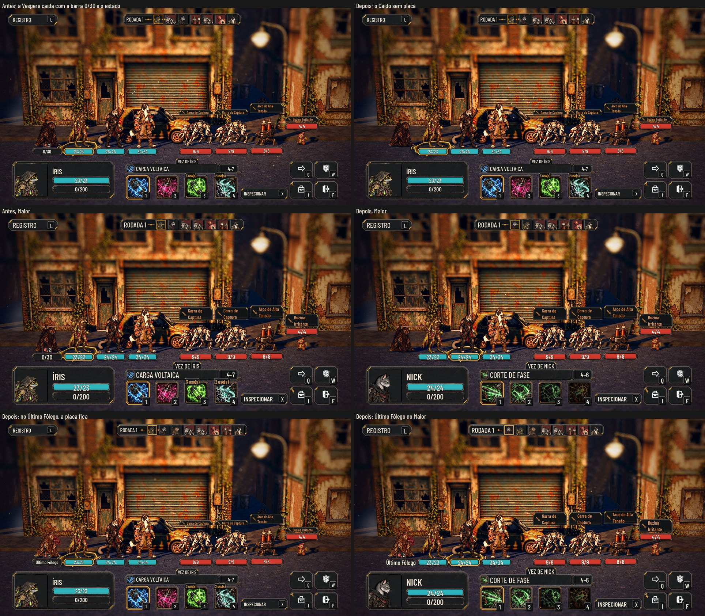

# O herói Caído sem placa no combate (#178)

O pedido do Lucas (27/10): "Na queda de um aliado, a HUD dele tem que sair para não atrapalhar a gameplay."

As fotos saem de `tools/capture_178.gd` (`--text-size=2` para o Maior). O antes é o mesmo roteiro na `main`: a Véspera
caída (vida 0, sangrando) com a barra "0/30" e o estado com o contador embaixo dela.

## A regra

- **A placa** (a barra, a moldura de quem age, os estados e, no inimigo, a intenção) aparece para quem está na luta:
  vida acima de 0 **ou no Último Fôlego**. É a mesma regra que o motor do combate usa para "vivo na luta"
  (`AHCombatEngine.alive_any`).
- **O herói Caído** (vida 0, fora da luta, #118) perde a placa inteira, como o inimigo derrubado já perdia. O corpo
  continua na cena, ajoelhado e acinzentado.
- **O herói no Último Fôlego** tem vida 0, mas ainda luta e ainda pode ser curado, então a placa fica: ela diz "Último
  Fôlego". Esconder a placa de todo herói com vida 0, como a issue sugeria ao pé da letra, apagaria a dele.
- **Curado**, o herói volta à luta e a placa volta.
- **O inimigo** fica como antes.

## O que não some junto

- **A ordem dos turnos** já deixava o Caído de fora: na foto, sete retratos para três heróis e quatro inimigos.
- **O alvo da cura e do apoio:** o motor já não oferece o Caído como alvo, e a placa não entrava nessa escolha.
- **O resumo do fim da luta** não usa a placa.
- **O contador do estado** (o sangramento com o "2") deixa de aparecer no Caído. Fora da luta, ele não age nem sofre
  mais nada, então o contador não informa nada ao jogador. Se o Lucas quiser ver em outro lugar, é uma pergunta para
  a issue.

## Testes

- **`test_fallen_plate` (novo), no Normal e no Maior:**
  - o Caído sem placa e com o corpo na cena;
  - no Último Fôlego, a placa fica;
  - curado, a placa volta;
  - o inimigo derrubado sem placa e o vivo com ela.
- Sem a correção, o teste falha no Caído, nos dois tamanhos de texto.

## Rodadas da QA

### Rodada 1: APROVADO

A QA rodou `run_all` (75 de 75, paridade 48/48) e um script próprio, no Normal e no Maior:
- a queda pelo motor (o Último Fôlego com placa e sangramento, depois a morte sem placa, no próprio lance);
- INSPECIONAR e as setas, que nunca param no Caído; o mouse e `unit_at` no corpo dele;
- a auto-batalha até a derrota, conferida quadro a quadro: nenhum Caído com placa e nenhum herói no Último Fôlego sem
  ela; o resumo do fim lista os caídos.

**Observações baixas, que ficam:**
- No Maior, o antes e o depois pegam vezes diferentes (a Íris e o Nick). A placa some de fato no depois.
- Quando um herói do meio cai, o de trás avança para o posto dele, e o corpo do Caído pode ficar atrás de um herói
  vivo. Já acontecia antes desta issue; vira issue própria se atrapalhar.
- `tests/test_station_spacing.gd` deixa uma pasta de teste nos dados do usuário. Também é de antes.

## Para o Lucas

- O contador do estado do Caído deixa de aparecer. Se quiser vê-lo em outro lugar, diga na issue.
