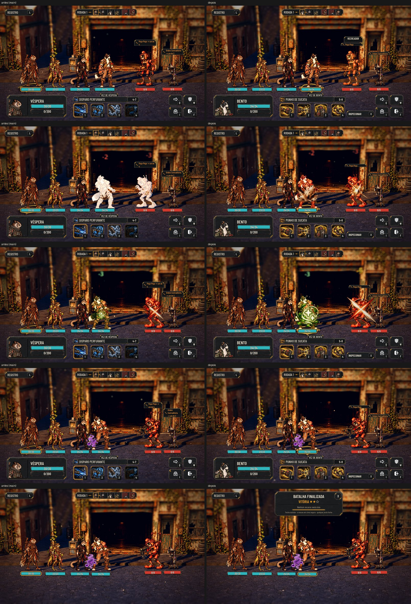

# A luta legível: popup, inspeção, intenção e efeitos (#128)

O pedido do Lucas depois de jogar (26/10): o popup do fim fechava rápido demais para ler; o mouse em cima abria
informação demais de uma vez; a intenção dizia em quem a máquina ia bater; e os efeitos estavam pequenos, diferente da
Unreal.

A inspeção ligada num herói e numa máquina, no Normal, no Maior e no daltonismo:
[inspect.jpg](fight-reading/inspect.jpg). O popup e os efeitos no Maior e no daltonismo:
[profiles.jpg](fight-reading/profiles.jpg).

As fotos saem de `tools/capture_128.gd` (`--text-size=2`, `--colorblind`). O antes é a mesma ferramenta numa cópia da
`main`.

## O popup do fim

- Fica **5 s de verdade** (`AHCombatHud.POPUP_HOLD`):
  - antes eram 2,5 s divididos pela velocidade da batalha, ou seja, 1,25 s no 2x;
  - só a automação, acelerada além do 2x, encurta.
- **Com o mouse em cima, a contagem para;** a linha do tempo para junto e volta a andar quando o mouse sai. No toque,
  o último ponto do mouse emulado não segura, e a dica diz "toque para fechar antes".
- **O X no canto fecha.** Ele fica por cima do canto, para o popup não crescer e descer sobre a equipe no texto Maior,
  e é quadrado em qualquer tamanho de texto.
- Qualquer tecla, clique ou toque ainda fecha. A derrota continua esperando o toque.

## A inspeção por botão

- **O mouse em cima** de um personagem não abre mais a ficha na luta: só marca quem é, com o nome numa plaqueta acima
  da cabeça (a mesma do alvo) e uma luz leve no corpo.
  - O toque longo também não abre a ficha.
  - A ficha da Preparação continua ao apontar.
- **O botão INSPECIONAR** fica entre as habilidades e as ações, com a tecla do lado:
  - a tecla é a ação `combat_examine` (X, ou o L3 no controle), trocável nas Opções como "Luta: inspecionar";
  - no texto Maior, a letra encolhe o que falta para caber no vão.
- **Ligada, a inspeção mostra os detalhes na HUD de baixo,** no lugar do painel do herói da vez e das habilidades:
  - à esquerda, o retrato, o nome, a espécie e o papel (ou "Máquina"), o nível, a vida, o instinto e a velocidade;
  - no meio, os efeitos passivos;
  - à direita, os estados.
  - Cada passivo e cada estado vem com o que faz ao lado, na cor de bom ou ruim, com + ou −.
  - Sem espaço (muitos estados, texto Maior), as explicações saem por partes.
- **Quem aparece no painel:**
  - quem o mouse aponta;
  - sem nada apontado, quem foi escolhido: quem age, ao ligar; depois, o clique num corpo ou as setas.
- **A luz** fica em quem o painel mostra.
- **O botão** fica apagado quando não faz nada (na mira, na vez do inimigo, com a Mochila aberta).
- **Para desligar:** a tecla de novo, o botão ou Voltar (Esc).
  - A Mochila e uma ação escolhida também desligam.
  - Na mira, a inspeção não liga.

## A intenção sem o alvo

- A intenção sobre a máquina diz o que ela vai fazer (o ícone e o nome do golpe), nunca em quem.
- Saíram o "→ Nick", o "→ Bento ou Nick" e o "→ um de 3", na placa e na dica.
- O ícone de ataque em área continua: ele diz o tipo do golpe, não o alvo.
- A prévia de quem o golpe do jogador atinge não muda.

## Os efeitos no corpo

- **O tamanho** acompanha o corpo de quem recebe, com um mínimo na tela. Antes era um tamanho fixo de 128 a 192 px, que
  ficava pequeno perto do personagem.
- **As medidas** estão em `data/presentation/combat_effects_layout.json`, para ajustar sem mexer no código:
  - `body`: a altura do quadro, em frações da altura do corpo;
  - `min_px`: o mínimo na tela de 1080;
  - `at`: onde fica a âncora no corpo, a partir do pé.
- **Os valores de agora:**
  - acerto: 0,85 do corpo, no peito;
  - poeira: 0,7, na cintura;
  - crítico: 1,0;
  - cura: 0,95;
  - bloqueio: 0,8;
  - esquiva: 0,75, nos pés;
  - estados: 0,6.
- **Para conferir com a Unreal:** não havia Claude local para pedir a captura da Unreal. Os números acima são uma
  proposta tirada das fotos. Com a captura dos efeitos lado a lado, o ajuste é só no JSON.

## Testes

- `tests/run_all.gd`: 59 de 59, com a paridade 48/48.
- `test_fight_popup`:
  - pelo menos 5 s, e os mesmos 5 s no 2x;
  - o mouse em cima segura a contagem, que volta a andar quando ele sai;
  - o X fecha e sai junto;
  - qualquer tecla fecha; a derrota espera.
- `test_character_sheet` (a luta):
  - o hover e o toque longo não abrem a ficha;
  - o botão INSPECIONAR, com a tecla, liga o painel no lugar do herói da vez, com a vida, o instinto, a velocidade, os
    passivos e os estados;
  - o mouse mostra o inimigo, e o clique o escolhe;
  - as setas passam; a tecla e Voltar desligam;
  - na mira, nem a inspeção nem a ficha.
- `test_combat_icons`: a intenção não diz o alvo, nem no texto nem na dica.
- `test_combat_effects`: o tamanho do efeito é o de `combat_effects_layout.json` e nunca fica abaixo do mínimo.

## Rodadas da QA

### Rodada 1: REPROVADO

**Médias, corrigidas:**
- **O painel da inspeção passava do espaço.** No Maior, cobria o botão INSPECIONAR; no Normal, com três estados, descia
  abaixo da HUD.
  - Agora o encaixe mede o painel inteiro (com as margens), na largura e na altura.
  - A explicação desce para a linha de baixo quando o nome ocupa a coluna.
  - O painel fica preso ao espaço dele.
  - O `test_character_sheet` confere o tamanho e o botão inteiro, no Normal e no Maior, com três estados em todos.
- **O mouse em cima não marcava mais quem é.** A placa só tinha a vida, e o registro dizia que tinha o nome.
  - Agora o apontado ganha o nome numa plaqueta acima da cabeça (a mesma do alvo) e uma luz leve.
  - Com a inspeção ligada, a luz segue quem o painel mostra.
  - O teste confere o nome e que a ficha não abre.

**Baixas, corrigidas:**
- **Toque:** o último ponto do mouse emulado não segura mais o popup, e a dica diz "toque para fechar antes".
- **Inglês:** "Combat: inspect", como as outras opções.
- **Botão INSPECIONAR:** apagado quando não faz nada (na mira, na vez do inimigo, com a Mochila).
- **Código morto:** o do toque longo saiu.
- **X do popup:** quadrado em qualquer tamanho de texto.

### Rodada 2: APROVADO

A QA conferiu:
- o painel da inspeção, que cabe e não cruza o botão nos três tamanhos de texto, com 0, 3 e 8 estados;
- o nome com o mouse em cima: a posição, a luz e que some na inspeção, na Mochila e no popup;
- que nenhum cartão fica aceso depois da luta;
- o popup: o toque com o mouse parado, o X quadrado e um fim só;
- a tecla trocada e o botão apagado na mira.

**A observação baixa que entrou:** no modo compacto, cada nome mantém o + ou −, porque só a cor não basta no
daltonismo.

**A que fica:** com 8 estados, os selos do painel do herói da vez aparecem por baixo do painel da inspeção. Isso já
acontecia antes desta entrega: o painel do herói vaza sozinho com tantos estados.
