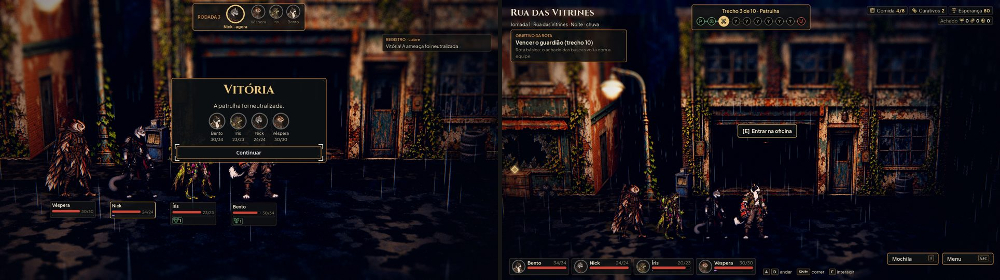
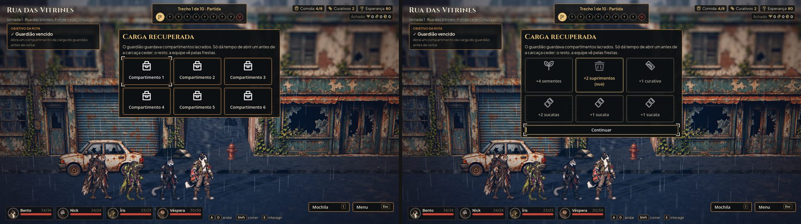
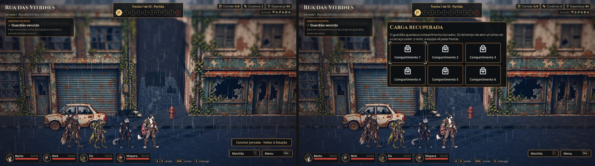

# O fim de luta que recompensa (#91)

Fotos de `tools/capture_rewards.gd` (1920x1080, gl_compatibility): o fim de uma patrulha vencida no automático; com o
guardião vencido, a carga recuperada antes e depois de escolher.

À esquerda, o antes, na `main`: a vitória, o retrato e a vida de cada herói. À direita, o depois:
- as estrelas;
- os quatro critérios, cada um cumprido ou não;
- o nível e o XP ganho de cada herói, com a barra que enche no ritmo da luta.

A carga do guardião: seis compartimentos fechados. Depois da escolha, a caixa escolhida fica em dourado com "(sua)", as
outras se revelam uma a uma, apagadas, e aparece o Continuar.

A rua com o guardião vencido: antes, nada; agora, a carga espera a escolha antes de a equipe andar.

## Como funciona

- **As estrelas** (`data/fight-stars.json`):
  - a vitória dá 1 estrela, e a derrota e a fuga não dão nenhuma;
  - os critérios são quatro: ninguém caiu; a luta durou até 4 rodadas (até 8 no guardião); o golpe final foi de um
    herói (o sangramento na vez do inimigo não conta); o instinto ficou controlado (ninguém em colapso);
  - 2 critérios cumpridos dão 2 estrelas, e os 4 dão 3 estrelas;
  - a melhor nota do guardião de cada fase fica no save (`mission_stars`), para a #92 liberar a próxima missão;
  - o save de antes abre sem estrelas.
- **A carga recuperada** (`data/recovered-cargo.json`, por fase):
  - depois do guardião, são sorteadas 6 caixas com sementes, sucata, fragmentos, suprimentos, curativos e, no máximo,
    uma relíquia;
  - o sorteio usa a semente da expedição. Salvar e voltar mostra as mesmas caixas e não deixa escolher de novo;
  - sementes, sucata, fragmentos e suprimentos entram no achado da rota e chegam na volta, como o resto do achado;
  - os curativos vão na hora para a Mochila, e a relíquia para o Depósito.
- **O XP na tela do fim:** é o XP da #90 (`xp_gained` da sessão), e mostra "Treino pronto" quando o herói já pode
  treinar.

## Como testar

- `tests/test_fight_rewards.gd` cobre:
  - os critérios e as estrelas, e quem deu o golpe final;
  - a nota no save e o save antigo;
  - o sorteio igual depois de salvar e carregar, a escolha única, e o achado na volta, na Mochila e no Depósito;
  - a revelação das caixas;
  - reabrir com a carga pendente;
  - a tela do fim de uma luta de verdade.
- `tests/test_full_journey.gd` escolhe a carga depois do guardião e segue até o trem.
- A suíte inteira, `tests/run_all.gd`, passa.

## O ajuste de equilíbrio

As sugestões da primeira entrega foram fechadas com um meio-termo. O critério foi recompensar quem joga bem sem
castigar quem está aprendendo.

**O que a medição mostrou.** A medição usa `tools/measure_balance.gd --stars`, com 40 sementes e os níveis e o gear
típicos. Com as regras antigas (o par de 4 e 8 rodadas, e 2 critérios para 2 estrelas):
- o golpe final e o instinto saíam em quase 100% das lutas, então toda vitória já dava 2 estrelas, e a de 1 estrela
  nunca aparecia;
- o par fixo não servia: o guardião da fase 5 nunca cabia em 8 rodadas, porque leva cerca de 11;
- as patrulhas da fase 1 sempre cabiam.

**O que mudou:**
- **O par de rodadas é de cada fase** (`rounds_fase_N`). Ele fica perto do que 3 em 4 vitórias no automático
  alcançam:

  | Fase | Patrulha | Guardião |
  |---|---|---|
  | 1 | 3 | 5 |
  | 2 | 3 | 7 |
  | 3 | 5 | 8 |
  | 4 | 5 | 8 |
  | 5 | 5 | 13 |

  Uma fase sem linha (as missões da #92) usa o par geral, de 4 e 8.
- **As estrelas:** 2 estrelas pedem 3 critérios, e 3 estrelas pedem os 4. Na prática, 3 estrelas são ninguém caído e o
  par de rodadas; 2 estrelas são um dos dois; e um colapso ou o golpe final do sangramento tiram uma estrela.
- **No automático, a tela do fim fica 3 s na vitória** (1,5 s na derrota e na fuga), no ritmo da luta, para dar tempo
  de ler as estrelas e o XP. O Continuar fecha antes.
- **Os suprimentos entram no "Achado" do HUD** quando há algum. Hoje só a carga do guardião traz suprimentos. A dica
  também passou a citá-los.
- **O objetivo com a carga na tela** diz "Abra um compartimento da carga do guardião antes de voltar", em vez de
  "botão ou Esc".
- **Os curativos e a relíquia continuam entrando na hora.** O curativo serve na própria rota, e a relíquia é rara (no
  máximo uma por carga). Se a equipe cair depois, perde só o achado da rota, como já acontece com o resto.
- **A carga continua sorteada pela semente da expedição.** A #87 vai trocar pela semente da rota.

**O resultado (vitórias que dão 1, 2 e 3 estrelas):**

| Fase | Luta | Automático (1★ · 2★ · 3★) | Jogando mal (1★ · 2★ · 3★) |
|---|---|---|---|
| 1 | patrulha | 0 · 11 · 89% | 1 · 32 · 67% |
| 1 | guardião | 2 · 22 · 75% | 12 · 45 · 42% |
| 3 | patrulha | 4 · 24 · 72% | 15 · 16 · 69% |
| 3 | guardião | 10 · 48 · 42% | 51 · 27 · 22% |
| 5 | patrulha | 8 · 19 · 72% | 23 · 11 · 66% |
| 5 | guardião | 27 · 73 · 0% | 26 · 63 · 11% |

Ninguém sai do guardião da fase 5 sem uma queda, então as 3 estrelas dele ficam como meta de quem domina a luta. O conteúdo
da carga não mudou.

## Rodadas da QA

1. **Reprovada,** com dois bugs médios e três observações baixas, todos corrigidos:
   - o "Concluir jornada" ficava clicável com a carga na tela, e a carga se perdia. Agora o botão some enquanto a carga
     espera, e concluir só funciona depois do Continuar;
   - uma fase sem linha na tabela travava a equipe. Agora ela não tem carga, e um teste confere que toda fase tem
     linha;
   - as caixas reveladas estavam quase ilegíveis e passaram a ser legíveis, apagadas;
   - a relíquia passou a usar o ícone dela, e não sempre o do Botão de Cobre.
2. **Aprovada.** A suíte passou 45 de 45, e os scripts da QA também passaram: concluir antes e durante a revelação,
   reabrir com a carga pendente, fase sem linha na tabela, e guardião no automático com estrelas, save, foco, teclado e
   Esc. Ficou uma observação baixa: com a carga na tela, o painel do objetivo ainda diz "botão ou Esc".
3. **O ajuste de equilíbrio** (pedido do Lucas: "algo equilibrado nas sugestões"), descrito acima. A suíte passou 45 de
   45.
