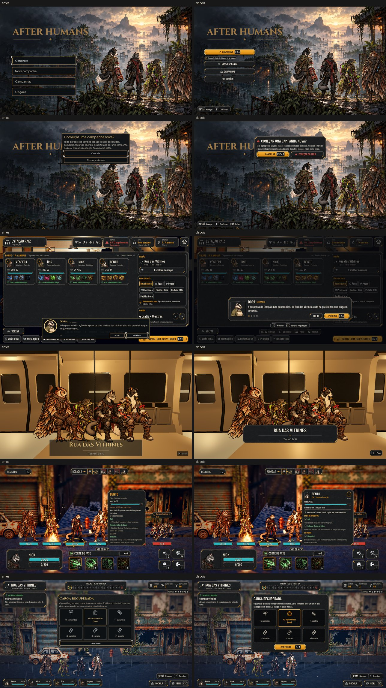

# O título e o fluxo no kit (#107)

A integração de [hud-fluxo.md](../design/hud-fluxo.md): o título, as Campanhas, a campanha nova, as Opções do título,
o briefing e o debriefing, a passagem, a ficha do personagem, a carga do guardião e as dicas, no kit da Awesomic. O
Mapa da Rede fica para a #87 (a proposta com o radar está no mesmo documento).

As maquetes (à esquerda) e o jogo (à direita):
- [Normal](flow/target_game.jpg)
- [Maior](flow/target_game_large.jpg)

As fotos saem das ferramentas de cada tela:
- o título, com `--capture-title=<pasta>`, no Normal e no Maior;
- `tools/capture_briefing.gd`, `capture_sheet.gd` (com `--big` no Maior), `capture_departure.gd` e `capture_rewards.gd`.

## O que mudou

- **Título** (a logo e a arte ficam como estão):
  - CONTINUAR é o botão âmbar, com a tecla logo depois do texto; embaixo, a linha do espaço numa chapinha;
  - NOVA CAMPANHA, CAMPANHAS e OPÇÕES são de aço, com o ícone;
  - o aviso de um espaço que não abriu fica numa chapa com o triângulo, abaixo dos botões;
  - embaixo à esquerda, a barra das teclas, que acompanha a janela aberta.
- **Campanhas e "Em qual espaço começar?":** a chapa grande com o título e o ícone. Cada espaço é uma linha de lista
  com o ícone, o nome e o resumo. O vazio e o que não abre ficam apagados. VOLTAR leva a tecla do Menu.
- **Campanha nova:** o triângulo e a pergunta; CANCELAR é o âmbar, na tecla de voltar; COMEÇAR DO ZERO é de aço, em
  alerta e sem tecla.
- **Opções do título:** o painel das Opções da Estação numa janela à direita (a logo à vista), com o X.
- **Briefing e debriefing:**
  - a tela de baixo escurecida, o retrato no quadro do kit, o nome em caixa alta e o papel em âmbar;
  - a contagem em losangos e "1/3";
  - PULAR de aço e PRÓXIMO âmbar com a tecla; na última fala, PARTIR ou VER O RELATÓRIO com o ícone da Estação;
  - a barra das teclas embaixo diz o que o Esc faz: no briefing da saída, "Voltar à Preparação"; no debriefing, "Pular".
- **Passagem:** o cartão na chapa grande, com o nome em caixa alta, a divisa com o losango âmbar e o subtítulo. Ele
  fica à frente das pernas da equipe, sem cobrir os rostos. Embaixo à direita, um aviso só ("E Pular", "Toque para
  pular" ou "Carregando…") na barra das teclas.
- **Ficha do personagem** (na Preparação e na luta):
  - o retrato, o nome, a espécie e o papel em âmbar e o medalhão do nível com "Nível";
  - Vida e Instinto em barras ("em 200, crise"), a Velocidade com o que ela faz;
  - os efeitos passivos e os estados com o quadradinho de + ou −, na cor de bom e de ruim (que o daltonismo troca);
  - num espaço apertado (muitos estados no texto Maior), um passo a mais de encolher: o nome menor, sem o retrato e as
    barras.
- **Carga do guardião:** os compartimentos em quadrados de recurso; a escolhida com a moldura âmbar, as outras no tom
  apagado; CONTINUAR âmbar com a tecla.
- **Dicas:** a chapa grande, DICA em âmbar, ENTENDI âmbar e DESLIGAR DICAS de aço.
- **Ferramenta:** `tools/capture_departure.gd` travava desde a #88 (a saída abre o briefing antes da passagem); agora
  ela pula o briefing.

## A trava do padrão

O título, o briefing, a passagem, a ficha, a carga e as dicas saíram de `tools/kit_guard_exceptions.txt`. Sobra só o
Mapa da Rede (`phase_map.gd`), que entra no kit com a #87.

## Testes

- `tests/run_all.gd`: 55 de 55, com a paridade 48/48.
- Atualizados para os botões do kit em caixa alta: `test_title`, `test_briefing` e `test_i18n` (o título em inglês).

## Rodadas da QA

### Rodada 1: REPROVADO

**Alta, corrigido:** o aviso de save estragado no título ficava vazio, com 2400 px de altura e o texto fora da tela.
- A causa: a chapa media o texto antes de ele ter a largura.
- Agora a largura vem antes de medir, e a chapa acompanha o texto quando ele quebra de novo.
- O `test_title` confere a chapa inteira na tela, com o texto dentro dela e acima da barra das teclas. O
  `--capture-title` passou a fotografar o aviso.

**Média, corrigidos:**
- O VOLTAR, o CANCELAR e as barras do título e do briefing mostravam a tecla do Menu, mas quem volta é o Esc
  (`ui_cancel`). Agora mostram o Esc fixo, como a Preparação.
- A tecla do CONTINUAR (ou do NOVA CAMPANHA) segue o Interagir trocado nas Opções do título (`refresh_keys`, com o
  formato "%s / A").
- O briefing não escurecia a tela de baixo e deixava o clique passar, porque o HUD da Estação é um Control sem
  tamanho; isso já acontecia antes desta entrega. Agora a caixa cobre a tela inteira, e o `test_briefing` confere.

**Baixa, corrigidos:**
- O foco das Opções do título não começa mais no X.
- A margem do botão apertado não soma duas vezes.
- O ENTENDI ficou mais largo no Maior.

**Baixa, ficam:**
- Os losangos da contagem saem vazados, porque é o ícone do mapa; o preenchido não existe no kit.
- A barra das teclas do título e do briefing no modo de toque.

### Rodada 2: APROVADO

Conferido: o aviso nos quatro perfis; o Esc com o Menu e o Interagir trocados; a tecla do CONTINUAR com o Interagir em F;
o véu do briefing e o clique fora da caixa; o foco das Opções na primeira opção. O aviso de âncora do briefing no
console também saiu (a caixa não tem mais âncora de tela cheia).
