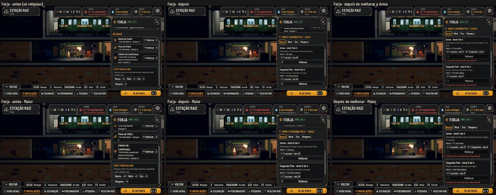
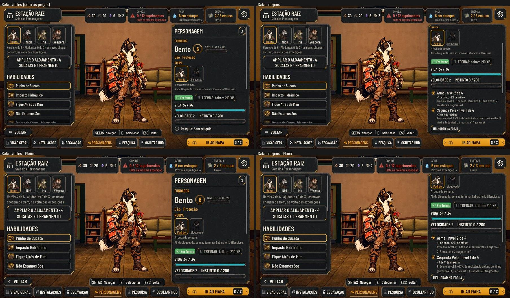

# A Arma e a Segunda Pele (#262)

A proposta aprovada pelo Orquestrador em nome do Lucas (01/11) está na #262. Cada herói tem duas peças que só sobem,
de 0 a 4, melhoradas na Forja, **sem mudar o visual**. Os números ficam em `data/gear.json`, e a regra em
`scripts/flow/gear_rules.gd` (`AHGear`). O PR 1 trouxe as regras, os dados, o save e a Forja; o PR 2 traz a ficha da
Sala.

As fotos saem de `tools/capture_262.gd` (`--case=room` para a Sala, e `--text-size=2` para o Maior).

## A regra

| Nível da peça | Herói no nível | Forja no nível | Custo | Arma | Segunda Pele |
| --- | --- | --- | --- | --- | --- |
| 1 | 2 | 1 | 3 sucatas | +1 de dano | +3 de Vida máxima |
| 2 | 4 | 1 | 4 sucatas e 1 fragmento | +2% de crítico | +10% de resistência a dano contínuo |
| 3 | 6 | 2 | 5 sucatas e 2 fragmentos | +1 de dano | +3 de Vida máxima |
| 4 | 8 | 2 | 6 sucatas e 3 fragmentos | +2% de crítico | +10% de resistência a atordoamento |

- **A Arma** soma nos limites de dano de todas as habilidades de dano (`gear_damage` na unidade), **nunca na cura**.
  Ela soma também no crítico (`gear_crit`, junto do crítico do papel).
- **A Segunda Pele:**
  - a vida é somada no herói na compra, uma vez só, como o Treino;
  - as resistências somam às do papel (`hero_resist`), até o teto de 80%.
- **Nenhuma peça dá Velocidade.**
- **A Forja** faz uma melhoria por dia, e duas no nível 2. O dia é o ciclo da Estação, como o Treino e o Bar (#265).
- **Quem não melhora:** quem está na expedição ou em missão solo. Caído e em tratamento podem, porque quem melhora é a
  peça.
- **A ordem de cálculo** (#189 §5):
  1. o papel;
  2. o nível e o Treino;
  3. a Arma e a Segunda Pele;
  4. a relíquia;
  5. as peculiaridades;
  6. os efeitos temporários.
- **Nomes:** "Arma" e "Segunda Pele" (lore §16) para todos. O nome próprio das peças dos fundadores fica com o Lucas.

## Na Sala (PR 2)

- **As duas peças**, cada uma com o nível ("Arma · nível 2 de 4"), o que já soma e o próximo nível, com o requisito e o
  custo.
- **O "Melhorar na Forja"** abre a Forja com o herói já escolhido.
- **A ficha fora da luta** (os chips da Estação e a Partida) mostra a resistência e o crítico com as peças, pelo mesmo
  cálculo da luta (`AHGear.resist_with`, com o teto de 80%).

## Save

- No herói, `gear = {weapon, armor}`. Na Estação, `forge = {cycle, heroes}`, o dia.
- Saves de antes abrem com as duas peças no nível 0.
- O `migrate` põe números de 0 a 4 no que estiver editado e nunca mexe na vida já somada, então migrar de novo não muda
  nada.

## Testes

`tests/test_gear.gd`:
- os dados;
- a compra: os requisitos, a cobrança uma vez, a vida uma vez, a recusa sem cobrar e o máximo;
- o dia da Forja;
- a luta: o dano sem cura, o crítico, as resistências e o teto;
- o save: o de antes, o editado e o JSON;
- a seção na Forja: o Melhorar, o motivo na tela e o chip do herói;
- a ficha: a resistência e o crítico com as peças, e o próximo nível;
- a Sala: as duas peças e o Melhorar na Forja com o herói escolhido.

A paridade 48/48 não muda, porque sem peças tudo fica zero.
