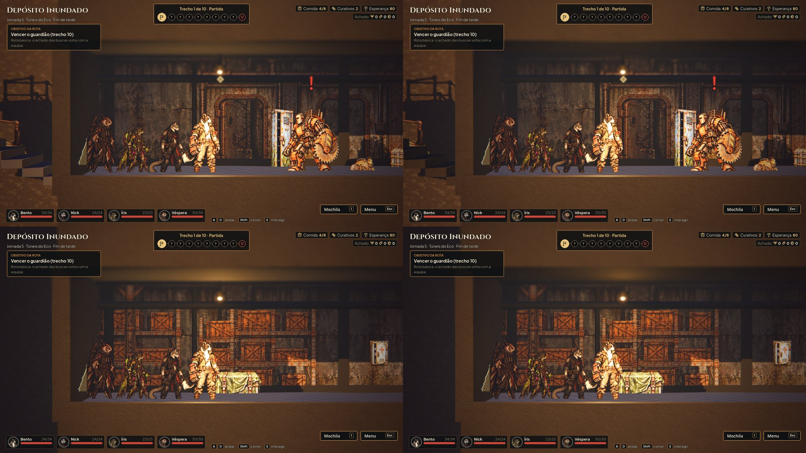
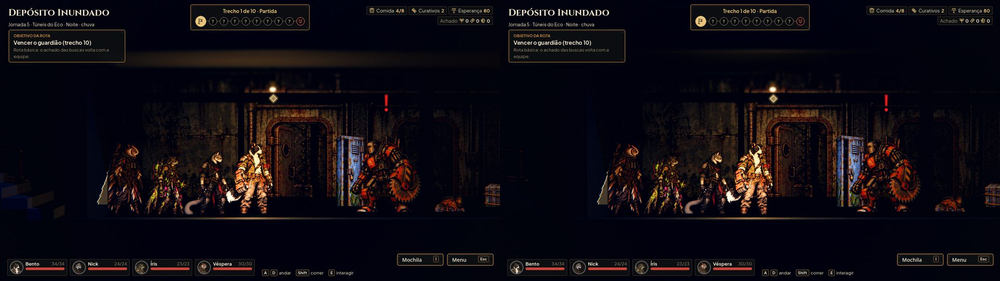

# Cenários sem a grade da Unreal (#62)

Capturas de `tools/capture_scenarios.gd`, antes (código de 26d9ef5) e depois.

Na zona 0 do Depósito Inundado, a escada xadrez (a grade padrão da Unreal) virou o concreto das paredes; os tetos das
zonas também (no quadro, a faixa escura de cima). O mesmo vale para os 3 tetos do Abrigo Lacrado e a laje dos Dutos.

À noite a escada some no escuro (antes a grade aparecia cinza-azulada): fica para o Lucas decidir se quer um concreto
mais claro só nos degraus.
