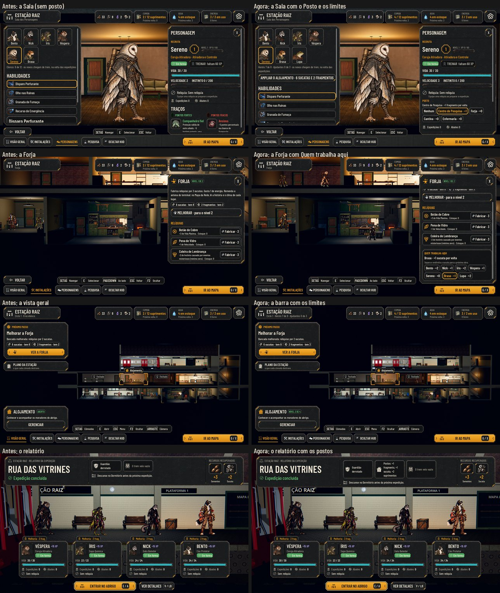

# Os limites da Estação e os postos de quem fica (#119)

O pedido do Lucas (26/10): "A gente tem que ter o limite de personagens na casa: de protagonistas, de heróis, e de
ajudantes [...]. No XCOM, dependendo do personagem, dava para usar eles em alguns locais, tipo na pesquisa. [...] Usar
esse artifício para não deixar os personagens parados na base, os que ficarem sem ir para a expedição."

No Maior e no daltonismo: [screens.jpg](hero-jobs/screens.jpg). As fotos saem de `tools/capture_119.gd` (`--text-size=2`,
`--colorblind`). O antes é o mesmo roteiro no código da #122.

## Os limites

- **Heróis, pelo Alojamento:** 6, 8, 10 e 12 nos níveis 1 a 4 (`data/hero-jobs.json`, `limit_heroes`).
  - Ampliar o Alojamento custa 4 sucatas e 1 fragmento, depois 6 e 2, depois 8 e 3 (`characters_level_N`). O botão fica na
    Sala dos Personagens, embaixo dos heróis.
  - Quem está em recuperação conta.
  - Com a casa cheia, o animal do trem (#122) não entra ("O Alojamento está cheio (6 de 6 heróis): não há lugar para
    Sereno agora."), e a Admin também não recruta.
- **Ajudantes (os civis), pelo Dormitório:** 3 e 4 nos níveis 0 e 1 (`limit_helpers`; o Dormitório não passa do nível 1). O Dormitório ainda não se
  recupera, então hoje o limite é 3, o mesmo número dos civis da fila. Sem lugar, o trem não traz civil, e acolher fica
  barrado.
- **Onde aparece:**
  - na barra da Estação: "Ciclo 1 · Heróis 6 de 8 · Ajudantes 0 de 3";
  - no Plano da Estação, no que cada nível do Alojamento comporta;
  - na Sala dos Personagens, com o botão de ampliar;
  - no estado do Alojamento ("Nível 2 de 4").
- **O save antigo** com mais heróis que o limite abre com o Alojamento ampliado até caber todos.

## Os postos

- **Quem trabalha:** cada herói que não sai na expedição e não está em recuperação pode ficar num posto. É um posto por
  herói e um herói por cômodo; pôr outro no lugar tira o de antes.
- **Os postos** são os cômodos recuperados com trabalho (`job_<cômodo>`, base 1 por volta):

  | Cômodo | O que faz | Rende por volta |
  |---|---|---|
  | Centro de Pesquisa | Organiza as anotações e ajuda a ler o que a equipe trouxe. | +1 fragmento |
  | Forja | Separa e endireita a sucata para a próxima obra. | +1 sucata |
  | Cantina | Ajuda a preparar e a repartir a comida da Cantina. | +1 suprimento (até o que o Depósito guarda) |
  | Enfermaria | Troca curativos e vigia o sono dos caídos. | −1 dia de recuperação para 1 caído |

- **A espécie e os traços** somam ou tiram (`bonus_*` e `perk_*`), nunca abaixo de 0:
  - a coruja e o sapo rendem +1 na Pesquisa;
  - o cão e o guaxinim, +1 na Forja;
  - o sapo, +1 na Enfermaria;
  - o traço Esperançoso, +1 em qualquer posto, e o Pessimista, −1.
- **Onde se escolhe:**
  - na Sala dos Personagens, no campo "Posto" de cada herói, com o que ele rende em cada cômodo no próprio botão;
  - no painel de cada cômodo com posto, em "Quem trabalha aqui", com quem trabalha, o que faz e quem pode ficar no lugar
    (com o rendimento de cada um).
- **Quem parte na equipe deixa o posto:** a plataforma da partida avisa ("Bento deixa o posto na Forja para partir.").
- **Na volta,** cada posto rende o seu, e o relatório mostra: "Postos: +3 fragmentos, +1 sucata". O ajudante e o herói
  no mesmo cômodo somam (a Dora na Cantina e um herói no posto dela).

## A medição de equilíbrio

Por volta, com os postos cheios e os heróis da espécie certa:

| Posto | Rendimento comum | Com a espécie certa | O que isso compra |
|---|---|---|---|
| Pesquisa | +1 fragmento | +2 (coruja, sapo) | Cada pesquisa custa 3 fragmentos: com a coruja, uma pesquisa a cada 1,5 volta só do posto. |
| Forja | +1 sucata | +2 (cão, guaxinim) | A relíquia custa 3 sucatas (2 com a Forja no nível 2); os cômodos, 3 a 8. Com o cão, uma relíquia a cada 1,5 volta. |
| Cantina | +1 suprimento | +2 (com Esperançoso) | A Cantina rende 2 por volta (4 com a Dora): o posto soma metade disso. |
| Enfermaria | 1 caído | 2 (sapo) | Um caído no leito volta em 2 dias; com o posto, em 1. |

Os postos só valem com mais heróis do que a equipe leva: com o Alojamento no nível 1 (6 heróis) e a equipe de 4, são
até 2 postos ocupados. **Os números são propostas para o Lucas.** A Pesquisa medida em expedições fica para a #94; até
lá, o posto da Pesquisa rende fragmentos.

## Testes

- **`test_hero_jobs` (novo, 52 verificações):**
  - os limites, com o caído contando, o recruta barrado, o animal do trem barrado e o Alojamento ampliado;
  - o civil sem lugar;
  - um posto por herói e um herói por cômodo, quem cai deixando o posto, e quem parte deixando o posto;
  - o rendimento pela espécie e pelos traços;
  - o efeito na volta (fragmentos, sucata e o dia de recuperação) e o relatório;
  - o save antigo, sem posto e com o Alojamento ampliado até caber todos;
  - a tela: a barra, o Posto na Sala, "Quem trabalha aqui" na Forja e o aviso na plataforma.
- **`test_station_rules`, `test_small_teams`, `test_train_recruits`, `test_departure` e `test_recruit_art`** ampliam o
  Alojamento para caber os recrutas dos testes.

## Rodadas da QA

### Rodada 1: REPROVADO

**Médias, corrigidas:**
- **O voluntário pendente de um save antigo sumia com o Alojamento cheio.** Agora ele espera lugar na fila.
- **Quem a Enfermaria punha de pé não aparecia no relatório.** Agora entra em "se recuperou e voltou ao Alojamento".
- **O posto da Cantina passava do limite do Depósito.** Agora rende só até o que o Depósito guarda.
- **No teclado e no controle, escolher o Posto ou ampliar o Alojamento jogava o foco para a aba do herói.** O foco
  volta ao mesmo botão.
- **O Plano não dizia o que ampliar o Alojamento dá.** Agora diz quantos heróis cada nível comporta.

**Baixas, corrigidas:**
- "na Centro de Pesquisa" virou "no Centro de Pesquisa", e "sai da" segue o mesmo artigo.
- O posto da Cantina falava de uma horta que não existe: agora "Ajuda a preparar e a repartir a comida da Cantina."
- O rendimento de cada posto fica no próprio botão da Sala, e o motivo de não poder ampliar o Alojamento fica à vista
  (o toque não mostra a dica).
- "Quem trabalha aqui" desceu para o fim do painel: as relíquias da Forja ficam no alto.

**Para o Lucas:**
- Os postos da Pesquisa e da Forja rendem mesmo com o cômodo sem energia, ao contrário da Dora e da Cora.
- Com a casa cheia, o trem continua trazendo animais que não podem entrar (já acontecia com 12, agora com 6).

### Rodada 2: APROVADO

A QA refez os cinco casos da rodada 1 com um script próprio, no Normal e no Maior:
- o voluntário pendente com a casa cheia;
- os dois caídos postos de pé pela Enfermaria, no relatório;
- a Cantina no limite do Depósito;
- o Plano;
- o foco do teclado no Posto, em Ampliar e em Quem trabalha aqui.

**Baixa, corrigida depois:** no Maior, "Quem trabalha aqui" da Forja ficava abaixo da dobra na foto. As montagens ganharam
a Cantina, que mostra o posto à vista nos três perfis.

**Ficam:**
- Ao chegar no nível 4, o botão de ampliar some, e o foco volta para a aba do herói.
- Com o Depósito cheio, o posto da Cantina rende 0 e não aparece no relatório.
